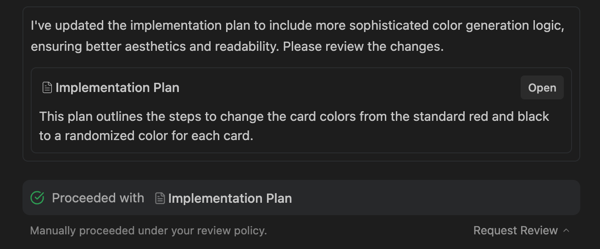
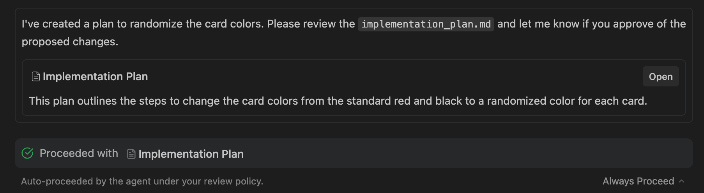

產出物審查
2-0
Antigravity 應用程式
功能
產出物審查 Antigravity 應用程式功能
Antigravity 應用程式
適用於：
Antigravity 應用程式
# 產出物審查

[「產出物審查」章節](#artifact-review)

開始新的代理對話時，您可以在兩種主要的執行模式之間選擇，決定變更的提議與審查方式：

- **規劃模式**：代理在執行任務前會周詳規劃。在此模式下，代理會將工作組織於 [任務群組](/docs/ide/agent-side-panel)，產出稱為…的結構化實作計畫 [產出物](/docs/artifacts)，並徹底研究程式碼庫以達最佳品質。
- **快速模式**：代理直接執行任務，不設專門的規劃階段。適用於可快速完成的簡單、高度局部化任務，例如變數重新命名、執行特定 Bash 指令或小型重構。

在下列項目中工作時 **規劃模式**，產出物審查政策控制您在變更套用至程式碼庫前，如何與這些計畫互動並核准它們。

## 產出物審查政策

[「產出物審查政策」章節](#artifact-review-policy)

您可以使用以下項目自訂審查工作流程 **計畫審查政策** 於 **設定** > **一般**。請在兩種政策之間選擇：

### 要求審查（建議）

[「要求審查（建議）」章節](#request-review-recommended)

顯示為 **一律詢問** 在設定中。代理一律會先停下來，並在繼續執行建議的變更之前請求您的明確核准：

- 當代理產生實作計畫或程式碼差異時，它會暫停執行並通知您。
- 這讓您可以徹底審查提議的變更、新增內嵌註解，並在工作區中驗證計畫。
- 滿意後，您可以核准計畫讓代理繼續進行。

### 一律繼續

[「一律繼續」章節](#always-proceed)

顯示為 **一律繼續** 在設定中。這項設定不會讓代理在計畫完成後繼續執行。當您要求提供包含以下內容的計畫時 [`/plan`](/docs/plan)，無論您的審查政策為何，代理一律會停下來等待您的核准：

- 如要讓代理在撰寫計畫後繼續執行，請在提示詞中說明。
- 搭配 **一律繼續**，方案卡片可能不會顯示 **繼續** 按鈕。如要核准計畫，請在訊息框中回覆，例如 `proceed`.

[上一個
代理設定](/docs/agent-settings/)

[下一步
Vim 編輯器模式](/docs/cli/vim-editor-mode/)

您的下載已開始

## 您如何得知我們？

請選一個。這有助於我們接觸更多像您一樣的人。

感謝您讓我們知道！
