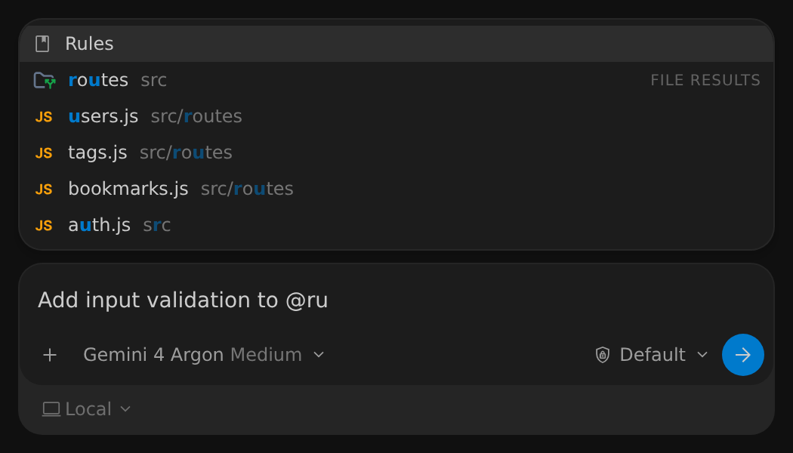
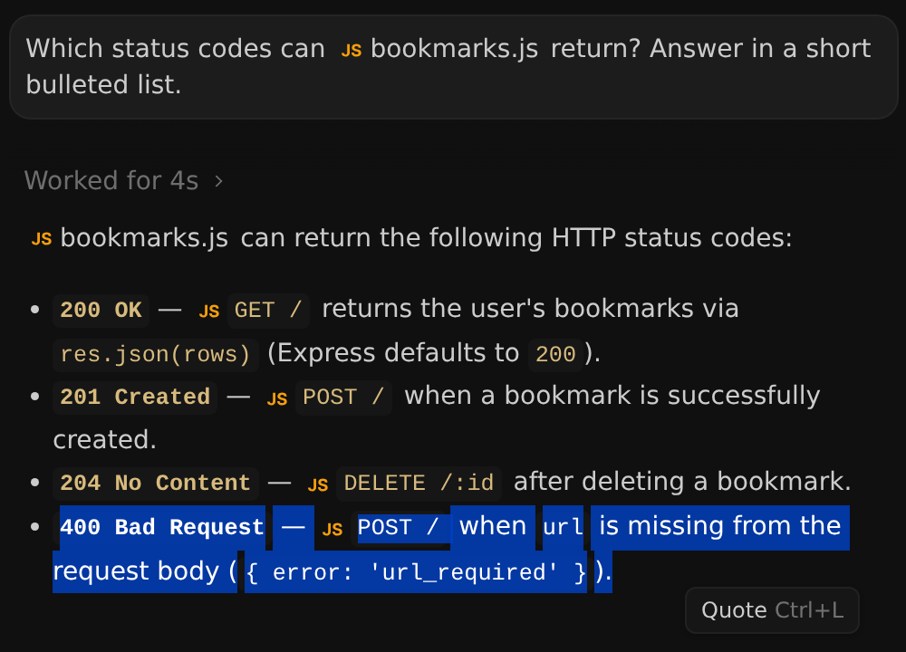
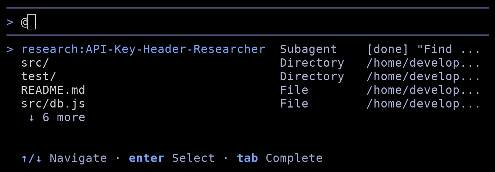

提及與引用
2-0
Antigravity 應用程式
功能
提及與引用 Antigravity App 功能
Antigravity 應用程式
Antigravity CLI
適用於：
Antigravity 應用程式
Antigravity CLI
# 提及與引用

[標題為「Mentions and quoting」的章節](#mentions-and-quoting)

類型 `@` 將代理指向特定的檔案、資料夾、規則或過去的
對話，或引用您選取的文字，讓代理從
正確的上下文開始，而不必自行搜尋。您也可以直接將訊息傳送
給子代理。

## 您可以新增的內容

[標題為「What you can add」的章節](#what-you-can-add)

下表比較 Antigravity App 與 Antigravity CLI：

| 情境 | Antigravity 應用程式 | Antigravity CLI |
| --- | --- | --- |
| 檔案與資料夾 | 類型 `@` 以及名稱的一部分 | 類型 `@` 以及路徑的一部分 |
| 規則 | 類型 `@`, 然後選擇 **規則** | 不可用 |
| 過去的對話 | 類型 `@`, 然後選擇 **對話** | 不可用 |
| 選取的文字 | 選取文字，然後按一下 **引用** | 不可用 |
| 子代理訊息 | 開啟子代理並使用其訊息框 | 以以下內容作為提示詞的開頭 `@` 以及子代理的名稱 |

- [Antigravity 應用程式](#tab-panel-134)
- [Antigravity CLI](#tab-panel-135)

### Antigravity 應用程式

[「Antigravity App」章節](#sr-tab-1)

### 提及檔案與資料夾

[標題為「Mention files and folders」的章節](#mention-files-and-folders)

類型 `@` 在訊息框中，再接著輸入檔案或資料夾名稱的一部分。單獨的
`@` 僅列出 **規則** 和 **對話** 類別。當您輸入時，
選單會縮小到與您專案中相符的類別、檔案和資料夾，以及
目前對話中相符的產出物，例如實作
計畫。比對採用模糊比對，因此 `@bkmk` 會尋找 `bookmarks.js`. 例如，輸入
`@ru` 列出 **規則** 類別、相符的外掛程式，以及相符的檔案與資料夾：



按下 ↑ 或 ↓ 反白一個結果，然後按
Enter 或 Tab 選取它，或按一下它。該提及
會在您的提示詞中顯示為帶有其圖示與名稱的標籤。若要不需輸入就能開始提及 `@`，按一下 **新增脈絡** (**+**）在訊息框中並選取
**提及**.

代理會收到您提及的每個檔案或資料夾的完整路徑，因此它
能確切知道您指的是哪一個，並在需要時讀取它。

### 附加規則

[標題為「Attach a rule」的章節](#attach-a-rule)

選擇 **規則** 於 `@` 選單，或輸入 `@rules:`, 以列出您工作區
與全域的所有 [規則](/docs/rules), 無論其觸發方式為何。每一列都會顯示
規則的名稱及其文字開頭。繼續輸入即可依名稱篩選。選取
規則即可將其完整文字加入您的訊息.

提及規則是套用使用以下內容之規則的方式 `manual` 觸發條件，
Antigravity 不會自行載入，例如您只
偶爾需要的發布檢查清單。

### 引用過去的對話

[標題為「Reference a past conversation」的章節](#reference-a-past-conversation)

選擇 **對話** 於 `@` 選單，或輸入 `@conversation:`, 以列出您
最近的對話。繼續輸入即可依標題，以及您與代理寫過的內容
搜尋過往對話，例如 `@conversation:rate limiter`. 按下
Esc 關閉清單。

選取一個對話，將其以標籤形式加入您的提示詞，並帶有該對話的標題。代理隨後即可查閱您在該對話中討論與決定的內容，因此您不必重述先前的工作。

### 引用選取內容

[標題為「Quote a selection」的章節](#quote-a-selection)

引用代理回應的一部分，針對該段文字提出後續問題。
當您在回應中選取文字時，會出現一個彈出視窗顯示 **引用** 及其鍵盤
快速鍵：



1. 在代理回應中選取文字。
2. 按一下 **引用** 在彈出視窗中，或按下 Cmd + L 或 Cmd + I 在 macOS 上，或 Ctrl + L 或 Ctrl + I 在 Windows 與 Linux 上。
3. 在訊息框中輸入您的後續訊息並傳送。

引用的文字會以標籤形式出現在訊息框中，代理會
連同您的訊息一起收到完整的引用文字。

#### 從檔案、差異與產出物引用

[標題為「Quote from files, diffs, and artifacts」的章節](#quote-from-files-diffs-and-artifacts)

當您選取側邊欄中檔案或差異內的文字，或是產出物（例如
）內的文字時， [實作計畫](/docs/implementation-plan), 彈出視窗會顯示
**留言** 和 **引用**. 若要將選取內容以標籤形式加入訊息框，
請按一下 **引用**，或按下 Cmd + L 或
Cmd + I 在 macOS 上，或 Ctrl + L 或
Ctrl + I 在 Windows 與 Linux 上。標籤所顯示的內容取決於
您選取文字的位置：

- **檔案與差異**: 標籤會顯示檔案名稱與行範圍，例如 `bookmarks.js #L13-17`. 代理會收到檔案路徑與行 號.
- **產出物**: 標籤會顯示產出物名稱與所選 文字的開頭。代理會收到所選文字。

若要改為在選取範圍上留下審查留言，請按一下 **留言**.

#### 引用終端機輸出

[標題為「Quote terminal output」的章節](#quote-terminal-output)

在整合式終端機中選取輸出，然後按一下 **引用** 將它以終端機標籤的形式加入
訊息框，例如 `terminal:bash`. 例如，引用一段
錯誤訊息來向代理詢問.

### 傳訊息給子代理

[標題為「Message a subagent」的章節](#message-a-subagent)

若要直接傳送訊息給執行中或閒置的子代理，請在
對話中選取該子代理，在側邊欄開啟它，然後在子代理
自己的訊息框中輸入。您的訊息會傳送給該子代理，而不是父
代理。子代理不會出現在 `@` 選單，且您無法傳訊息給已終止的
子代理。如需子代理狀態的詳細資訊，請參閱
[自訂子代理](/docs/subagents).

### Antigravity CLI

[「Antigravity CLI」章節](#sr-tab-2)

### 提及檔案與目錄

[標題為「Mention files and directories」的章節](#mention-files-and-directories)

類型 `@` 在提示詞框中開啟路徑建議，並繼續輸入以篩選
它們。比對採模糊比對，因此 `@bkjs` 會尋找 `src/routes/bookmarks.js`. 每個
建議都會顯示其相對於工作區的路徑，以及它是 **File** 或
 **目錄**，及其完整路徑。如果對話有子代理，它們會
在下列情況下優先列出： `@` 作為提示詞的開頭：



在建議清單中使用這些按鍵：

| 金鑰 | 動作 |
| --- | --- |
| ↑ | 移至上一個建議。 |
| ↓ | 移至下一個建議。 |
| Enter | 插入反白的路徑，後接一個空格。 |
| Tab | 插入反白的路徑。若為目錄，清單接著會顯示其內容。 |
| Esc | 關閉建議並保留你輸入的內容。 |

當您從清單中選取路徑時，它會以文字形式保留在您的提示詞中，例如
`@src/routes/bookmarks.js`，且當您傳送提示詞時，代理也會收到該項目的完整路徑
。您自行輸入或編輯的路徑會以
純文字形式傳送。

若要提及工作區外的路徑，請在查詢開頭加上 `~/` 或 `/`，
例如 `@~/Develop/`. 提及路徑並不會授予它的存取權：您的
[權限設定](/docs/permissions) 仍可決定代理是否能
讀取您工作區以外的檔案。

### 傳訊息給子代理

[標題為「Message a subagent」的章節](#message-a-subagent-1)

若要不經由父代理直接給予子代理新指示，
請在提示詞開頭加上 `@` 後面接著子代理的名稱和您的訊息，
例如：

```
@research:API-Key-Header-Researcher Also check whether the tests cover a missing X-API-Key header.
```

建議清單會顯示每個執行中或已完成的子代理，依據其
`<type>:<role>` 名稱，後接其狀態，例如 `[running]` 或 `[done]`，
以及其任務的開始。

按下 Enter 傳送。CLI 會以下列方式確認 **已傳送訊息給**
後面接著子代理的名稱和您的訊息。已
完成的子代理會接手該訊息，並以其先前工作的上下文繼續。名稱必須與列出的子代理完全相符（不分大小寫）；
否則，CLI 會將提示詞傳送給上層代理。如果您只傳送
名稱，CLI 會要求您輸入訊息。

若要監控子代理並開啟其完整對話，請使用
[`/agents` 面板](/docs/cli/commands/agents).

## 代理會收到什麼

[標題為「What the agent receives」的章節](#what-the-agent-receives)

提及檔案或資料夾並不會將其內容貼到您的提示詞中。此
表顯示代理會取得每一種上下文的哪些內容。在 Antigravity
CLI 中，您只能新增檔案與目錄。

| 您新增 | 代理會收到 |
| --- | --- |
| 檔案或資料夾 | 其完整路徑。代理會在需要時讀取它。 |
| 行範圍 | 檔案路徑與行號，而不是選取的文字。代理在需要時會讀取那些行。 |
| 規則 | 規則的完整文字。 |
| 過去的對話 | 該對話的標題與 ID。代理在需要詳細資訊時，會讀取該對話已儲存的記錄。 |
| 引用的文字 | 您引用的文字。 |
| 終端機輸出 | 您選取的輸出（最多最後 8 KB）以及終端機的名稱。 |

## 後續步驟

[「後續步驟」章節](#next-steps)

- [規則](/docs/rules): 撰寫規則，包括 `manual` 您附加的規則 使用 `@`.
- [自訂子代理](/docs/subagents): 了解子代理如何執行，以及如何 監控它們。
- [提示與互動](/docs/cli/prompting): 在 Antigravity CLI 中撰寫多行提示詞 並附加媒體.
- [斜線指令總覽](/docs/slash-commands): 瀏覽您可以 透過以下方式執行的指令 `/`.

[上一個
總覽](/docs/features/)

[下一步
語音模式](/docs/voice-mode/)

您的下載已開始

## 您如何得知我們？

請選一個。這有助於我們接觸更多像您一樣的人。

感謝您讓我們知道！
