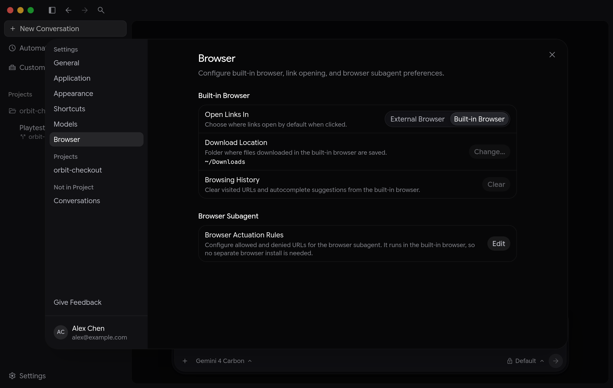

瀏覽器使用
2-0
Antigravity 應用程式
功能
瀏覽器使用 Antigravity App 功能
Antigravity 應用程式
Antigravity CLI
適用於：
Antigravity 應用程式
Antigravity CLI
# 瀏覽器使用

[標題為「瀏覽器使用方式」的章節](#browser-use)

在 Google Antigravity 中，代理可以開啟網頁、與正在執行的應用程式互動、檢查主控台錯誤與失敗的網路請求、擷取螢幕畫面，並在完成工作前驗證視覺修正。

在 Antigravity App 中使用瀏覽器：請代理測試本機結帳頁面，觀察瀏覽器子代理在內建瀏覽器中開啟 localhost:5174/checkout 並重現計算錯誤，在程式碼修正後檢查審查差異，並確認更新後的總金額正確且主控台零錯誤。

---

## 啟動瀏覽器工作

[標題為「啟動瀏覽器工作」的章節](#start-a-browser-task)

- [Antigravity 應用程式](#tab-panel-138)
- [Antigravity CLI](#tab-panel-139)

### Antigravity 應用程式

[「Antigravity App」章節](#sr-tab-1)

### 用白話詢問，或執行 `/browser`

[標題為「以自然語言提問或執行 /browser」的章節](#ask-in-plain-language-or-run-browser)

使用個人 Google 帳戶登入時（`v2.30.0+`)，您不需要
先設定 Chrome 或輸入斜線指令。請在訊息方塊中描述您希望驗證、
測試或研究的內容，主代理便會啟動 `browser`
子代理會自動在內建瀏覽器中執行：

```
Playtest Annual billing with promo code LAUNCH15 on http://localhost:5174/checkout, fix any bug you hit, and verify the updated total in the browser.
```

您也可以呼叫 [`/browser`](/docs/commands/browser) 明確指定，每當您
想將請求直接導向瀏覽器子代理時：

```
/browser Open http://localhost:3000, switch to a 390px mobile viewport, verify that the navigation drawer opens and closes cleanly, and report any console errors.
```

對於靜態文件文字即可回答的快速問題，代理會直接閱讀頁面，
無需開啟瀏覽器分頁。它會委派給 `browser` 子代理
適用於工作需要即時算繪、點擊或表單輸入、回應式版面
檢查、視覺螢幕截圖、主控台或網路檢查，或您已
登入的頁面。

### 模型用量

[標題為「模型用量」的章節](#model-usage)

每個 `browser` 子代理會在各自隔離的內容視窗中執行，因此頁面
快照與螢幕截圖不會塞滿您的主要對話：

- **預設模型**：瀏覽器子代理執行時不會奪取對話方塊或其他分頁的鍵盤焦點。在代理控制的分頁內捲動或點選不會中止執行，而開啟自己的手動分頁也能正常運作。
- **配額備援**：如果您的組織管理員停用 瀏覽器子代理，

### Antigravity CLI

[「Antigravity CLI」章節](#sr-tab-2)

### 連線至 Chrome 並執行 `/browser`

[標題為「連接 Chrome 並執行 /browser」的章節](#connect-chrome-and-run-browser)

在 Antigravity CLI 中， `browser` 子代理會透過 Chrome DevTools MCP
伺服器（啟動時搭配），在同一台電腦上驅動您本機的 Google Chrome
（144 版或更新版本） `npx`):

1. 請確認 [Node.js](https://nodejs.org/) (`npx` 在您的 `PATH`) 以及 Google Chrome (`v144+`) 已安裝在使用 `agy` 正在執行。
2. 開啟 Google Chrome 並前往 `chrome://inspect/#remote-debugging`.
3. 開啟 **允許這個瀏覽器執行個體進行遠端偵錯**.
4. 在您的 `agy` 工作階段，執行 `/browser` 後方接著任務與明確的 完成檢查： `/browser Open http://localhost:3000/dashboard, verify that the analytics charts render, and report any console or failed network requests.`
5. 當 Chrome 提示您允許遠端偵錯時，請按一下 **允許** 在 60 秒內。
6. 執行 [`/agents`](/docs/cli/commands/agents) 或按下 Alt + J 以監控瀏覽器子代理或回應 網站權限提示，或按下 Ctrl + K 以核准來自您主要對話的 待處理請求。

關於 Chrome 中 DevTools 效能分析、Lighthouse 與模擬功能的完整清單，
請參閱 [瀏覽器指令（`/browser`)](/docs/commands/browser)
指南。

---

## 觀看、並排瀏覽並接管

[標題為「觀看、並行瀏覽與接手」的章節](#watch-browse-alongside-and-take-over)

在 Antigravity App 中，內建瀏覽器位於
[側邊面板](/docs/side-panel) 就位於對話旁邊，讓您即時看到
每一次點擊、捲動與輸入：

- **分頁與游標指示器**：工作者會使用與您的對話相同的模型。若要為某個工作者或所有工作者使用不同的模型，請在提示詞中說明，例如「讓驗證者在與工作者不同的模型上執行。」您要求的模型必須是可以在模型選擇器中選擇的模型。您也可以稍後要求協調者將等待中的工作者移至另一個模型；該工作者會保留其對話，並在新模型上繼續執行。 **思考中…** 當子代理規劃下一步行動時）。
- **不會搶走焦點**：以程式化方式在 Antigravity 上建置。
- **前景分頁保護**：在內建瀏覽器中， 子代理會在隔離的工作者內透過結構化瀏覽器動作執行，沒有工作區／殼層工具，也不會任意評估頁面內 JavaScript， 且網路診斷會移除 Cookie，

### 執行平行瀏覽器分頁

[標題為「執行平行瀏覽器分頁」的章節](#run-parallel-browser-tabs)

對於多頁稽核、環境比較或大範圍文件掃描，
代理可以啟動多個 `browser` 子代理同時執行。每個子代理
在側邊面板中擁有各自的專屬分頁，無法瀏覽、檢查或
關閉其他子代理的分頁，也無法關閉您自行開啟的分頁。

Antigravity App 中的平行瀏覽器子代理：三個瀏覽器子代理同時開啟「定價」、「文件」與「更新日誌」分頁，以發現配額不符之處，同時您可以在對話中輸入後續提示詞而不失去焦點。

### 暫停、接手與登入

[標題為「暫停、接手與登入」的章節](#pause-take-over-and-sign-in)

- **停止並接手**：設定 Antigravity App 與 CLI。 **停止** 按鈕，位於任何 代理控制分頁的底部，可立即停止該瀏覽器子代理，並將 分頁交還給您手動控制（**瀏覽器：你已接手**)。停止主要 對話也會停止其作用中的瀏覽器子代理。
- **登入並繼續**：內建瀏覽器會為每個 Antigravity 帳號保留自己的 Cookie 與登入資訊，與您的 Chrome 設定檔分開。請在以下位置設定連結行為、下載資料夾、瀏覽記錄與操作規則  代理會讓登入頁面保持在內建瀏覽器分頁中開啟，暫停下來，並請您完成登入。 直接在該分頁中登入（或事先在任何內建瀏覽器分頁中登入）。 在對話中回覆，例如： `Signed in, continue`——而 瀏覽器子代理會取回已驗證的分頁，並從中斷處 繼續。

---

## 手動使用內建瀏覽器

[標題為「手動使用內建瀏覽器」的章節](#use-the-built-in-browser-manually)

您可以在任何桌面帳戶上使用 Antigravity App 的內建瀏覽器，
預覽本機伺服器、在程式碼旁閱讀文件，並將頁面上下文傳回
代理：

- **開啟頁面或分頁**:  點擊代理回覆或產出物中的連結，即可在內建 瀏覽器中開啟。 Hold Cmd （macOS）或 Ctrl (Windows 和 Linux) 在 點選連結時按住——或以中鍵點選——即可在 **background** 內建 瀏覽器分頁（`v2.30.0+`)。按住 Cmd + Shift （macOS）或 Ctrl + Shift (Windows 和 Linux) 在新 **foreground** 分頁。 Hold Shift （或 Option 在 macOS／ Alt 在 Windows 與 Linux 上）並按一下連結，即可在您的系統 **預設外部瀏覽器** (`v2.30.0+`). 按下 Cmd + T （macOS）或 Ctrl + T （Windows 與 Linux），或點選 **新分頁** (**+**) 在側邊面板中， 並選擇 **瀏覽器** (或直接在以下位置輸入網址或搜尋查詢 **搜尋或 輸入網址**)。對於本機 HTTP 伺服器，請包含 `http://`, 例如 `http://localhost:3000`.
- **工具列控制項**：使用 **返回**, **轉寄**，與 **重新載入** 以瀏覽； 點按網址列中的連線安全性圖示，查看 TLS 憑證 詳細資訊或選擇 **刪除 Cookie 與網站資料** 針對該網站（`v2.30.0+`)； 開啟 **Downloads** 以檢視已下載的檔案；點按 **將螢幕截圖加入對話** (相機圖示)，將可見檢視區的快照附加 到提示詞；或點選 **在外部瀏覽器中開啟**.
- **為選取的文字留言或引用**：敏感的 Google 資產，例如 **留言** 或 **引用** (`v2.30.0+`):  **留言** （或按下 C)：附加錨定在該段落的意見回饋，並隨您的下一則訊息傳送。 **引用** （或按下 Cmd + L 在 macOS／ Ctrl + L 在 Windows 與 Linux 上）：將選取的 段落與頁面 URL 插入您的訊息方塊。
- **連線硬體裝置** (`v2.30.0+`)：手動瀏覽期間，使用 WebUSB、WebHID 或 Web Serial 的網站會在網址列下方顯示裝置選擇器，讓您可以選擇裝置並點選 **Connect**.

---

## 權限與安全防護機制

[標題為「權限與安全防護機制」的章節](#permissions-and-safety-guardrails)

瀏覽器子代理結合了你的 [權限預設](/docs/permissions) 具備
專用的網站、上傳、下載與頁面隔離保護：

- **網站導覽核准（`execute_url`)**：在以下項目下 **要求審查**, **預設**，與 **自動** 預設集，前往未核准的網站時會暫停並 顯示 **允許在這個 URL 上執行動作？** 方便您選擇 **是，允許 這一次**, **是，允許** *domain* **在這個對話中**，或 **是， 一律允許** *domain* (或在核准前編輯網域目標)。代理在讀取目的地或與目的地互動之前，會檢查每一個 跨來源重新導向跳轉：  **Per-port `localhost` isolation**：與對話並排管理瀏覽器、檔案、 產出物與審查分頁。`localhost`, `127.0.0.1`, `[::1]`) 會依通訊埠隔離——核准 `localhost:3000` 不會授予存取權 `localhost:8080`。若要變更或刪除規則，請點選 `localhost`，輸入 `localhost` 在沒有連接埠的情況下 **瀏覽器操作 規則**. **敏感的 Google 子網域**：在對話中設定一次性 計時器與週期性排程。 `mail.google.com`, `docs.google.com`, `drive.google.com`, `calendar.google.com`, `chat.google.com`，與 `console.cloud.google.com`——永遠不涵蓋於一般 `google.com` 或 `cloud.google.com` 授權，且一律需要各自明確的規則。
- **單次檔案上傳確認**：一張顯示誰提及誰的圖表，箭頭粗細依貼文 數量加權。使用重播控制項，逐步或連續播放群組從第一則到最新一則的貼文，或點選 **允許 上傳** *檔案* **至** *origin***?** (**是，僅允許這次**)——即使在 **Turbo** preset.
- **檔案下載核准（`download_url`)**：在以下位置預先設定網站與 檔案下載規則 **下載檔案** 規則，位於 **瀏覽器操作規則** (`v2.30.0+`)。當內建瀏覽器 子代理觸發檔案下載時 (`v2.31.0+`)，下載會在以下情況暫停 **允許 瀏覽器代理下載檔案？**，顯示檔案名稱、來源、任何 重新導向來源、MIME 類型與目的地資料夾。您可以允許從該網域下載檔案，適用於目前執行、對話，或一律允許 (`data:` 和 `blob:` 下載需要一次性核准，包括在 **Turbo**):  核准的下載會儲存到你設定的 **下載位置**，會隨附 **代理** 徽章，在 **Downloads** 抽屜（**在資料夾中顯示** 僅限，因此無法透過按一下來啟動代理下載），並讓安全的 匯出檔案可供子代理讀取。 可執行檔、安裝程式、指令碼與動態標記下載，包括 `.exe`, `.dmg`, `.pkg`, `.msi`, `.bat`, `.cmd`, `.ps1`, `.sh`, `.dll`, `.so`, `.dylib`, `.html`, `.svg`, `.xml`，與 `.wasm`——會自動遭到封鎖 （針對代理控制的分頁）。
- **Turbo 預設會變更哪些內容**: **Turbo** 自動核准一般 `execute_url` 網站導覽與標準 HTTP(S) `download_url` 下載， 但拒絕清單上的網站或管理員允許網域以外的網站除外。 檔案上傳， `data:`/`blob:` 下載、登入頁面、付款 介面與遭到封鎖的檔案類型，即使在 **Turbo**.
- **常駐防護**:  **不輸入任何憑證、付款資訊或 CAPTCHA**：如果 Gemini Flash 配額用完或無法使用，代理會停止並詢問您希望如何繼續，而不會自動切換到另一個 模型。`accounts.google.com`, `myaccount.google.com`、Microsoft、Apple、Okta、 Auth0) 與付款處理商 (例如 Stripe、PayPal、Adyen、Braintree 和 Google Pay) 均禁止代理操作。付款、登入與未核准的跨來源 iframe 會在傳送給模型之前，自動從螢幕截圖 與快照中遮蔽。 **獨立的瀏覽器操作與經過清理的日誌**：在您系統的信任存放區中安裝根憑證 (macOS 上的「鑰匙圈存取」、Windows 憑證 存放區，或 Linux 上發行版的 CA 套件)。背景 `Authorization` 標頭， 以及 OAuth/JWT 權杖。 **不會全螢幕、不會鎖定指標，也不會劫持區域網路**：Antigravity 會使用開啟中解決方案的資料夾 (或您的`v2.31.0+`)，將外部網站重新導向至 `localhost` 或私人 LAN IP，或 存取雲端中繼資料與連結本機位址。

---

## 設定瀏覽器設定

[標題為「設定瀏覽器設定」的章節](#configure-browser-settings)

在 Antigravity 應用程式中 (`v2.30.0+`)，開啟 **設定** > **瀏覽器** 以管理
內建瀏覽器與瀏覽器子代理：



### 內建瀏覽器

[標題為「內建瀏覽器」的章節](#built-in-browser)

- **連結開啟方式**：點選代理回應中的網頁連結，即可在內建瀏覽器中開啟 ( **內建瀏覽器** (預設值) 或您的 **外部瀏覽器**.
- **下載位置**：Visual Studio 2022 (17.14 版或更新版本) 或 Visual Studio 2026，適用於 Windows 10 或 11。 **變更…**，或 **重設** 內建瀏覽器下載檔案的儲存資料夾（`~/Downloads` 預設啟用）。
- **瀏覽記錄**：按一下 **Clear** 以移除已造訪的 URL 與網址列 自動完成建議。（如需清除特定網站的 Cookie 與儲存空間， 請點按該網站網址列中的安全性圖示並選擇 **刪除 Cookie 與網站資料**.)

### 瀏覽器子代理

[標題為「瀏覽器子代理」的章節](#browser-subagent)

- **瀏覽器操作規則**：按一下 **編輯** 以開啟 **瀏覽器操作 權限**，現在會將登入連結縮排得與周圍文字一致，並以空白行將其隔開，不再為換行連結的結尾空白加上底線，並使用外掛程式的顯示名稱 **允許**, **詢問**，或 **拒絕** 規則，位於 **執行網址** (子代理可以開啟的網站) 以及 **下載檔案** (子代理可從中下載的網站)。如需瞭解比對規則與企業網域 限制，請參閱 [允許清單與拒絕清單](/docs/ide/allowlist-denylist).
- **瀏覽器 Javascript 執行政策** *(使用 Chrome DevTools MCP 時顯示)*：控制您正在執行的 本機 Google Chrome ( `/browser` 子代理會在執行前 先詢問 `evaluate_script` (**要求審查**，預設值)，無須詢問即可執行 (**一律繼續**)，或封鎖自訂頁面內指令碼 (**已停用**)。當 內建瀏覽器代理作用中時，不會使用任意頁面內 JavaScript 執行， 因此會隱藏此設定。
- **組織控制項**：如果代理開始瀏覽時，您正在側邊 面板中閱讀某個分頁，新的瀏覽器子代理會在背景開啟自己的 分頁，而不會離開您正在查看的頁面。 **瀏覽器子代理** 區段會顯示通知，而非 這些控制項。如需 IDE 瀏覽器設定（**Antigravity** > **開啟設定** > **瀏覽器**），請參閱 [IDE 瀏覽器總覽](/docs/ide/browser).

---

## 比較各介面的瀏覽器模式

[標題為「比較各介面的瀏覽器模式」的章節](#compare-browser-modes-across-surfaces)

| 功能 | Antigravity App（內建瀏覽器、個人帳戶 `v2.30.0+`) | Antigravity CLI & App 商務版／企業版（[`/browser`](/docs/commands/browser)) | Antigravity IDE `v2.6.0+` & VS Code `v1.9.0+` ([IDE 瀏覽器](/docs/ide/browser)) |
| --- | --- | --- | --- |
| **瀏覽器引擎 & setup** | 內建側邊面板瀏覽器（無需設定外部瀏覽器或 Node.js） | 本機 Google Chrome（`v144+`) 透過 Chrome DevTools MCP (`npx` / Node.js；本機工作區) | 本機 Google Chrome（`v144+`) 透過 Chrome DevTools MCP (`npx` /automation 與 /schedule 的比較 |
| **如何開始** | 自然語言提示詞（自動叫用）或 `/browser <task>` | `/browser <task>` | `/browser <task>` |
| **平行瀏覽器子代理** | 是，各自在獨立的內建瀏覽器分頁中 | 每個執行個體僅允許一個使用中的 Chrome 偵錯連線 | 每個執行個體僅允許一個使用中的 Chrome 偵錯連線 |
| **Cookie 與登入設定檔** | 每個 Antigravity 帳戶皆有獨立的持續性設定檔，並支援暫停與接續登入交接 | 您執行中的 Google Chrome 設定檔 | 您執行中的 Google Chrome 設定檔 |
| **視覺播放與產出物** | 在側邊面板中即時觀看，搭配動畫游標與 **停止** 按鈕；請要求代理將螢幕截圖儲存為產出物 | 子代理步驟中的螢幕畫面與選用的 WebM 工作階段錄影 | 螢幕畫面與選用的 [WebM 瀏覽器錄影](/docs/ide/browser-recordings) |
| **DevTools 效能分析 & Lighthouse** | 主控台錯誤，以及經過清理的失敗／近期網路請求 | 完整的 DevTools 效能追蹤、Lighthouse 稽核、堆積快照、網路／CPU 節流，以及 `evaluate_script` | 完整的 DevTools 效能追蹤、Lighthouse 稽核、主控台／網路記錄、節流，以及 `evaluate_script` (依 JS 政策) |

## 後續步驟

[「後續步驟」章節](#next-steps)

- [瀏覽器指令（`/browser`)](/docs/commands/browser)：在代理的協助下設定 持久的背景自動化。
- [允許清單與拒絕清單](/docs/ide/allowlist-denylist)：正在 macOS、 Windows 與 Linux 上推出，適用於 **瀏覽器操作規則**.
- [代理權限](/docs/permissions)：瞭解子代理的運作方式，以及如何定義自己的子代理。 `read_url`, `execute_url`，與 `download_url` 一起運作。
- [側邊面板與總覽面板](/docs/side-panel)：直接傳送訊息給子代理與工作者。
- [螢幕截圖](/docs/screenshots)：查看 Antigravity 在何處尋找自訂項目，以及哪一個優先。

[上一個
終端機標題自訂](/docs/cli/title/)

[下一步
允許清單與拒絕清單](/docs/ide/allowlist-denylist/)

您的下載已開始

## 您如何得知我們？

請選一個。這有助於我們接觸更多像您一樣的人。

感謝您讓我們知道！
