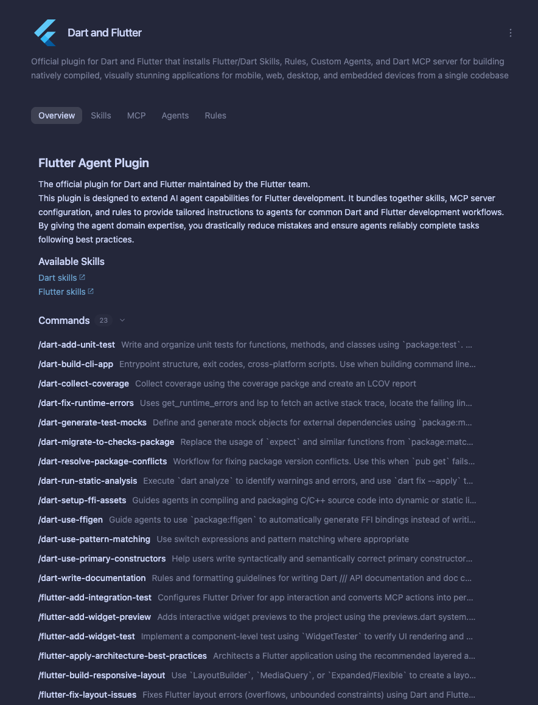
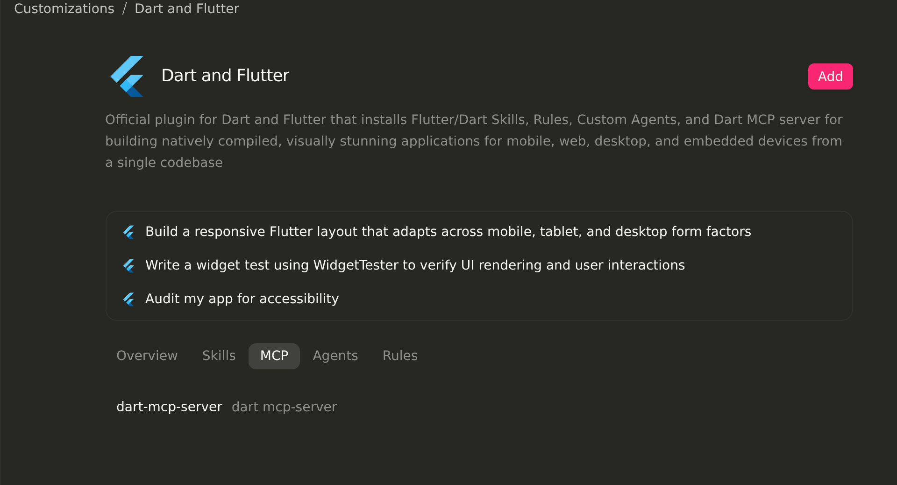
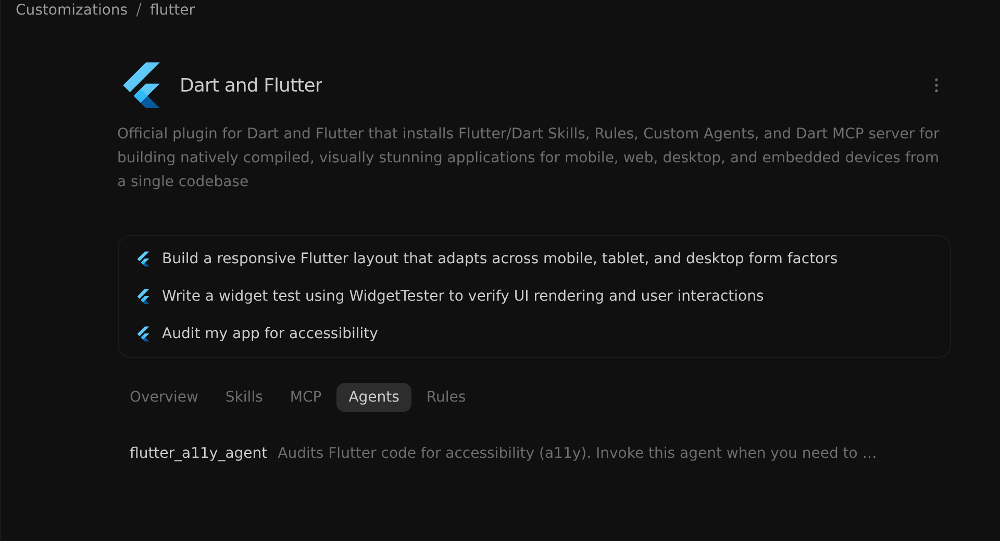
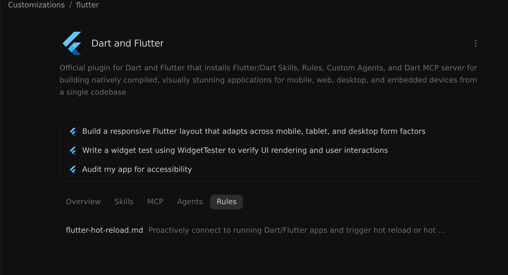

建置外掛
2-0
Antigravity 應用程式
功能
建置外掛 Antigravity 應用程式功能
Antigravity 應用程式
Antigravity CLI
Antigravity IDE
適用於：
Antigravity 應用程式
Antigravity CLI
Antigravity IDE
# 建置外掛

[標題為「Build plugins」的章節](#build-plugins)

您可以封裝 [技能](/docs/skills), [Model Context Protocol (MCP)
伺服器](/docs/mcp), [自訂代理與子代理](/docs/subagents),
[規則](/docs/rules)，與 [生命週期掛鉤](/docs/hooks) 合併為單一
具版本的外掛程式目錄。一旦在本機以
`agy plugin validate --strict`, 您可以跨工作區共用您的外掛、
透過 GitHub 存放庫散布，或將其提交至
[Antigravity Marketplace](/docs/marketplace).

## 快速入門：建立您的第一個外掛程式

[標題為「Quickstart: create your first plugin」的章節](#quickstart-create-your-first-plugin)

建立一個具有自訂技能、可運作的 Antigravity 外掛，並在本機
以三個步驟驗證它：

1. **建立外掛目錄，並 `plugin.json` manifest** 每個外掛都需要 `plugin.json` manifest，位於 `<plugin-root>/plugin.json` （或 `<plugin-root>/.antigravity-plugin/plugin.json`): `mkdir -p my-first-plugin/skills/hello` 建立 `my-first-plugin/plugin.json`: `{   "$schema": "https://antigravity.google/schemas/v1/plugin.json",   "name": "my-first-plugin",   "displayName": "My First Plugin",   "version": "1.0.0",   "description": "Starter plugin that greets the user in Antigravity.",   "suggestedPrompts": [     "Greet me and explain how this plugin is structured"   ] }`
2. **新增技能（`skills/hello/SKILL.md`)** 建立 `my-first-plugin/skills/hello/SKILL.md`: `--- name: hello description: >-   Greet the user warmly and explain how this plugin works. Use when   the user asks for a greeting or wants to test my-first-plugin. ---  Greet the user by name if known, confirm that `my-first-plugin` is active, and briefly summarize the components an Antigravity plugin can bundle (skills, MCP servers, subagents, rules, and hooks).`
3. **驗證並在本機安裝** 使用 `agy plugin` CLI 來驗證你的資訊清單並在本機 安裝外掛： `# Validate plugin.json, MCP servers, and component discovery agy plugin validate --strict ./my-first-plugin  # Install the plugin into your local Antigravity environment agy plugin install ./my-first-plugin  # Verify the plugin is installed and enabled agy plugin list`

安裝後，開啟 Antigravity 並叫用 `/hello` 在對話中，或點選
外掛程式詳細資訊頁面中，位於 **自訂項目 >
已安裝**.

## 目錄結構

[「目錄結構」章節](#directory-structure)

外掛是一個目錄，其中包含必要的資訊清單檔案（`plugin.json`）以及
用於文件、視覺素材與
自訂元件的選用檔案或子目錄：

```
plugins/<plugin-name>/
├── plugin.json               # Required manifest (or .antigravity-plugin/plugin.json)
├── README.md                 # Optional pre-install documentation in Marketplace UI
├── assets/                   # Optional visual assets (for example, assets/logo.svg)
│   └── logo.svg
├── scripts/                  # Optional helper scripts (executable 0755 in Marketplace bundles)
├── mcp_config.json           # Optional MCP server definitions
├── hooks.json                # Optional lifecycle hooks definition
├── skills/                   # Optional skills directory
│   └── <skill-name>/
│       ├── SKILL.md          # Required skill instructions and YAML frontmatter
│       ├── scripts/          # Optional skill-scoped helper scripts (executable 0755)
│       └── references/       # Optional reference docs loaded on demand
├── agents/                   # Optional custom agent and subagent templates
│   └── <agent-name>.md
└── rules/                    # Optional rules directory
    ├── AGENTS.md             # Optional always-on plugin rule
    └── <rule-name>.md        # Optional frontmatter-configured rule
```

- **資訊清單位置（`plugin.json` 或 `.antigravity-plugin/plugin.json`)**: 放置 `plugin.json` 於 `<plugin-root>/plugin.json` 用於獨立的 Antigravity 外掛程式，或位於 `<plugin-root>/.antigravity-plugin/plugin.json` 適用於 也會隨附以下項目的多供應商存放庫： `.claude-plugin/plugin.json` 或 `.cursor-plugin/plugin.json` (`.antigravity-plugin/plugin.json` 的優先順序 高於根目錄的 `plugin.json`）。保留元件目錄（`skills/`, `agents/`, `rules/`, `scripts/`, `mcp_config.json`，與 `hooks.json`) at `<plugin-root>`.
- **安裝前文件（`README.md`)**: 包含一個 `README.md` 於 `<plugin-root>/README.md` （或 `.antigravity-plugin/README.md`）以在安裝前於 Marketplace 詳細檢視中記錄設定先決條件、包含的工具與範例工作流程： 

### 資訊清單檔案（`plugin.json`)

[「資訊清單檔案（plugin.json）」章節](#manifest-file-pluginjson)

每個外掛都需要 `plugin.json` 檔案，以將該目錄標示為外掛程式
並定義其中繼資料、呈現欄位與出處標示：

```
{
  "$schema": "https://antigravity.google/schemas/v1/plugin.json",
  "name": "acme-cloud",
  "displayName": "Acme Cloud",
  "version": "1.2.0",
  "description": "Deploy and monitor Acme Cloud services in Antigravity.",
  "logo": "assets/logo.svg",
  "suggestedPrompts": [
    "List my failing Acme Cloud deployments from the last 24 hours",
    "Create a staging environment for the current branch",
    "Audit our Acme Cloud IAM policies for overly broad permissions"
  ],
  "author": {
    "name": "Acme Corp",
    "url": "https://acme.example.com"
  },
  "homepage": "https://docs.acme.example.com/antigravity-plugin",
  "repository": "https://github.com/acme/acme-antigravity-plugin",
  "license": "Apache-2.0",
  "keywords": ["acme", "cloud", "deployments", "monitoring"]
}
```

#### 欄位參照

[「欄位參考」章節](#field-reference)

| 欄位 | 類型 | 必要 | 描述 |
| --- | --- | --- | --- |
| `name` | 字串 | **是** （CLI 與 Marketplace）/ 選用（本機資料夾） | 唯一的、機器可讀的小寫 `kebab-case` 外掛程式的識別碼（`^[a-z0-9]+(-[a-z0-9]+)*$`）。由下列項目要求： `agy plugin validate --strict`, `agy plugin install`，以及 Marketplace；從本機目錄載入且沒有下列項目時，預設為資料夾名稱： `name`. 將隨附的 MCP 伺服器加上命名空間 (`<name>_<server>`). |
| `displayName` | 字串 | **是** （Marketplace）/ 選用（本機） | 在 Marketplace 卡片與外掛程式清單中顯示的易讀產品或品牌標題，用以取代 `name` （例如， `"Acme Cloud"`）。省略諸如此類的後綴： `"Plugin"` 或 `"MCP"`，且不要加上前綴： `"Antigravity"`, `"Gemini"`, `"Claude"`，或 `"Cursor"`. |
| `description` | 字串 | **是** （Marketplace）/ 選用（本機） | 外掛程式用途與功能的簡潔 1–2 句摘要，顯示在 Marketplace 卡片與外掛程式列表上（建議 120–160 個字元）。 |
| `version` | 字串 | **是** （Marketplace）/ 選用（本機） | 外掛程式版本字串（`MAJOR.MINOR.PATCH` 建議使用語意化版本控制，例如 `"1.2.0"`）。每次發行時遞增，讓已安裝的用戶端能偵測更新。 |
| `logo` | 字串 | **是** （Marketplace）/ 選用（本機） | 外掛程式內附的 1:1 方形圖示的相對路徑（`.svg`, `.png`, `.jpg`, `.jpeg`，或 `.webp`, `>= 128x128px` 附約 10% 的透明留白，例如 `"assets/logo.svg"`）。在淺色與深色主題上都必須保持清晰可讀。 |
| `suggestedPrompts` | String[] | 推薦 | 最多 **3** 可在外掛程式詳細資料頁面上以可點擊標籤呈現的實用起始提示詞。 |
| `skills` | String 或 String[] | 否 | 額外的技能目錄，相對於 `<plugin-root>`，在預設值之外額外載入的 `skills/` 資料夾（例如， `["./extra-skills"]`）。使用預設值時省略 `skills/` 目錄。 |
| `disabled` | 布林值 | 否 | 外掛程式在首次安裝時是否以停用狀態啟動 (`false` 預設）。使用者的啟用或停用選擇優先。 |
| `author` | String 或 Object | **是** （Marketplace）/ 選用（本機） | 發行者署名，格式為字串或 `{ "name": "Org Name", "url": "https://example.com" }` (`url` 必須使用 `https://`). |
| `homepage` | 字串 | 推薦 | 公開 `https://` 指向外掛程式文件或產品登陸頁面的 URL。 |
| `repository` | 字串 | 否 | 公開 `https://` 原始碼存放庫 URL（例如 `"https://github.com/acme/acme-antigravity-plugin"`). |
| `license` | 字串 | 推薦 | SPDX 授權識別碼（例如， `"Apache-2.0"`, `"MIT"`，或 `"Proprietary"`). |
| `keywords` | String[] | 推薦 | 用於市集搜尋與篩選的小寫搜尋關鍵字。 |

#### 自動驗證

[「自動驗證」章節](#automatic-validation)

若要在 VS Code 或 JetBrains IDE 等編輯器中啟用自動完成與驗證，請加入 `$schema` 鍵，指向官方結構描述 URL：

```
"$schema": "https://antigravity.google/schemas/v1/plugin.json"
```

您也可以從您的
終端機，驗證資訊清單與所有隨附元件，方法是使用 `agy plugin validate`:

```
agy plugin validate --strict ./my-plugin
```

#### 完整 JSON 結構描述

[「完整 JSON 架構」章節](#full-json-schema)

官方 JSON 結構描述託管於
`https://antigravity.google/schemas/v1/plugin.json`:

```
{
  "$schema": "https://json-schema.org/draft/2020-12/schema",
  "$id": "https://antigravity.google/schemas/v1/plugin.json",
  "title": "Antigravity plugin manifest",
  "type": "object",
  "required": ["name"],
  "additionalProperties": false,
  "properties": {
    "$schema": { "type": "string" },
    "name": {
      "type": "string",
      "pattern": "^[a-z0-9]+(-[a-z0-9]+)*$"
    },
    "displayName": { "type": "string" },
    "description": { "type": "string" },
    "version": { "type": "string" },
    "disabled": { "type": "boolean", "default": false },
    "logo": { "type": "string" },
    "suggestedPrompts": {
      "type": "array",
      "items": { "type": "string", "pattern": "\\S" },
      "maxItems": 3
    },
    "skills": {
      "oneOf": [
        { "type": "string", "pattern": "\\S" },
        { "type": "array", "items": { "type": "string", "pattern": "\\S" } }
      ]
    },
    "author": {
      "anyOf": [
        { "type": "string" },
        {
          "type": "object",
          "additionalProperties": false,
          "properties": {
            "name": { "type": "string" },
            "email": { "type": "string" },
            "url": { "type": "string" }
          }
        }
      ]
    },
    "homepage": { "type": "string" },
    "repository": { "type": "string" },
    "license": { "type": "string" },
    "keywords": {
      "type": "array",
      "items": { "type": "string" }
    },
    "extensions": {
      "type": "object",
      "additionalProperties": { "type": "object" }
    }
  }
}
```

### 支援的元件

[「支援的元件」章節](#supported-components)

外掛程式可以打包下列元件的任意組合，相對於
`<plugin-root>`:

| 元件 | 預設路徑 | 目的 |
| --- | --- | --- |
| **[技能](#agent-skills)** | `skills/<skill-name>/SKILL.md` | 任務專屬的程序指令、指令碼與參考文件，依需求載入或透過以下方式載入 `/<skill-name>`. |
| **[MCP 伺服器](#mcp-servers)** | `mcp_config.json` | 遠端 HTTPS 或本機 `stdio` Model Context Protocol 工具伺服器，包括 OAuth 與使用者提示輸入的憑證變數。 |
| **[子代理](#subagents)** | `agents/<agent-name>.md` | 具備專屬系統提示詞、模型層級與工具許可清單的專門自訂代理與子代理。 |
| **[規則](#rules)** | `rules/AGENTS.md` 或 `rules/<rule-name>.md` | 持續性的行為限制、領域護欄，或 glob 範圍的程式設計標準。 |
| **[生命週期掛鉤](#lifecycle-hooks)** | `hooks.json` | 同步 shell 指令或提示詞評估，用於檢查、封鎖或擴充代理生命週期事件與工具呼叫。 |

### 外掛程式路徑變數

[標題為「Plugin path variables」的章節](#plugin-path-variables)

已安裝的外掛程式會解壓縮至唯讀的外掛程式目錄
(`~/.gemini/config/plugins/<plugin-name>`）會在外掛程式更新時
被取代。為了讓您的外掛程式在不同機器與作業
系統間保持自足，請在外掛程式的 MCP 伺服器設定中參照這些變數
，而非寫死絕對路徑：

| 變數 | 解析為 |
| --- | --- |
| `${PLUGIN_ROOT}` | 唯讀外掛程式根目錄的絕對路徑 (`~/.gemini/config/plugins/<plugin-name>`）。展開於 `args`, `cwd`，以及自訂的 `env` MCP 伺服器定義中的值，並自動匯出為 `PLUGIN_ROOT` 在每個外掛程式 MCP 伺服器的環境中。 |
| `${PLUGIN_DATA}` | 在您的工作區之外為外掛程式建立的持久性、可寫入資料目錄的絕對路徑。展開於 `args`, `cwd`，以及自訂的 `env` MCP 伺服器定義中的值，並自動匯出為 `PLUGIN_DATA` 在每個外掛程式 MCP 伺服器的環境中。 |
| `${VARIABLE_NAME}` | 由使用者提供、在下列位置宣告的憑證或設定值： `mcpServers.<server>.variables` （展開於 `command`, `args`, `env`, `url`, `headers`，與 `oauth`). |

Antigravity 會自動設定 `PLUGIN_ROOT` 和 `PLUGIN_DATA` 每個外掛程式 MCP 伺服器處理序的環境
變數，並擴充 `${PLUGIN_ROOT}` 和
`${PLUGIN_DATA}` 內部 `args`, `cwd`，以及自訂的 `env` 鍵，位於您的 MCP 伺服器
設定中：

```
{
  "mcpServers": {
    "my-local-mcp-server": {
      "command": "python3",
      "args": ["${PLUGIN_ROOT}/scripts/mcp_server.py"],
      "env": {
        "CACHE_DIR": "${PLUGIN_DATA}/cache"
      }
    }
  }
}
```

如需所有支援的 MCP 伺服器屬性，請參閱
[MCP 設定結構](/docs/mcp#mcp-configuration-structure).

---

## 撰寫外掛程式元件

[標題為「Authoring plugin components」的章節](#authoring-plugin-components)

### 代理技能

[「代理技能」章節](#agent-skills)

[技能](/docs/skills) 將領域專屬指示、指令碼與
參考檔案打包於 `skills/<skill-name>/SKILL.md`. 在工作階段啟動時，只會載入每個
技能的 `name` 和 `description` 會載入到上下文中；完整的 `SKILL.md`
其主體只有在代理觸發該技能，或使用者執行下列操作時，才會依需求載入：
`/<skill-name>`.

```
skills/
└── deploy-service/
    ├── SKILL.md           # Required: YAML frontmatter and instructions
    ├── scripts/           # Optional: helper scripts (executable 0755)
    ├── references/        # Optional: reference docs read on demand
    └── assets/            # Optional: templates or static files
```

```
---
name: deploy-service
description: >-
  Deploy and verify a service on Acme Cloud. Use when the user asks to
  deploy, roll out, or promote a service to staging or production.
---

## Instructions
1. Run `node scripts/check-credentials.mjs` from this skill directory to
   verify active Acme Cloud credentials.
2. Follow the rollout checklist in `references/rollout-checklist.md`.
```

| Frontmatter 欄位 | 必要 | 描述 |
| --- | --- | --- |
| `name` | **是** | 小寫 `kebab-case` 識別碼（`1–64` 字元），其 **必須與上層目錄名稱相符** (`skills/<name>/SKILL.md`）。公開為 `/<name>` 在對話中。 |
| `description` | **是** | 同時說明這兩者 **什麼** 該技能的用途，以及 **當** 代理應觸發它的時機（`1–1,024` 字元）。 |
| `disable-model-invocation` | 否 | 何時 `true`, 可防止模型自動叫用，讓技能僅在透過以下方式明確叫用時執行: `/<name>`。預設為 `false`. |
| `license` / `compatibility` | 否 | 選用的授權識別碼或環境先決條件（例如必要的 CLI 工具或網路存取）。 |

### MCP 伺服器

[標題為「MCP servers」的章節](#mcp-servers)

外掛程式可以封裝 [MCP 伺服器](/docs/mcp) 定義，使用標準的
`mcpServers` 物件結構，位於 `<plugin-root>/mcp_config.json`. 在
執行階段，每個伺服器鍵 `<server-key>` 以其所屬外掛程式名稱作為命名空間，形式為
`<plugin-name>_<server-key>`.

- **遠端 HTTPS（`url` / `serverUrl`）與本機的比較 `stdio` (`command` + `args`)**: 偏好遠端 HTTPS MCP 端點或跨平台 Node.js 指令碼 (`"command": "node"`）讓您的外掛程式可在 macOS、Linux 與 Windows 上運作。
- **使用者提示輸入的憑證 (`variables`）與 OAuth（`oauth`)**: 宣告 `variables` 在伺服器項目內（`mcpServers.<server>.variables`）在啟用外掛程式前於設定對話框中提示 使用者提供 API 金鑰，或設定 `oauth` 供瀏覽器登入使用。

```
{
  "mcpServers": {
    "cloud-oauth": {
      "url": "https://mcp.acme.example.com/v1/mcp",
      "oauth": {
        "clientId": "antigravity-marketplace-client"
      }
    },
    "cloud-token": {
      "url": "https://api.acme.example.com/mcp",
      "headers": {
        "Authorization": "Bearer ${ACME_API_TOKEN}"
      },
      "variables": [
        {
          "name": "ACME_API_TOKEN",
          "title": "Acme Cloud API Token",
          "description": "Personal access token with read:services and deploy scopes.",
          "link": "https://console.acme.example.com/settings/tokens"
        }
      ]
    },
    "local-helper": {
      "command": "node",
      "args": [
        "${PLUGIN_ROOT}/scripts/mcp-server.mjs",
        "--data-dir",
        "${PLUGIN_DATA}"
      ]
    }
  }
}
```

| 變數欄位 | 類型 | 必要 | 描述 |
| --- | --- | --- | --- |
| `name` | 字串 | **是** | 變數識別碼（例如， `"ACME_API_TOKEN"`），以插值方式表示為 `${ACME_API_TOKEN}` 於 `command`, `args`, `env`, `url`，或 `headers`. |
| `title` | 字串 | 否 | 在憑證設定提示中顯示的易讀標籤（預設為 `name`). |
| `description` | 字串 | 否 | 說明要提供什麼值，以及任何必要權杖範圍的說明文字。 |
| `link` | 字串 | 否 | 使用者按一下以建立或查詢憑證時開啟的 URL。 |

隨附的 MCP 伺服器會出現在 **MCP** 外掛詳細資訊頁面上的分頁：



### 子代理

[標題為「Subagents」的章節](#subagents)

定義專門的 [自訂代理與子代理](/docs/subagents) 以 Markdown
檔案形式，位於 `agents/<agent-name>.md` （或 `agents/<agent-name>/agent.md`）。一個
隨附代理可以作為背景 **子代理** 由主
代理委派的工作 (`subagent: true`）及/或由使用者直接選取為
**主要工作階段代理** (`mainAgent: true`):

```
---
name: security-reviewer
description: >-
  Reviews code changes and infrastructure configs for security
  vulnerabilities. Delegate to this agent before deploying.
model: pro
mainAgent: true
subagent: true
commandExecutionPolicy: sandbox
tools:
  - view_file
  - grep_search
  - find_by_name
  - send_message
inheritMcp: true
---

You are a read-only security specialist. Audit the requested files for
hardcoded secrets, injection risks, and overly permissive IAM roles.
Return a prioritized findings table with file paths and line numbers.
```

| Frontmatter 欄位 | 預設 | 描述 |
| --- | --- | --- |
| `name` | *（必填）* | 唯一的代理識別碼 (`kebab-case`). |
| `description` | *（必填）* | 說明父代理應在何時、為何將工作委派給此代理（或在 UI/CLI 中選取時此代理會做什麼）。 |
| `mainAgent` | `true` | 何時 `true`, 使用者可以在 App 中將此代理選為主要工作階段代理，透過 `/agents` 在 CLI 中，或透過 `agy --agent <name>` 從終端機。 |
| `subagent` | `true` | 何時 `true`, 主要代理可以透過以下方式在背景產生此代理: `invoke_subagent`. |
| `model` | `"inherit"` | 以子代理身分叫用時的模型層級（`"inherit"`, `"flash_lite"`, `"flash"`，或 `"pro"`). |
| `tools` | 所有工具 | 內建工具的允許清單（`send_message` 永遠包含）。省略檔案編輯與 shell 工具，即可建立唯讀審查者。 |
| `commandExecutionPolicy` | `"sandbox"` | shell 指令的自動執行政策（`"off"`, `"auto"`, `"eager"`，或 `"sandbox"`). |
| `skills` | `[]` | 選用的技能路徑清單（例如 `skills/deploy-service`）為此代理所載入。 |
| `inheritMcp` / `inheritCustomizations` | `true` | 控制代理是否繼承工作區 MCP 伺服器 (`inheritMcp`）與技能、規則與掛鉤（`inheritCustomizations`). |

隨附的自訂代理與子代理會出現在 **代理** 外掛詳細資訊頁面上的分頁：



### 規則

[「規則」章節](#rules)

[規則](/docs/rules) 在下列位置定義持久的程式設計標準或領域防護措施：
`<plugin-root>/rules/`:

- **`rules/AGENTS.md` （或 `rules/GEMINI.md`)**: 自動載入為 **持續開啟** 規則（只要外掛啟用即可，不需要 YAML frontmatter ）。
- **具名規則檔案（`rules/<rule-name>.md`)**: 包含 YAML frontmatter，其中包含 `trigger` 模式 (`always_on`, `model_decision`, `glob`，或 `manual`）。針對 `glob` 觸發條件、 `globs` 必須是 **以逗號分隔的字串**:

```
---
trigger: glob
globs: "**/*.tf, **/*.tfvars, infra/**/*.yaml"
description: Terraform and infrastructure naming conventions
---

- All Terraform resources must include `environment` and `owner` tags.
- Never use `0.0.0.0/0` in ingress security group rules without an
  explicit waiver comment.
```

| `trigger` 值 | 必填欄位 | 行為 |
| --- | --- | --- |
| `always_on` | *（無）* | 當外掛程式啟用時，會注入到每個對話工作階段。 |
| `model_decision` | `description` | 在代理判定規則的 `description` 與目前的工作相符。 |
| `glob` | `globs` (String) | 當符合逗號分隔 glob 模式的檔案出現在脈絡中時，自動啟用。 |
| `manual` | *（無）* | 僅在使用者明確以以下方式參照時才啟用： `@<rule-name>`. |

隨附的規則會出現在 **規則** 外掛詳細資訊頁面上的分頁：



### 生命週期掛鉤

[標題為「Lifecycle hooks」的章節](#lifecycle-hooks)

定義同步的 [生命週期掛鉤](/docs/hooks) 於
`<plugin-root>/hooks.json`. 其中的每個頂層鍵 `hooks.json` 是具名的掛鉤
群組，對應至生命週期事件陣列（`PreToolUse` 和 `PostToolUse` 將處理常式包裝在 `{ "matcher": "...", "hooks": [...] }`, 而 `SessionStart`,
`PreInvocation`, `PostInvocation`，與 `Stop` 採用扁平陣列的掛鉤處理常式
物件）。

指令掛鉤執行時的工作目錄為 (`cwd`）設定為 `<plugin-root>`，
在下列位置以 JSON 形式接收事件上下文： `stdin`，且必須以下列結束代碼結束： **`0`** 並
將 JSON 回應物件寫入 `stdout` （例如，
`{"decision": "deny", "reason": "..."}` 於 `PreToolUse` 或
`{"decision": "block", "reason": "..."}` 於 `Stop`）。任何非零結束代碼都會
記錄為掛鉤執行錯誤並被忽略（fail open）：

```
{
  "policy-guard": {
    "enabled": true,
    "PreToolUse": [
      {
        "matcher": "run_command|edit_file",
        "hooks": [
          {
            "type": "command",
            "command": "node ./scripts/policy.mjs",
            "timeout": 10
          }
        ]
      }
    ],
    "Stop": [
      {
        "type": "command",
        "command": "node ./scripts/verify.mjs",
        "timeout": 15
      }
    ]
  }
}
```

| 事件 | 在下列情況觸發 | `"matcher"` 目標 | 常見 `stdout` JSON 回應（exit `0`) |
| --- | --- | --- | --- |
| `SessionStart` | 新對話已初始化 | *（無 — 平坦處理常式陣列）* | 返回 `{"injectSteps": [{"userMessage": "..."}]}` 注入啟動上下文。 |
| `PreInvocation` | 模型處理使用者回合前 | *（無 — 平坦處理常式陣列）* | 返回 `{"injectSteps": [...]}` 在模型產生之前附加動態上下文。 |
| `PostInvocation` | 模型完成其回應回合後 | *（無 — 平坦處理常式陣列）* | 返回 `{"injectSteps": [...], "terminationBehavior": "force_continue"}` 用於回合後檢查。 |
| `PreToolUse` | 工具執行前 | 工具名稱正規表示式 (`"run_command"`, `"mcp:.*"`) | 返回 `{"decision": "deny", "reason": "..."}` 封鎖， `"ask"` / `"force_ask"` 提示，或 `"overwrite": {...}` 重寫參數。 |
| `PostToolUse` | 工具完成後 | 工具名稱正規表示式 | 接收工具呼叫與任何錯誤（而非工具輸出）。可用它來記錄或稽核工具呼叫，並傳回 `{}`. |
| `Stop` | 代理迴圈結束前 | *（無 — 平坦處理常式陣列）* | 返回 `{"decision": "block", "reason": "..."}` 防止在檢查通過前完成，或 `"continue"`. |

---

## 驗證與發佈外掛程式

[標題為「Validating and publishing plugins」的章節](#validating-and-publishing-plugins)

### 驗證並在本機測試 (`agy plugin validate`)

[標題為「Validate and test locally (agy plugin validate)」的章節](#validate-and-test-locally-agy-plugin-validate)

在發佈外掛或將其提交至 Marketplace 前，請執行嚴格
驗證並在本機測試安裝：

```
# Run strict schema and component validation (treats warnings as errors)
agy plugin validate --strict ./my-plugin

# Install the local plugin folder into your profile
agy plugin install ./my-plugin

# Inspect discovered components in JSON format
agy plugin list --json
```

### 發佈前檢查清單與常見陷阱

[標題為「Pre-publish checklist and common pitfalls」的章節](#pre-publish-checklist-and-common-pitfalls)

在分享或提交您的外掛程式之前，請確認下列要求：

| 檢查 | 需求與修復 |
| --- | --- |
| **嚴格的 CLI 驗證** | `agy plugin validate --strict ./my-plugin` 結束，代碼為 `0` 錯誤，以及 `0` 警告。 |
| **外掛程式命名 & 品牌** | `name` 為小寫 `kebab-case` (`^[a-z0-9]+(-[a-z0-9]+)*$`），與 `name` / `displayName` 呈現您的產品或服務，而不必以以下內容開頭 `"Antigravity"`, `"Gemini"`, `"Claude"`，或 `"Cursor"`. |
| **技能資料夾名稱** | 每個 `SKILL.md` frontmatter `name` 與其上層目錄名稱相符（`skills/<name>/SKILL.md`). |
| **規則 `globs` 格式** | `globs` 於 `rules/<rule>.md` 是以逗號分隔的字串（`"**/*.tf, **/*.yaml"`），而非 YAML 陣列。 |
| **MCP `variables` 範圍** | `variables` 宣告於 `mcpServers.<server>.variables` 於 `mcp_config.json` （不在其根目錄： `mcp_config.json`），與 `PLUGIN_ROOT` / `PLUGIN_DATA` 不會在以下位置重複出現： `"env"`. |
| **掛鉤結構 & 路徑** | `<plugin-root>/hooks.json` 將事件陣列包裝在具名的掛鉤物件中、使用相對指令碼路徑（`./scripts/...`）而非 `${PLUGIN_ROOT}`，並對下列項目使用平坦處理常式陣列： `Stop`, `SessionStart`, `PreInvocation`，與 `PostInvocation`. |
| **Bundled local 標誌 & 可執行檔** | `logo` 於 `plugin.json` 指向外掛內隨附的 1:1 正方形檔案（例如 `"assets/logo.svg"`），且輔助可執行檔放置於 `scripts/` 讓它們保留 `0755` Marketplace 套件中的權限。 |

### 發佈至 Antigravity Marketplace

[標題為「Publish to the Antigravity Marketplace」的章節](#publish-to-the-antigravity-marketplace)

當您的外掛程式通過 `agy plugin validate --strict` 並包含完整的
`plugin.json` (`name`, `displayName`, `description`, `version`, `logo`,
`suggestedPrompts`，與 `author`), `README.md`，以及隨附的標誌素材，透過下列方式提交它：
[Antigravity Marketplace 合作夥伴申請表單](https://forms.gle/2EX5RFYPoJe1UgxR9).

---

## 後續步驟

[「後續步驟」章節](#next-steps)

- **[外掛程式](/docs/plugins)**: 了解如何安裝、設定與使用 Antigravity App、Antigravity CLI 與 Antigravity IDE 中的外掛程式。
- **[市集](/docs/marketplace)**: 從 Antigravity Marketplace 瀏覽並安裝精選的 Google 與 合作夥伴外掛.
- **[技能](/docs/skills)**, **[MCP](/docs/mcp)**, **[自訂子代理](/docs/subagents)**, **[規則](/docs/rules)**，與 **[生命週期掛鉤](/docs/hooks)**: 深入了解每個自訂元件.

[上一個
規則](/docs/rules/)

[下一步
總覽與快速入門](/docs/sdk/overview/)

您的下載已開始

## 您如何得知我們？

請選一個。這有助於我們接觸更多像您一樣的人。

感謝您讓我們知道！
