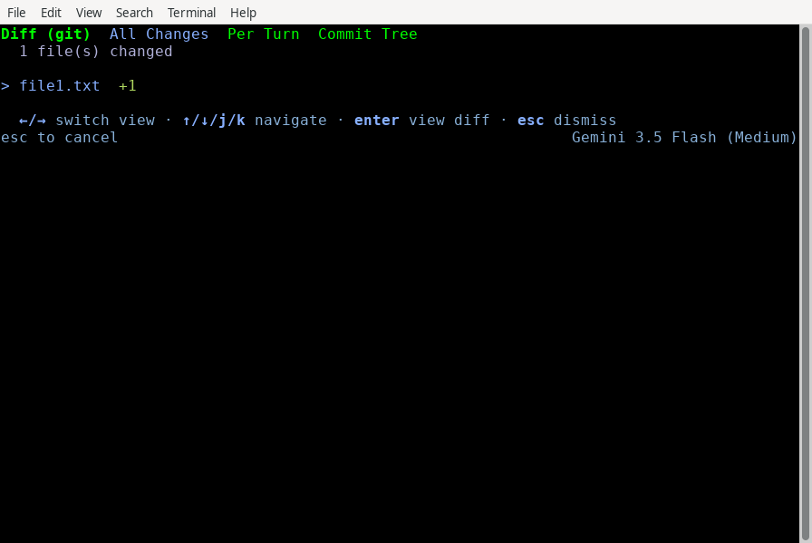
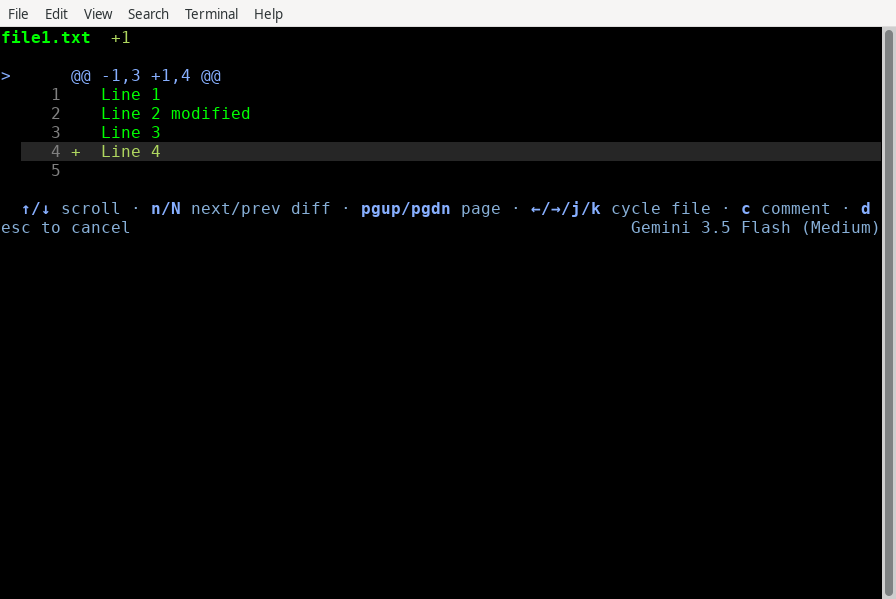
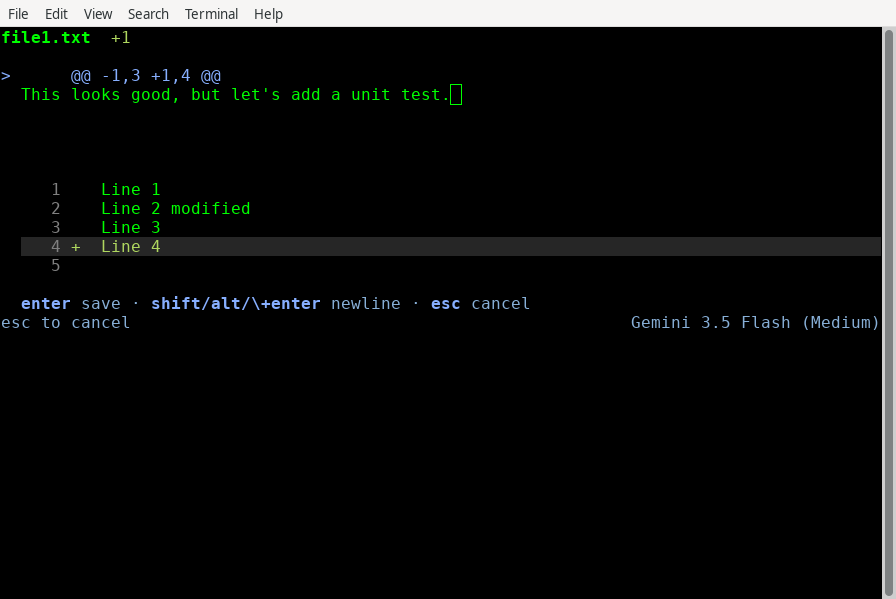
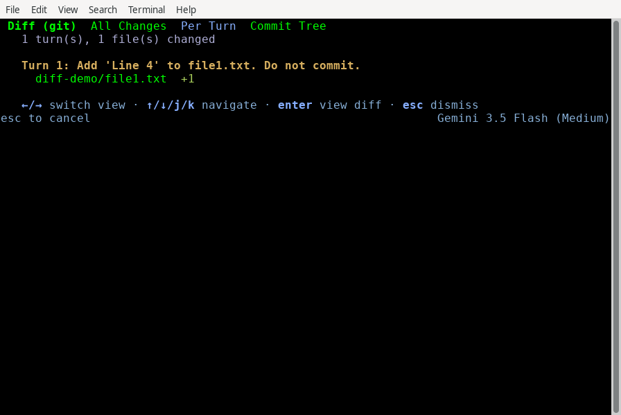
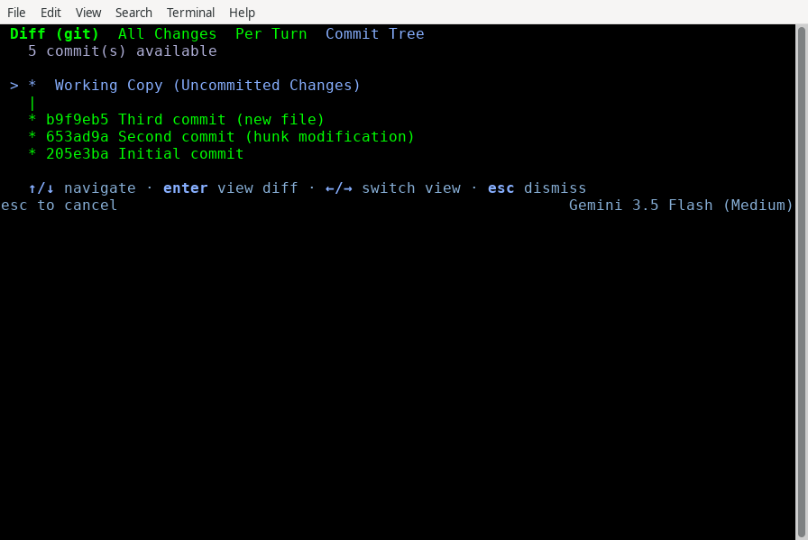
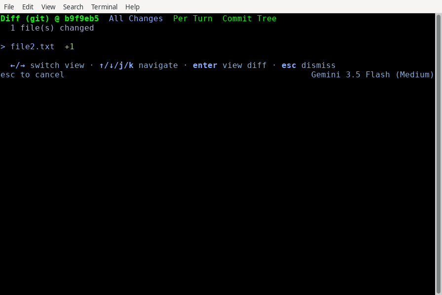

差異指令（/diff） - Antigravity CLI
cli
Antigravity CLI
功能
差異指令（/diff） - Antigravity CLI Antigravity CLI 功能
Antigravity CLI
適用於：
Antigravity CLI
# 差異指令（/diff）

[「差異指令（/diff）」章節](#diff-command-diff)

在 TUI 中以互動方式檢視及審查工作區變更、提交歷程記錄與代理回合差異。

## 總覽

[「總覽」章節](#overview)

The `/diff` 指令會開啟 **互動式 Diff 檢視器**，一個全螢幕面板，讓您檢視工作區中的變更與對話歷史。它有三個檢視（**所有變更**, **每輪**，與 **提交樹**），並提供互動式審查工作流程，您可以逐行加上註解來引導代理的後續步驟。

## 互動式 diff 檢視器面板

[「互動式差異檢視器面板」章節](#interactive-diff-viewer-panels)

若要開啟差異檢視器，請依照下列步驟操作：

1. 類型 `/diff` 於提示詞方塊。
2. 按下 Enter.

```
/diff
```

### 導覽與控制項

[「導覽與控制」章節](#navigation-and-controls)

差異檢視器有三種檢視，您可以使用下列按鍵切換： ← / → （或 Tab):

- **所有變更**：顯示作用中工作區中所有已修改與未追蹤檔案的清單：  自動支援 Git、Mercurial (Hg) 與 Jujutsu (JJ)。 使用 ↑/↓ 瀏覽檔案清單，且 Enter 開啟詳細資料檢視。
- **每輪**：顯示代理在目前對話每一輪中引入的變更：  適合逐步審查代理的工作。 使用 ↑/↓ 瀏覽，且 Enter 檢視詳細資料。
- **提交樹**：算繪儲存庫的互動式提交圖/樹：  使用 ↑/↓ 瀏覽提交鏈。 按下 Enter 列出所選提交在以下位置變更的檔案 **所有變更** 檢視。

---

## 逐步導覽

[「逐步導覽」章節](#step-by-step-walkthrough)

以下是如何使用 diff 檢視器審查變更、新增註解並引導代理。

### 檢視工作區變更（All Changes 檢視）

[標題為「Reviewing workspace changes (All Changes view)」的章節](#reviewing-workspace-changes-all-changes-view)

當您執行 `/diff`，它會在下列位置開啟： **所有變更** 檢視，會列出已修改與未追蹤的檔案（或顯示 **沒有未提交的變更** 若沒有任何項目）：



按下 Enter 於檔案以開啟其 **詳細資訊檢視**, 會顯示統一 diff。若要在 diff 中移動:

- 使用 ↑/↓ 逐行移動游標。
- 使用 ←/→ 快速在檔案之間切換，無需返回清單。
- 使用 N/Shift + N 跳至下一個/上一個變更。



### 新增留言與引導代理

[「新增留言並引導代理」章節](#adding-comments-and-steering-the-agent)

在下列項目中時 **詳細資訊檢視**，您可以審查程式碼並將意見回饋直接寫在特定行上：

1. **找到該行**: 將游標移到您想要評論的那一行。
2. **開啟註解輸入**：按下 C. 留言輸入框會在該行下方開啟:



1. **撰寫您的意見回饋**：輸入您的意見回饋並按下 Enter 儲存（或 Esc 取消）。
2. **管理您的註解**：已儲存的註解會在差異中標記。您可以突顯該行並按下以下按鍵來刪除註解 D.
3. **離開並送出**：按下 Esc 返回檔案清單。按 Esc 再次按下以退出 `/diff`. 如果您有未傳送的留言， **未傳送的留言** 畫面出現：  按下 Y 傳送留言並退出。您的留言會經過格式化，作為您的下一個提示詞傳送給代理，讓您引導它的下一個回合。 按下 N 退出而不傳送，並捨棄留言。

### 檢視回合記錄（Per Turn 檢視）

[標題為「Reviewing turn history (Per Turn view)」的章節](#reviewing-turn-history-per-turn-view)

按下 → （或 Tab）以切換至 **每輪** 檢視。這會依變更引入時所在的對話回合分組，讓您可以檢查代理在先前步驟中所做的事：



### 瀏覽提交樹（提交樹檢視）

[標題為「Navigating the commit tree (Commit Tree view)」的章節](#navigating-the-commit-tree-commit-tree-view)

按下 → （或 Tab）再次按下以切換至 **提交樹** 檢視。這會將存放庫的提交記錄算繪為互動式圖形。請使用 ↑/↓ 在鏈中上下導覽：



反白標示任何提交並按下 Enter 列出它在以下位置變更的檔案 **所有變更** 檢視，然後按 Enter 在檔案上，以檢視其 diff：



---

## 鍵盤快速鍵參考

[「鍵盤快速鍵參考」章節](#keyboard-shortcuts-reference)

### 檔案清單檢視（所有變更和每回合檢視）

[標題為「File list view (All Changes and Per Turn views)」的章節](#file-list-view-all-changes-and-per-turn-views)

| 金鑰 | 動作 |
| --- | --- |
| ← / → （或 Tab) | 切換檢視（All Changes > Per Turn > Commit Tree） |
| ↑ / ↓ （或 K / J) | 導覽檔案清單 |
| Enter | 開啟所選檔案的詳細檢視 |
| / | 搜尋所有列出檔案的差異，然後開啟第一個相符項目 |
| Esc | 清除搜尋，或離開差異檢視器 |

### 檔案詳細資訊檢視

[「檔案詳細檢視」章節](#file-detail-view)

| 金鑰 | 動作 |
| --- | --- |
| ↑ / ↓ （或 K / J) | 將游標上移或下移一行 |
| Shift + ↑ / ↓ （或 Ctrl + U / Ctrl + D) | 將差異捲動半頁 |
| PgUp / PgDn | 以頁面為單位捲動差異 |
| → / ← | 切換至下一個/上一個檔案 |
| N / Shift + N | 跳至下一個／上一個變更，或在搜尋進行時跳至下一個／上一個相符項目 |
| / | 搜尋差異 |
| F | 在僅顯示變更與完整檔案之間切換 |
| Ctrl + O | 顯示或隱藏最靠近游標的摺疊未變更行 |
| C | 在目前行新增／編輯留言 |
| D | 刪除目前行的註解 |
| Esc | 清除搜尋，或返回檔案清單檢視 |

### 提交樹檢視

[標題為「Commit Tree view」的章節](#commit-tree-view)

| 金鑰 | 動作 |
| --- | --- |
| ↑ / ↓ （或 K / J) | 導覽提交歷程 |
| ← / → （或 Tab) | 切換檢視 |
| Enter | 列出所選提交變更的檔案，位置在 **所有變更** 檢視 |
| Esc | 離開差異檢視器 |

### 未傳送留言畫面

[標題為「Unsent Comments screen」的章節](#unsent-comments-screen)

| 金鑰 | 動作 |
| --- | --- |
| Y | 將註解傳送給代理並退出 |
| N | 不傳送留言即退出 |
| Esc | 返回檔案清單檢視 |

## 另請參閱

[「另請參閱」章節](#see-also)

探索下列指南以進一步了解 CLI 自訂與對話管理：

- **[審查變更](/docs/review-changes?tab=cli)**: 比較 `/diff` 搭配 Antigravity App 中的檢視窗格。
- **[設定、算繪與按鍵繫結](/docs/cli/settings)**：自訂 TUI 主題、alt-screen 偏好設定與按鍵綁定。
- **[對話](/docs/cli/conversations)**：了解如何管理、分叉與倒帶對話執行緒。
- **[CLI 參考資料](/docs/cli/reference)**：所有斜線指令與預設快速鍵的快速參考。

[上一個
/credits](/docs/cli/commands/credits/)

[下一步
/effort](/docs/cli/commands/effort/)

您的下載已開始

## 您如何得知我們？

請選一個。這有助於我們接觸更多像您一樣的人。

感謝您讓我們知道！
