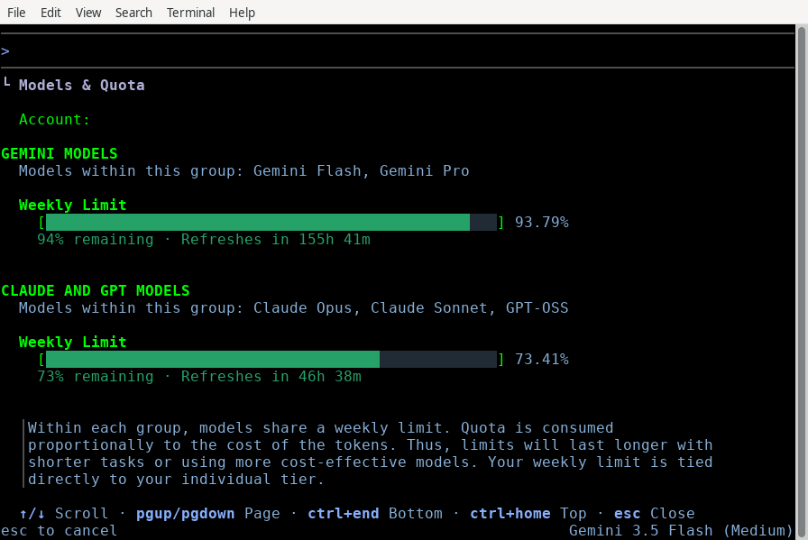

模型配額 (/usage) - Antigravity CLI
cli
Antigravity CLI
功能
模型配額 (/usage) - Antigravity CLI Antigravity CLI 功能
Antigravity CLI
適用於：
Antigravity CLI
# 模型配額 (/usage)

[「模型配額（/usage）」章節](#model-quotas-usage)

檢視使用中模型的配額用量並重新整理您的設定。

## 總覽

[「總覽」章節](#overview)

Antigravity CLI 提供 `/usage` 指令（別名 `/quota`）協助您監控資源消耗量。執行時，此指令會從後端重新整理您的模型設定與配額狀態，並開啟互動式 TUI 面板。

## 檢視您的用量

[「檢視您的用量」章節](#viewing-your-usage)

若要開啟 **模型 & Quota** 面板，請依下列步驟操作：

1. 類型 `/usage` （或 `/quota`）於提示方塊中。
2. 按下 Enter.

```
/usage
```



### 互動面板功能

[「互動面板功能」章節](#interactive-panel-features)

該面板會顯示下列詳細資訊：

- **模型配額**：每個模型群組的剩餘配額，例如 Gemini 模型（Gemini Flash 和 Gemini Pro）以及 Claude 和 GPT 模型。同一個群組中的模型共用每週上限和五小時上限。
- **主動刷新**：當您開啟此面板時，CLI 會自動觸發對磁碟上與後端服務配額的全新檢查。

### 導覽控制項

[「導覽控制」章節](#navigation-controls)

使用下列鍵盤快捷鍵導覽面板：

| 金鑰 | 動作 |
| --- | --- |
| ↑ / ↓ （或 J / K) | 以一行向上或向下捲動。 |
| PgUp / PgDn | 以一頁向上或向下捲動。 |
| G / Shift + G | 跳至清單的頂部或底部。 |
| Esc （或 Q) | 關閉面板並返回提示詞。 |

## 後續步驟

[「後續步驟」章節](#next-steps)

探索下列指南以進一步了解 CLI 指令與設定：

- **[CLI 參考資料](/docs/cli/reference)**：檢視所有可用的斜線指令與按鍵綁定。
- **[設定、算繪與按鍵繫結](/docs/cli/settings)**：設定預設模型與點數使用偏好。

[上一個
/title](/docs/cli/commands/title/)

[下一步
/voice](/docs/cli/commands/voice/)

您的下載已開始

## 您如何得知我們？

請選一個。這有助於我們接觸更多像您一樣的人。

感謝您讓我們知道！
