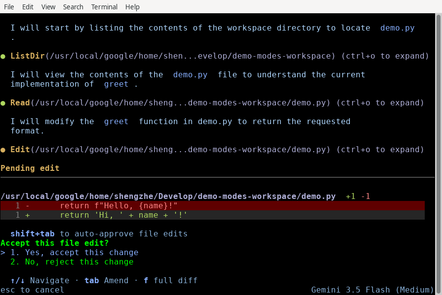
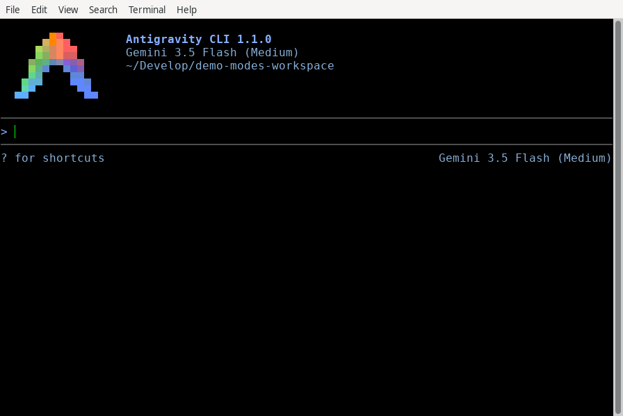
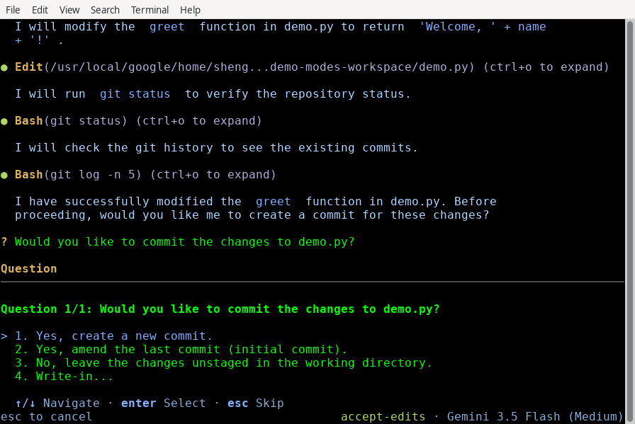
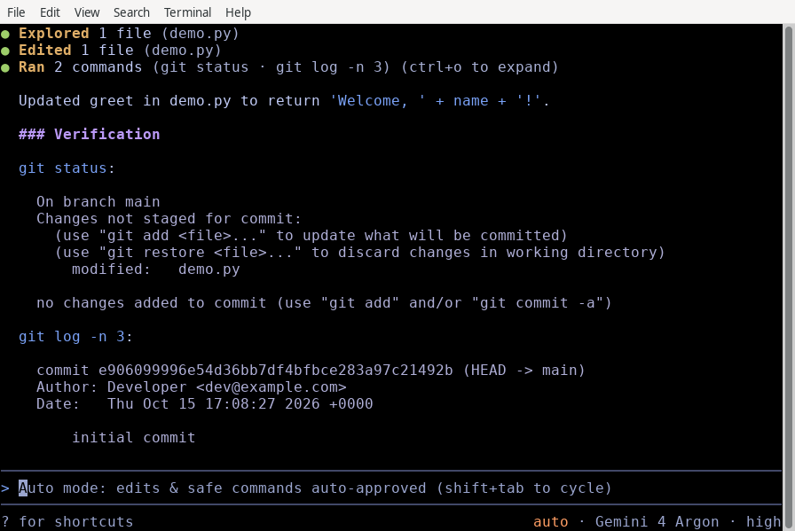
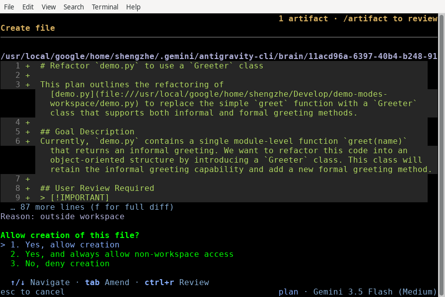
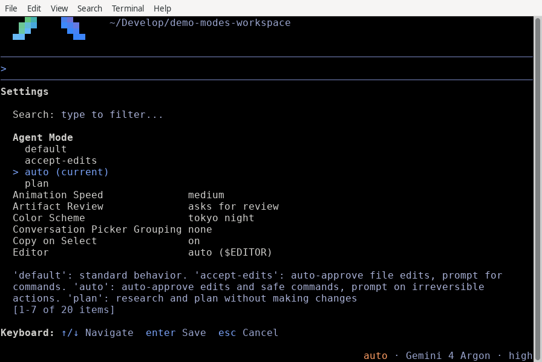

選擇執行模式 - Antigravity CLI
cli
Antigravity CLI
功能
選擇執行模式 - Antigravity CLI Antigravity CLI 功能
Antigravity CLI
適用於：
Antigravity CLI
# 選擇執行模式

[「選擇執行模式」章節](#choose-an-execution-mode)

控制 Antigravity CLI 在工作階段中修改檔案或執行指令前是否暫停詢問。

## 開始之前

[「開始之前」章節](#before-you-begin)

請確認您符合以下先決條件：

- [安裝 Antigravity CLI](/docs/cli/install).
- 擁有可編輯原始碼的作用中專案儲存庫。

## 可用模式

[「可用模式」章節](#available-modes)

每種執行模式在對話自主性和開發人員監督之間都有不同的取捨。下表顯示 Antigravity CLI 在每種模式下如何處理檔案操作、指令執行和規劃：

| 模式 | 行為 | 適用於 |
| --- | --- | --- |
| `default` *（預設）* | 在修改或建立檔案前暫停以進行互動式差異審查，並在執行終端機指令前先徵詢。 | 標準開發、審查敏感程式碼變更，以及謹慎的重構。 |
| `auto` | 自動核准工作區檔案編輯，預設在沙箱中執行終端機指令，並自動評估沙箱外的指令，讓安全、可還原的指令無需提示即可執行。適用於 `v1.3.5+` 在 macOS 與 Linux 上，且 `v1.4.4+` 在 Windows 上；需要終端機沙箱和個人帳戶。 | 自主工作流程，安全的編輯與指令不中斷地繼續進行，而不可逆的動作仍會提示確認。 |
| `accept-edits` | 自動核准工作區內的檔案建立與編輯，但在執行終端機指令前仍會詢問。 | 在您仍希望手動核准每個 Shell 指令時，針對受信任的程式碼進行反覆修改。 |
| `plan` | 在以下項目前方加上 `/plan` 指示前綴，用來在撰寫程式碼前分析並概述步驟。 | 探索不熟悉的架構或設計複雜的多步驟功能。 |

## 在工作階段中循環切換執行模式

[「在工作階段中循環切換執行模式」章節](#cycle-execution-modes-during-a-session)

您可以在工作階段中切換執行模式，無需中斷進行中的任務或重新啟動終端機：

1. 按下 Shift + Tab 於提示詞方塊內部循環瀏覽作用中的序列： `default` > `accept-edits` > `auto` > `plan` > `default`. 其中 `auto` 模式無法使用，切換時會直接從 `accept-edits` 至 `plan`.
2. 請觀察右下角狀態列中的模式指示器（`accept-edits`, `auto`，或 `plan`）與提示詞佔位符提示（例如 `Auto mode: edits & safe commands auto-approved (shift+tab to cycle)`）以確認您目前的模式。

## 在預設模式中審查修改

[「在預設模式中審查修改」章節](#review-modifications-in-default-mode)

於 `default` 模式 (`request-review`），Antigravity CLI 會在將任何檔案寫入套用至磁碟前暫停，並渲染行內、具語法醒目提示的差異預覽。 `agy` 開始於 `default` 模式，除非您使用以下方式設定其他模式 `agentMode` 或 `--mode`。若要在工作階段期間返回，請按下 Shift + Tab 直到狀態列中的模式指示標記清除為止，或設定 **代理模式** 至 `default` 於 `/config`.

下列範例顯示一個待處理的檔案編輯，包含差異以及接受或拒絕的提示：



當 Antigravity CLI 詢問時 **接受此檔案編輯嗎？**, 您可以採取下列任一動作:

- 按下 1, 或反白標示 **是，接受此變更** 並按下 Enter, 以將變更儲存到磁碟.
- 按下 2, 或反白標示 **否，拒絕此變更** 並按下 Enter, 以保持現有檔案不變.
- 若要拒絕編輯並告訴代理改用其他做法，請反白標示 **否，拒絕此變更**，按下 Tab, 輸入您的指示，然後按下 Enter.
- 按下 f 開啟全螢幕、可捲動的差異檢視，包含三行上下文與區塊分隔符號。

待處理的檔案編輯會保持開啟，直到您接受或拒絕它。按下 Esc 不會將其關閉。

### 新檔案建立預覽

[「新檔案建立預覽」章節](#new-file-creation-previews)

當 Antigravity CLI 建立新檔案時，確認面板會顯示一個 **建立檔案** 標頭、檔案路徑（例如， `src/utils/formatter.py`），以及僅新增的差異預覽，接著是此提示詞：

```
Allow creation of this file?
> 1. Yes, allow creation
  2. No, deny creation
```

若檔案位於工作區之外，面板也會顯示 `Reason: outside workspace` 並新增 **是，且一律允許工作區外部存取** 作為第二個選項。

下列範例顯示 **建立檔案** 面板（用於新檔案）， `src/utils/formatter.py`:



與檔案編輯一樣，按下 f 開啟完整的差異，或反白 **否，拒絕建立** 並按下 Tab 告訴代理要如何改變做法。按下 Esc 拒絕建立檔案。

## 使用 accept-edits 模式自動核准編輯

[「使用 accept-edits 模式自動核准編輯」章節](#auto-approve-edits-with-accept-edits-mode)

選取 `accept-edits` 當您希望 Antigravity CLI 在檔案系統中長時間不間斷工作、每個檔案修改不暫停時，使用 模式。

```
# Launch directly in accept-edits mode
agy --mode=accept-edits
```

在此模式中，工作區內所有標準的檔案建立、編輯與取代都會自動執行。在工作階段期間產生的子代理也會繼承 `accept-edits` 設定，防止背景檔案寫入排入佇列等待手動核准。

何時 `accept-edits` 模式啟用時，右下角狀態列會顯示 `accept-edits`:



## 以自動模式自動評估指令

[標題為「Automatically evaluate commands with auto mode」的章節](#automatically-evaluate-commands-with-auto-mode)

`auto` 模式延伸 `accept-edits` 套用到終端機指令執行，讓例行開發任務無需手動確認提示即可進行。

```
# Launch directly in auto mode
agy --mode=auto
```

何時 `auto` 模式啟用時：

- **工作區檔案編輯**: 您目前工作區內的檔案建立與修改會自動核准，包括來自背景子代理的待寫入內容.
- **預設沙箱化執行**: 終端機指令在原生作業系統終端機沙箱內執行（`sandbox-exec` 在 macOS 上、Linux 上的 kernel namespace、Windows 上的處理序安全環境）。
- **對沙箱外指令進行自動安全性評估**: 任何需要在終端機沙箱外執行的指令，都會在執行前自動評估。安全且可逆的指令（例如工作區的建置、測試、lint 與格式化指令）會自動執行，不需請求核准；而不可逆或高風險的動作仍會暫停並提示您確認.

右下角的狀態列會顯示 `auto`，且提示詞輸入框會顯示 `Auto mode: edits & safe commands auto-approved (shift+tab to cycle)`:



### 需求與限制

[標題為「Requirements and limitations」的章節](#requirements-and-limitations)

`auto` 模式需要 [終端機沙箱](/docs/sandbox):

- 在 Windows 上，沙箱需要 Windows 11 24H2 或更新版本，並安裝 2026 年 8 月更新或更新版本。
- 自以下時間起 `v1.4.4`，如果您的機器上無法使用沙箱—例如，在 Windows 10、較早的 Windows 11 版本，或封鎖非特權使用者命名空間的 Linux 主機與某些容器上—`auto` 模式未提供。

於 [無頭模式](/docs/cli/headless), if `auto` 模式無法使用， `--mode=auto` 顯示警告，並繼續在 `default` 模式。

## 使用規劃模式在編輯前分析任務

[「使用計畫模式在編輯前分析工作」章節](#analyze-tasks-before-editing-with-plan-mode)

使用 `plan` 在處理複雜重構、多檔案架構變更或不熟悉的程式碼庫調查時使用 模式。

```
# Launch directly in planning mode
agy --mode=plan
```

何時 `plan` 模式透過 啟用 Shift + Tab 循環或 `--mode` 旗標，CLI 會自動在前面加上 `/plan` 指令前綴加入您的提示詞。代理會使用唯讀搜尋與檔案檢視工具調查相關檔案，並在編寫程式碼前，提出結構化的執行大綱供您核准。

右下角的狀態列會顯示 `plan` 在該模式啟用期間：



## 保留或覆寫預設模式

[「保留或覆寫預設模式」章節](#persist-or-override-your-default-mode)

您可以跨工作階段永久設定偏好的啟動執行模式，或針對特定呼叫覆寫。

### 使用互動式設定面板

[「使用互動式設定面板」章節](#using-the-interactive-settings-panel)

若要在工作階段中途檢查或更新您的預設模式：

1. 開啟互動式設定面板： `/config`
2. 反白顯示 **代理模式** 與 ↑/↓.
3. 按下 ←/→ 變更它，或按 Enter 開啟模式清單，目前的模式會標示為 `(current)`:  反白某個模式並按下 Enter. 無論哪種方式，變更都會寫入 `settings.json` 並立即套用到您的工作階段。
4. 按下 Esc 關閉面板。

### 設定 `agentMode` 於 `settings.json`

[「在 settings.json 中設定 agentMode」章節](#setting-agentmode-in-settingsjson)

設定 `agentMode` 直接在您的使用者或專案設定檔內 (`"accept-edits"`, `"auto"`，或 `"plan"`, 或省略/`""` 供 `default`):

```
{
    "agentMode": "accept-edits"
}
```

CLI 會從…載入此檔案 `~/.gemini/antigravity-cli/settings.json` 在啟動時套用您選擇的基準執行模式。

### 命令列旗標覆寫

[「命令列旗標覆寫」章節](#command-line-flag-overrides)

傳遞 `--mode` 旗標 (`accept-edits`, `auto`，或 `plan`）以在單次終端機執行中暫時覆寫您的持久預設模式：

```
# Override settings.json to run in auto mode or planning mode
agy --mode=auto
agy --mode=plan
```

## 常見錯誤

[「常見錯誤」章節](#common-mistakes)

| 錯誤 | 失敗的原因 | 修正 |
| --- | --- | --- |
| 預期 `sandbox` 於 Shift + Tab 循環 | `sandbox` 是作業系統層級的隔離權限設定，而非執行模式（`auto` 模式會自動啟用終端機沙箱） | 使用 `--mode=auto`, 傳遞 `--sandbox`, 或啟用 **沙箱模式** 於 `/config` |
| 使用舊版 `/planning` 或 `/fast` 指令 | 這些殘留指令已在…中移除 `1.1.0` | 按下 Shift + Tab 循環切換模式或輸入 `/plan` 您的提示詞之前 |
| 通過中 `--permission-mode` | `agy` 使用 `--mode` (`--mode=accept-edits`, `--mode=auto`，或 `--mode=plan`）用於執行覆寫 | 執行 `agy --mode=accept-edits`, `agy --mode=auto`, 或檢查 `agy --help` |

## 後續步驟

[「後續步驟」章節](#next-steps)

探索下列指南以進一步自訂您的 CLI 工作流程：

- **[權限](/docs/cli/permissions)**：設定精細的工具核准規則與萬用字元比對。
- **[設定、算繪與按鍵繫結](/docs/cli/settings)**：自訂組態覆寫與互動式偏好設定。
- **[背景工作與子代理](/docs/cli/subagents)**：管理平行子代理執行與非同步任務佇列。

[上一個
Jupyter 筆記本](/docs/jupyter-notebooks/)

[下一步
無頭模式](/docs/cli/headless/)

您的下載已開始

## 您如何得知我們？

請選一個。這有助於我們接觸更多像您一樣的人。

感謝您讓我們知道！
