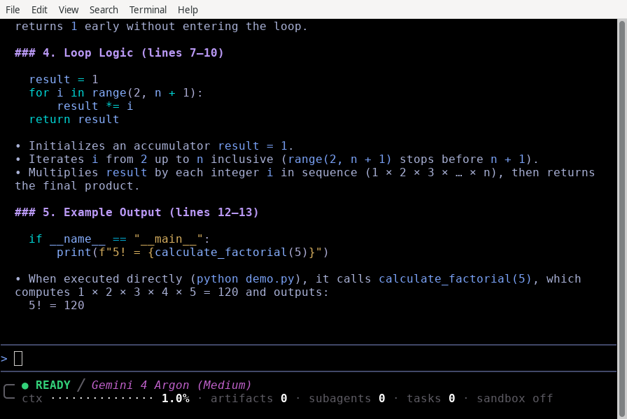

狀態列自訂 - Antigravity CLI
cli
Antigravity CLI
功能
狀態列自訂 - Antigravity CLI Antigravity CLI 功能
Antigravity CLI
適用於：
Antigravity CLI
# 狀態列自訂

[「狀態列自訂」章節](#status-line-customization)

定義自訂指令碼組態，並格式化動態 JSON 狀態負載以自訂您的 TUI 狀態列。

## 總覽

[「總覽」章節](#overview)

狀態列位於 TUI 提示詞面板底部，可一目了然地提供有關使用中代理週期、工作區環境、上下文權杖視窗用量，以及背景執行工作的上下文。

## 自訂狀態列指令碼

[「自訂狀態列指令碼」章節](#custom-status-line-scripting)

對於進階終端機版面或自訂狀態列顯示，你可以將使用中的代理中繼資料路由到自訂指令碼。

### 設定

[「設定」章節](#configuration)

新增 `statusLine` 設定區塊至您的 `~/.gemini/antigravity-cli/settings.json` 檔案：

```
{
    "statusLine": {
        "type": "command",
        "command": "~/.gemini/antigravity-cli/statusline.sh"
    }
}
```

每當代理狀態變更時，CLI 都會以下列方式執行您的指令： `sh -c` (`cmd /c` 在 Windows 上），會將工作階段狀態以 JSON 管道傳送至其 `stdin`，並顯示指令列印至下列位置的內容： `stdout` 在狀態列中。支援多行輸出與 ANSI 色彩碼，且開頭的 `~` 於 `command` 會展開為您的主目錄。

The `statusLine` 區塊接受以下屬性：

- **`command`** （string）：列印狀態列的 Shell 指令。
- **`type`** （string，預設 `"command"`）：選用。 `"command"` 是唯一支援的類型。
- **`padding`** （integer，預設 `0`）：狀態列上方的空白行數。
- **`enabled`** （boolean，預設 `true`）：設定為 `false` 停止執行 `command` 並改為顯示內建狀態列。該指令仍保留在 `settings.json`.
- **`stack_with_default`** （boolean，預設 `false`）：當 `true`, 會將您的狀態列顯示在內建狀態列下方，而不是取代它.

設定 `statusLine` 至物件，而非至 `true` 或 `false`. CLI 會將布林值讀取為不含以下內容的物件 `command`, 因此不會執行任何指令碼.

### 可用的 JSON 欄位

[「可用的 JSON 欄位」章節](#available-json-fields)

傳送至您指令碼的 JSON 承載包含下列頂層欄位：

| 欄位 | 類型 | 描述 |
| --- | --- | --- |
| `cwd` | 字串 | CLI 啟動時所在的目錄。 |
| `session_id` | 字串 | 與以下相同的值 `conversation_id`，為相容性而保留。 |
| `conversation_id` | 字串 | 使用中對話的 ID（第一個對話開始前為空）。 |
| `conversation_title` | 字串 | 進行中對話的標題（在有標題之前會省略）。 |
| `transcript_path` | 字串 | 對話記錄寫入的路徑（該檔案可能尚不存在）。 |
| `model` | 物件 | 包含 `id`, `display_name`，與 `effort` (`low` 透過 `max`, 僅適用於具有多個投入等級的模型). `null` 直到選取模型為止。 |
| `workspace` | 物件 | 包含 `current_dir` 和 `project_dir` 路徑。 |
| `version` | 字串 | CLI 版本字串。 |
| `context_window` | 物件 | 包含權杖使用量詳細資訊： `total_input_tokens`, `total_output_tokens`, `context_window_size` (`0` 若未知）， `used_percentage`, `remaining_percentage`，與 `current_usage` (`null` （在第一個模型回應之前）。 |
| `exceeds_200k_tokens` | bool | 若對話脈絡已超過 200,000 個權杖，則為 True (`null` （在第一個模型回應之前）。 |
| `agent` | 物件 | 包含下列 `name` 使用中代理的項目（預設代理則省略）。 |
| `product` | 字串 | 應用程式名稱（`antigravity`). |
| `quota` | 物件 | 將配額 bucket ID 對應至其狀態： `remaining_fraction` 或 `remaining_amount`, `reset_time`, `reset_in_seconds`，與 `disabled` （選用）。 |
| `agent_state` | 字串 | 目前狀態： `idle`, `working`, `tool_use`, `reviewing`, `authenticating`, `initializing`，或 `error`. |
| `vcs` | 物件 | 版本控制 `type`: `git`, `jj`，或 `hg` （在儲存庫外省略）。 |
| `cycle_mode` | 字串 | 以以下方式選取的模式 Shift + Tab: `accept-edits`, `auto`，或 `plan` （在預設模式中省略）。 |
| `sandbox` | 物件 | 包含 `enabled`, 也就是 `true` 在終端機沙箱開啟時。 |
| `subagents` | 陣列 | 執行中與已完成的子代理，每個都具有 `name`, `role`，與 `status` (`running` 或 `completed`). |
| `artifact_count` | int | 對話中產生的產出物數量（為 0 時省略）。 |
| `plan_tier` | 字串 | 已驗證使用者的訂閱層級（選填）。 |
| `email` | 字串 | 已登入帳戶的電子郵件地址。 |
| `pending_input_count` | int | 佇列中的使用者訊息數量（為 0 時省略）。 |
| `tool_confirmation_pending` | bool | 當工具確認對話框顯示時為 True（否則省略）。 |
| `task_count` | int | 執行中的背景工作數量（為 0 時省略）。 |
| `terminal_width` | int | 互動式終端機的即時寬度。 |
| `vim` | 物件 | Vim 編輯狀態： `mode` 是 `NORMAL`, `INSERT`, `VISUAL`，或 `VISUAL LINE`。僅在…時顯示 [Vim 編輯器模式](/docs/cli/vim-editor-mode) 已啟用。 |
| `cost` | 物件 | 以美元計算的預估支出： `total_usd` （包括子代理）， `subagent_usd`，與 `estimated`. 這些是依定價估算的金額，並非帳單金額（在回報費用之前會省略）. |

### JSON 承載範例

[「JSON 承載範例」章節](#json-payload-example)

以下是傳送至狀態列指令碼的清理後典型 JSON 承載：

```
{
    "cwd": "/home/user/my-project",
    "session_id": "12345678-abcd-ef01-2345-6789abcdef01",
    "conversation_id": "12345678-abcd-ef01-2345-6789abcdef01",
    "transcript_path": "/home/user/.gemini/antigravity/brain/12345678-abcd-ef01-2345-6789abcdef01/.system_generated/logs/transcript.jsonl",
    "conversation_title": "Explain the factorial function",
    "model": {
        "id": "Gemini 4 Argon (Medium)",
        "display_name": "Gemini 4 Argon (Medium)",
        "effort": "medium"
    },
    "workspace": {
        "current_dir": "/home/user/my-project",
        "project_dir": "/home/user/my-project"
    },
    "version": "1.4.5",
    "context_window": {
        "total_input_tokens": 88244,
        "total_output_tokens": 61074,
        "context_window_size": 1048576,
        "used_percentage": 14.24,
        "remaining_percentage": 85.76,
        "current_usage": {
            "input_tokens": 63382,
            "output_tokens": 346,
            "cache_creation_input_tokens": 0,
            "cache_read_input_tokens": 20857
        }
    },
    "exceeds_200k_tokens": false,
    "product": "antigravity",
    "quota": {
        "gemini-weekly": {
            "remaining_fraction": 0.9378,
            "reset_time": "2026-07-06T07:50:32Z",
            "reset_in_seconds": 560580
        }
    },
    "agent_state": "idle",
    "vcs": {
        "type": "git"
    },
    "cycle_mode": "plan",
    "sandbox": {
        "enabled": false
    },
    "artifact_count": 2,
    "plan_tier": "Pro",
    "email": "developer@example.com",
    "task_count": 1,
    "terminal_width": 111,
    "cost": {
        "total_usd": 0.4213,
        "subagent_usd": 0,
        "estimated": false
    }
}
```

### 範例指令碼

[「指令碼範例」章節](#example-script)

您可以從官方網站下載完整且可適應版面的指令碼 [GitHub 上的 statusline.sh 範例](https://github.com/google-antigravity/antigravity-cli/blob/main/examples/statusline/statusline.sh). 此指令碼會顯示代理狀態、模型、上下文視窗使用量長條，以及產出物、子代理與背景工作的數量.

將指令碼儲存至 `~/.gemini/antigravity-cli/statusline.sh` 並使其可執行：

```
chmod +x ~/.gemini/antigravity-cli/statusline.sh
```

設定好指令碼後，您的狀態列會取代提示詞輸入框下方的內建狀態列：



## 另請參閱

[「另請參閱」章節](#see-also)

探索下列指南以自訂其他 CLI 元素：

- **[狀態列指令](/docs/cli/commands/statusline)**：互動式切換狀態列元素。
- **[終端機標題自訂](/docs/cli/title)**：設定動態視窗標題。
- **[設定、算繪與按鍵繫結](/docs/settings?tab=cli)**: 自訂鍵盤快速鍵與緩衝區，並查看每個 `statusLine` 屬性。
- **[CLI 參考資料](/docs/cli/reference)**: 斜線指令、按鍵綁定與設定鍵的快速參考。
- **[權限與沙箱](/docs/sandbox?tab=cli)**：管理安全的目錄權限。

[上一個
代理用戶端通訊協定 (ACP)](/docs/cli/acp/)

[下一步
終端機標題自訂](/docs/cli/title/)

您的下載已開始

## 您如何得知我們？

請選一個。這有助於我們接觸更多像您一樣的人。

感謝您讓我們知道！
