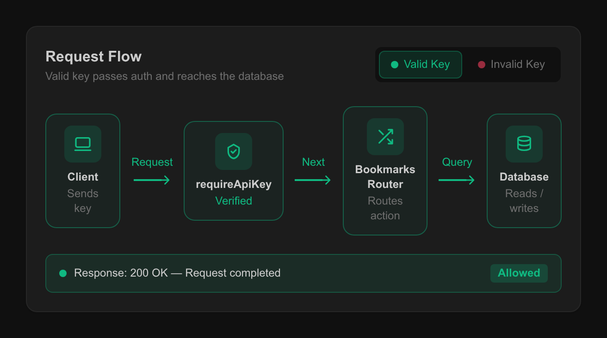
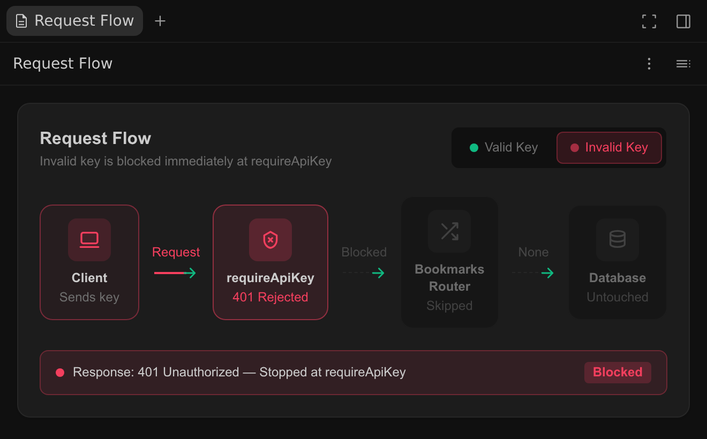

Generative UI 指令 (/generative_ui)
2-0
Antigravity 應用程式
功能
Generative UI 指令 (/generative_ui) Antigravity 應用程式功能
Antigravity 應用程式
適用於：
Antigravity 應用程式
# Generative UI 指令 (/generative_ui)

[標題為「Generative UI command (/generative_ui)」的章節](#generative-ui-command-generative_ui)

讓代理向您展示答案，而不只是描述。透過
`/generative_ui`, 代理會建立互動式小工具，例如圖表、
圖形或逐步說明，並以 HTML 產出物的形式讓您在側邊
面板開啟。精簡的小工具也能以行內方式出現在對話中.

## 總覽

[「總覽」章節](#overview)

有些答案以視覺方式呈現更容易理解：請求如何流經中介軟體、兩個資料庫表格如何關聯，或變更某個值如何影響結果。透過生成式 UI，代理會以可點選操作的小工具連同說明一起回答。

當您使用 `/generative_ui`, 代理會:

- **建置網頁**: 每個小工具都是一個 HTML 檔案，擁有自己的樣式 與 JavaScript，並儲存為一個 [產出物](/docs/artifacts) 對話的內容。
- **選擇它的顯示位置**: 預設情況下，小工具是獨立的產出物 ，您在側邊面板中開啟它。精簡的小工具，例如小型圖表或 繪圖，也可以行內出現在代理的回應中。
- **符合您的主題**: 小工具使用 Antigravity App 的主題色彩，因此 能配合您的淺色或深色主題。

`/generative_ui` 執行內建的 [技能](/docs/skills), 因此代理也能
在不使用該指令的情況下使用生成式 UI，只要視覺呈現有幫助即可，例如
當您要求「我可以點選瀏覽的互動式圖表」時.

## 建立小工具

[標題為「Create a widget」的章節](#create-a-widget)

類型 `/generative_ui` 在訊息框中，再接著輸入您想查看的內容。您
也可以輸入 `/` 並選取 **generative_ui** 從選單中。

```
/generative_ui Show a simple left-to-right diagram of a request going from the client through requireApiKey and the bookmarks router to the database, with a toggle for a valid or invalid API key. Use icons, short labels, and no code.
```

在此範例中，代理讀取相關程式碼，建立一個精簡的小工具，
並將其嵌入回覆中。圖表顯示了請求的每個階段，
從用戶端到 `requireApiKey` 並將書籤路由器連接到
資料庫。有一個切換開關可在有效和無效的 API 金鑰之間切換。使用
有效的金鑰時，要求會抵達資料庫並獲得 `200 OK` 回應：



回覆的結尾會附上一張小工具產出物的卡片，顯示其標題
與簡短摘要。

## 選擇內嵌或獨立

[標題為「Choose inline or standalone」的章節](#choose-inline-or-standalone)

依預設，代理會將小工具以獨立產出物的形式分享。只有在小工具精簡且能闡明周圍的
說明時，才會將小工具內嵌。下表比較這兩種呈現方式：

| 放置位置 | 出現位置 | 適用於 |
| --- | --- | --- |
| 獨立產出物（預設） | 在側邊面板中，高度可達面板的完整高度 | 儀表板、模擬和應用程式原型 |
| 行內小工具 | 在代理的回覆中，高度上限為 500 像素 | 小型圖表、圖形與說明 |

若要自行選擇放置位置，請在您的請求中說明。例如，若要取得
行內小工具：

```
/generative_ui Show which status code each bookmarks route returns as an inline widget
```

若要取得獨立的產出物：

```
/generative_ui Build a multi-tab dashboard of bookmark activity with sample data as a standalone artifact
```

## 在側邊面板開啟小工具

[標題為「Open a widget in the side panel」的章節](#open-a-widget-in-the-side-panel)

每個小工具都會以 HTML 產出物形式儲存，包括內嵌小工具。若要開啟
其中一個，請在對話中點選其產出物卡片。小工具會在側邊開啟
面板中開啟，你可以在其中以完整大小使用它。在此範例中，切換開關已設為
無效的金鑰，因此請求會停在 `requireApiKey` 使用
`401 Unauthorized` 回應，且永遠不會送達路由器或資料庫：



該對話的產出物也會列在 **產出物** 於
**總覽** 面板，位於對話的右上方。若要儲存
HTML 檔案的副本，請點選 **更多動作** （三點選單），位於產出物頂部
，然後點選 **匯出產出物**. 匯出的檔案不包含
Antigravity App 的主題顏色，因此在
瀏覽器中開啟時，外觀可能不同.

## 您可以請求的內容

[標題為「What you can ask for」的章節](#what-you-can-ask-for)

Generative UI 非常適合任何能透過觀看與
互動而更清楚呈現的內容：

- **程式碼與架構圖**: 您可以點擊瀏覽的要求流程、呼叫路徑、狀態 機器與資料模型。
- **資料視覺化**: 您提供的資料，或代理 計算出的資料，所繪製的圖表。
- **互動式說明**: 逐步導覽與控制項，展示 變更值如何影響結果。
- **UI 模型圖與原型**: 可點擊的版面配置，在您建置之前 先試用一個想法。

例如，若要將資料模型視覺化：

```
/generative_ui Visualize the users and bookmarks tables and how they relate
```

若要在代理的回覆中將範例資料繪製成圖表：

```
/generative_ui Chart how many bookmarks each user has saved, using sample data, as an inline widget
```

若要在建置畫面之前先製作原型：

```
/generative_ui Build a clickable prototype of a bookmark manager screen as a standalone artifact
```

## 小工具的運作方式

[標題為「How widgets work」的章節](#how-widgets-work)

小工具具有下列行為與限制：

- **互動式**: 按鈕、頁籤、滑桿與其他控制項都在小工具內 執行。使用它們不會傳送訊息給代理。
- **依內容調整大小**: 行內小工具會依內容擴展，最高可達 500 像素 高。較高的內容會在小工具內捲動。若需要更多空間，請點擊該小工具的 產出物卡片，在側邊面板中開啟它，即可使用面板 的完整高度，或要求獨立的產出物。
- **沙箱化**: 每個小工具都在隔離的框架中執行。它無法存取您的 檔案或 Antigravity App 的其他部分，也無法嵌入其他網頁。
- **無外部指令碼**: 小工具無法從其他網站載入指令碼，除了 用於樣式的 Tailwind CSS 指令碼。代理使用 HTML、SVG 或 canvas 繪製圖表 與圖形，而非外部的圖表 函式庫。
- **時間點**: 小工具從您的程式碼或資料顯示的任何內容，都會在代理建置時寫入 HTML 中。您的程式碼或資料變更後，請要求 代理更新該小工具。

## 後續步驟

[「後續步驟」章節](#next-steps)

探索相關文件：

- [產出物](/docs/artifacts): 了解代理如何分享計畫、差異與 其他交付成果供您檢閱。
- [代理技能](/docs/skills): 了解技能如何擴充代理，以及如何 叫用它們。
- [斜線指令總覽](/docs/slash-commands): 瀏覽每個可用的斜線 指令.

[上一個
/effort](/docs/cli/commands/effort/)

[下一步
/goal](/docs/commands/goal/)

您的下載已開始

## 您如何得知我們？

請選一個。這有助於我們接觸更多像您一樣的人。

感謝您讓我們知道！
