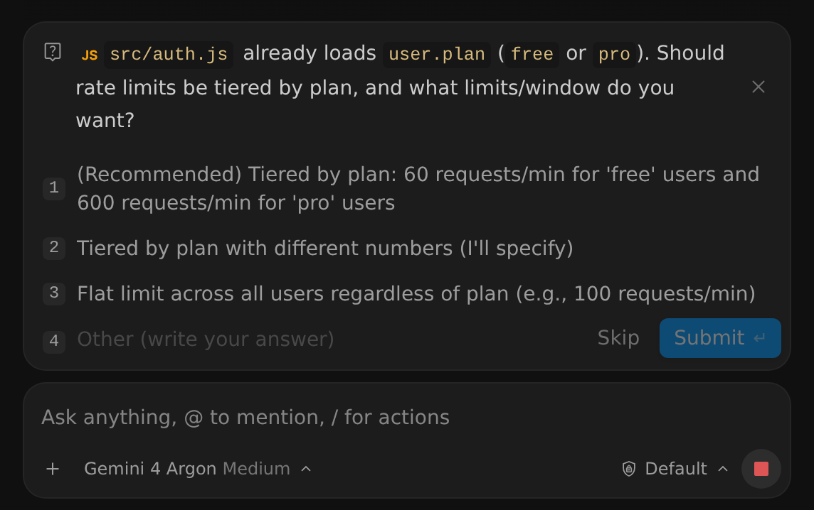
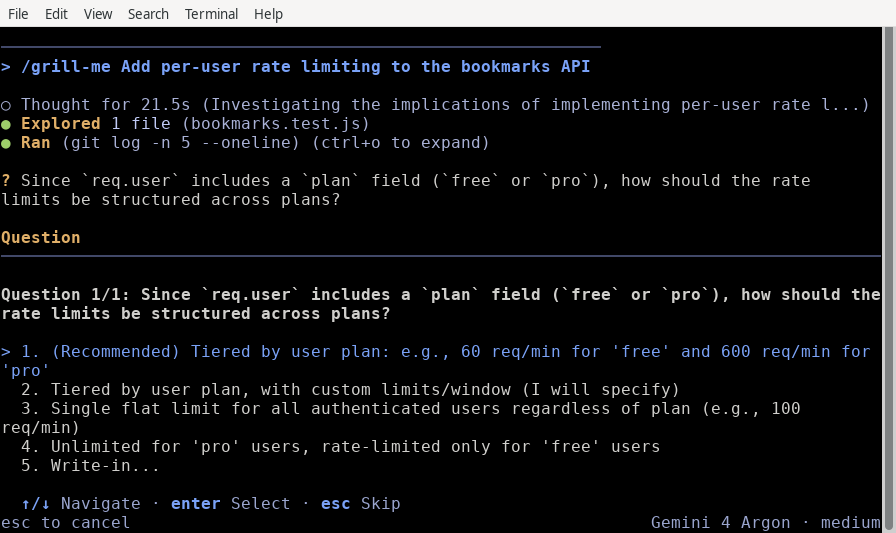

Grill me 指令 (/grill-me)
2-0
Antigravity 應用程式
功能
Grill me 指令 (/grill-me) Antigravity 應用程式功能
Antigravity 應用程式
Antigravity CLI
適用於：
Antigravity 應用程式
Antigravity CLI
# Grill me 指令 (/grill-me)

[標題為「Grill me command (/grill-me)」的章節](#grill-me-command-grill-me)

在開始工作前，先讓代理就任務向您進行訪談。透過
`/grill-me`, 代理會一次提出一個問題，並為每個問題
推薦答案。它會探索您的程式碼庫，而不是詢問程式碼能
回答的問題，並持續進行，直到雙方對任務達成
相同的理解.

## 總覽

[「總覽」章節](#overview)

像「add rate limiting」這樣的簡短要求會留下許多未定的決策：哪些
限制適用於哪些使用者、要求計數儲存在何處，以及用戶端被節流時 API
會傳回什麼。若沒有更多細節，代理會以自己的假設填補這些
缺口，而這些假設可能與您的想法不符。

The `/grill-me` 指令會要求代理在開始工作之前，先與您敲定這些決策。
訪談只會改變代理收集
需求的方式。您的 [工具權限](/docs/permissions) 仍然適用，因此您
可能會被要求核准代理在探索時執行的指令。

## 開始訪談

[標題為「Start an interview」的章節](#start-an-interview)

類型 `/grill-me` 後面接著您想討論的工作。描述您想要
的成果；訪談會補齊細節。

- [Antigravity 應用程式](#tab-panel-146)
- [Antigravity CLI](#tab-panel-147)

### Antigravity 應用程式

[「Antigravity App」章節](#sr-tab-1)

在訊息框中輸入指令：

```
/grill-me Add per-user rate limiting to the bookmarks API
```

每個問題都會出現在訊息框上方的卡片中，並將代理的
建議答案列在第一位：



選取一個答案，或在以下位置輸入您自己的答案 **其他（請寫下您的答案）**，然後
點選 **提交**. 按一下 **Skip** 跳過問題，或按一下關閉按鈕
（**X**）位於卡片右上方，用以取消問卷並停止
代理。

訊息框在問題開啟期間仍可使用，因此您可以輸入
後續訊息並按下 Enter 將它排入佇列。

### Antigravity CLI

[「Antigravity CLI」章節](#sr-tab-2)

在互動式提示中輸入指令：

```
/grill-me Add per-user rate limiting to the bookmarks API
```

每個問題都會在終端機中開啟一個編號的答案清單，並將
代理的建議答案列在第一位：



若要回答問題：

- 按下 ↑/↓ 反白一個答案，並 Enter 選取它，或按下答案的編號。
- 選取 **填寫…** 輸入您自己的答案，然後按 Enter 提交它。
- 按下 Esc 跳過問題。

若您執行 `/grill-me` 在沒有任務的情況下，代理通常會先探索
工作區，並從詢問您想處理什麼開始。

## 訪談的運作方式

[標題為「How an interview works」的章節](#how-an-interview-works)

1. **代理會探索程式碼庫。** 當程式碼能回答問題時， 代理會讀取程式碼而不是詢問您，因此它的問題會建立在 既有的內容之上。
2. **它一次只問一個問題。** 每個問題都提供幾個答案，其中 代理的建議列在第一位並已標記 **（建議）**, 外加一個 供您填寫自訂答案的欄位.
3. **每個答案都會塑造下一個問題。** 代理會沿著設計的每個分支 逐步走訪，逐一解決決策之間的相依性。
4. **當你們達成共識時，訪談即結束。** 當沒有未解決的問題時， 代理會使用您的回答繼續執行任務。若要在任何程式碼變更之前審查書面 計畫， [將其與以下項目結合： `/plan`](#combine-with-plan).

## 與下列項目結合 `/plan`

[標題為「Combine with /plan」的章節](#combine-with-plan)

若要將您的回答轉換為可供審查的計畫，請堆疊使用 [`/plan`](/docs/plan)
和 `/grill-me` 在同一個提示詞中：

```
/plan /grill-me Add per-user rate limiting to the bookmarks API
```

代理會一次問您一個問題進行訪談，然後撰寫一份
[實作計畫](/docs/implementation-plan) 根據您的回答而定。接著，代理
會等待您審查並核准計畫，才會變更任何
程式碼，無論您的 [產出物審查政策](/docs/artifact-review) 。在
Antigravity 應用程式中，按一下 **繼續** 核准它。

## 何時使用 `/grill-me`

[標題為「When to use /grill-me」的章節](#when-to-use-grill-me)

`/grill-me` 在任務有程式碼無法
自行決定的未定決策時最有用：

- **規格未明確定義的功能**: 將簡短的要求轉化為具體的端點、 資料模型與驗證規則。
- **設計取捨**: 在快取策略、儲存後端、 並行模型或驗證流程之間做選擇。
- **高風險重構**: 在變更共用程式碼前，先就相容性、遷移與測試 期望達成共識。
- **測試您自己的設計**: 在您確定方法之前，讓代理針對您的假設探查 其中的缺口與邊界情況。

若您想在任何程式碼變更前先檢閱並核准一份書面計畫，請使用
[`/plan`](/docs/plan) 改用此方式，或將兩者結合。

## 後續步驟

[「後續步驟」章節](#next-steps)

探索相關的規劃與工作流程文件：

- [計畫指令（`/plan`)](/docs/plan): 在代理修改程式碼之前，先取得可檢閱的實作計畫 .
- [實作計畫產出物](/docs/implementation-plan): 了解如何 檢閱、評論與核准計畫產出物。
- [目標指令（`/goal`)](/docs/commands/goal): 一旦您同意設計，便可自主 執行長時間任務。
- [斜線指令總覽](/docs/slash-commands)：瀏覽所有可用的 斜線指令。

[上一個
/goal](/docs/commands/goal/)

[下一步
/learn](/docs/commands/learn/)

您的下載已開始

## 您如何得知我們？

請選一個。這有助於我們接觸更多像您一樣的人。

感謝您讓我們知道！
