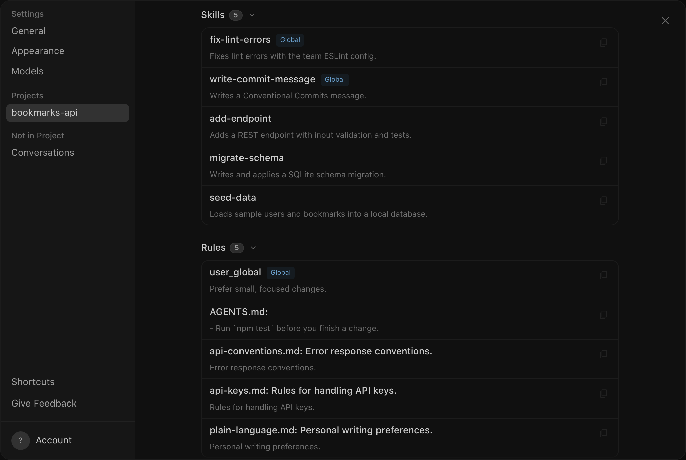
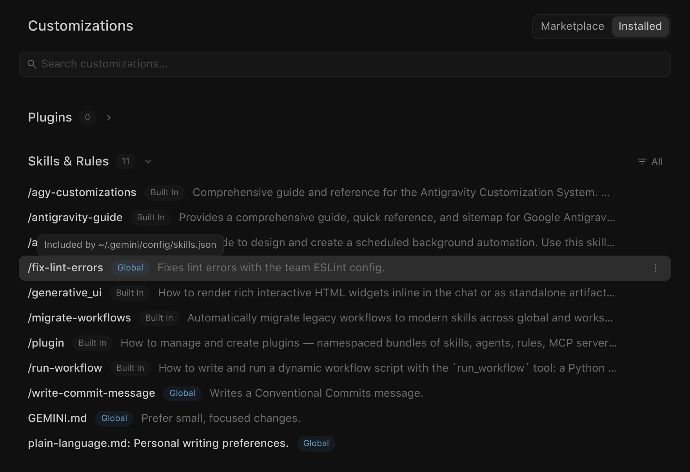
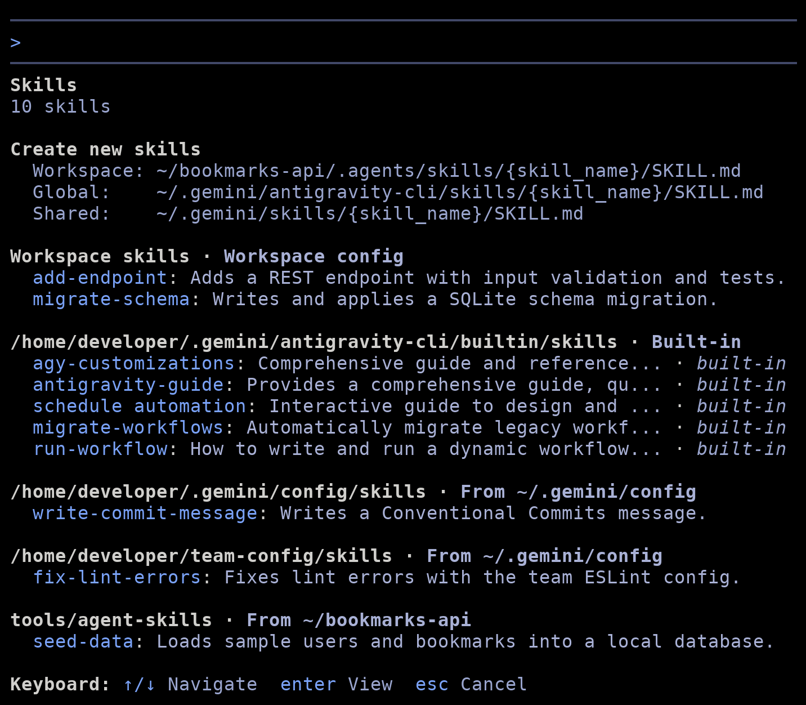

自訂項目探索
2-0
Antigravity 應用程式
功能
自訂項目探索 Antigravity 應用程式功能
Antigravity 應用程式
Antigravity CLI
適用於：
Antigravity 應用程式
Antigravity CLI
# 自訂項目探索

[標題為「Customization discovery」的章節](#customization-discovery)

Antigravity 從您專案與主目錄中的標準資料夾載入您的規則、技能、自訂代理、外掛程式、掛鉤與 MCP
伺服器。使用此
頁面來決定自訂項目應放在何處、載入位於
其他資料夾的自訂項目，並查看 Antigravity 找到了什麼。

## Antigravity 的搜尋位置

[標題為「Where Antigravity looks」的章節](#where-antigravity-looks)

Antigravity 從兩個範圍讀取自訂項目：

- **工作區**：the `.agents/` 您專案中的資料夾，再加上 `AGENTS.md` 和 `GEMINI.md` 檔案。提交這些檔案即可與您的團隊分享。
- **個人**：the `~/.gemini/config/` 您主目錄中的資料夾，再加上 `~/.gemini/AGENTS.md` 和 `~/.gemini/GEMINI.md`. 這些自訂設定適用於 每個專案，在 Antigravity App 與 Antigravity CLI 中皆然.

兩個範圍使用相同的版面配置。下表列出每種類型
自訂項目所在的位置 `.agents/` 或 `~/.gemini/config/`:

| 自訂 | 內部的路徑 `.agents/` 或 `~/.gemini/config/` |
| --- | --- |
| [規則](/docs/rules) | `rules/*.md`, `AGENTS.md`, `GEMINI.md` |
| [技能](/docs/skills) | `skills/<name>/SKILL.md` |
| [自訂代理](/docs/subagents) | `agents/<name>.md` 或 `agents/<name>/agent.md` |
| [外掛程式](/docs/plugins) | `plugins/<plugin-folder>/` |
| [掛鉤](/docs/hooks) | `hooks.json` |
| [MCP 伺服器](/docs/mcp) | `mcp_config.json` |

外掛程式也可以封裝自己的技能、規則、自訂代理、掛鉤與 MCP
伺服器，這些會在外掛程式啟用時載入。Antigravity CLI 也會從
下列位置載入技能 `~/.gemini/antigravity-cli/skills/` 和 `~/.gemini/skills/`, 而
Antigravity App 不會讀取它.

## 工作區資料夾與上層目錄

[標題為「Workspace folders and parent directories」的章節](#workspace-folders-and-parent-directories)

您的工作區資料夾就是您作業所在的資料夾：

- **Antigravity 應用程式**: 您加入專案的每個資料夾。
- **Antigravity CLI**: 您啟動時所在的資料夾 `agy`, 以及您透過 以下方式新增的任何資料夾 `--add-dir` 或 `/add-dir`.

Antigravity 檢查工作區資料夾，以及向上至其存放庫根目錄的每個父資料夾
，例如包含以下內容的資料夾 `.git`. 在每一層，它
會讀取 `AGENTS.md`, `GEMINI.md`，以及 `.agents/` 資料夾。例如，如果您
在下列位置啟動 CLI： `services/api/`，Antigravity 載入其中的自訂項目
`services/api/.agents/` 以及在 `.agents/` 資料夾，位於存放庫根目錄。

Antigravity 不會搜尋這些資料夾以外的位置：

- 它會停在儲存庫根目錄。若工作區資料夾不在 儲存庫中，它只會檢查工作區資料夾。
- 它不會搜尋工作區資料夾下方的子資料夾。例如，若您 開啟儲存庫根目錄，Antigravity 不會載入 `src/routes/AGENTS.md`， 即使代理讀取該資料夾中的檔案亦然。

## 掃描深度

[標題為「Scan depth」的章節](#scan-depth)

Antigravity 掃描每個自訂資料夾一層深。技能資料夾必須
直接位於 `skills/`，以及一個直接位於其中的規則檔案 `rules/`. 在
以下範例專案中，掃描會略過 `rules/security/api-keys.md` 和
`skills/database/migrate-schema/` 因為每個都多巢狀了一層：

```
bookmarks-api/
├── AGENTS.md
├── .agents/
│   ├── agents/
│   │   └── api-reviewer.md
│   ├── rules/
│   │   ├── api-conventions.md
│   │   └── security/
│   │       └── api-keys.md
│   ├── rules.json
│   ├── skills/
│   │   ├── add-endpoint/
│   │   │   └── SKILL.md
│   │   └── database/
│   │       └── migrate-schema/
│   │           └── SKILL.md
│   └── skills.json
└── tools/
    └── agent-skills/
        ├── load-test/
        │   └── SKILL.md
        └── seed-data/
            └── SKILL.md
```

若要載入巢狀項目，請將它上移一層，或在探索資訊清單中命名它。
自訂代理遵循相同規則：Antigravity 會載入 `agents/<name>.md` 和
`agents/<name>/agent.md`，但不包括更深層資料夾中的檔案。

## 探索資訊清單

[標題為「Discovery manifests」的章節](#discovery-manifests)

探索資訊清單是一個 JSON 檔案，列出儲存在標準資料夾之外
、或巢狀深度超過掃描範圍的自訂項目。資訊清單是對標準資料夾的補充
，而非取代它們。技能、規則、自訂代理
與外掛程式各有自己的資訊清單： `skills.json`, `rules.json`,
`agents.json`，與 `plugins.json`.

將資訊清單放在 `.agents/` 單一專案的資料夾，或在
`~/.gemini/config/` 適用於您所有的專案。Antigravity 會讀取每一個 `.agents/` 介於工作區資料夾與存放庫根目錄之間的資料夾，
因此位於存放庫根目錄的資訊清單，在您從
子資料夾啟動時也同樣適用。

範例專案使用此 `.agents/skills.json` 檔案：

```
{
  "entries": [
    {
      "path": "tools/agent-skills",
      "exclude": ["load-test"]
    },
    {
      "path": ".agents/skills",
      "include_only": ["database/migrate-schema"]
    }
  ]
}
```

第一個項目會載入下列位置的每個技能： `tools/agent-skills/` 除了 `load-test`.
第二個條目會加入巢狀的 `migrate-schema` 技能，是單層掃描
略過的。一個 `rules.json` 檔案的運作方式相同；例如，
`"include_only": ["security/api-keys.md"]` 載入巢狀規則。您在
以下位置列出的規則 `rules.json` 保留其 frontmatter，因此其 `trigger` 設定仍然
適用。

### 資訊清單欄位

[標題為「Manifest fields」的章節](#manifest-fields)

資訊清單支援下列頂層欄位：

| 欄位 | 類型 | 描述 |
| --- | --- | --- |
| `entries` | 物件陣列 | 要掃描的資料夾，或要載入的單一自訂項目。 |
| `inherits` | 物件陣列 | 要包含的同類型其他資訊清單。 |
| `exclude` | 字串陣列 | 要隱藏的自訂項目。Antigravity 會在每個位置略過符合的項目，包括你的個人資料夾。如需 Antigravity CLI 中的例外情況，請參閱 [哪個自訂項目優先](#which-customization-wins). |

下列中的每個物件 `entries` 和 `inherits` 支援以下欄位：

| 欄位 | 類型 | 描述 |
| --- | --- | --- |
| `path` | 字串 | 必填。在 `entries`，一個 Antigravity 掃描一層深度的資料夾，或單一自訂項目的資料夾或檔案。在 `inherits`, 另一個 manifest 的路徑. |
| `include_only` | 字串陣列 | 僅載入相符的項目。可以命名巢狀項目，例如 `database/migrate-schema`. |
| `exclude` | 字串陣列 | 略過相符的項目。 |

### 路徑與模式

[標題為「Paths and patterns」的章節](#paths-and-patterns)

Antigravity 解析 `path` 欄位如下：

- **在專案的資訊清單中**: 相對路徑從包含 以下內容的資料夾開始 `.agents/` 資料夾，例如以下項目的存放庫根目錄： `.agents/skills.json`. 如果相對路徑在該處不存在，Antigravity 會從 存放庫根目錄嘗試.
- **在個人資訊清單中**: 相對路徑位於 `entries` 從以下位置開始 `~/.gemini/config/`. 在以下位置使用絕對路徑 `inherits`.
- **絕對路徑** 在兩者中都能運作。Antigravity 不會展開 `~`, 因此請以絕對路徑寫出 您家目錄中的資料夾.

The `include_only` 和 `exclude` 清單依名稱或相對路徑比對項目：

- 資料夾名稱，例如 `load-test`，用於儲存在資料夾中的技能、外掛程式與自訂代理 。
- 檔案名稱，含或不含 `.md`, 例如 `api-keys.md`，用於規則與 自訂代理檔案。
- 巢狀項目的相對路徑，例如 `database/migrate-schema`.

不支援萬用字元：例如以下模式： `load-*` 不相符
`load-test`.

### 跨專案共用自訂設定

[標題為「Share customizations across projects」的章節](#share-customizations-across-projects)

若要重複使用共用簽出中的自訂項目，請以絕對路徑
將資訊清單指向它。若要載入該簽出中已存在的資訊清單，請將它新增
至 `inherits` 在您專案的 `.agents/skills.json`, 也可選擇性地縮小範圍，搭配
`include_only` 或 `exclude`:

```
{
  "inherits": [
    {
      "path": "/home/developer/team-config/.agents/skills.json",
      "include_only": ["fix-lint-errors"]
    }
  ]
}
```

當專案外繼承的資訊清單位於 `.agents/` 資料夾，
其相對路徑從包含該項目的資料夾開始 `.agents/` 資料夾，在
此情況下 `/home/developer/team-config/`.

若要改為在每個專案中載入共用技能，請將它們的資料夾列在您的
個人 `~/.gemini/config/skills.json`. 本頁的截圖使用以下
設定:

```
{
  "entries": [
    { "path": "/home/developer/team-config/skills" }
  ]
}
```

## 共用儲存庫中的個人資料夾

[標題為「Personal folders in a shared repository」的章節](#personal-folders-in-a-shared-repository)

有些團隊會在共用存放庫中為每個人保留一個資料夾。若要讓 Antigravity 從每個人自己的資料夾載入其自訂設定，請加入
`.gemini/config.json` 檔案，位於存放庫根目錄：

```
{
  "personal_customization_dir": "people/{user}"
}
```

Antigravity 取代 `{user}` 搭配您來自下列位置的使用者名稱： `USER` 環境
變數 (`USERNAME` 在 Windows 上），或在該變數未設定時，使用您的作業系統帳戶名稱。它會從儲存庫根目錄解析路徑，並讀取
 `.agents/` 其中的資料夾，例如 `people/alex/.agents/skills/`.
該資料夾中的自訂設定優先於專案本身的 `.agents/`
資料夾。該資料夾中資訊清單的相對路徑從存放庫
根目錄開始。

## 哪個自訂項目優先

[標題為「Which customization wins」的章節](#which-customization-wins)

當兩個技能或兩個自訂代理同名時，Antigravity 會保留其中
一個，優先順序如下：

1. 您在存放庫內的個人資料夾（若存放庫有設定）。 詳情請參閱 [共用儲存庫中的個人資料夾](#personal-folders-in-a-shared-repository).
2. 工作區（包括其資訊清單，存放於其 `.agents/` 資料夾。
3. 您的個人 `~/.gemini/config/` 資料夾，包括個人資訊清單。
4. 內建技能與代理。

在 Antigravity CLI 中，位於下列位置的技能 `~/.gemini/antigravity-cli/skills/` 和
`~/.gemini/skills/` 優先於以上所有項目，且資訊清單會 `exclude`
清單不會將其隱藏。

規則不會互相取代：Antigravity 會載入它找到的每一條規則。來自外掛程式的技能命名為 `<plugin>:<skill>`, 以免與您的
其他技能衝突.

## 查看 Antigravity 載入了什麼

[標題為「Check what Antigravity loaded」的章節](#check-what-antigravity-loaded)

- [Antigravity 應用程式](#tab-panel-152)
- [Antigravity CLI](#tab-panel-153)

### Antigravity 應用程式

[「Antigravity App」章節](#sr-tab-1)

若要查看適用於專案的所有內容，請執行下列步驟：

1. 按一下 **設定** 於左側邊欄底部。
2. 在 **專案**, 選取專案。如果未列出，請按一下 **全部顯示**.
3. 捲動至 **自訂項目** 區段。

此區段顯示您的自訂項目使用了多少權杖，後面接著下列清單：
**技能**, **規則**, **外掛程式**，與 **自訂代理**. 內建技能、您個人資料夾中的
技能與自訂代理，以及您的個人 `AGENTS.md`
和 `GEMINI.md` 檔案（每個都列為 **user_global**）具有 **全域** 徽章
並出現在其清單頂部。其他技能、規則和自訂代理，
包括下列位置中的規則： `~/.gemini/config/rules/`，沒有徽章，除非
專案有多個資料夾；此時專案的項目會顯示其資料夾名稱。
外掛程式一律顯示一個 **全域** 或 **工作區** 徽章。以下範例
顯示了 **技能** 和 **規則** 清單，適用於 `bookmarks-api` 專案：



若要查看個人自訂項目的來源，請執行下列步驟：

1. 按一下 **自訂項目** 在左側邊欄中。
2. 按一下 **已安裝**.
3. 在 **技能 & 規則** 清單，將滑鼠懸停在該項目的 **全域** 徽章。若要 先縮小清單範圍，請按一下 **全部** 並依下列條件篩選： **類型** (**技能** 或 **規則**）或 **來源** (**內建** 或 **全域**).

工具提示會顯示 **安裝於** 後面接著該項目的位置，或
**包含於** 後面接著列出它的資訊清單：



### Antigravity CLI

[「Antigravity CLI」章節](#sr-tab-2)

執行 `/skills` 以列出可用的技能，依來源分組。
清單還包含不會在 Antigravity CLI 中以斜線指令執行的內建技能，例如 `migrate-workflows`，僅在 Antigravity App 中執行：



按下 ↑/↓ 反白一個技能，並按 Enter
檢視其說明、路徑與指示。請按 Esc 返回
清單，再按一次即可關閉面板。

其他自訂項目有各自的指令： `/agents` 列出自訂代理，
`/hooks` 顯示掛鉤、 `/mcp` 開啟 **MCP 伺服器** 面板，且 `/plugin`
開啟 **外掛程式** 面板。

## 變更何時生效

[標題為「When changes take effect」的章節](#when-changes-take-effect)

Antigravity 在每個回合前都會重新讀取您的規則與技能，因此新增或編輯的
檔案會套用到您的下一則訊息，無需重新啟動。

- [Antigravity 應用程式](#tab-panel-150)
- [Antigravity CLI](#tab-panel-151)

### Antigravity 應用程式

[「Antigravity App」章節](#sr-tab-3)

Antigravity App 會重新整理下列位置的自訂項目清單： **設定** 以及在
**自訂項目** 在您開啟它們時的頁面。

### Antigravity CLI

[「Antigravity CLI」章節](#sr-tab-4)

若要更新 `/skills` 清單與斜線指令，在您新增、編輯或
移除技能後，請開始新對話或執行下列指令：

```
/skills reload
```

CLI 會摘要說明變更內容，例如：
`Reloaded 12 skills: 1 added, 0 updated, 0 removed.`

## 若自訂項目無法載入

[標題為「If a customization doesn’t load」的章節](#if-a-customization-doesnt-load)

檢查下列項目：

- **位置**: 該檔案位於下列所列的其中一個資料夾中： [Antigravity 的搜尋位置](#where-antigravity-looks)，位於工作區資料夾中 或向上至儲存庫根目錄的任一父資料夾。
- **深度**: 該項目位於其資料夾內一層，或有資訊清單指名它。
- **檔案名稱**: 技能使用 `SKILL.md`, 規則與自訂代理結尾為 `.md`， MCP 伺服器設定使用 `mcp_config.json`，且每個外掛程式都有 `plugin.json` 位於其資料夾或其 `.antigravity-plugin/` 或 `.gemini-plugin/` 子資料夾。
- **Frontmatter**: `SKILL.md` 以及每個規則檔案，位於 `rules/` 以 YAML frontmatter 區塊開頭，且每條規則都會設定有效的 `trigger`. 詳情請參閱 [規則](/docs/rules#yaml-frontmatter-and-activation-modes).
- **資訊清單**: JSON 有效、路徑為絕對路徑或相對於正確的 資料夾，且沒有 `exclude` 模式與該項目相符。
- **名稱衝突**: 另一個同名的技能或自訂代理不會 優先。請參閱 [哪個自訂項目優先](#which-customization-wins).

## 後續步驟

[「後續步驟」章節](#next-steps)

- [代理技能](/docs/skills): 撰寫技能，並了解代理如何使用它們。
- [規則](/docs/rules): 設定規則觸發條件、檔案包含與大小限制。
- [自訂子代理](/docs/subagents): 以 Markdown 定義自訂代理.
- [外掛程式](/docs/plugins): 將自訂設定打包為單一單位並安裝.
- [掛鉤](/docs/hooks): 在代理迴圈的特定時點執行指令碼。
- [MCP](/docs/mcp): 將 Antigravity 連接到外部工具與資料.
- [工作流程轉技能遷移](/docs/migration/workflows-to-skills): 以技能取代 已棄用的工作流程。

[上一個
自訂子代理](/docs/subagents/)

[下一步
生命週期掛鉤](/docs/hooks/)

您的下載已開始

## 您如何得知我們？

請選一個。這有助於我們接觸更多像您一樣的人。

感謝您讓我們知道！
