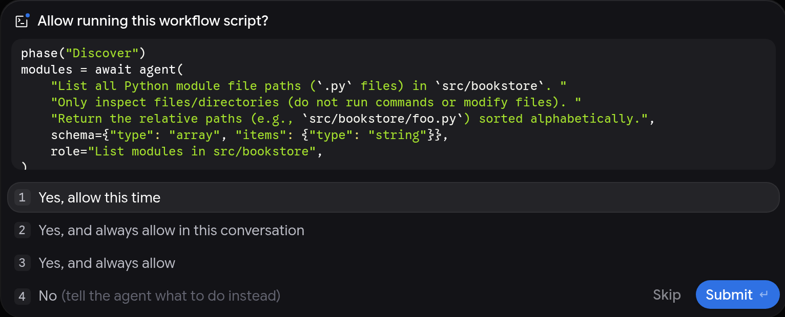
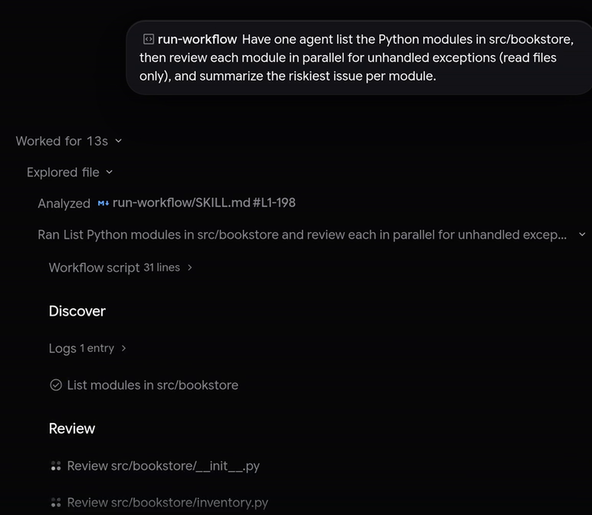
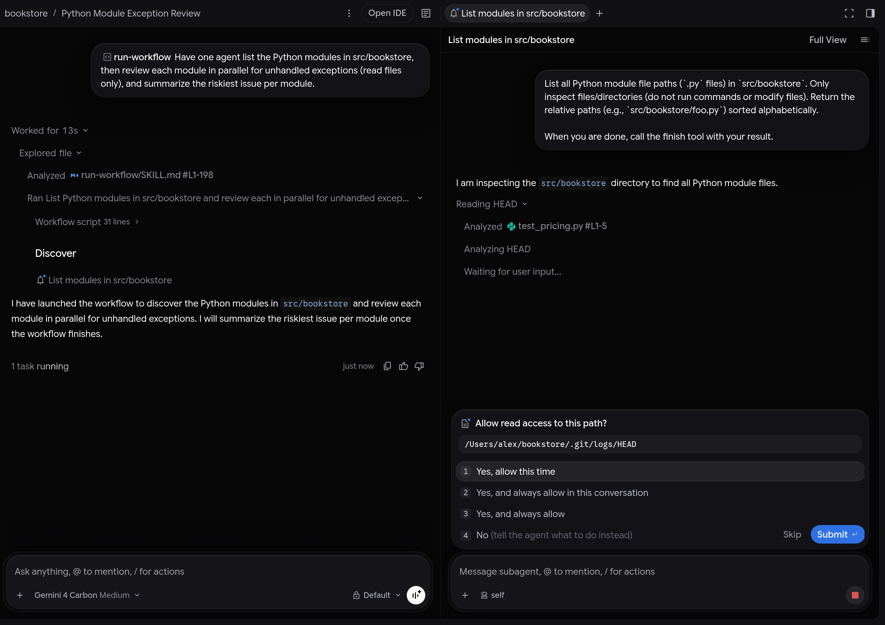
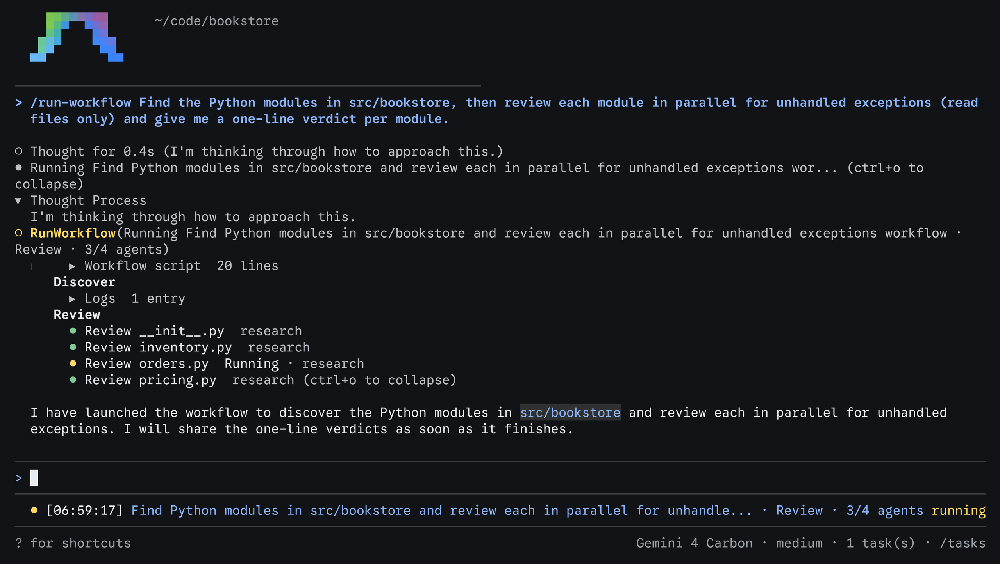

動態工作流程 (/run-workflow)
2-0
Antigravity 應用程式
指令
動態工作流程 (/run-workflow) Antigravity App 指令
Antigravity 應用程式
Antigravity CLI
適用於：
Antigravity 應用程式
Antigravity CLI
# 動態工作流程 (/run-workflow)

標題為「Dynamic Workflows（/run-workflow）」的章節

搭配 **動態工作流程**，代理會撰寫並執行簡短的 Python 指令碼，為您協調多個代理。請使用 `/run-workflow` 當任務拆分為多個獨立部分（每個變更檔案一次審查、每個套件一次稽核）或分階段步驟（先撰寫失敗的測試，再修正程式碼），且你想要可預測的指令碼化控制流程，而非單一冗長對話。

動態工作流程可為您提供：

- **平行與循序階段**：指令碼會使用以下方式同時執行代理 `parallel()` 或一個接一個地使用 `pipeline()`，分組為具名階段，您可以即時追蹤。
- **乾淨的主要對話**：工作流程啟動的每個代理會在 自己的對話中工作，並傳回符合 JSON Schema 的結構化結果。檔案讀取、搜尋與測試記錄不會進入您主要對話的脈絡。
- **單次使用與多回合代理**：工作流程可以啟動一次性代理（例如每個檔案一位審查者），或讓單一代理跨回合持續運作，如此一來，發現錯誤的同一位審查者稍後可以確認錯誤已修正。
- **可重複使用的指令碼**：請代理將可用的指令碼儲存為專案中的檔案，稍後再執行。

## 運作方式

「運作方式」章節

當您執行 `/run-workflow <task>`，或用自己的話要求工作流程， 接著會發生以下情況：

1. 代理會讀取內建的 `run-workflow` 技能，並為你的任務撰寫 Python 指令碼。
2. Antigravity 會向您展示指令碼並要求您核准，除非您的 [權限預設](/docs/permissions#permission-presets) 已允許（例如， **Turbo**）。若要變更計畫，請拒絕該請求，並告訴代理要調整什麼。
3. 工作流程會在背景執行，因此你可以在同一個對話中繼續工作。工作流程步驟會在指令碼進行時顯示每個階段、日誌行與代理。
4. 指令碼完成後，主要代理會收到工作流程的日誌與輸出，並為你摘要結果。

由工作流程啟動的代理是擁有自己對話的完整代理。他們 看不到指令碼，也看不到彼此，因此指令碼會在提示詞中為每個代理提供其所需的一切， 並要求提供簡短、定義明確的結果。

## 啟動並監控工作流程

標題為「啟動並監控工作流程」的章節

[Antigravity 應用程式](#tab-panel-183)[Antigravity CLI](#tab-panel-184)Antigravity 應用程式[「Antigravity App」章節](#sr-tab-1)Antigravity 應用程式中的動態工作流程：輸入 /run-work，按 Tab 插入 run-workflow 指令，新增您的任務，核准指令碼，追蹤 Discover 與 Review 階段，並開啟代理的對話以核准其要求。影片部分內容已加速。啟動工作流程[標題為「啟動工作流程」的章節](#launch-a-workflow)在任何對話中輸入 `/run-workflow` 後接你的任務。在你輸入時，選單會建議相符的指令：輸入 `/run-work` 並按下 Tab 以插入醒目顯示的 **run-workflow** 指令，然後輸入你的任務（其後為：）`/run-workflow Find every TypeScript file changed on this branch, review each one in parallel for missing error handling, and give me a one-line verdict per file.`你也可以用自己的話詢問，例如 *「執行會平行稽核每個套件的工作流程。」* 在工作流程開始之前，代理會在以下位置向您展示 產生的指令碼： **允許執行此工作流程指令碼嗎？** 提示詞。選擇 **是，僅允許這次** 以執行它，或選擇 **否** 並告訴代理要變更的內容：追蹤各階段與代理[標題為「遵循階段與代理」的章節](#follow-phases-and-agents)工作流程在對話中顯示為單一步驟，標題包含工作流程的描述、目前階段，以及已完成其代理的數量（例如， `workflow · Review · 3/4 agents`）。與其他工具呼叫一樣，此步驟可收合在摘要之下，例如 **已工作 19 秒**； 展開摘要即可找到。工作流程會繼續在背景執行：對話會顯示 **1 項任務執行中**，且工作流程會列在 **背景工作** 在側邊面板的 **總覽**.展開步驟以查看下列內容： **工作流程指令碼**：正在執行的 Python 指令碼，預設為收合狀態。 **階段**：指令碼中每個具名階段各有一個區段。 **記錄**：指令碼在該階段記錄的行。 **代理卡片**：每個階段啟動的代理各有一張卡片，以代理的角色為標題，並以圖示顯示其狀態，例如執行中、等待您的核准或已完成。 **輸出**：指令碼輸出的任何內容，會在步驟結尾處收合顯示。 點按代理卡片，即可在側邊面板開啟該代理的對話，您可以在其中閱讀其提示詞、觀看其工具呼叫、核准其待處理要求，或 傳送訊息給它。工作流程代理不會出現在您的主要對話清單中； 您可以從其卡片開啟。工作流程完成後，主要代理會讀取其結果並在對話中回覆。若要提早停止工作流程，請停止對話。停止父對話也會停止所有正在執行的工作流程代理。Antigravity CLI[「Antigravity CLI」章節](#sr-tab-2)Antigravity CLI 中的動態工作流程：輸入 /run-work，按 Tab 完成 /run-workflow，新增您的任務，核准指令碼，在代理執行期間按 Ctrl+O 展開階段樹狀結構，並閱讀結果。影片部分內容已加速。啟動工作流程[標題為「啟動工作流程」的章節](#launch-a-workflow-1)在提示詞處輸入 `/run-workflow` 後接你的任務。為了節省輸入，輸入 `/run-work` 並按下 Tab 以完成指令名稱，然後加上空格與你的任務：`/run-workflow Find the Python modules in src/bookstore, then review each module in parallel for unhandled exceptions (read files only) and give me a one-line verdict per module.`除非你的權限預設已允許，否則 CLI 會在以下位置顯示產生的 Python 指令碼 **正在請求授權：** 並詢問 **執行此 指令？**。請選擇 **是，執行指令** 以啟動工作流程，或 **否， 取消** 以停止它。追蹤各階段與代理[標題為「遵循階段與代理」的章節](#follow-phases-and-agents-1)工作流程會在背景繼續執行，因此提示詞在它工作時保持可用。提示詞上方的狀態列會顯示工作流程的描述、目前階段與其代理數量，狀態行則會顯示 **1 項任務 · /tasks**.在記錄中，工作流程步驟會顯示目前階段以及已完成代理的數量。請按下 Ctrl+O 以將步驟展開為可摺疊的樹狀結構 `▸ Workflow script`, `▸ Logs`，與 `▸ Output` 列（附有其行數或項目數）與每個階段的代理及其狀態，例如 **執行中**, **閒置**, **需要核准**, **已取消**，或已完成：工作流程完成後，步驟標題會從以下變更： **執行中** 至 **已執行**， 代理會回覆結果。檢查工作流程及其代理[標題為「檢查工作流程與其代理」的章節](#inspect-the-workflow-and-its-agents)若要開啟工作流程的完整樹狀結構，請執行下列操作：  執行 `/tasks` （或按下 Ctrl+T），反白工作流程任務，然後按下 Enter 以開啟 **任務詳細資訊**.   按下 ↑/↓ （或 j/k）以便瀏覽 `Workflow script`，每個階段的 `Logs` 與代理列，以及任何最終 `Output`:  按下 Enter 於 `Workflow script`, `Logs`，或 `Output` 以就地展開或摺疊其內容。 按下 Enter 在代理列上，以開啟該代理的對話。    按下 Esc 返回。  當工作流程代理正在等待你的核准時，請按下 Alt+J 以跳至該處，或按下 Ctrl+K 無需離開主對話即可核准待處理的請求。

## 範例提示詞

標題為「提示詞範例」的章節

`/run-workflow` 當任務拆分為多個獨立項目、分階段或審查後修正迴圈時，效果最佳。描述你想要的結果；代理會撰寫指令碼。

### 平行審查變更的檔案

標題為「平行審查變更的檔案」的章節

一個階段負責找出項目，第二個階段同時處理所有項目：

```
/run-workflow List the Python files changed since main, then review each file in parallel for unhandled exceptions using the flash model, and log a one-line verdict per file.
```

### 審查、平行修正並驗證

標題為「審查、平行修正並驗證」的章節

多回合審查者會在各階段保留其筆記，同時由平行修正者處理其發現的問題：

```
/run-workflow Have a persistent Reviewer agent list the bugs in src/billing, fan out one Fixer agent per bug in parallel, and then ask the same Reviewer to confirm that every bug it found is fixed.
```

### 在隔離工作區中編輯

標題為「在隔離的工作區中編輯」的章節

當平行代理同時編輯程式碼並執行測試時，請為每個平行代理提供各自的隔離工作區：

```
/run-workflow For each package under packages/, start one agent in an isolated branch workspace to replace the deprecated request() helper with fetchJson(), run npm test in that package, and log a diff summary and the test result.
```

### 一次測試並修正一個項目

標題為「一次測試並修正一個項目」的章節

當項目涉及共用檔案或測試套件時，請依序處理：

```
/run-workflow Process BUG-1.md and BUG-2.md one at a time: for each bug, have one agent write a failing pytest test and a second agent fix the code until the new test passes.
```

## 讀取並引導工作流程指令碼

標題為「讀取並引導工作流程指令碼」的章節

你不需要撰寫 Python 也能使用 Dynamic Workflows。因為 Antigravity 會在執行前向你顯示指令碼，了解建構組件有助於你審查工作流程將執行的內容，並在提示詞中要求特定的選項。

### 範例指令碼

「指令碼範例」章節

以下指令碼是代理會為上述平行審查提示詞撰寫的那種指令碼：

```
phase("Discover")
files = await agent(
    "List the Python files changed since main. Paths only.",
    schema={"type": "array", "items": {"type": "string"}},
)

phase("Review")
# parallel() runs one agent per file at the same time.
# role titles each agent's card.
reviews = await parallel(
    files,
    lambda f: agent(
        f"Review {f} for unhandled exceptions. Reply with a one-line verdict.",
        schema={"type": "string"},
        role=f"Review {f}",
        model="flash",
    ),
)
for r in reviews:
    log(r)
```

### 指令碼建構組件

標題為「指令碼建構組件」的章節

每個工作流程指令碼都可以使用下列函式與值：

| 建構組塊 | 其功能 |
| --- | --- |
| `phase(name)` | 啟動具名階段。後續的日誌、工具呼叫與代理卡片會歸入該階段之下。 |
| `log(*args)` | 在工作流程步驟的目前階段，以及主要代理收到的結果中新增一行。 |
| `agent(prompt, schema, role, type_name, workspace, model)` | 定義代理。 `await agent(prompt, schema)` 執行一次並回傳其結果。 `a = agent(...)` 後接 `await a(prompt, schema)` 執行一回合可跨呼叫持續存在的對話。 |
| `parallel(items, fn)` | 執行 `fn(item)` 同時處理每個項目，並依項目順序回傳結果。如果一個項目失敗，其他項目會被取消。 |
| `pipeline(items, fn)` | 執行 `fn(item)` 一次處理一個項目，並依項目順序回傳結果。 |
| `await trajectory(...)` | 傳回目前對話中較早的步驟（工作流程開始之前），可選擇依步驟類型、工具名稱、索引範圍或最近 N 個步驟篩選。 |
| `args` | 代理傳遞給指令碼的選用引數字典（無引數時為空）。 |
| `CONVERSATION_ID`, `STEP_INDEX`, `WORKSPACES` | 對話 ID、工作流程步驟的索引，以及你的工作區資料夾（主要資料夾優先）。指令碼會在你的主要工作區資料夾中執行。 |

The `schema` 代理的其中一個是其結果的 JSON Schema。代理會透過以下方式回傳其結果 `finish` 根據結構描述檢查它的工具，而指令碼會收到剖析後的值。使用 `{"type": "string"}` 以取得自由形式的答案。

當你發出提示詞時 `/run-workflow`，您可以要求代理自訂其代理的執行方式：

- **模型（`model`)**：根據預設，工作流程代理會使用您對話的模型（`inherit`）。請要求較輕量的層級，例如 `flash_lite` 或 `flash`，以便對多個檔案進行快速大量檢查，或用於 `pro` 以進行更深入的推理。如果某個層級不適用於你，代理會以有效選項清單回報失敗。
- **代理類型（`type_name`)**: `self` （預設值）會使用目前代理的設定與工具。您也可以使用內建的 `research` 供唯讀程式碼庫研究使用的代理，或你其中一個 [自訂子代理](/docs/subagents#custom-subagents).
- **工作區（`workspace`)**: `inherit` （預設值）會使用您目前的工作區。 `branch` 為每個代理提供各自隔離的 Git 工作樹，當代理平行編輯程式碼時很有用。 `share` 為每個代理提供新的工作副本，該副本共用底層儲存庫儲存空間。

## 重新執行工作流程指令碼

標題為「重新執行工作流程指令碼」的章節

如果您定期執行相同類型的工作流程，可以保留指令碼， 不必每次都讓代理重新產生。請代理將指令碼儲存至 `.py` 工作區中的檔案，然後使用例如以下的提示詞再次執行 `/run-workflow Run scripts/review-changes.py`。Antigravity 會在每次執行指令碼時要求您核准，除非您已選擇一律允許。

## 權限

標題為「權限」的章節

動態工作流程會遵循您的 [權限設定](/docs/permissions):

- **核准指令碼**：Antigravity 會在每個工作流程指令碼執行前要求您核准，除非您的權限預設已允許。您可以允許一次、允許至對話結束，或一律允許。核准僅涵蓋該確切指令碼；指令前置詞規則無法涵蓋 Python 指令碼。
- **代理會在自己的對話中提出要求**：工作流程啟動的每個代理 都會遵循您的權限預設，並在自己的對話中要求核准。 代理會等到您回覆為止。

## 在動態工作流程、子代理與代理團隊之間選擇

標題為「在 Dynamic Workflows、子代理與代理團隊之間選擇」的章節

Antigravity 提供多種方式，可將工作分配給多個代理：

| 使用 | 當你想要 |
| --- | --- |
| **[Orchestrator](/docs/models#orchestrator)** | 單一對話，其中頂級規劃者模型（例如 `Gemini 4 Neon`, `Gemini 4 Carbon`, `Gemini 4 Argon`，或 `Claude Opus 5.5`）負責規劃與審查，同時將例行工具執行交給更快的執行者模型（例如 `Gemini 4 Hydrogen`). |
| **[子代理](/docs/subagents)** | 若要委派一項任務（例如研究問題或建置），同時繼續工作。 |
| **動態工作流程（`/run-workflow`)** | 可預測的指令碼化控制流程：對檔案或套件清單執行相同的檢查、依序執行分階段步驟，或是審查者與修正者迴圈，由代理將結構化結果回傳給指令碼，而非彼此交談。 |
| **[`/swarm`](/docs/swarm)** | 同儕在共用訊息看板上協作，拆分功能、錯誤大掃除或調查，並直接協調（`@name`). |
| **[`/boost`](/docs/boost)** | 針對棘手錯誤、競爭條件或演算法的深度推理，並進行獨立驗證。 |
| **[`/teamwork`](/docs/teamwork)** | 適合大型多里程碑專案的協作代理團隊，從範圍訪談開始。 |

如果您的代理在工作時需要彼此協調，例如 在共用訊息板上就介面達成共識或審查彼此的差異，請使用 [`/swarm`](/docs/swarm) 而非工作流程。

## 相關文件

「相關文件」章節

- [自訂子代理](/docs/subagents)：了解代理如何在背景執行， 並定義自己的代理類型以用作 `type_name`.
- [代理蜂群（`/swarm`)](/docs/swarm)：協調一支在共用訊息板上協作的代理團隊。
- [模型與 Orchestrator](/docs/models#orchestrator)：比較可用的 模型，並了解 Orchestrator 如何將前沿規劃器與 Gemini 4 Hydrogen 配對。
- [斜線指令](/docs/slash-commands)：瀏覽 Antigravity 中的每個斜線指令。
- [技能](/docs/skills)：封裝可重複使用的指示。如要轉換舊版 Markdown 工作流程，請參閱 [工作流程轉技能遷移指南](/docs/migration/workflows-to-skills).
- [自訂項目探索](/docs/customization-discovery)：了解 Antigravity 會在哪些位置尋找工作區與個人自訂內容。
- [權限](/docs/permissions)：設定預設值，以及允許、詢問與拒絕規則。

上一個
代理團隊

下一步
/agy-customizations

您的下載已開始您如何得知我們？請選一個。這有助於我們接觸更多像您一樣的人。感謝您讓我們知道！
