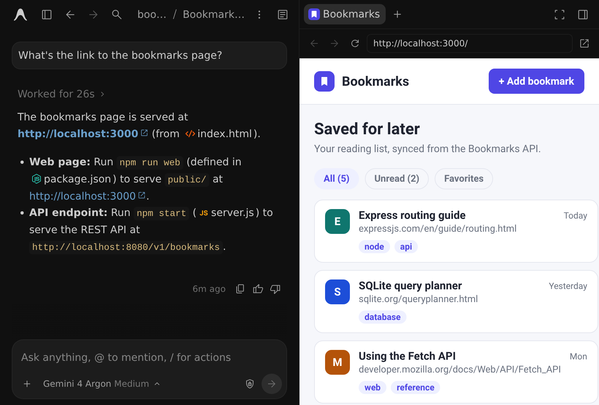
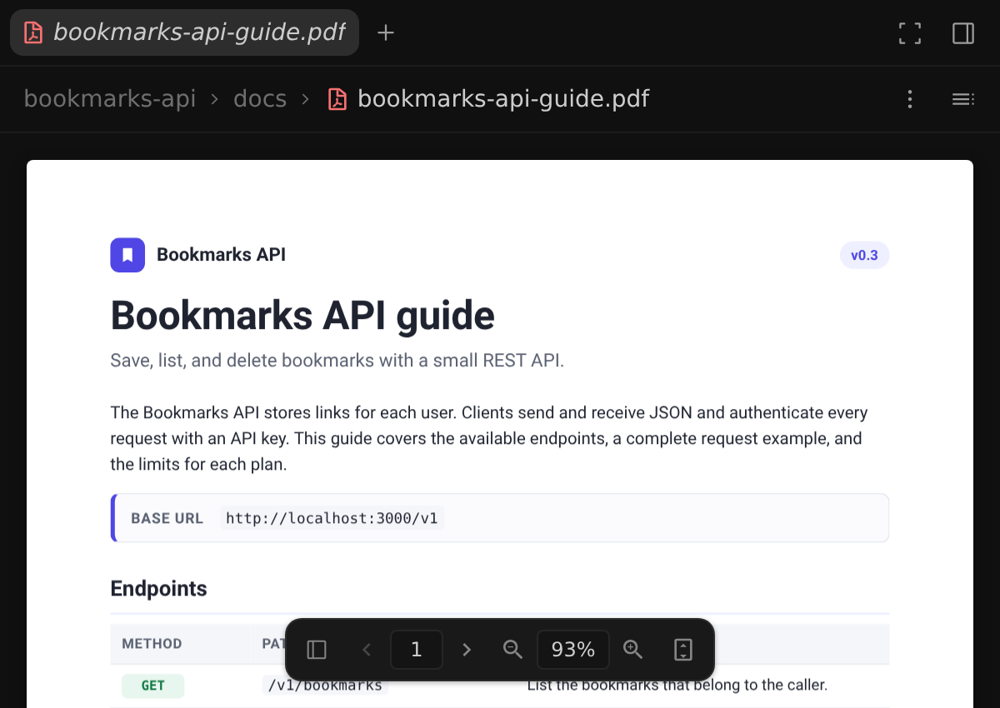

功能概覽
2-0
Antigravity 應用程式
功能
功能概覽 Antigravity 應用程式功能
Antigravity 應用程式
Antigravity CLI
適用於：
Antigravity 應用程式
Antigravity CLI
# Antigravity 功能

[標題為「Antigravity features」的章節](#antigravity-features)

Antigravity App 與 Antigravity CLI 執行的是同一個代理，因此大多數功能在兩者上都能使用。本頁先介紹兩者共用的功能，再介紹專屬於下列介面的功能： [Antigravity 應用程式](#antigravity-app-features) 和 [Antigravity CLI](#antigravity-cli-features).

## 應用程式和 CLI 中的功能

[標題為「Features in the App and CLI」的章節](#features-in-the-app-and-cli)

當某項功能在 App 與 CLI 中的運作方式不同時，請在分頁中選取您的介面。您的選擇會套用到本頁的所有分頁，並在整個文件中記住。

### 專案

[「專案」章節](#projects)

代理在以下環境中運作： **專案**, 定義代理可存取的資料夾，以及其使用的設定與權限.

- [Antigravity 應用程式](#tab-panel-157)
- [Antigravity CLI](#tab-panel-158)

### Antigravity 應用程式

[「Antigravity App」章節](#sr-tab-1)

- **Worktree 支援**：專案原生支援 Git worktree，讓代理可在隔離的背景資料夾中運作。
- **範圍化設定**: 設定具有範圍，您可以為每個專案設定不同的安全性設定。也就是說，受信任的專案可以採用較寬鬆的設定，不受信任的資料夾則可採用較嚴格的安全性設定。關於可用的預設，請參閱 [權限預設集](/docs/permissions#permission-presets).
- **範圍化權限**: 將權限授予附加到專案，以控制代理可存取的範圍。在對話中手動授予的權限可以保留，讓代理隨著時間學習受信任的動作.
- **多資料夾存取**：您可以設定專案在多個資料夾中工作，讓代理在同一對話中跨不同程式碼庫運作。

### Antigravity CLI

[「Antigravity CLI」章節](#sr-tab-2)

- **預設專案**: 對話會在以下環境中執行 `default-cli-project` 除非您使用以下參數啟動 CLI `--project=<project_id>` 或 `--new-project`.
- **已繼續的對話**: 當您以以下方式繼續對話時： `/resume` 或 `--conversation`, CLI 會使用該對話的專案.
- **分岔對話**：執行 `/fork <project_id>` 在另一個專案中繼續目前對話的副本。

[深入了解專案](/docs/projects).

### 預設安全

[「預設安全」章節](#secure-by-default)

依預設，代理在執行敏感操作前會先詢問，並將檔案存取範圍限制在你的專案資料夾內。詳細內容因介面而異：

- [Antigravity 應用程式](#tab-panel-159)
- [Antigravity CLI](#tab-panel-160)

### Antigravity 應用程式

[「Antigravity App」章節](#sr-tab-3)

- **互動式核准**：依預設，指令會在隔離的 [終端機沙箱](/docs/sandbox) 無須提示，代理在沙箱外執行終端機命令之前會請求您的明確許可。在以下位置之下： **自動** 預設值，沙箱外的命令會自動接受評估，讓安全、可還原的命令繼續執行，而具風險或不可還原的動作則會請求您的核准。搭配 [先前的權限設定](/docs/agent-settings#previous-permission-settings)，代理在執行任何終端機指令前都會先詢問。
- **有界存取**: 預設情況下，您的代理只能在專案所提供的資料夾內讀取與寫入。如果您放寬權限設定（例如選擇 **Turbo** 預設）下，代理可讀寫您整台電腦。

### Antigravity CLI

[「Antigravity CLI」章節](#sr-tab-4)

- **互動式核准**: 預設 `request-review` 權限會在代理寫入檔案、執行 Shell 命令或使用網頁工具之前先詢問，除非其中一條允許規則符合。在 [`auto` 模式](/docs/cli/modes)，CLI 會核准工作區檔案編輯，在 [終端機沙箱](/docs/sandbox)，並評估沙箱外的指令，因此只有具風險或不可逆的動作會徵求您的核准。
- **終端機沙箱**：The [終端機沙箱](/docs/sandbox) 預設為關閉。使用以下方式開啟： `enableTerminalSandbox` 於 `settings.json` 或 `--sandbox` 旗標。 `auto` 模式會自動將其開啟。
- **工作區之外的檔案**: 代理在讀取或編輯工作區資料夾外的檔案前會先詢問。若要將這些檔案視為工作區檔案，請開啟 `allowNonWorkspaceAccess`.

[深入了解權限](/docs/permissions) 和 [終端機沙箱](/docs/sandbox).

### 子代理

[標題為「Subagents」的章節](#subagents)

主代理可以將研究、建置或測試執行等工作委派給子代理。每個子代理都以全新的脈絡開始，在自己的對話中執行，與您的主對話平行進行。

- [Antigravity 應用程式](#tab-panel-161)
- [Antigravity CLI](#tab-panel-162)

### Antigravity 應用程式

[「Antigravity App」章節](#sr-tab-5)

在側邊面板的 **總覽**, 開啟 **子代理** 並選取一個子代理以追蹤其對話。

### Antigravity CLI

[「Antigravity CLI」章節](#sr-tab-6)

- **監控與核准**：開啟 `/agents` 面板，以監控子代理並核准其要求。
- **前往核准**：按下 Alt + J 跳至下一個等待核准的子代理。
- **就地核准**：按下 Ctrl + K 核准待處理的要求，無需離開主要對話。

[深入了解子代理](/docs/subagents).

### 瀏覽器子代理

[標題為「Browser subagent」的章節](#browser-subagent)

讓 `browser` 子代理會開啟頁面、點擊操作流程、檢查主控台與網路錯誤、擷取螢幕截圖，並在完成工作前驗證視覺修正：

- [Antigravity 應用程式](#tab-panel-163)
- [Antigravity CLI](#tab-panel-164)

### Antigravity 應用程式

[「Antigravity App」章節](#sr-tab-7)

- **內建瀏覽器自動化** (`v2.30.0+`，個人 Google 帳號)：以自然語言詢問或執行 [`/browser`](/docs/commands/browser) 以直接在內建瀏覽器內啟動瀏覽器子代理——無須安裝或設定 Chrome。
- **平行分頁與即時交接**：將瀏覽器螢幕截圖儲存為產出物，並 為代理留下區域註解。 `browser` 子代理會同時在隔離分頁中執行，具備動畫即時游標、零焦點搶奪，以及一鍵 **停止** 接管按鈕，以及暫停與恢復登入交接。
- **商務版與企業版帳戶上的 Chrome DevTools**：執行 [`/browser`](/docs/commands/browser) 以驅動您本機的 Google Chrome（`v144+`) 透過 Chrome DevTools MCP。

### Antigravity CLI

[「Antigravity CLI」章節](#sr-tab-8)

- **可依需求透過 `/browser`**：執行 [`/browser`](/docs/commands/browser) 以驅動本機 Google Chrome（`v144+`) 透過 Chrome DevTools MCP，在隔離的子代理情境中。
- **DevTools 效能分析與錄製**：變更會使用 Visual Studio 的階層式 差異引擎計算，包含逐字比較與正規化的行結尾 (

[深入了解瀏覽器使用方式](/docs/browser).

### 斜線指令

[標題為「Slash commands」的章節](#slash-commands)

類型 `/` 在 App 的訊息框或 CLI 的提示詞框中，以執行諸如 [`/plan`](/docs/plan), [`/grill-me`](/docs/commands/grill-me), [`/goal`](/docs/commands/goal), [`/boost`](/docs/boost), [`/schedule`](/docs/commands/schedule), [`/swarm`](/docs/swarm)，與 [`/teamwork`](/docs/teamwork). 有些指令僅適用於單一介面，而且 `/boost` 和 `/teamwork` 需要付費方案。

[瀏覽所有斜線指令](/docs/slash-commands).

### 提及與引用

[標題為「Mentions and quoting」的章節](#mentions-and-quoting)

將代理指向正確的上下文，讓它不必自行搜尋。

- [Antigravity 應用程式](#tab-panel-165)
- [Antigravity CLI](#tab-panel-166)

### Antigravity 應用程式

[「Antigravity App」章節](#sr-tab-9)

類型 `@` 在訊息框中提及檔案、資料夾、規則與過去的對話，或在回覆、檔案、diff 或產出物中選取文字，然後點選 **引用** 將它加入您的下一則訊息。

### Antigravity CLI

[「Antigravity CLI」章節](#sr-tab-10)

類型 `@` 在提示詞框中提及檔案與目錄，或讓您的提示詞以 `@` 以及子代理的名稱，即可傳送訊息給該子代理。

[深入了解提及與引用](/docs/at-mentions).

### 語音轉錄

[「語音轉錄」章節](#voice-transcription)

Antigravity 具備內建即時語音轉錄，讓您可以使用自然語音提示代理並留下回饋。

- [Antigravity 應用程式](#tab-panel-167)
- [Antigravity CLI](#tab-panel-168)

### Antigravity 應用程式

[「Antigravity App」章節](#sr-tab-11)

- **啟動或停止**: 按一下訊息框旁的麥克風按鈕開始錄音，再按一下即可停止。您也可以按下 Ctrl + M 開始錄製，再按一次即可停止。
- **即時檢視**: 在您說話時，您的話語會即時轉錄到訊息框中.
- **對話感知**: Antigravity 會將您最近的對話與游標周圍的文字提供給語音辨識器，讓專案專屬術語更有可能正確辨識.
- **適用位置**: 在訊息方塊中使用語音來開始對話並傳送提示詞更新；在產出物評論中，則可對計畫、程式碼差異與交付成果留下精確的行內意見回饋。
- **與代理交談**：若要與代理進行口頭雙向對話而非聽寫，請使用 [語音模式](/docs/voice-mode).

### Antigravity CLI

[「Antigravity CLI」章節](#sr-tab-12)

- **與代理交談**：執行 `/voice live` 或按下 F6 開始 [語音模式](/docs/voice-mode)，與代理進行口頭雙向對話。
- **開始聽寫**：執行 `/voice dictate` 或 `/record`，或按下 F5. 您的話語會出現在提示框中，您可以在傳送前編輯.
- **透過 SSH 聽寫**: 當 CLI 在遠端機器上執行時，請執行 `agy mic-serve` 在您的本機上，將麥克風串流傳送給它。
- **可用性**: CLI 中的語音聽寫目前不適用於商務或企業版帳戶。

[深入了解 CLI 中的語音聽寫](/docs/cli/commands/voice).

### 遠端控制

[「遠端控制」章節](#remote-control)

遠端控制可讓您從任何網頁瀏覽器操控與監控跨多台機器的 Antigravity App 工作階段與 Antigravity CLI 執行個體：

- **從任何裝置工作**: 在您的工作站上啟動長時間執行的代理工作，然後透過手機或筆記型電腦監控進度或核准動作。
- **保留您的本機設定**: 代理能完整存取您工作站的檔案、工具鏈、憑證與 Git worktree，無需另設環境.
- **接收通知**：在任務完成或需要您的輸入時，接收瀏覽器推播通知。

若要開啟遠端控制：

- [Antigravity 應用程式](#tab-panel-169)
- [Antigravity CLI](#tab-panel-170)

### Antigravity 應用程式

[「Antigravity App」章節](#sr-tab-13)

於 **設定**, 開啟 **應用程式** 並開啟 **啟用遠端控制**. 接著您可以輸入 **裝置名稱** 識別這台機器。

### Antigravity CLI

[「Antigravity CLI」章節](#sr-tab-14)

- **目前工作階段**：執行 `/remote-control` 為使用中的終端機工作階段開啟 Remote Control，並 `/remote-control off` 將它關閉。
- **新工作階段**: 使用下列方式啟動 CLI： `--remote-control` 旗標。
- **常時開啟的機器**：執行 `agy remote-control start` 在背景保持一個無頭 CLI 執行個體可用。

[深入了解遠端控制](/docs/remote-control).

### 遠端代理

[標題為「遠端代理」的章節](#remote-agents)

遠端代理會在隔離的 Google 代管遠端環境中執行您的代理工作階段與工具，因此即使本機處於睡眠或離線狀態，工作仍會繼續執行：

- **遠端工作區與資源**：建立連結至 GitHub 存放區、Google Drive 檔案和已上傳檔案的遠端專案。
- **隨時隨地存取**：從 Antigravity App、Antigravity CLI 或任何桌機或行動瀏覽器開始並監控遠端對話，網址為 [antigravity.google.com](https://https://antigravity.google.com).
- **可用性**：適用於 **Google AI Pro** 和 **Google AI Ultra** 使用個人 Google 帳戶登入的訂閱者。

如要開始遠端對話：

- [Antigravity 應用程式](#tab-panel-171)
- [Antigravity CLI](#tab-panel-172)

### Antigravity 應用程式

[「Antigravity App」章節](#sr-tab-15)

在左側邊欄中，點擊 **+** 旁邊 **專案** 並選取 **新增遠端專案**，或開啟 [antigravity.google.com](https://https://antigravity.google.com) 在任何瀏覽器中。

### Antigravity CLI

[「Antigravity CLI」章節](#sr-tab-16)

使用⋯啟動 CLI `--remote-agent` 旗標。請新增 `--project` 開啟特定的遠端專案，並執行 `/projects` 建立遠端專案並附加資源。

[深入了解遠端代理](/docs/remote-agents).

### 技能、規則與 MCP 伺服器

[標題為「Skills, rules, and MCP servers」的章節](#skills-rules-and-mcp-servers)

擴展代理的知識和能力。這些自訂項目在應用程式和 CLI 中都適用：

- **[技能](/docs/skills)**: 給代理裝有指示的資料夾，每個資料夾都有 `SKILL.md` 檔案，代理在處理特定工作時會遵循它。
- **[規則](/docs/rules)**: 設定適用於每個對話的持久指令、程式設計標準與架構限制。
- **[MCP 伺服器](/docs/mcp)**: 透過 Model Context Protocol 將代理連接到本機開發者工具、資料庫與遠端 API.

### JSON 掛鉤

[「JSON 掛鉤」章節](#json-hooks)

JSON 掛鉤可讓您在 Antigravity 代理執行週期的關鍵階段執行自訂本機 Shell 指令碼。您可以在工具呼叫前、模型回應後或迴圈停止條件時攔截並控制代理行為——透過簡單的 JSON 檔案全域或依工作區設定。

[深入了解掛鉤](/docs/hooks).

### 外掛程式

[「外掛」章節](#plugins)

外掛程式是具備命名空間的套件，可將技能、代理、規則、MCP 伺服器與掛鉤封裝為單一可部署單位。

- [Antigravity 應用程式](#tab-panel-173)
- [Antigravity CLI](#tab-panel-174)

### Antigravity 應用程式

[「Antigravity App」章節](#sr-tab-17)

在左側邊欄中，點擊 **自訂項目**，然後開啟 **市集** 分頁，瀏覽並安裝外掛。您在應用程式中安裝的外掛也會出現在 CLI 中。

### Antigravity CLI

[「Antigravity CLI」章節](#sr-tab-18)

- **外掛程式管理員**：執行 `/plugin` 開啟外掛管理員，並按 Tab 在…之間切換 **已安裝** 和 **探索** 分頁。
- **從您的 shell**：執行 `agy plugin install <plugin-name>` 安裝外掛，並使用 `agy plugin list`, `enable`, `disable`，與 `uninstall` 管理您的外掛。

[深入了解外掛程式](/docs/plugins) 和 [Marketplace](/docs/marketplace).

## Antigravity 應用程式功能

[「Antigravity App 功能」章節](#antigravity-app-features)

這些功能是 Antigravity App 專屬的。

### 知識工作與介面版面配置

[標題為「知識工作與介面版面配置」的章節](#knowledge-work-and-interface-layouts)

使用個人 Google 帳戶時，可在 **知識工作** 版面配置（著重於對話、文件、產出物與資料夾輸出）與 **軟體工程** 版面配置（包含 Git 工作樹、變更檢閱、終端機與子代理卡片），位於 **設定** > **一般** > **介面版面配置** (`v2.30.0+`)。兩種介面版面配置共用相同的代理、模型、權限、技能、MCP 伺服器與外掛程式。

[深入了解知識工作與介面版面配置](/docs/settings#interface-layout).

### 專案之外的對話

[「專案之外的對話」章節](#conversations-outside-of-projects)

在任何專案之外開始快速的一次性對話。這些工作階段在本機暫存資料夾中執行。除了繼承全域權限外，它們有自己的設定與權限。

### 搜尋與指令面板

[標題為「Search and command palette」的章節](#search-and-command-palette)

按下 Cmd + K （macOS）或 Ctrl + K （Windows 與 Linux）以依標題、專案與全文搜尋過去的對話，包括您的提示詞與代理的回應。同一個指令面板也能尋找專案中的檔案、執行應用程式指令，並在另一個專案中開始對話。

[深入了解搜尋與命令選擇區](/docs/search).

### 側邊面板與總覽面板

[標題為「側邊面板與總覽面板」的章節](#side-panel-and-overview-panel)

在對話旁邊的側邊面板中，將產出物、檔案、差異、終端機、子代理對話和網頁以分頁開啟。The **總覽** 每個對話右上方的面板會列出對話產生的變更、產出物、子代理和連結，讓您一按即可開啟其中任何一項。若要同時處理兩個對話，請分割視窗。

[深入了解側邊面板與總覽面板](/docs/side-panel).

### 語音模式

[標題為「語音模式」的章節](#voice-mode)

大聲與代理交談，並即時聽到它的回答。透過 Antigravity 中的語音模式（由 **Gemini Live**，按一下 **啟動語音模式** 在空白的訊息方塊中開始語音對話，您可以在其中執行以下操作：

- **指派並引導工作**：要求執行工作、在代理工作時補充細節或更正，或指示它停止。
- **以語音回答**：允許或拒絕權限提示，並回答代理的問題，無需點按。破壞性動作仍需在畫面上點按。
- **在您想要時聽取進度**：代理依預設會安靜工作。請要求它隨時向您報告，以及報告的頻率。

[深入了解語音模式](/docs/voice-mode).

### 自動化

[標題為「Automations」的章節](#automations)

自動化（先前稱為排程工作）讓您可以預先規劃專案，依排程傳送訊息給您的代理，即使您不在也一樣。從下列位置開啟它們： **自動化** 在左側邊欄中：

- **可重複**：設定基於時間的觸發器以定期啟動對話。
- **模型層級**: 每個自動化都會以您選擇的模型層級執行：Flash Lite、Flash（預設）或 Pro.
- **大約時間**: 執行會在接近排定時間時開始，而非在確切的分鐘。Antigravity 會將它們分散，最多達間隔的 10%，且不超過 15 分鐘。
- **依需求執行**: 立即使用下列方式執行自動化： **立即執行** 從其選單中，或選取 **使用提示詞建立** 讓代理引導您設定新的項目。

若要在單一對話內設定計時器或定期檢查，無論是在應用程式或 CLI 中，請使用 [`/schedule` 指令](/docs/commands/schedule).

### 內建瀏覽器

[標題為「Built-in browser」的章節](#built-in-browser)

使用內建瀏覽器在側邊欄中檢查您執行中的應用程式或閱讀文件，位置就在您的對話旁邊，並可將代理指向您在頁面上看到的確切內容。



- **開啟頁面**：點選紅色`v2.30.0+`：如果您現在選擇，它會在目前的對話中執行工作， 並記錄該次執行所需的確切權限。 Cmd 於 macOS 或 Ctrl 在 Windows 與 Linux 上—或使用滑鼠中鍵—以在背景分頁中開啟， Cmd + Shift 或 Ctrl + Shift 開啟新的前景分頁，或 Shift 以在預設外部瀏覽器中開啟）。如需開啟空白瀏覽器分頁，請按下 Cmd + T （macOS）或 Ctrl + T （Windows 與 Linux），或點選 **+** 在側邊面板中，然後選擇 **瀏覽器**.
- **前往某個 URL 或搜尋**: 在網址列中輸入。對於不使用 HTTPS 的本機伺服器，請包含 `http://`，例如 `http://localhost:3000`.
- **導覽與擷取**：使用 **返回**, **轉寄**, **重新載入**, **Downloads**, **將螢幕截圖加入對話**，或 **在外部瀏覽器中開啟** 在工具列中。按一下網址列中的連線安全性圖示，即可檢查憑證詳細資訊，或刪除該網站的 Cookie 與網站資料（`v2.30.0+`).
- **將各個登入分開保持**：與代理對話的對話視窗。您可以像其他 Visual Studio 工具視窗一樣，將它停駐在任何位置。 當您重新啟動 Visual Studio 時，Antigravity 會為每個解決方案還原您上次作用中的對話。 **設定** > **瀏覽器** (`v2.30.0+`).

若要將代理指向頁面的某一部分（`v2.30.0+`)，選取文字並按右鍵選擇 **留言** （或按下 C) 留下錨定意見回饋，或 **引用** （或按下 Cmd + L 於 macOS， Ctrl + L 在 Windows 與 Linux 上）將選取的段落與頁面 URL 插入您的訊息方塊。

在個人 Google 帳戶上（`v2.30.0+`)，代理也可以直接在單一或多個平行分頁中操作內建瀏覽器——以自然語言詢問或執行 [`/browser`](/docs/commands/browser)。支援的語言與架構包括： `/browser` 連接至 Google Chrome。 [深入了解瀏覽器使用方式](/docs/browser).

### PDF 檢視器

[標題為「PDF viewer」的章節](#pdf-viewer)

PDF 檔案會在側邊面板中開啟，讓您可以在對話旁閱讀規格或論文，並引導代理查看特定段落。若要從專案開啟 PDF，請在代理回應中點擊它，或點擊 **+** 在側邊面板中，選擇 **開啟檔案**，並搜尋該 PDF。網路上 PDF 的連結會在內建瀏覽器中開啟。



- **導覽**: 使用 PDF 底部的工具列來顯示頁面縮圖、切換頁面、縮放，以及符合頁面或寬度。若要搜尋 PDF、下載它或複製其路徑，請使用 **更多動作** 頂部的選單。
- **留言或引用**: 選取文字並點擊 **留言** (C）或 **引用** (Cmd + L 於 macOS， Ctrl + L 在 Windows 與 Linux 上），與在網頁上相同。

### Jupyter 筆記本

[標題為「Jupyter 筆記本」的章節](#jupyter-notebooks)

開啟 `.ipynb` 側邊面板中的檔案，可查看已算繪的 Markdown 儲存格、具語法反白與執行次數的程式碼儲存格，以及行內文字、圖片與錯誤輸出。請使用 **預覽** / **Raw** 標頭中的切換按鈕，以檢查底層 JSON，或在儲存格上新增內嵌留言，向代理傳送意見回饋。

[深入了解 Jupyter 筆記本](/docs/jupyter-notebooks).

### 整合終端機

[「整合式終端機」章節](#integrated-terminal)

在側邊面板開啟終端機：點擊 **+** 並選擇 **終端機**. 若要隨時顯示或隱藏終端機，請按下 Cmd + J （macOS）或 Ctrl + J （Windows 與 Linux）。

### 版本控制系統 (VCS) 面板

[「版本控制系統（VCS）面板」章節](#version-control-system-vcs-panel)

Antigravity App 提供 Git 原生的 **審查** 窗格，顯示您專案中的變更。從任何對話點選以下項目即可開啟： **審查** (）
在 **總覽** 面板，然後執行下列操作：

- **比較檢視**:  **未提交**：檢視所有已暫存與未暫存的工作樹變更。 **分支**: 檢閱目前分支上的所有變更。 **代理編輯**: 檢視代理在對話中修改過的檔案。
- **檔案動作**: 逐一對檔案暫存、取消暫存或捨棄未暫存的變更。
- **存放庫動作**:  **提交**: 建立本機提交；如果提交訊息留空，會自動產生. **修訂**: 將變更加入最新提交. **推送**：將分支提交傳送至遠端儲存庫。
- **意見回饋**: 在 diff 的行上留言，將意見回饋傳送給代理.

[深入了解如何審查變更](/docs/review-changes).

## Antigravity CLI 功能

[「Antigravity CLI 功能」章節](#antigravity-cli-features)

這些功能是 Antigravity CLI 專屬的。

### 終端機 UI 與指令

[標題為「Terminal UI and commands」的章節](#terminal-ui-and-commands)

執行 `agy` 在互動式終端機 UI 中與代理協作。除了共用的斜線指令之外，CLI 還有管理您工作階段的指令，例如 `/resume`, `/rewind`, `/model`, `/context`, `/codesearch`, `/tasks`，與 `/usage`.

- **鍵盤快速鍵**: 自訂快速鍵，搭配 `/keybindings`, 或以模態 Vim 按鍵綁定編輯提示詞，位於 [Vim 編輯器模式](/docs/cli/vim-editor-mode).
- **執行模式**: [選擇執行模式](/docs/cli/modes) 控制 CLI 在修改檔案或執行指令之前，是否暫停並先詢問。

[瀏覽所有 CLI 指令](/docs/cli/reference).

### 使用以下方式檢視變更 `/diff`

[標題為「Review changes with /diff」的章節](#review-changes-with-diff)

執行 `/diff` 開啟互動式差異檢視器，您可以在其中檢查工作區變更、提交記錄與每個代理回合的變更，並逐行新增留言，以引導代理的後續步驟。

[深入了解差異檢視器](/docs/cli/commands/diff).

### 無頭模式

[「無頭模式」章節](#headless-mode)

以非互動方式執行 CLI，將代理任務寫入指令碼、與 CI 管道整合，並擷取機器可讀的輸出。使用以下方式傳入提示詞 `-p` （或其別名（複數） `--print` 和 `--prompt`）以執行一次並結束。

[深入了解無頭模式](/docs/cli/headless).

### 使用下列方式自訂 `settings.json`

[標題為「Customize with settings.json」的章節](#customize-with-settingsjson)

在下列位置設定 CLI `~/.gemini/antigravity-cli/settings.json`. 例如，除了權限模式之外，您還可以定義代理可以或不可執行的特定指令:

```
{
  "permissions": {
    "allow": ["command(git)", "command(npm test)"],
    "deny": ["command(rm -rf)"]
  }
}
```

您也可以將即時代理中繼資料（JSON 格式，包含目前的工作目錄、使用中的模型、權杖用量、狀態等資訊）透過管道傳入您自己的 shell 指令碼，以產生自訂 [狀態列](/docs/cli/statusline) 或 [終端機視窗標題](/docs/cli/title).

[深入了解 CLI 設定](/docs/settings?tab=cli).

[上一個
常見問題](/docs/faq/)

[下一步
提及與引用](/docs/at-mentions/)

您的下載已開始

## 您如何得知我們？

請選一個。這有助於我們接觸更多像您一樣的人。

感謝您讓我們知道！
