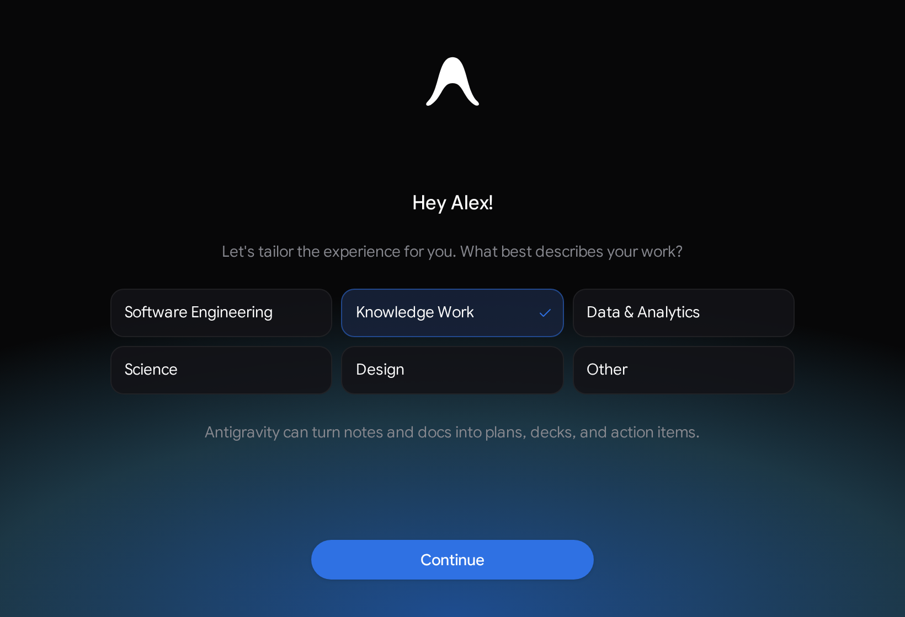
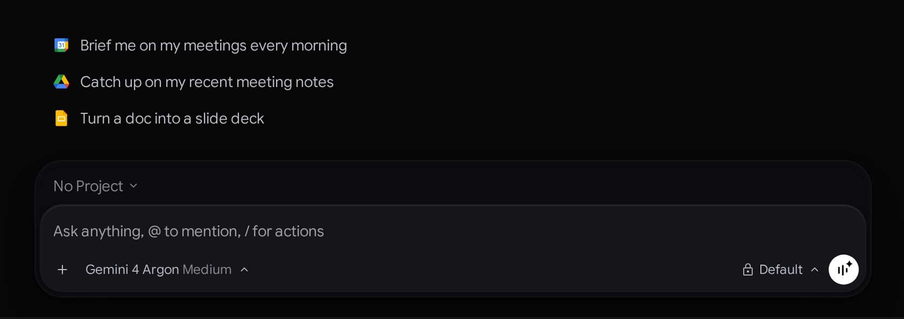
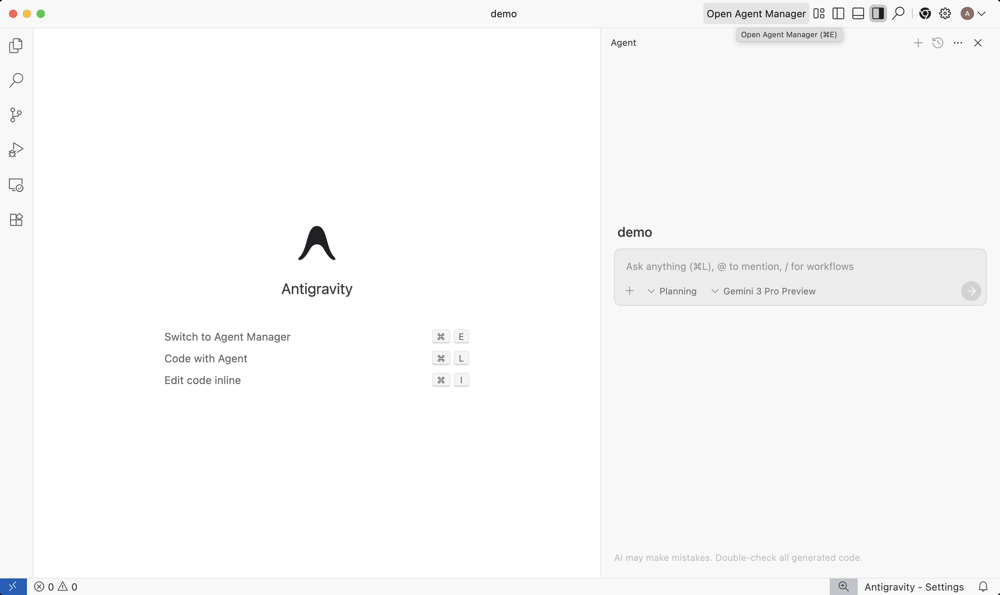

開始使用
2-0
Antigravity 應用程式
開始使用
開始使用 Antigravity 應用程式 開始使用
Antigravity 應用程式
# 開始使用

[「開始使用」章節](#get-started)

歡迎使用 Google Antigravity！請依照本指南的指示，在您偏好的介面上開始使用。

## 選擇您的介面

[「選擇您的介面」章節](#choose-your-surface)

## 下載並安裝

[「下載並安裝」章節](#download-and-install)

1. 為您的作業系統下載 Google Antigravity 安裝程式（或前往 查看所有版本 [antigravity.google/download](/download)): macOSmacOS 13 (Ventura) 或更新版本（Apple Silicon 或 64 位元 Intel）[下載 Apple Silicon 版](https://storage.googleapis.com/antigravity-public/antigravity-hub/2.31.0-6379060755038208/darwin-arm/Antigravity.dmg)[下載 Intel 版](https://storage.googleapis.com/antigravity-public/antigravity-hub/2.31.0-6379060755038208/darwin-x64/Antigravity.dmg)開啟下載的 `Antigravity.dmg` 磁碟映像並拖曳 **Antigravity** 進入您的 **應用程式** 資料夾。若您要升級現有安裝，請選擇 **取代** 在提示時，而非 **兩者皆保留**.WindowsWindows 10 (64 位元) 或 Windows 11[下載 x64 版](https://storage.googleapis.com/antigravity-public/antigravity-hub/2.31.0-6379060755038208/windows-x64/Antigravity-x64.exe)[下載 ARM64 版](https://storage.googleapis.com/antigravity-public/antigravity-hub/2.31.0-6379060755038208/windows-arm/Antigravity-arm64.exe)執行下載的 `.exe` 安裝程式並依循引導設定精靈。Linuxglibc >= 2.28、glibcxx >= 3.4.25（Ubuntu 20+、Debian 10+、Fedora 36+、RHEL 8+）[下載 x64 版](https://storage.googleapis.com/antigravity-public/antigravity-hub/2.31.0-6379060755038208/linux-x64/Antigravity.tar.gz)[下載 ARM64 版](https://storage.googleapis.com/antigravity-public/antigravity-hub/2.31.0-6379060755038208/linux-arm/Antigravity.tar.gz)使用 解壓縮封存檔 `tar -xzf Antigravity.tar.gz` 並啟動 `./Antigravity`.GooglebookGooglebook OS（已預先安裝於 Googlebooks；請透過 Google Play 更新或重新安裝）[在 Google Play 下載](https://play.google.com/store/apps/details?id=com.google.android.apps.antigravity)Google Antigravity 已預先安裝於 Googlebooks。請開啟 Google Play 安裝更新或重新安裝應用程式。
2. 從應用程式啟動器或選單啟動 Google Antigravity。
3. 登入並選擇您要如何設定工作區：   **個人 Google 帳戶** (`v2.30.0+`)：透過瀏覽器登入後，Antigravity 會詢問最能描述您工作的項目——**軟體工程**, **知識工作**, **資料 & 分析**, **科學**, **設計**，或 **其他** (點選 **Skip** 以從預設值開始 **軟體工程** 設定）：  您的選擇會設定初始 [介面版面配置](/docs/settings#interface-layout) (**知識工作** 供 *知識工作*, *科學*, *設計*，與 *其他*; **軟體工程** 供 *軟體工程* 和 *資料 & 分析*) 並在您確認後，於首頁訊息方塊上方顯示最多三個可關閉的起始提示詞 **條款 & 資料使用** 通知：  選擇角色時不會安裝任何外掛程式，點選入門提示詞才會安裝其配對的 [市集](/docs/marketplace) 在背景執行的外掛程式（視需要），預先填入 `@<Plugin>` 以及提示詞而不傳送，並選取第一個 `<...>` 預留位置，方便您先編輯（Google Calendar、Drive、Slides 或 Figma 等已連結服務會在您執行提示詞時提示您登入）。選擇 **軟體工程** 還包含 **從其他代理式開發者工具匯入我的設定** 以從 Claude Code、Codex、Cursor 與 Gemini CLI 匯入 MCP 伺服器、技能、規則與指示。您可以隨時在以下位置關閉任何建議或切換版面配置 **設定** > **一般** > **[介面版面配置](/docs/settings#interface-layout)**.   **Gemini 企業版 & Google Cloud 帳戶**：選擇 **商業帳戶** 期間 [sign-in](/docs/install) 並選取您獲指派的授權與 Google Cloud 專案。

1. 安裝 Antigravity CLI（`agy`）二進位檔，使用適用於您作業系統的自動安裝程式： [macOS / Linux / Googlebook](#tab-panel-175)[Windows (PowerShell)](#tab-panel-176)[Windows (CMD)](#tab-panel-177)`curl -fsSL https://antigravity.google/cli/install.sh | bash`預設二進位檔案位置： `~/.local/bin/agy``irm https://antigravity.google/cli/install.ps1 | iex`預設二進位檔案位置： `C:\Users\<username>\AppData\Local\agy\bin``curl -fsSL https://antigravity.google/cli/install.cmd -o install.cmd && install.cmd && del install.cmd`預設二進位檔案位置： `C:\Users\<username>\AppData\Local\agy\bin`
2. 開啟終端機視窗並驗證安裝： `agy --version`
3. 在首次啟動時完成互動式終端機設定：  **色彩配置**：選取您的視覺偏好（Dark、Solarized Dark、Solarized Light 或終端機預設）。 **轉譯模式**：選擇 **Alt-Screen** 模式 (full-screen buffer) 或 **內嵌** 模式（終端機紀錄中的循序輸出）。 **工作區信任**：在代理開始檔案索引前，確認您信任該儲存庫目錄。

1. 安裝您偏好編輯器的官方 Google Antigravity 擴充功能，或下載獨立 **Antigravity IDE**: [VS Code](#tab-panel-178)[JetBrains](#tab-panel-179)[Visual Studio](#tab-panel-180)[Zed](#tab-panel-181)[Xcode](#tab-panel-182)[Eclipse](#tab-panel-183)[Antigravity IDE](#tab-panel-184)[從 VS Code Marketplace 安裝](https://marketplace.visualstudio.com/items?itemName=Google.google-antigravity)**需求：** macOS、Linux 或 Windows 上的 Visual Studio Code 1.90 或更高版本。開啟擴充功能側邊欄（Cmd + Shift + X 於 macOS 或 Ctrl + Shift + X 於 Windows/Linux），搜尋 **Google Antigravity**，並按一下 **安裝**。請參閱 [VS Code 擴充功能指南](/docs/ide/extensions/vscode).**需求：** 任何 IntelliJ 系 IDE（IntelliJ IDEA、PyCharm、WebStorm、GoLand、CLion、Rider）2026.2.1 或更新版本。開啟 **JetBrains AI** > **設定** > **代理**，搜尋 **Antigravity**，並按一下 **安裝**。請參閱 [IntelliJ 架構 IDE 指南](/docs/ide/extensions/jetbrains).[從 Visual Studio Marketplace 下載](https://marketplace.visualstudio.com/items?itemName=Google.GoogleAntigravity)**需求：** Windows 10/11 上的 Visual Studio 2026（版本 17.8 或更高版本）。導覽至 **擴充功能** > **管理擴充功能**，搜尋 **Google Antigravity**，按一下 **下載**，並重新啟動 Visual Studio 以完成 VSIX 安裝。請參閱 [Visual Studio 指南](/docs/ide/extensions/visual-studio).**需求：** macOS 或 Linux 上的 Zed 0.140.0 或更新版本。開啟指令面板（Cmd + Shift + P / Ctrl + Shift + P），執行 `agent: open settings`，並導覽至 **外部代理** > **新增** > **從註冊表安裝** 安裝 **Antigravity**。請參閱 [Zed 指南](/docs/ide/extensions/zed).**需求：** macOS 上的 Xcode 27 beta 6 或更新版本。開啟 **Xcode** > **設定** (Cmd + ,），選取 **智慧** 面板，並按一下 **取得** 旁邊 **Antigravity**。請參閱 [Xcode 指南](/docs/ide/extensions/xcode).[從 Eclipse Marketplace 安裝](https://marketplace.eclipse.org/content/google-antigravity)**需求：** macOS、Linux 或 Windows 上的 Eclipse 2026-06 或更新版本（公開預覽）。選取 **說明** > **Eclipse Marketplace…**，搜尋 **Google Antigravity**，按一下 **安裝**，並在提示時重新啟動 Eclipse。請查看 [Eclipse 指南](/docs/ide/extensions/eclipse).[下載 Antigravity IDE](/download#antigravity-ide)**需求：** macOS 12 (Monterey)+、Windows 10（64 位元）+，或 Linux / Googlebook（glibc >= 2.28、glibcxx >= 3.4.25）。下載獨立版 **Antigravity IDE** 適用於您平台的安裝程式，來自 [antigravity.google/download](/download)。當 macOS 或 Windows 上有新版本時，Antigravity IDE 會在背景下載，並提示您按一下 **重新啟動以更新** （全系統 Windows 安裝會顯示 **安裝更新** ）。在 Linux 上， **有可用的更新** 按鈕會顯示在標題列中，徽章則會顯示在您的帳戶圖示上。請按一下 **有可用的更新** 相關說明：如果您是使用 apt 等套件管理員安裝 Antigravity IDE，請透過系統的更新程序進行更新；如果您是從 tarball 安裝，請自行下載新的 tarball：**基本導覽（編輯器 & 代理面板）：** 代理會在⋯執行 **代理** 編輯器右側的側邊面板。按下 Cmd + L (Ctrl + L 在 Windows/Linux 上）移至面板。在編輯器中，這也會將選取的行（或目前的行）新增至您的提示詞，作為內容脈絡。按下 Cmd + Shift + L (Ctrl + Shift + L）開始新的對話。若要顯示或隱藏面板，請按一下 **切換代理** 在標題列中：
2. 使用您的個人 Google 帳號登入，或 **Gemini 企業版** 憑證（IDE 擴充功能提供企業版支援——VS Code 與 Visual Studio 已正式推出，以及 **預覽** 適用於 JetBrains、Zed、Xcode 和 Eclipse），在 Antigravity 面板或設定中出現提示時。

1. 在 Python 3.10+ 虛擬環境中安裝官方 Antigravity Python 套件： `pip install google-antigravity` 若您使用 Poetry 或 uv 進行套件管理： `# Poetry poetry add google-antigravity  # uv uv add google-antigravity`
2. 驗證並設定您的環境： 在初始化代理工具之前，先在環境中設定您的 API 憑證： `export GEMINI_API_KEY="your_api_key_here"`

## 開始專案

[「啟動專案」章節](#start-a-project)

代理在以下範圍內運作 **專案**，定義儲存庫邊界、檔案範圍與工作區的安全性權限。

1. 按一下 **新專案** 圖示（左側邊欄中含加號的資料夾）。
2. 按一下 **新增資料夾** 選取一或多個本機 Git 存放庫或工作目錄。
3. 按一下 **建立**.
4. 在提示詞輸入中輸入您的指示（例如： `Add unit tests for the authentication handlers`）並按下 Enter.
5. 選擇 **模式** 在設定對話方塊中啟動您的代理（位於 **軟體工程** [介面版面配置](/docs/settings#interface-layout)):  **本機模式**：代理直接在您的作用中資料夾中運作。 **新 worktree 模式**：代理在隔離的 Git worktree 中運作。  在 **知識工作** [介面版面配置](/docs/settings#interface-layout)，對話會直接在您的專案資料夾中執行，不會提示建立 Git 工作樹——或者您可以直接從以下位置開始對話 **Home** 無須先建立專案。

在終端機中導覽至任何程式碼庫目錄並開始工作階段：

1. 建立或前往專案目錄並啟動 TUI： `mkdir agy-demo && cd agy-demo agy`
2. 輸入您的第一個任務提示詞，然後按下 Enter: `Write a simple python script to fetch web page text` 代理會為工作區建立索引並建立 `main.py` 在您的工作區中。按下 Y 系統提示核准檔案建立時（在 `auto` 模式，工作區編輯和沙箱命令會自動執行）。
3. 隨時檢查差異或審查產出物：  執行 `/diff` 開啟互動式差異檢視器並檢查每個回合所做的變更，或按下 Ctrl + R 收到通知要審查產生的產出物（例如實作計畫）時（按下 Esc 返回提示詞）。 按下 Shift + Tab 在提示詞方塊內部，如果您想在以下兩者之間切換 `auto`, `plan`, `default`，與 `accept-edits` [執行模式](/docs/cli/modes).
4. 與代理一起執行測試指令以驗證輸出： `Run the python script and show me the output` 按下 Y 確認並執行 `python3 main.py` (in `auto` 模式，代理會自動在終端機沙箱內執行它）。完成後，按下 Ctrl + D （或輸入 `/exit`）以關閉 TUI 工作階段。

1. 在慣用編輯器中開啟您的工作區資料夾、儲存庫或解決方案。
2. 在 IDE 中開啟 Antigravity 面板或代理檢視（例如，按一下 VS Code 活動列中的 Antigravity 圖示，按 Ctrl + \, Ctrl + Alt + L 在 Visual Studio 中，選取 **Antigravity** > **切換聊天** 在 Eclipse 中，或在 JetBrains AI、Zed External Agents 或 Xcode Intelligence 中選取 Antigravity）。
3. 在對話面板中輸入任務提示詞，啟動共享情境的代理工作階段 [自訂](/docs/skills) 與 Antigravity 生態系的其他部分。
4. 在編輯器中直接檢查互動式實作計畫、審查細緻的內嵌 diff，並執行多步驟工程工作。

1. 建立名為以下項目的檔案 `hello_agent.py` 具現化並執行自主代理： `import asyncio from google.antigravity import Agent, LocalAgentConfig  async def main():     # Initialize the local agent harness     config = LocalAgentConfig()     async with Agent(config) as agent:         response = await agent.chat("What files are in the current directory and what is their purpose?")         print(await response.text())  if __name__ == "__main__":     asyncio.run(main())`
2. 在終端機中執行代理指令碼： `python hello_agent.py`
3. 設定宣告式工具政策： 使用 `LocalAgentConfig` 和 `google.antigravity.hooks.policy` 定義明確的工具執行規則： `from google.antigravity import LocalAgentConfig from google.antigravity.hooks.policy import allow, deny  config = LocalAgentConfig(     policies=[         deny("*"),         allow("view_file"),     ] )`

## 快速鍵與指令

[「快速鍵與指令」章節](#shortcuts-and-commands)

### 導覽快速鍵

[「導覽快速鍵」章節](#navigation-shortcuts)

| 動作 | macOS | Windows / Linux | 描述 |
| --- | --- | --- | --- |
| **對話選擇器** | Cmd + K | Ctrl + K | 依標題或全文搜尋過去的對話並切換至其中一個 |
| **檔案搜尋** | Cmd + P | Ctrl + P | 依名稱在目前專案中搜尋檔案並開啟其中一個 |
| **指令** | Cmd + Shift + P | Ctrl + Shift + P | 搜尋並執行 App 指令 |
| **Find** | Cmd + F | Ctrl + F | 在目前的對話或開啟的檔案中尋找文字 |
| **聚焦輸入** | Cmd + L | Ctrl + L | 將游標焦點直接移至訊息框 |
| **新對話** | Cmd + N | Ctrl + N | 開始新的自主代理工作階段 |
| **上一個或下一個對話** | Option + ↑ / ↓ | Alt + ↑ / ↓ | 移至側邊欄中的上一個或下一個對話 |

如需搜尋對話、檔案與指令的更多資訊，請參閱 [搜尋與指令面板](/docs/search).

### 核心斜線指令

[「核心斜線指令」章節](#core-slash-commands)

| 指令 | 描述 |
| --- | --- |
| [`/goal`](/docs/commands/goal) | 自主執行任務直到完成，不會因中間輸入而暫停。 |
| [`/grill-me`](/docs/commands/grill-me) | 在開始實作之前，提示代理就需求對您進行訪談。 |
| [`/schedule`](/docs/commands/schedule) | 將指令作為一次性延遲任務或定期 cron 排程執行。 |
| [`/browser`](/docs/commands/browser) | 將即時 UI 測試、螢幕截圖與網頁檢查委派給 [瀏覽器子代理](/docs/browser) (個人帳號上的內建瀏覽器 `v2.30.0+`，或 Google Chrome)。 |
| [`/plugin`](/docs/plugins) | 管理已安裝的 [市集](/docs/marketplace) 外掛或建立並設定自訂外掛套件。 |

### 常見 CLI 指令

[「常用 CLI 指令」章節](#common-cli-commands)

| 指令 | 描述 |
| --- | --- |
| `agy` | 在目前目錄中啟動互動式 TUI。 |
| `agy -i "prompt"` | 使用初始提示詞啟動互動式工作階段。 |
| `agy -p "prompt"` | 以非互動方式執行單一提示詞並列印回應。 |
| `/agents` | 在使用中的背景子代理之間切換。 |
| `/statusline` | 切換或設定終端機狀態列顯示。 |
| `/usage` | 顯示目前的模型點數消耗量與配額上限。 |
| `/exit` | 關閉 TUI 並還原您原本的殼層工作階段。 |

### 鍵盤快速鍵

[「鍵盤快速鍵」章節](#keyboard-shortcuts)

| 快速鍵 | 動作 |
| --- | --- |
| Ctrl + R | 開啟 **產出物審查** 畫面以檢視計畫與差異 |
| Tab | 檢查檔案 diff 與工具執行詳細資訊 |
| Ctrl + C | 中斷目前代理的產生 |
| Ctrl + O | 展開或收合作用中工具執行藥丸 |
| Ctrl + D | 離開作用中的 Antigravity CLI 工作階段 |
| Esc | 離開差異檢查器或關閉作用中覆蓋層 |

### 編輯器指令與快速鍵

[「編輯器指令與快速鍵」章節](#editor-commands-and-shortcuts)

| IDE | 快速鍵／指令 | 動作 |
| --- | --- | --- |
| **VS Code** | Cmd + Shift + X / Ctrl + Shift + X | 開啟擴充功能側邊欄以安裝或管理 **Google Antigravity** |
| **Visual Studio** | Ctrl + \, Ctrl + Alt + L | 開啟 Antigravity 工具視窗 |
| **Zed** | Cmd + Shift + P / Ctrl + Shift + P → `agent: open settings` | 開啟代理設定以設定 **外部代理** |
| **JetBrains** | **JetBrains AI** > **設定** > **代理** | 安裝或設定 **Antigravity** 代理 |
| **Xcode** | Cmd + , → **智慧** | 管理與驗證 **Antigravity** 於 Xcode 設定 |
| **Eclipse** | Cmd + Option + E / Ctrl + Alt + K | 切換 **Antigravity** 對話檢視 |

### 驗證設定

[「驗證設定」章節](#authentication-configuration)

| 驗證類型（`auth.type`) | 帳戶等級 | 描述 |
| --- | --- | --- |
| `"oauth-personal"` | 個人 Google 帳戶 | 驗證個人 Free、Pro 與 Ultra 方案。 |
| `"oauth-business"` | Gemini 企業版（Preview） | 使用以下項目驗證企業身分 `gcp.project` 和 `gcp.location`. |
| `"gemini-api-key"` | Gemini API | 使用 Gemini API 金鑰驗證。 |
| `"agent-platform"` | Agent Platform（預覽版） | 透過 API 金鑰或 ADC 驗證 Gemini Enterprise Agent Platform。 |

### 常見 SDK 方法與設定

[「常用 SDK 方法與設定」章節](#common-sdk-methods-and-configuration)

| 方法 / 指令 | 描述 |
| --- | --- |
| `await agent.chat(prompt)` | 將使用者提示詞傳送給代理，並傳回該輪回應。 |
| `LocalAgentConfig(policies=...)` | 設定宣告式工具執行政策（`allow`, `deny`, `ask_user`). |
| `LocalAgentConfig(system_instructions=...)` | 自訂代理角色與系統指示。 |
| `export GEMINI_API_KEY="..."` | 在環境中設定 Gemini API 憑證。 |

## 其他資源

[「其他資源」章節](#additional-resources)

[核心功能指南自主子代理、視覺產出物與工具整合。](/docs/features/)

[安全性權限本機安全邊界、沙箱與執行閘道。](/docs/permissions/)

[設定設定專案、模型與代理行為的設定選項。](/docs/settings/)

[模型選擇模型推理投入層級、思考預算與支援的前沿模型。](/docs/models/)

[工作流程最佳實務驗證迴圈、規則檔案與工作階段檢查點。](/docs/cli/best-practices/)

[偵錯CLI 疑難排解路徑解析、金鑰圈驗證與 SSH 轉送。](/docs/cli/troubleshooting/)

[參考CLI 參考資料指令、快速鍵與 JSON 結構描述的目錄。](/docs/cli/reference/)

[導覽Vim 編輯器模式終端機使用者介面中的模態導覽與按鍵綁定。](/docs/cli/vim-editor-mode/)

[擴充功能IDE 擴充功能總覽支援的編輯器、統一驗證，以及跨 IDE 的企業授權。](/docs/ide/extensions/)

[VS CodeVisual Studio Code從 VS Code Marketplace 安裝並設定本機工作區。](/docs/ide/extensions/vscode/)

[JetBrainsIntelliJ 架構 IDE在 IntelliJ IDEA、PyCharm、WebStorm、GoLand 與 Rider 中設定 Antigravity 代理。](/docs/ide/extensions/jetbrains/)

[企業版企業版治理設定 Gemini Enterprise 登入、IAM 政策與 VPC Service Controls。](/docs/enterprise/)

[架構SDK 概覽Python 執行期測試框架與非同步工作階段管理員的架構總覽。](/docs/sdk/overview/)

[代理 API角色與指令系統提示詞設定與專門代理角色。](/docs/sdk/personas/)

[可擴充性工具與技能 API註冊自訂 Python 工具、殼層執行器與技能。](/docs/sdk/tools/)

[MCPModel Context Protocol將外部 MCP 伺服器與資源整合至 SDK 管線。](/docs/sdk/mcp/)

[上一個
總覽](/docs/overview/)

[下一步
驗證](/docs/install/)

您的下載已開始

## 您如何得知我們？

請選一個。這有助於我們接觸更多像您一樣的人。

感謝您讓我們知道！
