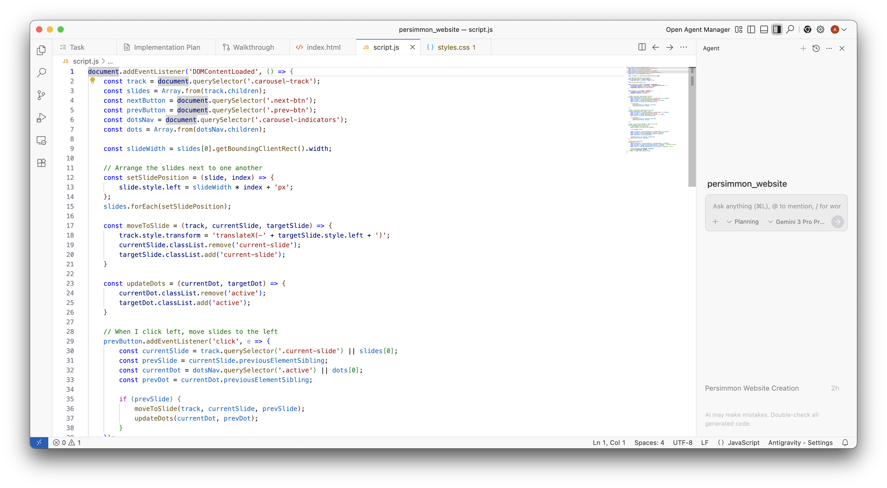
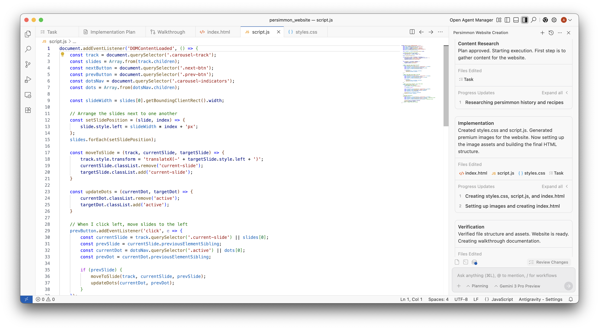

側邊面板 - Antigravity IDE
antigravity-ide
Antigravity IDE
功能
側邊面板 - Antigravity IDE Antigravity IDE 功能
Antigravity IDE
適用於：
Antigravity IDE
# 代理側欄

[「代理側邊面板」章節](#agent-side-panel)

使用 **代理** 編輯器中的側邊面板，直接與代理合作。在面板標題中，您可以開始新的對話、開啟側邊欄以在對話之間切換，以及跨對話搜尋。在提示詞輸入欄位中，輸入 `@` 提及檔案和其他內容脈絡，請輸入 `/` 執行操作，請按一下 **+** 新增檔案、資料夾和其他內容脈絡，並在以下兩者之間選取： [不同的模型](/docs/models).

隨著對話進行， **代理** 側邊面板會顯示代理每個回合的工作（展開 **適用於** 查看個別步驟）、其回覆，以及它變更的檔案摘要，並附上 **審查** 按鈕。在編輯等待您審查期間，提示詞輸入框上方會顯示一個橫條（例如， **1 個已變更的檔案**）會列出每個編輯過的檔案，並附上 **全部拒絕** 和 **全部接受** 按鈕，且編輯會以行內反白方式顯示在編輯器中，方便您 [審查每項變更](/docs/ide/review-changes-editor).

[上一個
Tab 補全](/docs/ide/tab/)

[下一步
代理總覽](/docs/agent/)

您的下載已開始

## 您如何得知我們？

請選一個。這有助於我們接觸更多像您一樣的人。

感謝您讓我們知道！
