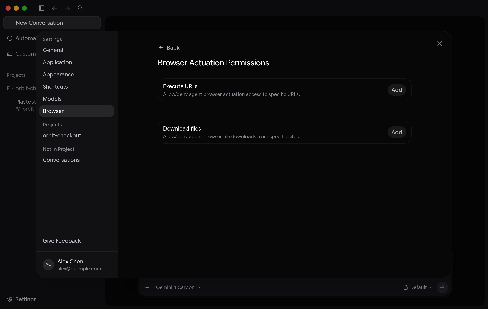

允許清單與拒絕清單 - Antigravity IDE
antigravity-ide
Antigravity IDE
功能
允許清單與拒絕清單 - Antigravity IDE Antigravity IDE 功能
Antigravity IDE
適用於：
Antigravity 應用程式
Antigravity IDE
# 允許清單與拒絕清單

[「允許清單與拒絕清單」章節](#allowlist-and-denylist)

Antigravity 會在 下先徵求你的同意 [瀏覽器子代理](/docs/browser) 開啟網站或
從您尚未允許的網域下載檔案。
若要提前決定，請將規則新增至 **瀏覽器操作規則**：按住

## 當子代理開啟網站或下載檔案時

[標題為「子代理開啟網站或下載檔案時」的章節](#when-the-subagent-opens-a-site-or-downloads-a-file)

當子代理嘗試在沒有規則的網站上開啟頁面時，Antigravity 會
提示 **允許在這個 URL 上執行動作？** 並要求您選擇
以下其中一項：

| 選項 | 其功能 |
| --- | --- |
| **是，僅允許這次** | 在子代理目前任務的剩餘期間允許該網站。 |
| **是，允許** *domain* **在這個對話中** | 在對話結束前允許該網站。 |
| **是，一律允許** *domain* | 將該網站的允許規則加入您的瀏覽器操作規則。 |
| **否** | 拒絕該要求。您可以告訴代理改做其他事。 |

當內建瀏覽器代理觸發檔案下載時（`v2.31.0+`)，
相符的 **允許瀏覽器代理下載檔案？** 提示會針對該網域提供每次執行、
對話或一律允許的選項（`data:` 和 `blob:`
下載一律要求一次性核准，且可執行檔或主動標記檔案
類型會自動遭到封鎖）。請參閱
[權限與安全防護機制](/docs/browser#permissions-and-safety-guardrails).

## 編輯規則

[標題為「編輯規則」的章節](#edit-the-rules)

若要開啟 **瀏覽器操作權限**:

- **Antigravity 應用程式** (`v2.30.0+`): Go to **設定** > **瀏覽器**，以及在 **瀏覽器子代理** 區段，按一下 **編輯** 旁邊 **瀏覽器操作 規則**.
- **Antigravity IDE** (`v2.6.0+`)：點選 **Antigravity** 在狀態列中，然後 選取 **開啟設定** > **瀏覽器** (或執行 **Antigravity：開啟設定** 從指令面板），然後按一下 **編輯** 旁邊 **瀏覽器操作 規則**.

您可以設定兩個獨立的規則清單：

- **執行網址** (`execute_url`)：瀏覽器子代理獲准開啟並互動、須詢問，或遭拒絕的網站。
- **下載檔案** (`download_url`)：瀏覽器子代理可從中下載檔案的網站。

旁邊 **執行網址** 或 **下載檔案**，按一下 **新增**，選擇 **允許**,
**詢問**，或 **拒絕**，並輸入例如以下的網站 `https://example.com` 或
`localhost:3000`。若要清除特定網站的 Cookie 與
儲存空間，請點選網址列中的連線安全性圖示，然後選取 **編輯** 或 **移除** 在它
旁邊。

## 規則的比對方式

[標題為「規則的比對方式」的章節](#how-rules-match)

- **網域與子網域**：獨立、可停駐的設定視窗， 會在重新啟動後保留其狀態。 `example.com` 也涵蓋 `docs.example.com` 以及兩者上的每個頁面。每次跨來源重新導向跳轉都會在代理與目的地互動之前 進行檢查。
- **拒絕優先**：A **拒絕** 規則優先於 **允許** 適用於 同一網站的規則，包括在 **Turbo** 權限預設集。
- **Per-port `localhost` isolation**：與對話並排管理瀏覽器、檔案、 產出物與審查分頁。`localhost`, `127.0.0.1`, `[::1]`) 會依通訊埠比對——針對 `localhost:3000` 不 涵蓋 `localhost:8080`。如需 Chrome 設定與 DevTools 效能分析工具， 請參閱 `localhost` 在沒有連接埠的情況下，以比對上的所有連接埠 `localhost`.
- **敏感的 Google 子網域**：身分識別提供者頁面 ( `accounts.google.com`, `myaccount.google.com`, `mail.google.com`, `docs.google.com`, `drive.google.com`, `calendar.google.com`, `chat.google.com`, `colab.research.google.com`，與 `console.cloud.google.com`——一律需要各自明確的規則。針對 `google.com` 或 `cloud.google.com` 不涵蓋它們（且登入與付款 主機即使已加入，仍會遭到封鎖，代理無法操作）。
- **直接讀取 URL**：將目前工作階段中的修正轉換為規則與技能。 **網路存取規則** (`read_url`) in [權限](/docs/permissions).

## 機構設定的規則

[標題為「機構設定的規則」的章節](#rules-set-by-your-organization)

如果您組織的管理員設定了瀏覽器子代理可使用的網域，子代理就無法開啟任何其他網站。
管理員設定的網域會顯示在 **機構允許的網域（唯讀）** 在瀏覽器
操作規則中，Antigravity 在開啟這些網站之前仍會先詢問，除非您新增
一條允許規則。如果您的管理員停用瀏覽器子代理，
**瀏覽器子代理** 設定區段會顯示通知，而非
規則。

[上一個
瀏覽器使用](/docs/browser/)

[下一步
IDE 瀏覽器總覽](/docs/ide/browser/)

您的下載已開始

## 您如何得知我們？

請選一個。這有助於我們接觸更多像您一樣的人。

感謝您讓我們知道！
