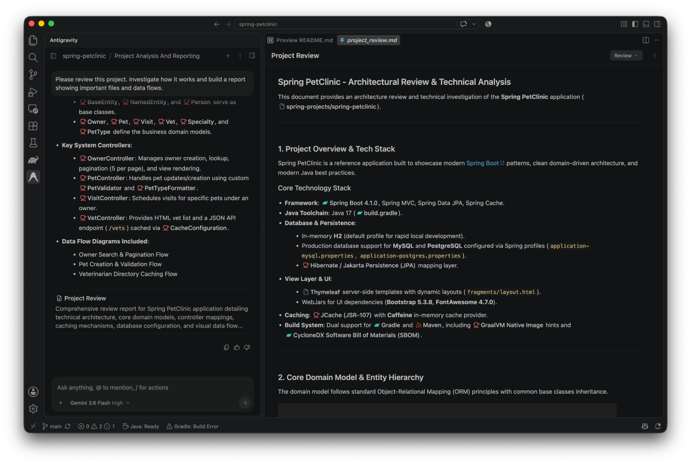
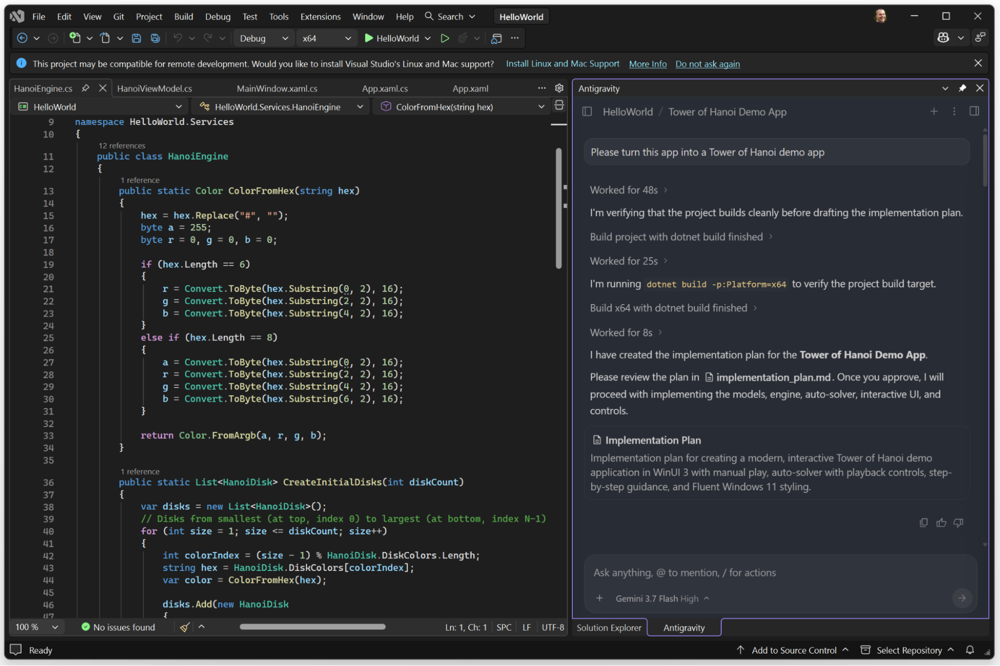
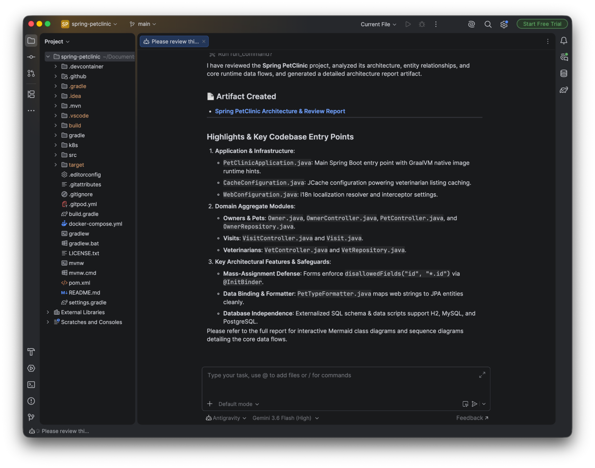
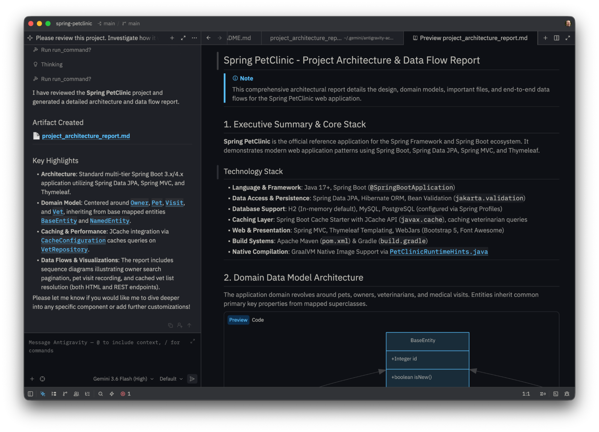
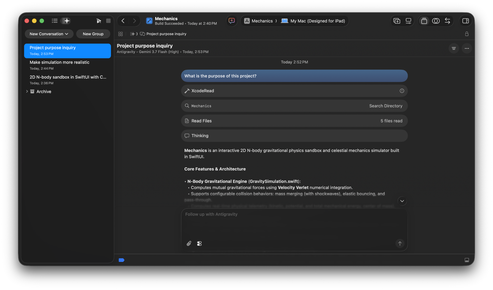

IDE 擴充功能
ide
IDE 擴充功能
開始使用
IDE 擴充功能 IDE 擴充功能開始使用
IDE 擴充功能
# IDE 擴充功能

[「IDE 擴充功能」章節](#ide-extensions)

Antigravity IDE 擴充功能將 Google 的代理式開發平台直接帶入您喜愛的編輯器。無需切換開發環境，您就可以在專屬側欄中與代理對話、審查精細的內嵌差異、檢視互動式計畫，並在日常工作流程中原生執行多步驟工程任務。

---

## 支援的 IDE 與編輯器

[「支援的 IDE 與編輯器」章節](#supported-ides-and-editors)

Top IDE Tabs
Carousel Viewport
Left: Info & CTA
### Visual Studio Code

VS Code Marketplace 上的輕量擴充功能，適用於 macOS、Linux 和 Windows。

[安裝 & VS Code 指南](/docs/ide/extensions/vscode)

Right: Screenshot

Left: Info & CTA
### Visual Studio

Visual Studio 2026 與 .NET 解決方案架構的官方 VSIX 擴充功能。

[安裝 & Visual Studio 指南](/docs/ide/extensions/visual-studio)

Right: Screenshot

Left: Info & CTA
### JetBrains

IntelliJ IDEA、PyCharm、WebStorm、GoLand、CLion、Rider 等的一鍵安裝（企業版支援為預覽版）。

[安裝 & JetBrains 指南](/docs/ide/extensions/jetbrains)

Right: Screenshot

Left: Info & CTA
### Zed

Zed 編輯器中的高效能原生代理編輯（企業版支援預覽中）。

[安裝 & Zed 指南](/docs/ide/extensions/zed)

Right: Screenshot

Left: Info & CTA
### Xcode

在 Xcode 中進行原生代理式開發，適用於 macOS、iOS、iPadOS、watchOS 和 visionOS（企業版支援為預覽版）。

[安裝 & Xcode 指南](/docs/ide/extensions/xcode)

Right: Screenshot

Left: Info & CTA
### Eclipse

在 macOS、Linux 與 Windows 上的 Eclipse 內提供代理式工作流程、多步驟工作執行與差異檢閱（公開預覽）。

[安裝 & Eclipse 指南](/docs/ide/extensions/eclipse)

Right: Screenshot
Bottom Controls Bar
### 其他編輯器與工具 (ACP)

[標題為「其他編輯器與工具 (ACP)」的章節](#other-editors-and-tools-acp)

Antigravity 也可在其他支援以下功能的編輯器中使用 [代理用戶端通訊協定 (ACP)](https://agentclientprotocol.com)。Antigravity CLI 內含 ACP 伺服器， `agy acp`，這些編輯器會啟動它，以便在自己的聊天面板中執行代理。可用功能取決於編輯器。

[其他編輯器 (ACP)](/docs/ide/extensions/acp)

將 VS Code、Zed、JetBrains IDE、Android Studio、Xcode 及其他 ACP 用戶端連結至 Antigravity CLI。
---

## 驗證與授權

[「驗證與授權」章節](#authentication-and-licensing)

Antigravity 在所有 IDE 擴充功能、Antigravity CLI 與 Antigravity 應用程式（桌面版）中使用統一的驗證系統。您的登入決定了您的模型權利、配額限制與資料隱私政策。

### 個人開發者

[「個人開發者」章節](#individual-developers)

若您是個人開發者，可使用任何個人 Google 帳戶登入：

1. 按一下編輯器活動列或工具視窗中的 Antigravity 圖示，然後按一下 **登入**.
2. 在預設網頁瀏覽器中完成驗證。
3. 您的工作階段會自動連接至您的帳號，以使用您方案的模型點數與速率限制（包括免費層級）。

[Antigravity 定價與方案](/pricing)

探索可用方案、點數上限與開發人員定價。
### 企業版團隊與組織

[「企業版團隊與組織」章節](#enterprise-teams-and-organizations)

對於企業版開發人員，Antigravity 直接整合 **Gemini 企業版** 與 Google Cloud 治理（目前處於 **預覽** 適用於 JetBrains、Zed、Xcode 和 Eclipse）：

1. 按一下 **登入** 並選取 **使用 Gemini Enterprise 登入**.
2. 使用您的企業身分驗證（包括 BYOID 與 Workforce Identity Federation）。
3. 選取您的目標 **Google Cloud 專案** 和 **區域** 在提示時。
4. **企業版保證**：審查以下企業保護：  **資料隱私權**：您的程式碼、提示詞與代理記錄是 **永不** 用於訓練 Google 基礎模型。 **法規遵循**：所有代理互動皆在企業級 Google Cloud 服務條款下運作。 **安全性**：遵守您組織的 IAM 政策、VPC Service Controls (VPC-SC)，以及自訂雙區域或主權雲邊界。

[Gemini 企業版文件](/docs/enterprise)

深入了解企業部署、IAM 角色對應、VPC Service Controls 與資料落地。
[上一個
與 Google 攜手建置](/docs/build-with-google/)

[下一步
Visual Studio Code](/docs/ide/extensions/vscode/)

您的下載已開始

## 您如何得知我們？

請選一個。這有助於我們接觸更多像您一樣的人。

感謝您讓我們知道！
