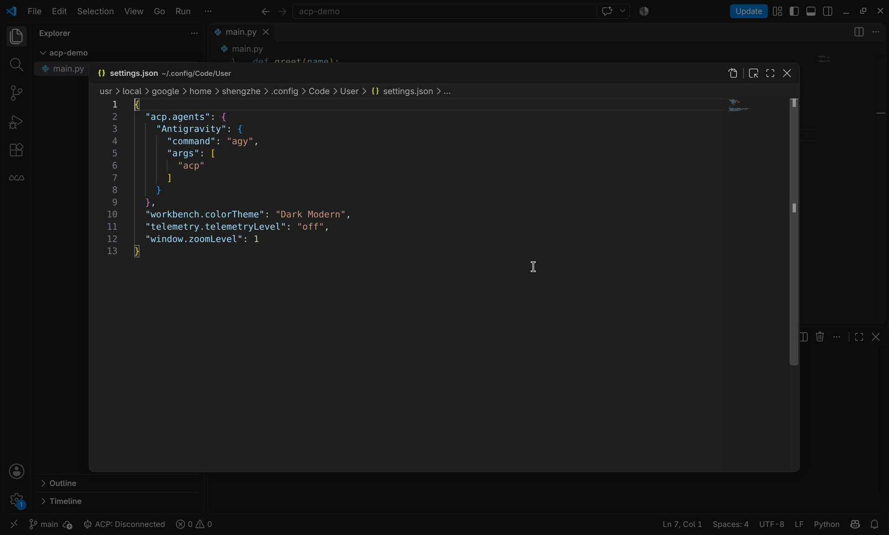
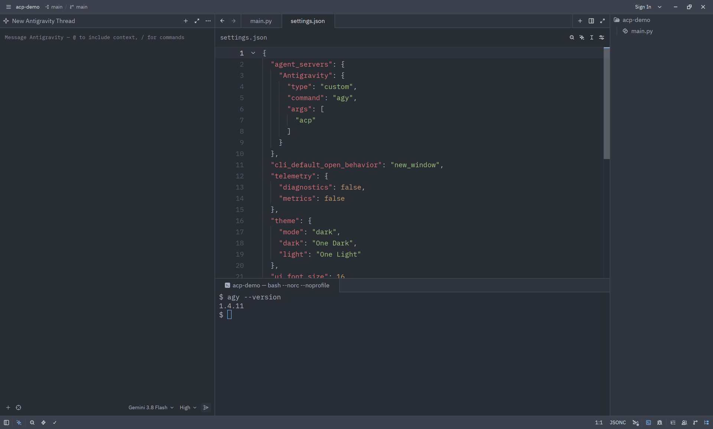
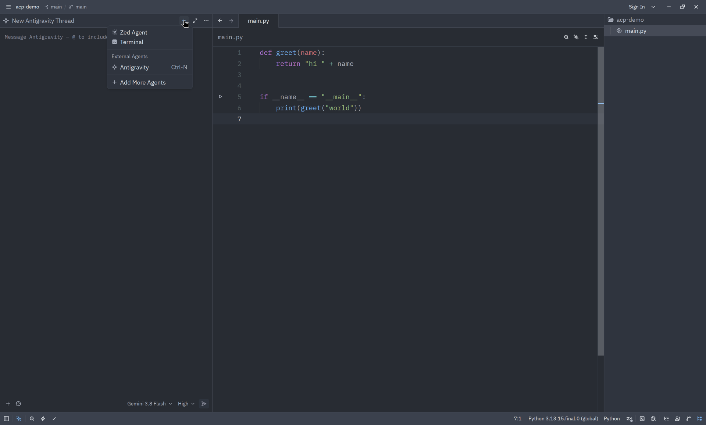
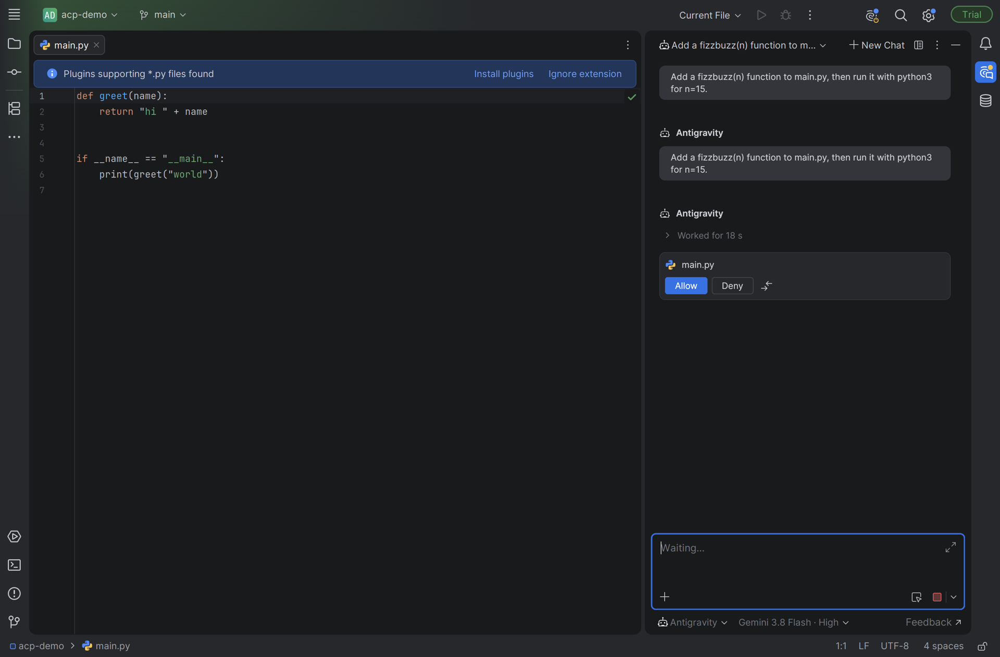
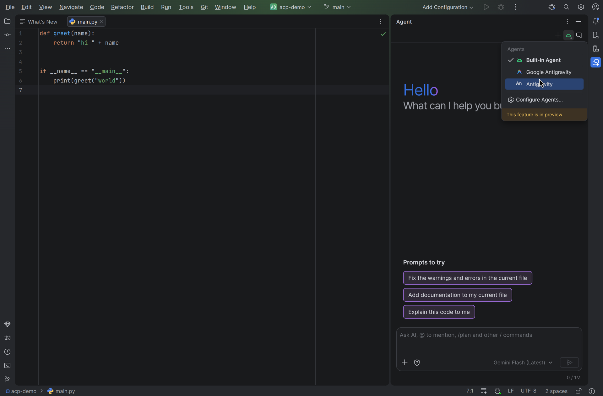
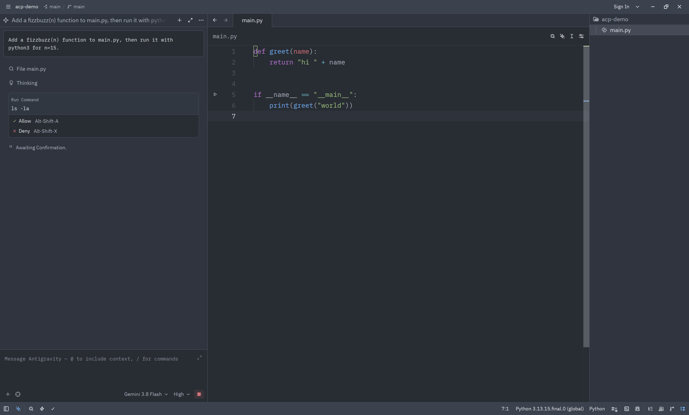
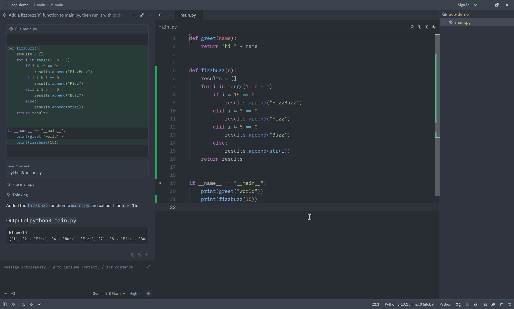

其他編輯器 (ACP) - IDE 擴充功能
ide
IDE 擴充功能
開始使用
其他編輯器 (ACP) - IDE 擴充功能 IDE 擴充功能 開始使用
IDE 擴充功能
# 其他編輯器 (ACP)

[標題為「其他編輯器 (ACP)」的章節](#other-editors-acp)

在任何支援下列通訊協定的編輯器中使用 Antigravity [代理用戶端通訊協定](https://agentclientprotocol.com) （ACP）。Antigravity CLI 內含 ACP 伺服器， `agy acp`，因此任何編輯器都可以在自己的面板中執行它並與代理對話。Zed、JetBrains IDE、Android Studio 和 Xcode 原生支援 ACP。VS Code 需要社群擴充功能。

`agy acp` 會啟動一個透過以下方式使用 JSON-RPC 通訊的 ACP 伺服器： `stdin` 和 `stdout`。您的編輯器會將它作為子程序啟動、傳送提示詞，並在其原生 UI 中算繪代理的回覆、工具呼叫、檔案差異和權限要求。代理、其工具和您的設定都來自 Antigravity CLI，因此代理在編輯器中的行為與在終端機中相同。

這段影片示範說明如何在 Zed 編輯器中設定 ACP：

## 開始之前

[「開始之前」章節](#before-you-begin)

- [安裝 Antigravity CLI](/docs/install?tab=cli) 並確認 `agy` 在您的 `PATH`: `agy --version`
- 使用互動式⋯登入一次 `agy` 工作階段，或執行 `agy acp --login`. `agy acp` 會重複使用快取的憑證。若要改從編輯器進行驗證，請參閱 [Authentication](#authentication).
- 尋找以下項目的絕對路徑 `agy`。有些編輯器會在沒有您 Shell 的 `PATH`: `which agy`

## 連結您的編輯器

[標題為「連線您的編輯器」的章節](#connect-your-editor)

每個用戶端都會註冊相同的指令： `agy` 搭配單一引數 `acp`.

- [VS Code](#tab-panel-188)
- [Zed](#tab-panel-189)
- [JetBrains IDEs](#tab-panel-190)
- [Android Studio](#tab-panel-191)
- [Xcode](#tab-panel-192)
- [其他用戶端](#tab-panel-193)

### VS Code

[標題為「VS Code」的章節](#sr-tab-1)

VS Code 不原生支援 ACP。請安裝社群 [ACP 用戶端](https://marketplace.visualstudio.com/items?itemName=formulahendry.acp-client) 擴充功能，然後將 Antigravity 新增至您的使用者 `settings.json`:

```
{
  "acp.agents": {
    "Antigravity": {
      "command": "agy",
      "args": ["acp"]
    }
  }
}
```

如要開始工作階段：

1. 開啟 **ACP 用戶端** 從活動列檢視。
2. 執行 **ACP：連結至代理** 從命令選擇區中選擇 **Antigravity**.
3. 在以下位置輸入提示詞 **Chat** 面板。



### Zed

[「Zed」章節](#sr-tab-2)

在 Zed 中將 Antigravity 新增為自訂代理伺服器 `settings.json` (**zed：開啟設定檔**):

```
{
  "agent_servers": {
    "Antigravity": {
      "type": "custom",
      "command": "agy",
      "args": ["acp"]
    }
  }
}
```

如要開始工作階段，請開啟代理面板，然後按一下 **+**，然後選擇 **Antigravity** 下方 **外部代理**.





### JetBrains IDEs

[標題為「JetBrains IDE」的章節](#sr-tab-3)

JetBrains IDE（IntelliJ IDEA、PyCharm、GoLand、WebStorm 等）會在以下位置執行 ACP 代理 **AI 聊天** 工具視窗，隨附 **AI 助理** 外掛程式。如果 AI Chat 要求您安裝此外掛程式，請按一下 **安裝外掛程式**.

IDE 會從⋯讀取自訂代理 `~/.jetbrains/acp.json`。從 **AI 聊天** 工具視窗，包含 **新增自訂代理**，或自行建立：

```
{
  "agent_servers": {
    "Antigravity": {
      "command": "/absolute/path/to/agy",
      "args": ["acp"]
    }
  }
}
```

使用來自以下位置的絕對路徑 `which agy`。JetBrains IDE 不一定會繼承您 Shell 的 `PATH`.

重新開啟 **AI 聊天** 工具視窗，然後選取 **Antigravity** 從提示詞方塊下方的代理選擇器中選取。



### Android Studio

[標題為「Android Studio」的章節](#sr-tab-4)

Android Studio 使用相同的 `~/.jetbrains/acp.json` 檔案，如同其他 JetBrains IDE：

```
{
  "agent_servers": {
    "Antigravity": {
      "command": "/absolute/path/to/agy",
      "args": ["acp"]
    }
  }
}
```

如要開始工作階段：

1. 重新啟動 Android Studio，然後開啟 **代理** 工具視窗。
2. 按一下面板頂端的代理挑選器，然後選擇 **Antigravity**，您在 `acp.json`。自訂代理目前為預覽版。
3. 輸入提示詞。模型與思考層級選擇器會顯示在提示詞方塊下方。



如果編輯器未顯示代理所做的變更，請選擇 **檔案 > 從磁碟重新載入全部**.

### Xcode

[「Xcode」章節](#sr-tab-5)

1. 開啟 **Xcode > 設定 > Intelligence**.
2. 在 **代理**，按一下 **新增代理**.
3. 設定 **指令** 至來自以下位置的絕對路徑： `which agy`。Xcode 不會展開 `~` 或讀取您的 Shell 的 `PATH`.
4. 設定 **引數** 至 `acp`，然後按一下 **新增**.

### 其他用戶端

[標題為「其他用戶端」的章節](#sr-tab-6)

任何 ACP 用戶端都可以啟動 Antigravity CLI。請設定以專案目錄為工作目錄來執行此指令：

```
agy acp
```

伺服器使用 ACP 通訊協定第 1 版，透過 `stdio` 並以以下身分識別自己 `Antigravity ACP Server`.

## 與代理合作

[標題為「與代理合作」的章節](#work-with-the-agent)

連線後，請以與在終端機中相同的方式向代理發出提示詞。編輯器會顯示回合的每個步驟：

- **工具呼叫** 會在執行時顯示，並附上其觸及的命令或檔案。
- **Edits** 以差異形式串流回來，讓您可以在編輯器中審查變更。
- **權限要求** 暫停該回合，直到您允許或拒絕該動作。
- **斜線指令** Antigravity CLI 支援的項目會出現在用戶端的命令選單中。
- **對話標題** 會隨著工作階段進行而自動更新。
- **圖片與內嵌資源**：貼上圖片或附加檔案，作為提示詞的情境。
- **Questions**：當代理提出問題時，支援 ACP 引導式表單的用戶端會顯示原生表單。其他用戶端會在聊天中顯示問題。
- **Steering**：在回合進行中傳送提示詞會引導該回合，而非開始新的回合。
- **取消**：取消回合會結束進行中的工具呼叫，並捨棄待處理的權限要求。





### 模型與思考層級

[標題為「模型與思考層級」的章節](#models-and-thinking-level)

伺服器提供兩個工作階段選項，用戶端會以選擇器顯示：

| 選項 | Values |
| --- | --- |
| 模型 | 您的帳戶可用的模型 |
| 思考層級 | `Low`, `Medium`, `High`, `Extra`, `Max` |

Gemini 模型適用於每個用戶端。第三方模型僅提供給 JetBrains IDE（包括 JetBrains Air）、Android Studio、Android Performance Analyzer、Zed 與 Xcode。

### 權限

[標題為「權限」的章節](#permissions)

代理想要執行命令或變更檔案時，用戶端會顯示包含以下內容的權限請求 **允許** 和 **拒絕** 選項。您的 [權限規則](/docs/permissions) 仍適用：您的規則已允許或拒絕的動作不會提示。

如要完全略過提示，請新增 `--dangerously-skip-permissions` 至代理的 `args`。僅在 [sandboxed](/docs/sandbox) 或用完即棄的環境。

### Sessions

[標題為「工作階段」的章節](#sessions)

伺服器支援載入、繼續、列出與關閉工作階段。支援這些 ACP 功能的用戶端可以重新開啟先前的 Antigravity 對話，而不必開始新的對話。繼續工作階段會重新開啟對話，而不會重播其歷程記錄。具備多根目錄工作區的編輯器（例如 Zed）也可以傳送額外的工作區資料夾。

## Authentication

[標題為「驗證」的章節](#authentication)

`agy acp` 會使用您透過互動式以下項目快取的憑證： `agy` 工作階段。如果沒有可用的憑證，要求會失敗並顯示以下錯誤： `Authentication required` （程式碼 `-32000`），而用戶端可以要求您使用下列其中一種方法登入：

| Method | ID | Notes |
| --- | --- | --- |
| 使用 Google 登入 | `oauth-personal` | 為個人 Google 帳戶開啟瀏覽器登入 |
| 使用 Gemini Enterprise 登入 | `oauth-business` | 為 Gemini Enterprise 帳戶開啟瀏覽器登入 |
| Gemini API 金鑰 | `gemini-api-key` | Reads `GEMINI_API_KEY` 從代理的環境 |
| Gemini Enterprise Agent Platform | `agent-platform` | 先前為 Vertex AI。使用應用程式預設憑證搭配 `GOOGLE_CLOUD_PROJECT` 和 `GOOGLE_CLOUD_LOCATION`，或 `gcp.project` 和 `gcp.location` 於 `settings.json` |
| 從終端機登入 | `terminal-login` | 在終端機中貼上代碼，使用您的 Google 帳戶登入。可透過 SSH 使用。僅提供給支援 ACP 終端機驗證的用戶端 |

如要透過編輯器傳遞 API 金鑰，請在代理的環境中設定。例如，在 Zed 中：

```
{
  "agent_servers": {
    "Antigravity": {
      "type": "custom",
      "command": "agy",
      "args": ["acp"],
      "env": { "GEMINI_API_KEY": "<your-api-key>" }
    }
  }
}
```

## Flags

[標題為「旗標」的章節](#flags)

在後方加入旗標 `acp` 在用戶端的 `args` 清單，例如 `["acp", "--sandbox"]`.

| 旗標 | 預設 | 描述 |
| --- | --- | --- |
| `--add-dir` | — | 將目錄加入工作區。如需加入更多目錄，請重複此步驟。 |
| `--agent` | — | ACP 工作階段要使用的代理（請參閱 `agy agents`) |
| `--sandbox` | `false` | 在啟用終端機沙箱限制的情況下執行 |
| `--dangerously-skip-permissions` | `false` | 自動核准所有工具權限請求 |
| `--process-per-session` | `false` | 每個工作階段由隔離的工作者處理程序提供服務。編輯器設定的 HTTP MCP 伺服器需要此設定。 |
| `--ide-mcp-port` | — | 將編輯器的 MCP 伺服器移植過來，向代理公開其工具。需要 `nc` 於 `PATH`. |
| `--login` | `false` | 在終端機中貼上代碼，以互動方式使用 Google 登入，然後結束。可透過 SSH 使用。 |
| `--log-file` | — | 將 ACP 伺服器記錄檔寫入此路徑 |
| `--disable-telemetry` | `false` | 停用此伺服器的遙測功能 |

## 疑難排解

[「疑難排解」章節](#troubleshooting)

**代理無法啟動。** 執行 `agy acp --help` 在終端機中執行，以確認您安裝的版本包含 ACP。如果在終端機中可以運作，但在編輯器中不行，請更換 `agy` 搭配來自以下位置的絕對路徑： `which agy`.

**要求失敗，錯誤為 `Authentication required`.** 執行 `agy` 以互動方式登入一次，或如所示透過代理的環境傳遞憑證 [Authentication](#authentication).

**透過 SSH 或在沒有瀏覽器的情況下登入失敗。** 執行 `agy acp --login` 在該電腦上的終端機中執行，然後再試一次。或者，使用 Gemini API 金鑰。

**您需要更多詳細資訊。** 伺服器會將記錄檔寫入 `~/.gemini/antigravity-cli/log/acp-*.log`。使用 `--log-file` 選擇不同的路徑。

## 後續步驟

[「後續步驟」章節](#next-steps)

- **[權限](/docs/permissions)**：設定代理無需詢問即可執行的動作。
- **[MCP](/docs/mcp)**：連結 MCP 伺服器，為代理提供更多工具。
- **[無頭模式](/docs/cli/headless)**：在指令碼和 CI 中以非互動方式執行代理。
- **[參考](/docs/cli/reference)**：完整的指令與旗標參考。

[上一個
Eclipse](/docs/ide/extensions/eclipse/)

[下一步
CLI 指令](/docs/cli/reference/)

您的下載已開始

## 您如何得知我們？

請選一個。這有助於我們接觸更多像您一樣的人。

感謝您讓我們知道！
