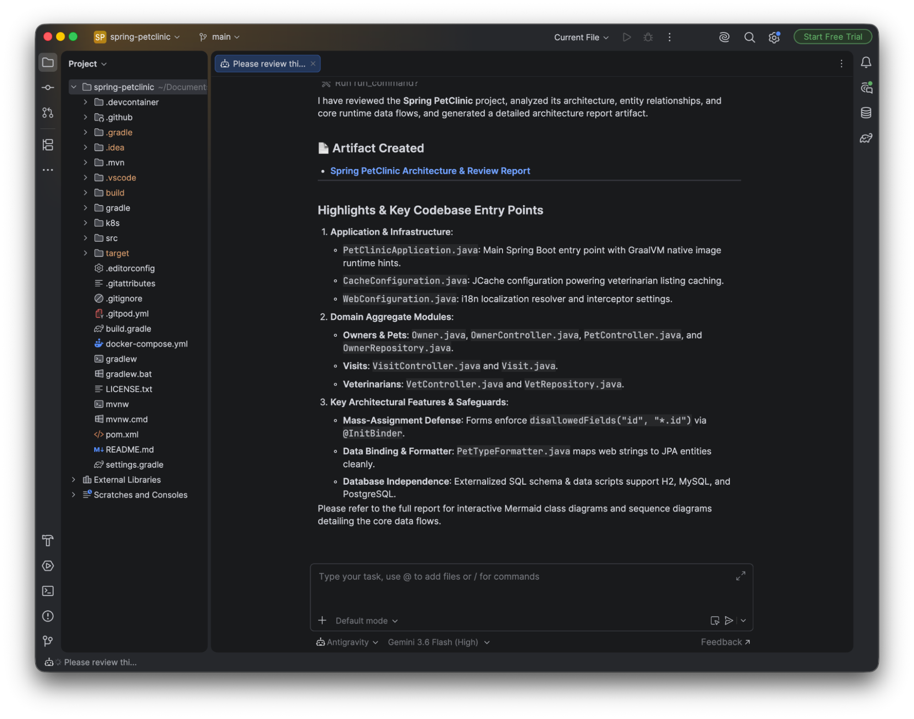

IntelliJ 架構 IDE - IDE 擴充功能
ide
IDE 擴充功能
開始使用
IntelliJ 架構 IDE - IDE 擴充功能 IDE 擴充功能開始使用
IDE 擴充功能
# IntelliJ 架構 IDE

[「IntelliJ 系列 IDE」章節](#intellij-based-ides)

Antigravity 支援完整的 **IntelliJ 架構 IDE**— 包括 IntelliJ IDEA、PyCharm、WebStorm、GoLand、CLion、Rider 等 — 從版本…開始 **2026.2.1+**.

---

## 先決條件

[「前置條件」章節](#prerequisites)

安裝擴充功能前，請確認符合下列必要條件：

- **IntelliJ 架構 IDE**：任何以 IntelliJ 為基礎的 IDE，2026.2.1 版或更新版本，適用於 macOS、Linux 或 Windows。
- **Antigravity 權利**：任何 Antigravity 方案（含免費方案）的 Google 帳戶，或 **Gemini 企業版** （企業版支援目前處於預覽階段）。

---

## 安裝與設定

[「安裝與設定」章節](#installation-and-setup)

完成下列步驟以安裝 Antigravity 擴充功能：

1. 開啟您的 IntelliJ 系列 IDE。
2. 開啟 **JetBrains AI** > **設定** > **代理**.
3. 搜尋 **Antigravity**.
4. 按一下 **安裝**.



---

## 驗證與授權

[「驗證與授權」章節](#authentication-and-licensing)

Desktop / Tablet Segmented Control
Mobile / Narrow Dropdown Select
### Google 帳戶

適用於個人 Google AI 訂閱方案（包括免費、Pro 與 Ultra）：

```
{
  "auth": {
    "type": "oauth-personal"
  }
}
```

### Gemini 企業版

請聯絡您的雲端管理員取得 GCP 專案 ID 與區域（JetBrains、Zed、Xcode 與 Eclipse 的企業版支援目前為預覽版）：

```
{
  "auth": {
    "type": "oauth-business"
  },
  "gcp": {
    "project": "<YOUR_GCP_PROJECT_ID>",
    "location": "<YOUR_GCP_REGION>"
  }
}
```

### Gemini API

使用 Gemini API 金鑰驗證：

```
{
  "auth": {
    "type": "gemini-api-key"
  }
}
```

### API / ADC

使用 API 金鑰或 Application Default Credentials (ADC) 驗證 Gemini Enterprise（預覽版）。使用 ADC 時，請指定您的 GCP 專案 ID 與區域：

```
{
  "auth": {
    "type": "agent-platform"
  },
  "gcp": {
    "project": "<YOUR_GCP_PROJECT_ID>",
    "location": "<YOUR_GCP_REGION>"
  }
}
```

[上一個
Visual Studio](/docs/ide/extensions/visual-studio/)

[下一步
Zed](/docs/ide/extensions/zed/)

您的下載已開始

## 您如何得知我們？

請選一個。這有助於我們接觸更多像您一樣的人。

感謝您讓我們知道！
