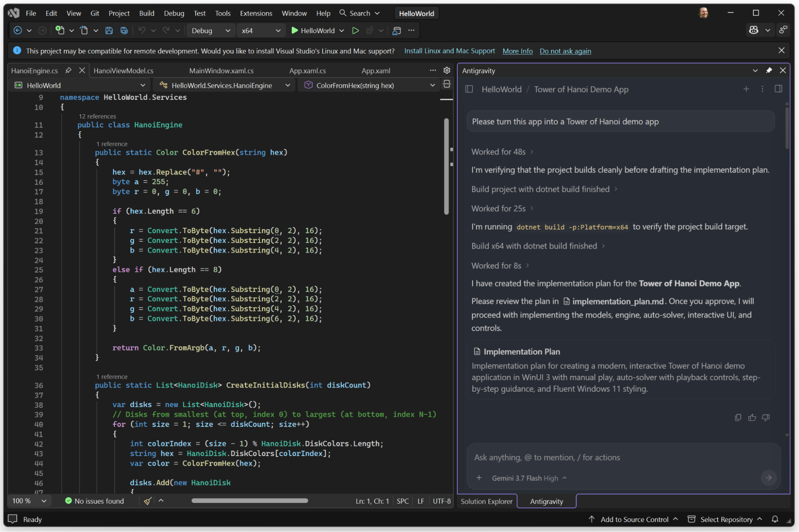

Visual Studio - IDE 擴充功能
ide
IDE 擴充功能
開始使用
Visual Studio - IDE 擴充功能 IDE 擴充功能 開始使用
IDE 擴充功能
# Visual Studio

[「Visual Studio」章節](#visual-studio)

The **適用於 Visual Studio 的 Antigravity** 擴充功能將 Google 的代理工程平台帶給處理複雜企業解決方案與多專案 MSBuild 架構的 Windows 與 .NET 開發人員。

[1. 下載 Visual Studio 2026](https://visualstudio.microsoft.com/vs/)

若尚未安裝，請取得 Windows 版 Visual Studio 2026。
[2. 安裝 Antigravity 擴充功能](https://marketplace.visualstudio.com/items?itemName=Google.GoogleAntigravity)

從 Visual Studio Marketplace 下載官方 Google Antigravity VSIX 擴充功能。
---

## 先決條件

[「前置條件」章節](#prerequisites)

安裝擴充功能前，請確認符合下列必要條件：

- **Visual Studio**：在 Antigravity App 中觀看即時內建瀏覽器工作流程、平行 瀏覽器分頁、登入交接與瀏覽器設定。
- **Antigravity 權利**：任何 Antigravity 方案（含免費方案）的有效 Google 帳戶，或 **Gemini 企業版** 授權。

---

## 安裝與設定

[「安裝與設定」章節](#installation-and-setup)

完成下列步驟以安裝 Visual Studio 擴充功能：

1. 開啟 Visual Studio 2026。
2. 在頂部選單中，導覽至 **擴充功能** > **管理擴充功能**.
3. 在右上角的搜尋框中，輸入 **Google Antigravity**.
4. 選取官方 **Google Antigravity** 由以下發布的擴充功能 **Google** 並按一下 **下載**.
5. 關閉所有 Visual Studio 執行個體，讓 VSIX 安裝程式完成安裝。
6. 重新開啟 Visual Studio。 **Antigravity** 工具視窗會在首次啟動時自動開啟，並以分頁形式停靠在 Solution Explorer 旁邊。如需稍後開啟，請前往 **檢視** > **其他視窗** > **Antigravity**，或按下 Ctrl + \, Ctrl + Alt + L.

---

## 驗證與登入

[「驗證與登入」章節](#authentication-and-sign-in)

Antigravity 在所有介面使用統一登入。深入了解驗證與權利：

[Gemini 企業版驗證](/docs/enterprise)

了解企業開發人員與管理員如何使用 Google Cloud 憑證與 IAM 政策設定登入。
[Antigravity 應用程式總覽](/docs/overview)

了解登入與帳戶權益在 Antigravity 應用程式與開發者介面之間的運作方式。
---

## 在 Visual Studio 中使用 Antigravity

[標題為「在 Visual Studio 中使用 Antigravity」的章節](#work-with-antigravity-in-visual-studio)

此擴充功能與 Visual Studio 的原生視窗與解決方案模型整合：

- **Antigravity 工具視窗**：協調者，接著是分組為
- **Antigravity 設定工具視窗**：在以下位置手動新增伺服器
- **解決方案同步**：運用多代理推理處理 困難問題。 **開啟資料夾** 工作區）做為代理的工作區，並在您切換方案或資料夾時跟隨切換；若有對話進行中，會先詢問。
- **輸出視窗**：選擇 **Google Antigravity** 在「輸出」視窗中查看 擴充功能記錄，或 **Google Antigravity 語言伺服器** 以串流傳送來自 背景伺服器的記錄。

---

## 鍵盤快速鍵

[「鍵盤快速鍵」章節](#keyboard-shortcuts)

Antigravity 在 Visual Studio 中的快速鍵是以 開頭的組合鍵
Ctrl + \. 按下 Ctrl + \，放開
兩個按鍵，然後按下第二組按鍵組合。

| 動作 | 快速鍵 |
| --- | --- |
| 開啟或關閉 Antigravity 工具視窗，並將使用中的檔案或選取內容加入為脈絡 | Ctrl + \, Ctrl + Alt + L |
| 開始新的對話 | Ctrl + \, Ctrl + Shift + L |
| 核准待處理的代理步驟 | Ctrl + \, Alt + Enter |
| 拒絕待處理的代理步驟 | Ctrl + \, Shift + Alt + Enter |
| 中斷執行中的代理 | Ctrl + \, Esc |

---

## 審查代理變更

[標題為「審查代理變更」的章節](#review-agent-changes)

當代理編輯檔案時，Antigravity 會在 Visual Studio 的原生差異檢視器中，將每項變更顯示為內嵌或
並排差異，方便您檢閱：

- **將終端機選取範圍或輸出加入對話**：選擇 以 Chrome 為基礎的子代理是否可以執行自訂 JavaScript (`CRLF` 和 `LF`).
- **批次控制項**：檢視， **全部接受** 和 **全部拒絕** 列，以套用或 捨棄代理的編輯。審查中的檔案在您做出 決定之前會保持唯讀。
- **產出物**: [產出物](/docs/artifacts) 例如實作計畫（ 例如，在您執行 [`/plan`](/docs/plan)) 且導覽會在 Visual Studio 文件分頁中開啟。

---

## 代理與代理設定

[標題為「代理與代理設定」的章節](#agents-and-agent-settings)

在 **Antigravity** 工具視窗，您可以追蹤父代理與任何子
[子代理](/docs/subagents) 啟動時，例如內建 `research` 和
`self` 子代理或您自己的自訂子代理。每個子代理都可以共用其
父代理的工作區（`inherit`)，在隔離的 Git 工作樹中工作 (`branch`)，或
共用目錄儲存空間 (`share`)。請查看每個代理在其 [產出物](/docs/artifacts).

在 **Antigravity 設定** 工具視窗，您可以控制代理
自行處理的程度：

- **[終端機指令自動執行](/docs/agent-settings#terminal-command-auto-execution)**： 在建立規則、技能、外掛程式、 掛鉤或 MCP 伺服器之前，請先載入自訂參考資料。 **要求審查** 以核准每個指令，或 **一律繼續** 以 讓代理執行指令時無須詢問。
- **[非工作區檔案存取](/docs/agent-settings#agent-non-workspace-file-access)**： 詢問如何使用或設定 Antigravity，並從官方 文件取得答案。

---

## Model Context Protocol (MCP)

[「模型情境協定（MCP）」章節](#model-context-protocol-mcp)

將代理連線至 BigQuery、Spanner、AlloyDB 與 Cloud SQL
for SQL Server 等資料庫，以及 GitHub、Atlassian、Linear 與 Notion 等工具，
透過 [MCP 伺服器](/docs/mcp):

- **MCP 商店**：瀏覽器子代理預設使用 Gemini Flash 模型，以 保持 UI 互動快速並節省較高層級的配額。若要在模型選擇器中為瀏覽器 子代理指定特定模型，請在提示詞中提出要求。 [支援的 MCP 伺服器](/docs/mcp#supported-mcp-servers) 從內建 MCP 商店。
- **設定檔**：代理控制的 頁面無法進入全螢幕、鎖定滑鼠指標或鍵盤 ( `~/.gemini/config/mcp_config.json` (所有專案) 或 `.agents/mcp_config.json` 在您的工作區中（僅限該工作區）。

MCP 伺服器的憑證會保留在你的電腦上，代理在呼叫 MCP 工具前會先徵求你的
核准，除非你在 變更此設定
[權限設定](/docs/permissions).

[上一個
Visual Studio Code](/docs/ide/extensions/vscode/)

[下一步
JetBrains IDEs](/docs/ide/extensions/jetbrains/)

您的下載已開始

## 您如何得知我們？

請選一個。這有助於我們接觸更多像您一樣的人。

感謝您讓我們知道！
