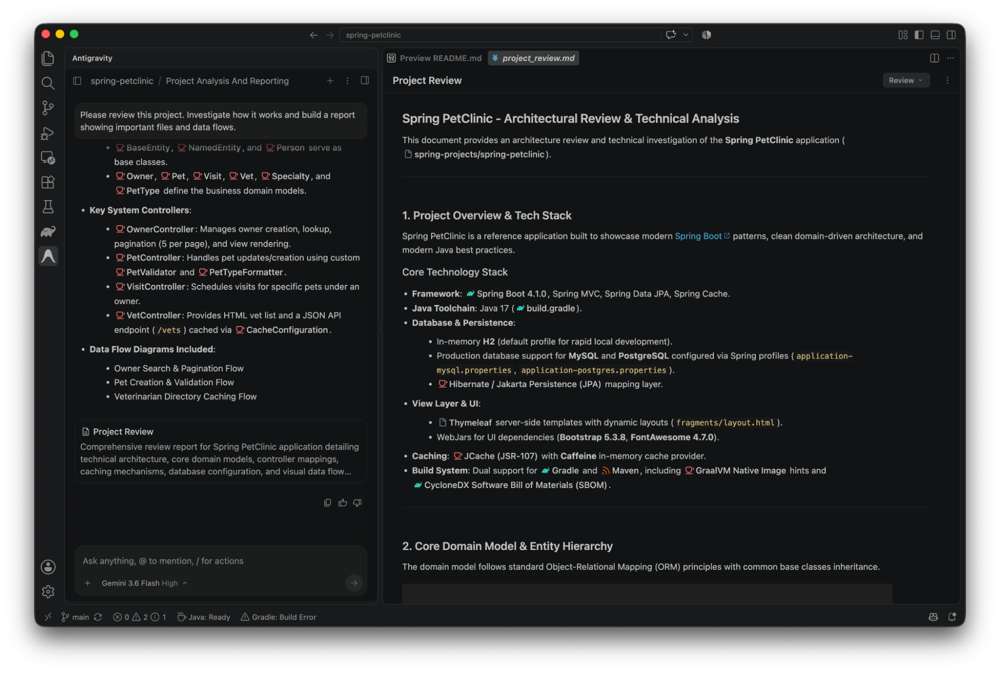

Visual Studio Code - IDE 擴充功能
ide
IDE 擴充功能
開始使用
Visual Studio Code - IDE 擴充功能 IDE 擴充功能 開始使用
IDE 擴充功能
# Visual Studio Code

[「Visual Studio Code」章節](#visual-studio-code)

The **適用於 Visual Studio Code 的 Antigravity** 擴充功能將 Google Antigravity 的完整代理能力帶入 VS Code。在專屬側邊面板中與代理對話、審查細緻的內嵌差異、檢查互動式計畫，並執行多步驟工程任務，無需離開編輯器。

[1. 下載 VS Code](https://code.visualstudio.com/)

若尚未安裝，請取得 macOS、Linux 或 Windows 版 Visual Studio Code。
[2. 安裝 Antigravity 擴充功能](https://marketplace.visualstudio.com/items?itemName=Google.google-antigravity)

從 VS Code Marketplace 下載官方 Google Antigravity 擴充功能。
---

## 先決條件

[「前置條件」章節](#prerequisites)

安裝擴充功能前，請確認符合下列必要條件：

- **Visual Studio Code**：macOS、Linux 或 Windows 上的 1.90 版或更新版本。
- **Antigravity 權利**：任何 Antigravity 方案（含免費方案）的 Google 帳戶，或已啟用以下功能的企業帳戶 **Gemini 企業版**.

---

## 安裝與設定

[「安裝與設定」章節](#installation-and-setup)

完成下列步驟以安裝 VS Code 擴充功能：

1. 開啟 Visual Studio Code。
2. 開啟擴充功能側邊欄（Ctrl + Shift + X 於 Windows 與 Linux， Cmd + Shift + X 於 macOS）至終端機右鍵內容選單，附自動剪貼簿備援。 [Visual Studio Code Marketplace](https://marketplace.visualstudio.com/items?itemName=Google.google-antigravity).
3. 搜尋 **Google Antigravity** （發布者為 **Google**).
4. 按一下 **安裝**.
5. 按一下活動列中的 Antigravity 圖示以登入並開始設定。擴充功能會自動安裝本機 `agy` 首次啟動時的後端服務。

---

## 驗證與登入

[「驗證與登入」章節](#authentication-and-sign-in)

Antigravity 在所有介面使用統一登入。深入了解驗證與權利：

[Gemini 企業版驗證](/docs/enterprise)

了解企業開發人員與管理員如何使用 Google Cloud 憑證與 IAM 政策設定登入。
[Antigravity 應用程式總覽](/docs/overview)

了解登入與帳戶權益在 Antigravity 應用程式與開發者介面之間的運作方式。
---

## 對話與脈絡

[標題為「聊天與脈絡」的章節](#chat-and-context)

點選活動列中的 Antigravity 圖示以開啟 Antigravity 聊天，或按下 Cmd + L （macOS）或 Ctrl + L
(Windows 和 Linux)。若要將程式碼加入提示詞，請在編輯器中選取程式碼，
再按下相同的快速鍵。

### 附加終端機輸出（`@terminal`)

[標題為「附加終端機輸出（@terminal）」的章節](#attach-terminal-output-terminal)

類型 `@terminal` 在聊天提示詞中，將您開啟的其中一個 VS Code
終端機附加至提示詞。每個提及都會包含該終端機的工作
目錄、上一條指令與結束代碼，以及約最後 8,000 個字元
的輸出內容，讓代理無需您複製輸出，即可診斷失敗的建置或測試執行。
此功能依賴 VS Code 的
[終端機殼層整合](https://code.visualstudio.com/docs/terminal/shell-integration).

若要附加終端機本身的輸出，請在終端機中按一下滑鼠右鍵，然後
選擇 **將螢幕截圖加入
對話**。如果您在群組啟動前開啟窗格，它會顯示 Cmd + L 當
終端機取得焦點時。在命令選擇區中，相同的指令會顯示為
**Antigravity：將終端機選取或輸出新增至聊天**.

---

## 審查代理變更

[標題為「審查代理變更」的章節](#review-agent-changes)

當代理編輯檔案時，其變更會以內嵌差異的形式顯示在編輯器中：

- **逐項變更審查**：檢視， **接受** 和 **拒絕** 每項變更上方的 CodeLens 動作，或按 Option + Enter （macOS）或 Alt + Enter (Windows 和 Linux) 接受聚焦的 變更，並 Option + Shift + Enter 或 Alt + Shift + Enter 以拒絕。
- **批次審查**：使用 **全部接受** 或 **全部拒絕** 以一次解決所有待處理 變更。
- **復原決策**：按下 Cmd + Z 或 Ctrl + Z 以復原個別或檔案層級的 **接受** 或 **拒絕** 決策，以及 Cmd + Shift + Z 或 Ctrl + Y 以重做。

若要改在並排差異分頁中檢閱變更，請關閉
`antigravity.enableInlineDiff`。若要允許以下位置上的每個通訊埠 **接受聚焦的變更、並排差異或待處理的代理步驟** 和 **全部拒絕** buttons.

預設情況下，傳送新的對話訊息會接受背景
檔案中待處理的變更，並保持使用中檔案的行內差異開啟以供審查。如要讓所有
待處理的審查在多輪對話中保持開啟，請關閉 `antigravity.autoAcceptOnChat`.

---

## 鍵盤快速鍵

[「鍵盤快速鍵」章節](#keyboard-shortcuts)

| 動作 | macOS | Windows 與 Linux |
| --- | --- | --- |
| 切換聊天焦點，或將編輯器選取範圍加入聊天 | Cmd + L | Ctrl + L |
| 將終端機選取範圍或輸出加入對話（終端機已聚焦） | Cmd + L | — |
| 開始新的對話 | Cmd + Shift + L | Ctrl + Shift + L |
| 精確的差異 | Option + Enter | Alt + Enter |
| 拒絕聚焦的變更、並排差異或待處理的代理步驟 | Option + Shift + Enter | Alt + Shift + Enter |
| 復原內嵌差異決策 | Cmd + Z | Ctrl + Z |
| 重新執行行內差異決策 | Cmd + Shift + Z | Ctrl + Y |
| 中斷執行中的代理（Antigravity 面板已聚焦） | Esc | Esc |

若要變更快速鍵，請開啟 **偏好設定：開啟鍵盤快速鍵** 並搜尋
其指令 ID：

- **Chat**: `antigravity.toggleChatFocus`, `antigravity.insertSnippet`, `antigravity.insertTerminalSnippet`, `antigravity.startNewConversation`
- **接受**: `antigravity.inlineDiff.acceptFocusedHunk`, `antigravity.sideBySide.acceptAll`, `antigravity.dynamic.acceptAgentStep`
- **拒絕**: `antigravity.inlineDiff.rejectFocusedHunk`, `antigravity.sideBySide.rejectAll`, `antigravity.dynamic.rejectAgentStep`
- **復原與重做**: `antigravity.inlineDiff.undo`, `antigravity.inlineDiff.redo`
- **Interrupt**: `antigravity.dynamic.interruptAgent`

---

## 擴充功能設定

[標題為「擴充功能設定」的章節](#extension-settings)

在 VS Code 的 中設定擴充功能 **設定** 編輯器（搜尋
`antigravity`) 或在您的 `settings.json` 檔案：

| 設定 | 類型 | 預設 | 描述 |
| --- | --- | --- | --- |
| `antigravity.enableInlineDiff` | 布林值 | `true` | 將代理變更顯示為行內差異，並附帶 **接受** 和 **拒絕** CodeLens 動作。當 `false`，變更會在並排差異分頁中開啟，並顯示 **全部接受** 和 **全部拒絕** 分頁標題列中的按鈕。 |
| `antigravity.autoAcceptOnChat` | 布林值 | `true` | 當您傳送新的聊天訊息時，系統會接受背景檔案中的待處理變更，同時保持使用中檔案的內嵌差異開啟。當 `false`，待審查的項目會在各輪對話之間保持開啟。 |
| `antigravity.autoOpenFiles` | 布林值 | `false` | 當代理提出編輯建議時，自動在編輯器中開啟檔案。 |
| `antigravity.serverPort` | Number | `0` | Antigravity 背景伺服器的連接埠（`agy --hub`)。保留為 `0` 以使用自動指派的連接埠，或為遠端與連接埠轉送環境設定固定連接埠。 |
| `antigravity.serverStartupTimeoutMs` | Number | `30000` | 等待背景伺服器啟動的時間（以毫秒為單位）。 |
| `antigravity.enableTelemetry` | 布林值 | `true` | **Deprecated.** 使用 **啟用遙測** Antigravity 中的切換開關 **設定** > **帳戶** 或者執行 **Antigravity：管理資料分享 & 遙測**. |

---

## 企業網路

[標題為「企業網路」的章節](#corporate-networks)

如果你的組織透過 Proxy 路由流量或檢查 TLS 流量，
請在啟動 VS Code 之前設定以下項目。

### Proxy 伺服器

[標題為「Proxy 伺服器」的章節](#proxy-servers)

此擴充功能及其背景伺服器使用標準的 `HTTP_PROXY`,
`HTTPS_PROXY`，與 `NO_PROXY` 環境變數。如果未設定
這些變數，擴充功能會複製 VS Code 的 `http.proxy` 和 `http.noProxy` 設定
寫入其中；環境變數一律優先。擴充功能會保留
`localhost` 和 `127.0.0.1` 在 Proxy 略過清單中，以便它一律能夠連接至
本機 `agy` 背景伺服器。

### 自訂根 CA 憑證

[標題為「自訂根 CA 憑證」的章節](#custom-root-ca-certificates)

如果 TLS 檢查 Proxy（例如 Zscaler）以你
組織的根憑證重新簽署流量，請在兩個位置信任該憑證：

1. **作業系統信任存放區**：瞭解存取授權的運作方式。 `agy` 伺服器會從 OS 信任存放區讀取憑證（透過 `SSL_CERT_FILE` 和 `NODE_USE_SYSTEM_CA`)，因此代理需要完成此步驟才能存取 Google 服務。
2. **`NODE_EXTRA_CA_CERTS`**：預先設定 在 macOS 與 Linux 上： `export NODE_EXTRA_CA_CERTS="$HOME/certs/corporate-root-ca.pem" code .` 在 Windows 上，透過 PowerShell 或命令提示字元永久設定，然後重新啟動 VS Code： `setx NODE_EXTRA_CA_CERTS "C:\certs\corporate-root-ca.pem"`

[上一個
總覽](/docs/ide/extensions/)

[下一步
Visual Studio](/docs/ide/extensions/visual-studio/)

您的下載已開始

## 您如何得知我們？

請選一個。這有助於我們接觸更多像您一樣的人。

感謝您讓我們知道！
