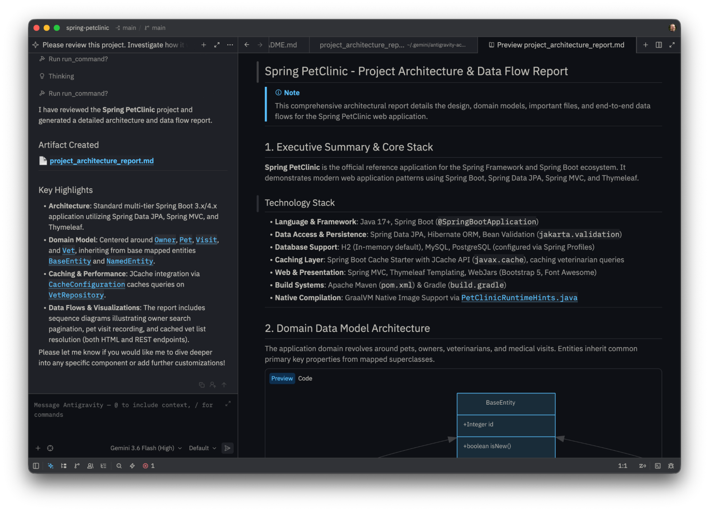

Zed - IDE 擴充功能
ide
IDE 擴充功能
開始使用
Zed - IDE 擴充功能 IDE 擴充功能開始使用
IDE 擴充功能
# Zed

「Zed」章節

Antigravity 直接整合至 **Zed** 編輯器，在原生 Rust 驅動的工作流程中實現高效能、代理式編輯。

---

## 先決條件

「前置條件」章節

安裝擴充功能前，請確認符合下列必要條件：

- **Zed**：macOS 或 Linux 上的 0.140.0 版或更新版本。
- **Antigravity 權利**：任何 Antigravity 方案（含免費方案）的 Google 帳戶，或 **Gemini 企業版**.

---

## 安裝與設定

「安裝與設定」章節

完成下列步驟以在 Zed 中安裝 Antigravity：

1. 開啟 Zed。
2. 開啟指令面板（Cmd + Shift + P 於 macOS， Ctrl + Shift + P 於 Linux 與 Windows）。
3. 輸入 `agent: open settings` 並按下 Enter.
4. 導覽至 **外部代理** > **新增** > **從註冊表安裝**.
5. 搜尋 **Antigravity**.
6. 按一下 **安裝**.



---

## 驗證與授權

「驗證與授權」章節

Desktop / Tablet Segmented Control
Mobile / Narrow Dropdown Select
### Google 帳戶

適用於個人 Google AI 訂閱方案（包括免費、Pro 與 Ultra）：

```
{
  "auth": {
    "type": "oauth-personal"
  }
}
```

### Gemini 企業版

請聯絡您的雲端管理員以取得 GCP 專案 ID 與區域：

```
{
  "auth": {
    "type": "oauth-business"
  },
  "gcp": {
    "project": "<YOUR_GCP_PROJECT_ID>",
    "location": "<YOUR_GCP_REGION>"
  }
}
```

### Gemini API

使用 Gemini API 金鑰驗證：

```
{
  "auth": {
    "type": "gemini-api-key"
  }
}
```

### API / ADC

使用 API 金鑰或 Application Default Credentials (ADC) 驗證 Gemini Enterprise（預覽版）。使用 ADC 時，請指定您的 GCP 專案 ID 與區域：

```
{
  "auth": {
    "type": "agent-platform"
  },
  "gcp": {
    "project": "<YOUR_GCP_PROJECT_ID>",
    "location": "<YOUR_GCP_REGION>"
  }
}
```

上一個
Android Studio

下一步
Xcode

您的下載已開始您如何得知我們？請選一個。這有助於我們接觸更多像您一樣的人。感謝您讓我們知道！
