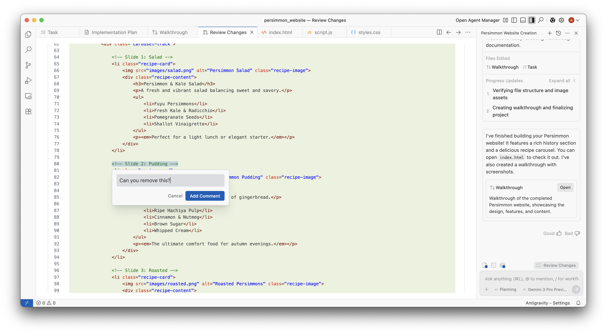

在編輯器中檢視變更 - Antigravity IDE
antigravity-ide
Antigravity IDE
功能
在編輯器中檢視變更 - Antigravity IDE Antigravity IDE 功能
Antigravity IDE
適用於：
Antigravity IDE
# 在編輯器中檢視變更

[標題為「Review changes in the editor」的章節](#review-changes-in-the-editor)

代理在對話中編輯檔案時，其變更會以行內方式顯示在編輯器中：新增與變更的行會反白顯示，且每項變更都有 **接受** 和 **拒絕** 在其上方。請按下 `Alt+Enter` (`Option+Enter` 在 macOS 上）接受目前聚焦的變更，或 `Alt+Shift+Enter` (`Option+Shift+Enter` 在 macOS 上）拒絕它。在 [代理側欄](/docs/ide/agent-side-panel)，提示詞輸入框上方的列會列出有待處理變更的檔案，並附上 **全部拒絕** 和 **全部接受** 按鈕，以及 **審查** 在某個回合的變更檔案摘要上，會帶您前往編輯器中的變更內容。

就像產出物一樣，您可以在程式碼上留言，與代理溝通。請選取行，然後按下 `Cmd+Alt+M` (`Ctrl+Alt+M` 在 Windows/Linux 上），或按一下 **+** 在邊欄中輸入您的留言，然後按一下 **將留言加入聊天**。這則註解會排入佇列，隨您的下一個提示詞送出。

[上一個
任務群組](/docs/tools/)

[下一步
總覽](/docs/settings/)

您的下載已開始

## 您如何得知我們？

請選一個。這有助於我們接觸更多像您一樣的人。

感謝您讓我們知道！
