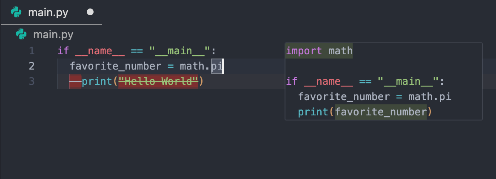
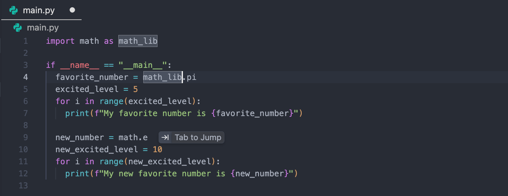

Tab - Antigravity IDE
antigravity-ide
Antigravity IDE
功能
Tab - Antigravity IDE Antigravity IDE 功能
Antigravity IDE
適用於：
Antigravity IDE
# Antigravity IDE：分頁與導覽

[「Antigravity IDE：Tab 與導覽」章節](#antigravity-ide-tab-and-navigation)

本指南涵蓋核心導覽與補全工具： **Supercomplete** 和 **Tab-to-Jump**.

## Supercomplete

[「Supercomplete」章節](#supercomplete)

Supercomplete 會在您目前游標位置附近的區域提供程式碼建議。

### 運作方式

[「運作方式」章節](#how-it-works)

Supercomplete 包含下列功能：

- **全檔案建議**：建議可修改整份文件中的程式碼，處理如變更變數名稱或同時更新不同函式定義等任務。
- **行內預覽**：建議的插入內容會以灰色文字顯示在編輯器中，建議的刪除內容則以紅色醒目提示並加上刪除線。
- **缺少的匯入項目**：Supercomplete 也可以在檔案頂端建議缺少的匯入項目。
- **接受中**：按下 Tab 接受變更，或按下 Esc 關閉它們。

## Tab-to-Jump

[「Tab-to-Jump」章節](#tab-to-jump)

Tab-to-Jump 是一種流暢的導覽工具，會建議您文件中游標下一個合理的移動位置。

### 運作方式

[「運作方式」章節](#how-it-works-1)

Tab-to-Jump 的運作方式如下：

- **導覽**：A **按 Tab 跳轉** 標籤會出現在 Antigravity 預測您下一次編輯的行尾，例如在您接受建議之後。
- **接受中**：按下 Tab 立即將游標移至該位置。

## 設定

[「設定」章節](#settings)

如要自訂這些功能，請按一下 **分頁設定** 在狀態列中：

- **編輯器中的建議**：開啟或關閉編輯器中的 Tab 建議。
- **分頁速度**：控制建議的回應速度：  `Fast`：提供快速連續的建議。這是預設值。 `Slow`：在建議前等待更多上下文。
- **按 Tab 跳轉**：開啟或關閉 Tab-to-Jump。

[上一個
總覽](/docs/permissions/)

[下一步
代理側欄](/docs/ide/agent-side-panel/)

您的下載已開始

## 您如何得知我們？

請選一個。這有助於我們接觸更多像您一樣的人。

感謝您讓我們知道！
