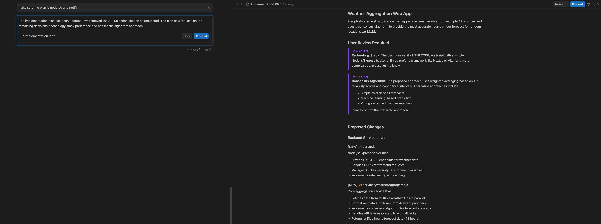
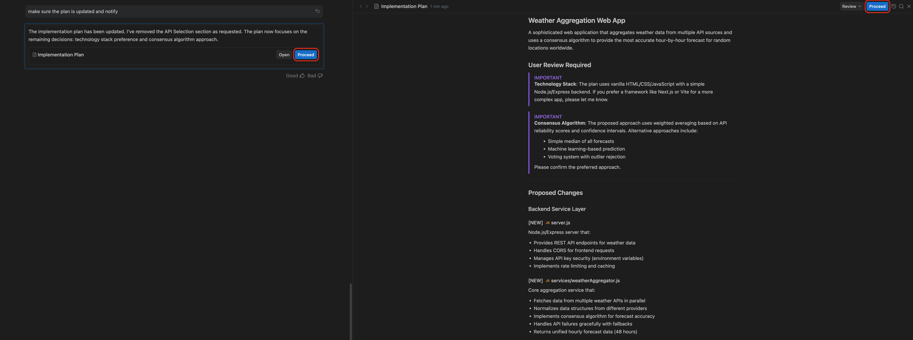
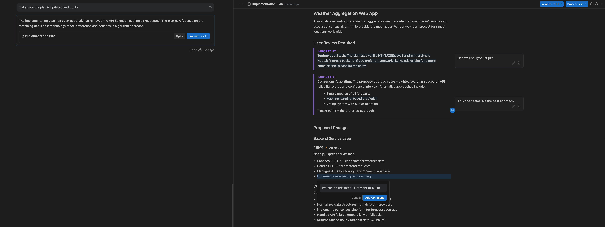
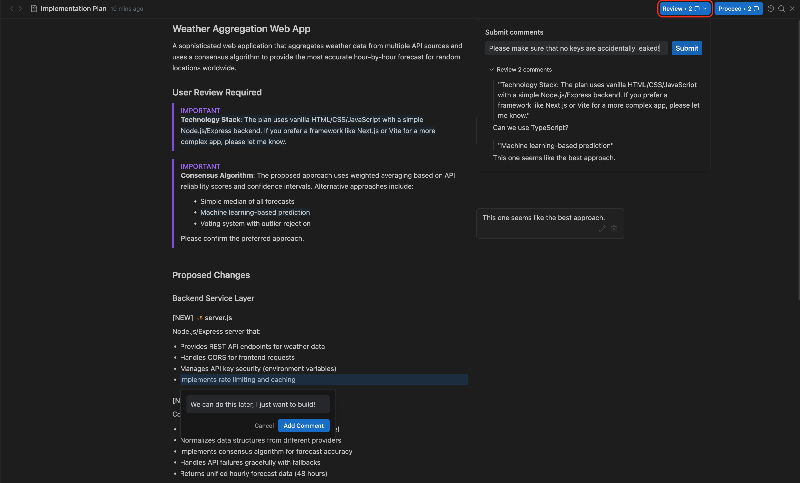
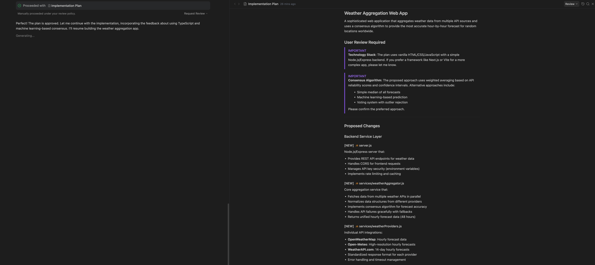

計畫
2-0
Antigravity 應用程式
功能
計畫 Antigravity App 功能
Antigravity 應用程式
Antigravity IDE
適用於：
Antigravity 應用程式
Antigravity IDE
# 實作計畫

[「實作計畫」章節](#implementation-plan)

代理使用實作計畫產出物，在您的程式碼庫中架構變更以完成工作。這些計畫包含必要的修訂技術細節，設計供您審查。

下列範例顯示代理生成的計畫：

代理會在進行完成工作所需的變更之前，請您檢閱實作計畫，無論您的 [產出物審查政策](/docs/artifact-review) 。按一下 **繼續** 在對話中計畫的卡片上，立即繼續執行代理的計畫。

代理產生的計畫常常與您的想法略有出入。Antigravity 支援在這些產出物上留言，讓您可以因任何原因（例如縮減變更範圍、使用不同技術堆疊，或修正任何差異）向代理提供意見回饋。

您的留言會附加到下一則訊息，並以標籤形式顯示，例如 **2 則註解**，位於訊息方塊上方。將滑鼠停留在標籤上，即可查看所有註解。您仍然可以按一下 **繼續** 繼續執行代理的計畫和您的留言，或傳送訊息提供意見回饋，而非直接繼續。

送出審查後，代理會繼續工作，不是迭代實作計畫並要求再次審查，就是開始實作。

[上一個
總覽](/docs/artifacts/)

[下一步
導覽](/docs/walkthrough/)

您的下載已開始

## 您如何得知我們？

請選一個。這有助於我們接觸更多像您一樣的人。

感謝您讓我們知道！
