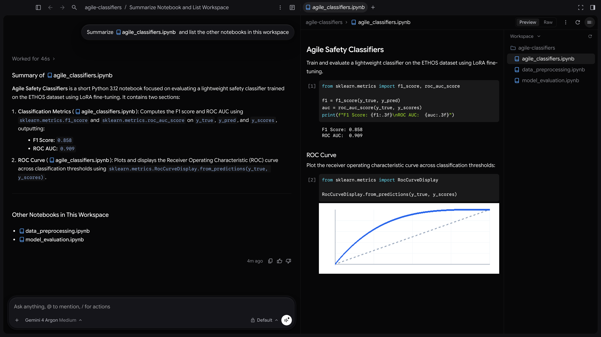

Jupyter 筆記本
2-0
Antigravity 應用程式
功能
Jupyter 筆記本 Antigravity App 功能
Antigravity 應用程式
Antigravity CLI
Antigravity IDE
適用於：
Antigravity 應用程式
Antigravity CLI
Antigravity IDE
# Jupyter 筆記本

[標題為「Jupyter 筆記本」的章節](#jupyter-notebooks)

檢查 Jupyter 筆記本（`.ipynb`）直接顯示在對話旁邊，
在算繪後的儲存格與原始 JSON 之間切換，在特定
儲存格留下行內註解，並與代理協作建立、更新及執行筆記本。

- [Antigravity 應用程式](#tab-panel-194)
- [Antigravity CLI](#tab-panel-195)
- [Antigravity IDE](#tab-panel-196)

## Antigravity 應用程式

[「Antigravity App」章節](#sr-tab-1)

在 Antigravity App 中， `.ipynb` 檔案會在側邊面板
的原生筆記本檢視器中開啟，讓您無須離開對話即可閱讀 Markdown 文件、具語法反白的程式碼
儲存格與儲存格輸出。

### 開啟筆記本

[標題為「開啟筆記本」的章節](#open-a-notebook)

如要開啟 `.ipynb` 側邊面板中的檔案，請執行下列任一操作：

- 按一下 `.ipynb` 檔案連結或 `@`對話中的 -提及標籤。
- 按一下 **+** 在側邊面板標題中，選擇 **開啟檔案**，然後搜尋 `.ipynb` 檔案。
- 開啟 **總覽** 面板，然後選取 `.ipynb` 從檔案清單中選取的檔案。

### 筆記本檢視器的算繪內容

[標題為「筆記本檢視器的算繪內容」的章節](#what-the-notebook-viewer-renders)

檢視器支援標準 `nbformat` v4 筆記本以及舊版
`nbformat` v3 (`worksheets`）筆記本：

| Element | 轉譯方式 |
| --- | --- |
| **Markdown 儲存格** | 已格式化的 Markdown，包含標題、清單、連結、行內程式碼、表格，以及相對於筆記本目錄解析的圖片。 |
| **程式碼儲存格** | 執行次數邊欄（`[1]`, `[2]`，或 `[ ]` 未執行時）顯示於使用筆記本語言中繼資料（預設為 Python）進行語法醒目顯示的程式碼旁邊。 |
| **圖片輸出** | 內嵌 `image/png`, `image/jpeg`，與 `image/gif` 圖表和圖形。 |
| **文字輸出** | 標準輸出（`stdout`），標準錯誤（`stderr`），以及純文字執行結果（`text/plain`). |
| **錯誤輸出** | 例外名稱、訊息與追蹤記錄會以錯誤樣式醒目提示。 |

### 在預覽與原始檢視之間切換

[標題為「在預覽與原始檢視之間切換」的章節](#switch-between-preview-and-raw-views)

使用 **預覽** / **Raw** 側邊面板標題中的切換按鈕，可在
已算繪的筆記本儲存格與底層 `.ipynb` JSON 文字。

如果 `.ipynb` 檔案包含格式錯誤的 JSON 或無效的筆記本結構時，
Antigravity 會自動改用 **Raw** 檢視並停用
**預覽** 附有描述剖析錯誤的工具提示的按鈕。

### 在筆記本儲存格上留言

[標題為「在筆記本儲存格上留言」的章節](#comment-on-notebook-cells)

您可以在已算繪的筆記本儲存格上留下行內留言，指向特定
的程式碼或 Markdown：

1. 將滑鼠游標停留在儲存格上，或在已轉譯的筆記本中選取行，然後按一下 **新增行內評論** (**+**).
2. 輸入您的意見回饋，然後按一下 **新增評論**.

留言會錨定在底層的對應行上 `.ipynb`
檔案，並附加到您傳送給代理的下一則訊息。

### 檢閱筆記本差異

[標題為「檢閱筆記本差異」的章節](#review-notebook-diffs)

當您在以下位置檢查變更時 **審查** 窗格或切換 **顯示差異** 在已修改的
 `.ipynb` 檔案時，Antigravity 會在計算對話回合差異
之前移除儲存格輸出，讓差異聚焦於您的程式碼與 Markdown 編輯
，而非大型輸出酬載。

### 運用代理處理筆記本

[標題為「使用代理處理筆記本」的章節](#work-with-notebooks-using-the-agent)

您可以要求代理讀取、建立、更新或執行工作區
中的筆記本：

- **參照筆記本**：輸入 `@` 後面接著筆記本名稱（例如， `@analysis.ipynb`）將它附加到您的提示詞。
- **建立或更新儲存格**：請代理新增分析步驟、重構 函式，或產生新的 `.ipynb` 檔案。
- **執行筆記本**：請代理從終端機執行筆記本（例如，使用 `jupyter nbconvert --to notebook --execute --inplace` 或 `papermill`）並摘要產生的輸出或錯誤。

## Antigravity CLI

[「Antigravity CLI」章節](#sr-tab-2)

在 Antigravity CLI 中，您可以參照、檢查、建立、更新及執行
Jupyter 筆記本（`.ipynb`）從您的終端機工作階段：

- **參照筆記本**：輸入 `@` 後面接著以下項目的路徑 `.ipynb` 檔案 （例如， `@notebooks/analysis.ipynb`）將它納入您的提示詞。
- **建立或編輯筆記本**：請代理產生新的 `.ipynb` 檔案 或更新現有儲存格與中繼資料。
- **執行筆記本**：請代理透過 `jupyter nbconvert --to notebook --execute --inplace <notebook.ipynb>` 或 `papermill` 並回報 輸出結果。
- **檢查 diff**：執行 `/diff` 審查以下項目的變更： `.ipynb` 檔案； Antigravity 會從回合差異中移除儲存格輸出，讓程式碼與 Markdown 變更 保持易讀。

## Antigravity IDE

[「Antigravity IDE」章節](#sr-tab-3)

在 Antigravity IDE 中，您可以開啟 `.ipynb` 檔案，可直接在編輯器
的互動式筆記本介面中編輯儲存格、選取本機或遠端 Jupyter
核心，並在與側邊面板
中的代理合作時以互動方式執行儲存格：

- **互動式執行**：在編輯器中執行個別儲存格或整個筆記本， 並以行內方式檢查豐富的輸出。
- **代理協作**：在代理側邊面板中參照使用中的筆記本， 以要求新增儲存格、偵錯協助或重構。

## 後續步驟

[「後續步驟」章節](#next-steps)

- 了解如何在以下項目中參照檔案與引用選取內容 [提及與引用](/docs/at-mentions).
- 在以下位置檢查工作區編輯內容 [審查變更](/docs/review-changes).
- 探索以下項目中的其他功能 [功能](/docs/features).

[上一個
審查變更](/docs/review-changes/)

[下一步
執行模式](/docs/cli/modes/)

您的下載已開始

## 您如何得知我們？

請選一個。這有助於我們接觸更多像您一樣的人。

感謝您讓我們知道！
