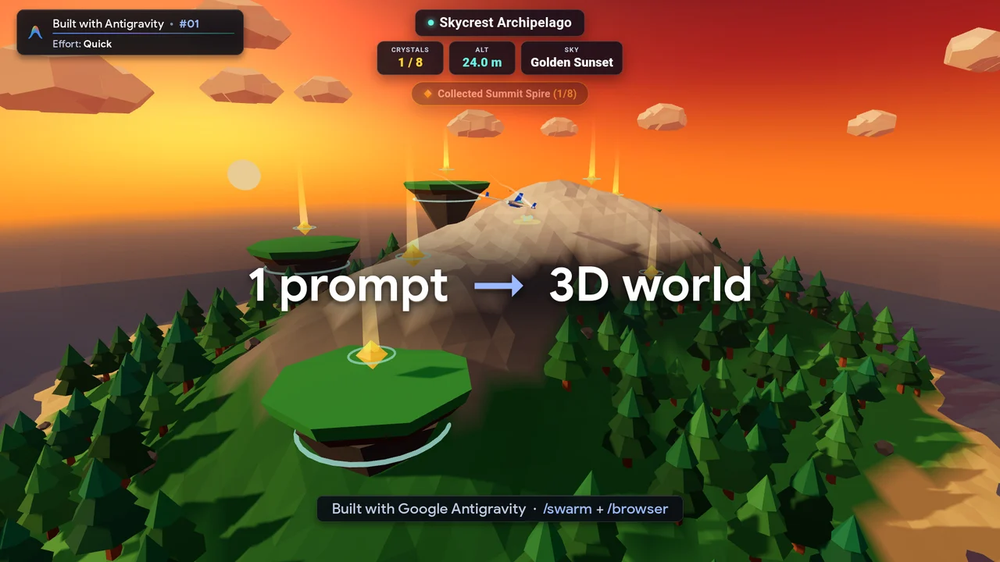

學習總覽
全部
全部
學習
學習總覽 學習
全部
Antigravity 應用程式
Antigravity CLI
Antigravity IDE
IDE 擴充功能
Antigravity SDK
# 搭配 Antigravity 學習

標題為「與 Antigravity 一起學習」的章節

有效的代理式開發始於您如何界定問題、管理 情境並驗證輸出。使用 **學習** 建立實用的 AI 工程 基礎。接著在逐步建置指南中加以應用，這些指南可直接 在 Google Antigravity 中啟動。

## 選擇你的路徑

標題為「選擇您的路徑」的章節

| 您的目標 | 由此開始 | 您將獲得的內容 |
| --- | --- | --- |
| **程式碼代理新手入門** | [AI 基礎](#ai-foundations) 依序 | 提示詞、情境衛生、工具與驗證的核心心智模型。 |
| **邊做邊學** | [建置可遊玩的 3D 瀏覽器世界](/docs/learn/build-3d-browser-world) | 一款 Three.js 遊戲，從空白資料夾開始，在一個 `/swarm` 提示詞。 |
| **擴展現有工作流程** | [情境視窗與權杖](/docs/learn/context-and-tokens) 和 [驗證與防護機制](/docs/learn/verification-and-guardrails) | Antigravity 上下文命令 （`/compact`, `/btw`）、沙箱、掛鉤與審查關卡。 |

---

## AI 基礎

標題為「AI 基礎」的章節

從這裡開始，磨練您對提示詞、脈絡管理、 多代理協調與驗證防護機制的思維模型。這些基礎原則適用於 每個 Antigravity 介面與任何前沿模型。

基礎提示與指示運用目標、限制條件、規則與範例，將模糊的請求轉化為明確的規格。

基礎情境視窗與權杖了解模型如何讀取權杖、保持作用中上下文聚焦，並避免上下文膨脹。

代理AI 代理如何運作看看代理如何規劃、呼叫工具、透過 MCP 連線，並將工作分配給平行群組。

品質驗證與防護機制搭配自動化測試、即時瀏覽器檢查、權限、掛鉤與沙箱機制，交付可靠的程式碼。

---

## 建置指南

標題為「建置指南」的章節

從概念邁向可運作的軟體。每份指南都會使用 Google Antigravity 中可執行的提示詞，從空白資料夾開始建立完整專案。

建置指南建置可遊玩的 3D 瀏覽器世界從空白資料夾開始，使用一個 /swarm 提示詞建置具有滑翔機物理效果與三種天空預設的可遊玩 Three.js 群島，然後使用 /browser 即時驗證。1 個提示詞/swarm + /browser應用程式 & CLI開啟建置指南

---

## 準備好深入探索了嗎？

標題為「準備好深入探索了嗎？」的章節

設定開始使用安裝 Antigravity 應用程式、CLI 或 IDE 擴充功能，並執行您的第一個任務。

模型選擇模型比較各方案的前沿模型、Orchestrator 模式與推理投入程度控制項。

工作流程斜線指令探索內建工作流程指令，包括 /plan、/swarm、/browser、/btw 與 /compact。

下一步
提示與指示

您的下載已開始您如何得知我們？請選一個。這有助於我們接觸更多像您一樣的人。感謝您讓我們知道！
