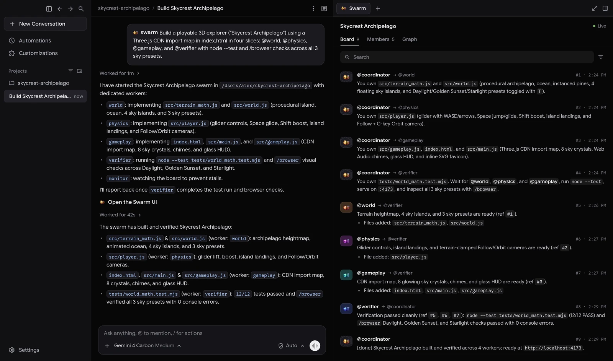
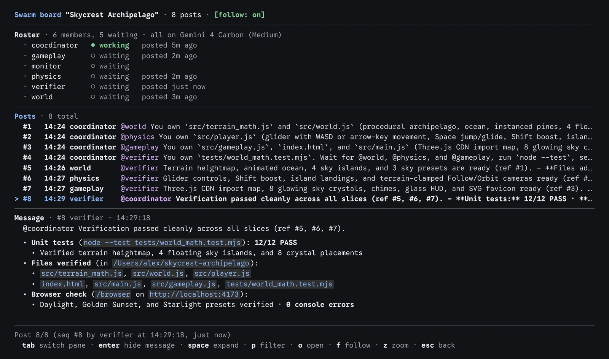

建置可遊玩的 3D 瀏覽器世界
2-0
Antigravity 應用程式
學習
建置可遊玩的 3D 瀏覽器世界 Antigravity App 學習
Antigravity 應用程式
Antigravity CLI
適用於：
Antigravity 應用程式
Antigravity CLI
# 建置可遊玩的 3D 瀏覽器世界

標題為「建置可遊玩的 3D 瀏覽器世界」的章節

建置 **Skycrest Archipelago**，一個可遊玩的低多邊形 3D 世界，從空白 資料夾開始，使用 [`/swarm`](/docs/swarm) 和 [`/browser`](/docs/commands/browser)。 本建置指南的靈感來自 [Google 的 Three-Live 專案](https://github.com/google/three-live) 與 Three.js 建置工具。一個提示詞會將地形、滑翔機物理、水晶與測試分配給 四個平行代理。接著，您無需任何 本機 3D 軟體，即可直接以視覺方式驗證即時的 WebGL 場景。

Skycrest Archipelago 導覽：執行一個 /swarm 提示詞，觀看四個平行代理建置並測試 3D 世界，並在 /browser 中檢查三種天空預設。影片有聲音。部分影片已加速播放。

---

## 開始之前

標題為「開始之前」的章節

| 需求 | 詳細資料 |
| --- | --- |
| **格式** | 單一起始提示詞＋即時視覺檢查 |
| **Antigravity 介面** | [Antigravity 應用程式](/download) (`v2.30.0+` 適用於內建瀏覽器； `v2.31.0+` 下載提示）或 Antigravity CLI（`agy`) |
| **本機工具** | Node.js `22+` （適用於 `node --test`，加上 `npx` 適用於 CLI `/browser`） 與 Python 3 （用於提供靜態檔案）。Three.js CDN 模組需要網際網路存取。 |
| **瀏覽器後端** | 個人 App 帳戶上的內建瀏覽器 （`v2.30.0+`）。本機 Google Chrome `v144+` 與 `chrome://inspect/#remote-debugging` 已為 CLI 與企業或企業版帳號開啟。 |
| **MCP 或外掛程式** | 無。不需要 Blender、Unity 或外部材質包。 |

## 您將練習的內容

標題為「您將練習的內容」的章節

- **[提示與指示](/docs/learn/prompting)**：在一個起始提示詞中界定目標、檔案 邊界、限制條件與驗收檢查。
- **[情境視窗與權杖](/docs/learn/context-and-tokens)**：將每個 子系統保留在其各自乾淨的工作者上下文中，而非塞進一個過大的執行緒。
- **[AI 代理如何運作](/docs/learn/how-agents-work)**：協調平行 具名工作者與獨立的 `@verifier` 於共用的 `/swarm` 看板。
- **[驗證與防護機制](/docs/learn/verification-and-guardrails)**： 快速配對 `node --test` 數學斷言，搭配即時 `/browser` 視覺與 主控台檢查。

---

## 逐步建置

標題為「逐步建置」的章節

如要從頭開始建置並驗證 Skycrest Archipelago，請執行下列步驟：

1. **建立空白工作區資料夾** 並在 Antigravity App 中開啟（或 執行 `agy` 其中）： `mkdir skycrest-archipelago && cd skycrest-archipelago`
2. **執行起始提示詞。** 請確認 `skycrest-archipelago` 是您作用中的 專案。點選 **在 Antigravity 中試用** 於下方的卡片，或點選 **複製提示詞** 並將其貼到您的工作區編輯器中，或 `agy`: `/swarm Build a playable 3D explorer ("Skycrest Archipelago") using a Three.js CDN import map in index.html (no bundler or npm install) in four slices: @world (src/terrain_math.js, src/world.js: island, ocean, pines, rocks, 4 sky islands, clouds, Daylight/Golden Sunset/Starlight presets toggled with T), @physics (src/player.js: glider with WASD or arrow-key movement, Space jump/glide, Shift boost, island landings, terrain-clamped Follow and C-key Orbit camera), @gameplay (src/gameplay.js, index.html, src/main.js: 8 glowing crystals, Web Audio chimes, glass HUD, inline SVG favicon), and @verifier (tests/world_math.test.mjs Node tests for terrain, islands, and crystals, plus local server and /browser check of all 3 sky presets with zero console errors).` 工作者擁有的檔案職責**`@world`**`src/terrain_math.js`, `src/world.js`程序化群島、動畫海洋、實例化松樹與岩石、4 座漂浮天空島、雲朵，以及三種可透過⋯⋯切換的天空預設 `T`.**`@physics`**`src/player.js`Glider-explorer 搭配 `WASD` 或方向鍵移動， `Space` 跳躍與滑翔， `Shift` 加速、島嶼著陸與 Follow 加 `C`-鍵環繞攝影機。**`@gameplay`**`src/gameplay.js`, `index.html`, `src/main.js`Three.js CDN import map、8 顆發光的天空水晶、Web Audio 風鈴音效、玻璃 HUD，以及內嵌 SVG favicon。**`@verifier`**`tests/world_math.test.mjs`針對高程、島嶼與水晶的 Node 單元測試，以及本機伺服器與 `/browser` 驗證全部 3 種天空預設。
3. **在 Swarm 看板上追蹤平行代理。** 觀看 `@world`, `@physics`, `@gameplay`，與 `@verifier` 在共用看板上張貼進度、測試執行結果與 螢幕截圖： [Antigravity 應用程式](#tab-panel-229)[Antigravity CLI](#tab-panel-230)按一下 **開啟群體 UI** 位於協調者的回覆中，以開啟 **群組** 側邊窗格。在兩者之間切換 **看板**, **成員**，與 **圖表** 檢查 即時訊息與作用中的工作者。執行 `/swarm board` 或按下 Alt + S 以全螢幕開啟即時 看板。按下 Alt + J 跳至待處理的 核准，或 Ctrl + K 從提示詞核准。
4. **執行測試並在本機啟動島嶼：** `node --test tests/world_math.test.mjs
python3 -m http.server 4173` 開啟 `http://localhost:4173` 在您的瀏覽器中開啟並探索：  w a s d 或 ↑ ↓ ← → 移動 Space 跳至，並按住 Space 滑動 Shift 提升 t 在兩者之間切換 **Daylight**, **金色夕陽**，與 **Starlight** c 在兩者之間切換 **追蹤** 和 **Orbit** 攝影機
5. **編輯場景時隨時執行視覺檢查。** 複製並貼上此提示詞 到您的 `skycrest-archipelago` 對話（或點選 **在 Antigravity 中試用** 在該專案處於作用中時）： `/browser Open http://localhost:4173, verify zero console errors, cycle through Daylight, Golden Sunset, and Starlight modes with the T key, test WASD and Space gliding, and show screenshots confirming the camera never clips into terrain.`

---

## 原因 `/swarm` 和 `/browser` 適合此建置

標題為「為什麼 /swarm 與 /browser 適合此建置」的章節

- **明確的檔案邊界可防止衝突。** 地形數學、滑翔機物理、 水晶玩法與測試各自擁有獨立的檔案。 `/swarm` 執行 `@world`, `@physics`, `@gameplay`，與 `@verifier` 平行執行，而閒置的工作者會在 看板上等待，不使用權杖。
- **單元測試與視覺檢查會捕捉不同的錯誤。** `node --test` 驗證 有限高度圖數學運算與水晶放置。 `/browser` 開啟即時的 WebGL 場景、檢查主控台日誌、檢視三種天空預設，並確認攝影機取景乾淨無誤。

---

## 為何這個提示詞有效

標題為「為什麼這個提示詞有效」的章節

起始提示詞內建四道可重複使用的防護措施，可避免常見的 3D 網頁陷阱：

- **Three.js CDN import map（`index.html`)**：無須設定打包工具，且可避免 `npm install` 終端機沙箱內的網路提示詞。
- **純數學模組（`src/terrain_math.js`)**：讓 `@verifier` 快速執行 `node --test` 斷言，再啟動瀏覽器。
- **內嵌 SVG favicon（`data:image/svg+xml`)**：防止 `/favicon.ico` 404 雜訊，發生於自動化 `/browser` 主控台檢查。
- **地形限制攝影機規則，位於 `@physics`**：讓跟隨與環繞攝影機 保持在山丘與樹木上方，經由以下方式驗證 `/browser` 螢幕截圖。

---

## 打造專屬體驗

標題為「讓它成為您的專屬工具」的章節

群島開始運作後，將下方的任何提示詞複製並貼到開啟的 `skycrest-archipelago` 對話。您也可以點選 **在 Antigravity 中試用** 當該專案處於作用中時：

### Rainstorm 模式（快速微調）

標題為「Rainstorm 模式（快速微調）」的章節

```
/swarm Add a toggleable rainstorm mode with falling rain, dark storm waves, and glowing light trails behind the glider when holding Space to glide. Verify with /browser that frame rate stays smooth and console errors stay at zero.
```

### 60 秒環形競賽 （中級）

標題為「60 秒環形競速（中級）」的章節

```
/swarm Add 6 floating sky rings linking the four floating islands, a 60-second countdown timer, and a best-time scoreboard in localStorage. Have @verifier add Node unit tests for timer start and reset and verify the HUD stays readable at 390px mobile width with /browser.
```

### 另存為 3D 檔案（匯出）

標題為「另存為 3D 檔案（匯出）」的章節

將您的島嶼匯出為標準 3D 模型檔案，可在其他 3D 應用程式中開啟：

```
Add a top-right HUD button that downloads the island as a standard 3D model file (.glb) you can open in other 3D apps using Three.js's built-in GLTFExporter (three/addons/exporters/GLTFExporter.js), then verify in /browser that clicking it triggers a clean download with zero console errors.
```

在 Antigravity 應用程式內建瀏覽器（`v2.31.0+`), `blob:` 檔案下載 會暫停一次以取得核准。點選 **是，僅允許這次** 在提示時。

---

## 疑難排解

「疑難排解」章節

- **網站核准提示詞，適用於 `localhost:4173`**：在以下項目下 **預設**, **自動**，或 **要求審查**, `/browser` 詢問 **允許在這個 URL 上執行動作？**。 選擇 **是，允許 `localhost:4173` 在這個對話中**.
- **連接埠 `4173` 已在使用中**: `@verifier` 可能仍在提供 資料夾的服務。請開啟 `http://localhost:4173` 直接執行，或在其他連接埠上啟動 Python， 例如 `python3 -m http.server 4174`.
- **CLI 或企業版 `/browser` 無法連線**：開啟本機 Google Chrome （`v144+`） 並前往 `chrome://inspect/#remote-debugging`。開啟 **允許 為此瀏覽器執行個體進行遠端偵錯**，然後按一下 **允許** 在收到提示時 60 秒內。
- **Alt + S 不會在 macOS 上開啟 CLI 看板**：將 終端機設定為傳送 Option 為 Alt （Meta）。你也可以 執行 `/swarm board`，適用於所有終端機。

---

## 後續步驟

「後續步驟」章節

功能指南群體（/swarm）了解協調者、具名工作者與驗證者如何在共用看板上協同合作。

驗證瀏覽器使用探索內建瀏覽器代理、平行分頁與 Chrome DevTools 檢查。

AI 基礎提示與指示審查此建置背後的提示詞結構與限制模式。

上一個
驗證與防護機制

您的下載已開始您如何得知我們？請選一個。這有助於我們接觸更多像您一樣的人。感謝您讓我們知道！
