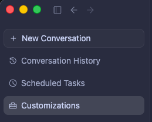
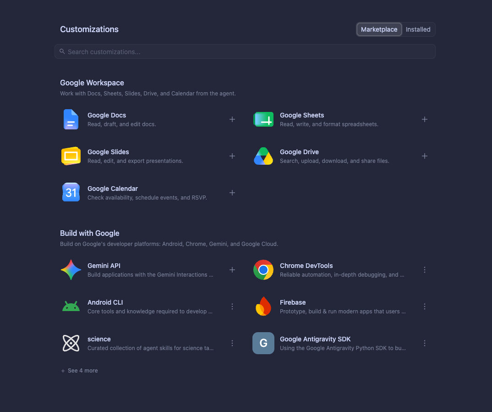
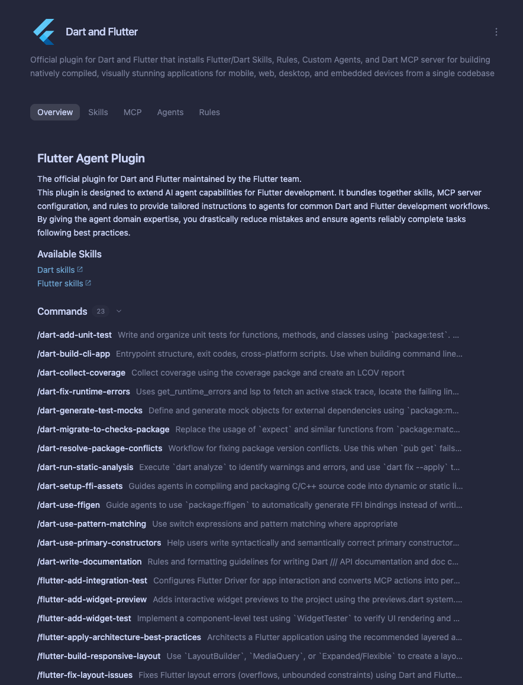
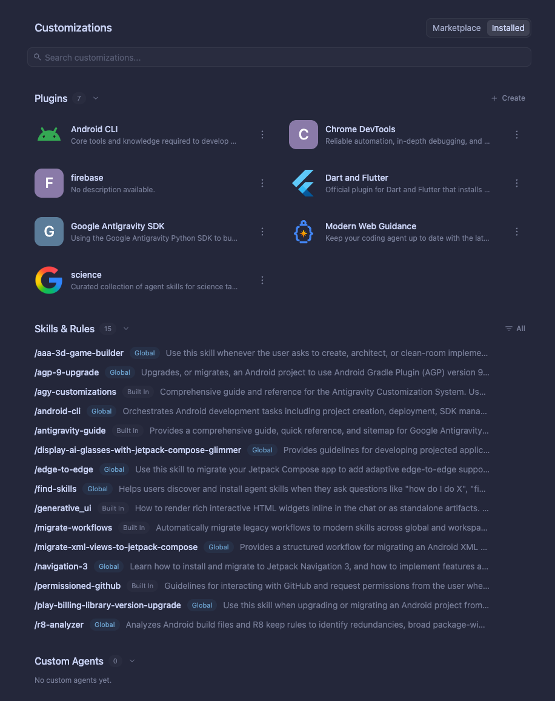
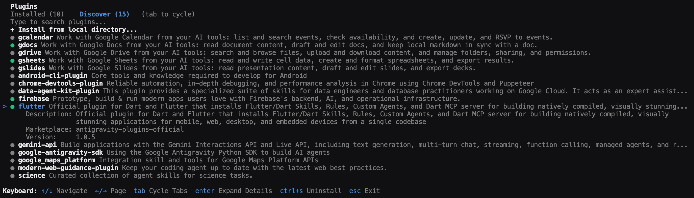

市集
2-0
Antigravity 應用程式
功能
市集 Antigravity 應用程式功能
Antigravity 應用程式
Antigravity CLI
適用於：
Antigravity 應用程式
Antigravity CLI
# 市集

[「市集」章節](#marketplace)

Marketplace 讓您可以探索、安裝與管理精選的
[外掛](/docs/plugins) 以可重複使用的…擴充你的代理
[技能](/docs/skills), [MCP 伺服器](/docs/mcp), [規則](/docs/rules)，與
[子代理](/docs/subagents).

- [Antigravity 應用程式](#tab-panel-197)
- [Antigravity CLI](#tab-panel-198)

## Antigravity 應用程式

[「Antigravity App」章節](#sr-tab-1)

### 瀏覽並安裝外掛程式

[「瀏覽並安裝外掛」章節](#browse-and-install-plugins)

若要在 Antigravity 應用程式中瀏覽並安裝 Marketplace 外掛，請依照下列步驟操作：

1. 在左側側欄中，點選 **自訂項目** 分頁（下方 **自動化**): 
2. 按一下 **市集** 分頁以檢視可用的外掛： 
3. 按一下任何外掛程式卡片以檢視其詳細資訊與隨附功能： 
4. 按一下 **新增** 安裝此外掛程式。您也可以按一下 **+** 在外掛程式旁邊 的 **市集** 清單來安裝它，而無須開啟其詳細資訊。

### 設定外掛憑證（API 金鑰與 OAuth）

[標題為「Configure plugin credentials (API keys and OAuth)」的章節](#configure-plugin-credentials-api-keys-and-oauth)

有些外掛程式連線至需要先驗證才能執行其 MCP 工具的外部服務：

- **API 權杖與設定變數**: 如果外掛需要 API 金鑰、token 或工作區 URL，在以下位置將它開啟時 **自訂項目 > 已安裝** 開啟設定對話框，逐一提示輸入每個變數（並附上產生或查詢權杖的直接連結）。
- **OAuth 登入**: 如果外掛使用 OAuth 2.0，當該外掛的 MCP 伺服器連線時，Antigravity 會開啟您的瀏覽器以完成登入.

### 管理已安裝的外掛

[「管理已安裝的外掛」章節](#manage-installed-plugins)

若要檢視、切換或解除安裝現有外掛：

1. 在 **自訂項目** 面板，按一下 **已安裝** 分頁： 
2. 按一下 **⋮** 任一已安裝外掛程式旁的選單（或開啟外掛程式卡片），以啟用、停用或設定它。
3. 選取 **解除安裝** 從 **⋮** 選單（或在外掛程式詳細資訊頁面）中移除外掛程式。

您在 Antigravity 應用程式中安裝的任何外掛都會自動同步，並出現在 Antigravity CLI 的 **已安裝** 分頁。

## Antigravity CLI

[「Antigravity CLI」章節](#sr-tab-2)

### 在 CLI 中開啟外掛管理員

[「在 CLI 中開啟外掛管理員」章節](#open-the-plugin-manager-in-the-cli)

在 Antigravity CLI 中，使用以下方式開啟互動式外掛管理員 `/plugin`
斜線命令（或其別名 `/plugins`):

```
/plugin
```

Top Terminal Window Bar
/plugin
—
Antigravity CLI
Terminal TUI Viewport
Title
外掛程式
Tabs Header
Search Input Line
Local Directory Install Row (Discover tab only)
+ Install from local directory...
Path:
./my-custom-plugin
(press Enter or Esc)
Plugin List Container
Populated dynamically via script
Toast Status Message
Bottom Keyboard Bar
Keyboard:
互動式 CLI 外掛管理員——按 Tab（或點選分頁）在「已安裝」與「探索」間切換，↑/↓ 導覽，Enter 展開詳細資訊，空白鍵切換啟用/停用，Ctrl+S 安裝或解除安裝。

按下 Tab 在…之間切換 **已安裝** 分頁與
**探索** 分頁。

---

### 探索分頁

[「探索分頁」章節](#discover-tab)

使用 **探索** 分頁以瀏覽市集目錄並安裝新外掛：

- **搜尋外掛程式**：開始輸入以搜尋並篩選特定外掛程式。
- **從本機目錄安裝**：突顯 **從本機 目錄安裝** 並按下 Enter 提供本機檔案系統路徑以供外掛安裝。
- **檢視外掛詳細資訊**：突顯外掛程式並按下 Enter 展開其詳細資料檢視。詳細資料檢視會顯示下列資訊：  描述 包含的元件（MCP 伺服器、技能、規則、代理等） 市集名稱 版本
- **安裝或解除安裝**：按下 Ctrl + S 於 未安裝的外掛以安裝，或按下 Ctrl + S 於 已安裝的外掛以解除安裝。

下列範例顯示 **探索** 分頁，展開所選
外掛的詳細資訊：



#### 安裝後

[「安裝後」章節](#after-installation)

外掛安裝後，介面更新如下：

- **探索分頁**：綠色圓點（`●`）出現在外掛程式名稱旁，表示其安裝狀態。
- **已安裝分頁**：外掛程式名稱出現在 **已安裝** 分頁清單。

### 已安裝分頁

[「已安裝分頁」章節](#installed-tab)

使用 **已安裝** 分頁以檢視與管理你已安裝的外掛：

- **搜尋已安裝的外掛程式**：開始輸入以篩選已安裝的外掛程式。
- **啟用或停用**：按下 Space 在已安裝的外掛程式上，將其 在啟用與停用之間切換。若外掛程式宣告了必要的 MCP 憑證（`variables`），按下 Space 開啟互動式 提示，在啟用外掛程式前填入這些值。
- **檢視外掛詳細資訊**：按下 Enter 於已安裝的外掛以 展開其詳細檢視。詳細檢視顯示以下資訊：  描述 技能（如適用） MCP 伺服器（如適用） 規則（如適用） 代理（如適用） 市集名稱 本機安裝路徑 版本
- **解除安裝**：按下 Ctrl + S 於已安裝的外掛以 解除安裝。

#### 鍵盤快速鍵

[「鍵盤快速鍵」章節](#keyboard-shortcuts)

外掛程式管理員中提供下列鍵盤捷徑：

| 金鑰 | Tab | 動作 |
| --- | --- | --- |
| Tab | 兩者皆是 | 在…之間切換 **已安裝** 分頁與 **探索** 分頁。 |
| Any key | 兩者皆是 | 在使用中的分頁中搜尋並篩選外掛程式。 |
| Enter | 兩者皆是 | 展開外掛詳細資料（或選取 **從本機目錄安裝** 於 **探索**). |
| Ctrl + S | 兩者皆是 | 安裝未安裝的外掛，或解除安裝已安裝的外掛。 |
| Space | **已安裝** | 切換已安裝外掛的啟用或停用。 |

---

### 內嵌 `/plugin` 指令

[「內嵌 /plugin 指令」章節](#inline-plugin-commands)

除了互動面板， `/plugin` 支援行內命令以
`install`, `uninstall`, `enable`, `disable`，與 `list` 直接從
提示詞安裝外掛，無需開啟外掛管理員 UI：

- **從官方 Marketplace 或本機目錄安裝**：執行 以下指令（`<marketplace-name>` 支援官方市集， `antigravity-plugins-official`): `/plugin install <plugin-name>@antigravity-plugins-official /plugin install <local-path>` 例如，執行 `/plugin install firebase@antigravity-plugins-official` 輸出： `Successfully installed plugin "firebase" from "antigravity-plugins-official".`
- **內嵌管理與列出外掛**：執行以下指令： `/plugin uninstall <plugin-name> /plugin enable <plugin-name> /plugin disable <plugin-name> /plugin list`

---

## 從您的 Shell 安裝（`agy plugin`)

[「從 Shell 安裝（agy plugin）」章節](#install-from-your-shell-agy-plugin)

在互動式 TUI 工作階段之外，您可以使用 從 shell 直接安裝與管理外掛 `agy plugin`:

- **從官方 Marketplace 安裝**: 登入之後 `agy`, 指定 `<plugin-name>@antigravity-plugins-official` (`<marketplace-name>` 僅 支援官方市集， `antigravity-plugins-official`），或傳遞 裸 `<plugin-name>`，預設為 `<plugin-name>@antigravity-plugins-official`: `agy plugin install firebase@antigravity-plugins-official agy plugin install firebase` 執行任一指令都會輸出： `Installed plugin "firebase" from antigravity-plugins-official`
- **從 GitHub 連結安裝**：直接從 GitHub 儲存庫 URL 複製並暫存外掛程式： `agy plugin install https://github.com/<owner>/<repo>`
- **從本機目錄安裝**：將本地外掛程式資料夾暫存至您的 設定檔： `agy plugin install </path/to/local/plugin>`
- **列出已安裝的外掛**：執行 `agy plugin list` 取得已安裝外掛及其元件數量的 人類可讀摘要，或傳入 `--json` 輸出包含安裝路徑與元件名稱的 JSON 陣列： `agy plugin list agy plugin list --json`
- **啟用、停用或解除安裝外掛**: `agy plugin enable <plugin-name> agy plugin disable <plugin-name> agy plugin uninstall <plugin-name>`

---

## 使用已安裝的外掛程式

[標題為「Using installed plugins」的章節](#using-installed-plugins)

外掛程式安裝並啟用後，其隨附功能會自動在您的工作區中提供：

| 元件 | 如何在您的工作流程中使用它 |
| --- | --- |
| **起始提示詞** | 在 Antigravity 應用程式中 (**自訂項目 > 已安裝**），開啟外掛程式的詳細檢視並點選任一 **建議的提示詞標籤** 立即開始引導式任務。 |
| **[技能](/docs/skills)** | 以自然語言要求工作——Antigravity 會透過漸進式揭露按需載入相關的外掛程式技能——或在對話中明確地以下列方式叫用技能： `/<skill-name>`. |
| **[MCP 伺服器](/docs/mcp)** | 要求代理查詢或操作已連線的服務（例如 Jira、Figma、Datadog、Stripe 或 Firebase）。隨附的 MCP 工具（命名空間為 `<plugin-name>_<server-name>`）在外掛程式啟用期間自動可用。 |
| **[自訂代理 & 子代理](/docs/subagents)** | 主代理會自動將專門任務（例如安全性審查或無障礙稽核）委派給隨附的子代理。您也可以透過 App 中的代理選擇器，直接將外掛程式的自訂代理作為主要工作階段代理來執行， `/agents` 在 CLI 中，或 `agy --agent <agent-name>` 從您的終端機（執行 `agy agents` 列出所有可用的代理）。 |
| **[規則](/docs/rules) & [掛鉤](/docs/hooks)** | 在外掛程式啟用期間於背景自動執行——強制執行程式設計慣例、SDK 標準，以及工具使用前或使用後的政策檢查，無需手動呼叫。 |

---

## 後續步驟

[「後續步驟」章節](#next-steps)

探索相關文件與指南：

- **[外掛程式](/docs/plugins)**: 了解如何設定、使用及管理 Antigravity App、Antigravity CLI 與 Antigravity IDE 中已安裝的外掛程式。
- **[建置外掛](/docs/build-plugins)**: 作者 `plugin.json` manifest、 打包技能、MCP 伺服器、自訂代理、規則與掛鉤，並在本機以 `agy plugin validate --strict`.
- **[讓你的外掛上架市集](https://forms.gle/2EX5RFYPoJe1UgxR9)**: 填寫此意願表單，將您已驗證的外掛提交至 Antigravity Marketplace.
- **[與 Google 攜手建置](/docs/build-with-google)**：探索精選的 Google 外掛程式，適用於 Firebase、Android、Flutter、Chrome DevTools、BigQuery 等。
- **[CLI 參考資料](/docs/cli/reference)**：檢視 Antigravity CLI 中的所有斜線指令與 鍵盤快速鍵。

[上一個
側邊面板與總覽](/docs/side-panel/)

[下一步
終端機沙箱](/docs/sandbox/)

您的下載已開始

## 您如何得知我們？

請選一個。這有助於我們接觸更多像您一樣的人。

感謝您讓我們知道！
