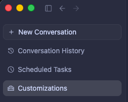
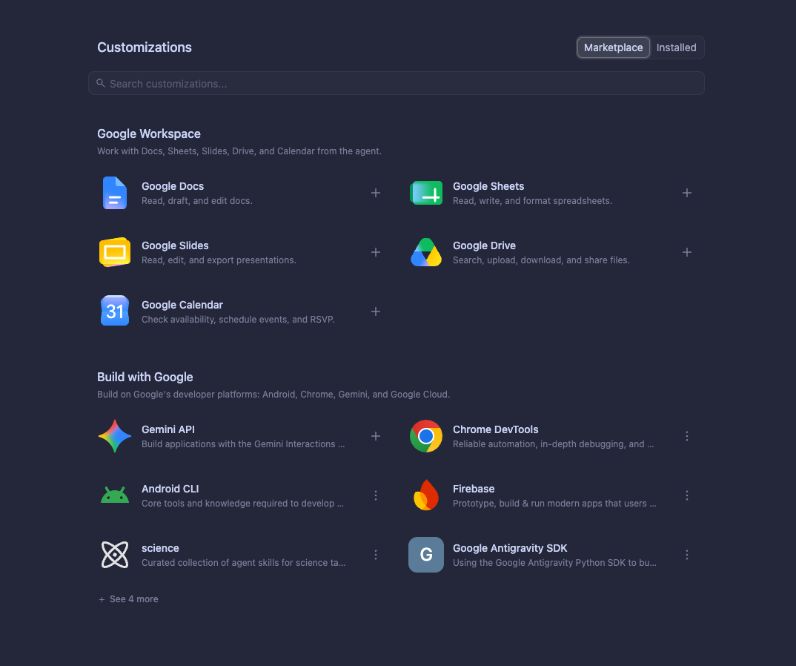
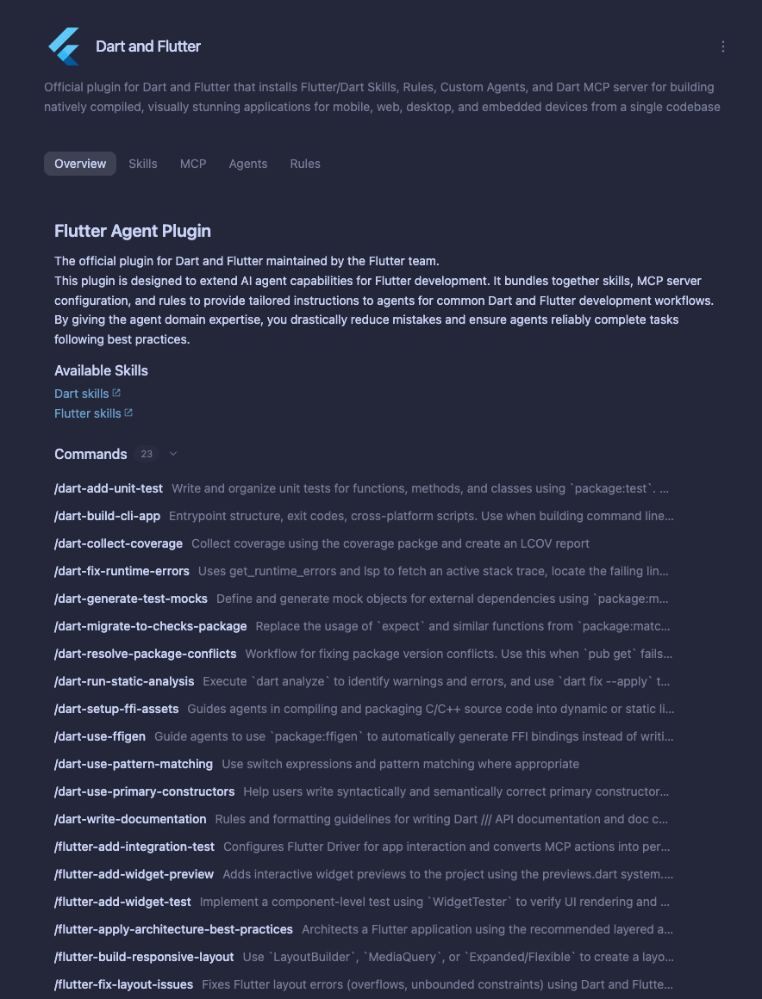
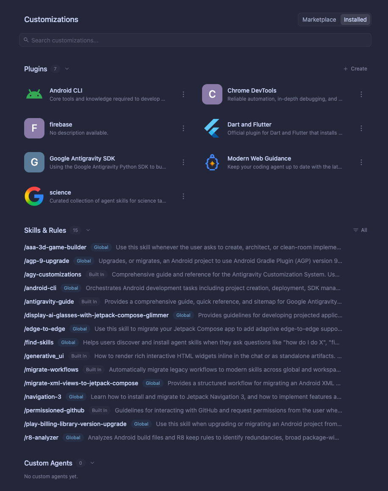
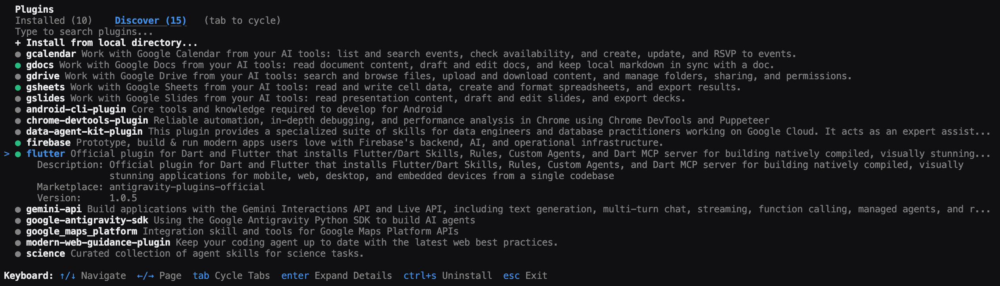

市集
2-0
Antigravity 應用程式
功能
市集 Antigravity 應用程式功能
Antigravity 應用程式
Antigravity CLI
IDE 擴充功能
Antigravity IDE
適用於：
Antigravity 應用程式
Antigravity CLI
IDE 擴充功能
Antigravity IDE
# 市集

「市集」章節

Marketplace 讓您探索、安裝及管理精選的 Google 與合作夥伴 [外掛](/docs/plugins) 以可重複使用的…擴充你的代理 [技能](/docs/skills), [MCP 伺服器](/docs/mcp), [規則](/docs/rules), [生命週期掛鉤](/docs/hooks)，與 [子代理](/docs/subagents)。直接跳至 [外掛程式目錄](#browse-marketplace-plugins) 以下內容可直接在 Antigravity App 中開啟任何外掛程式，或複製其 CLI 安裝指令。

[Antigravity 應用程式](#tab-panel-235)[Antigravity CLI](#tab-panel-236)Antigravity 應用程式[「Antigravity App」章節](#sr-tab-1)瀏覽並安裝外掛程式[「瀏覽並安裝外掛」章節](#browse-and-install-plugins)開啟 **自訂 > Marketplace** 直接在 Antigravity App 中執行，或依照下列步驟操作：[在 Antigravity 中開啟市集](antigravity://customizations/marketplaces)[瀏覽外掛程式目錄](#browse-marketplace-plugins)如要在 Antigravity App 中手動瀏覽並安裝 Marketplace 外掛程式：  在左側側欄中，點選 **自訂項目** 分頁（下方 **自動化**):    按一下 **市集** 分頁以檢視可用的外掛：    按一下任何外掛程式卡片以檢視其詳細資訊與隨附功能：    按一下 **新增** 安裝此外掛程式。您也可以按一下 **+** 在外掛程式旁邊 的 **市集** 清單來安裝它，而無須開啟其詳細資訊。  設定外掛憑證（API 金鑰與 OAuth）[標題為「Configure plugin credentials (API keys and OAuth)」的章節](#configure-plugin-credentials-api-keys-and-oauth)有些外掛程式連線至需要先驗證才能執行其 MCP 工具的外部服務： **API 權杖與設定變數**: 如果外掛需要 API 金鑰、token 或工作區 URL，在以下位置將它開啟時 **自訂項目 > 已安裝** 開啟設定對話框，逐一提示輸入每個變數（並附上產生或查詢權杖的直接連結）。 **OAuth 登入**: 如果外掛使用 OAuth 2.0，當該外掛的 MCP 伺服器連線時，Antigravity 會開啟您的瀏覽器以完成登入. 管理已安裝的外掛[「管理已安裝的外掛」章節](#manage-installed-plugins)若要檢視、切換或解除安裝現有外掛：  在 **自訂項目** 面板，按一下 **已安裝** 分頁：    按一下 **⋮** 任一已安裝外掛程式旁的選單（或開啟外掛程式卡片），以啟用、停用或設定它。   選取 **解除安裝** 從 **⋮** 選單（或在外掛程式詳細資訊頁面）中移除外掛程式。  您在 Antigravity 應用程式中安裝的任何外掛都會自動同步，並出現在 Antigravity CLI 的 **已安裝** 分頁。使用深層連結開啟外掛程式[標題為「使用深層連結開啟外掛程式」的章節](#open-plugins-with-deep-links)Antigravity App 負責處理 `antigravity://` 市集連結，讓您登入後一鍵開啟 目錄或特定外掛程式的詳細資訊頁面： **市集首頁**: `antigravity://customizations/marketplaces` **Google 外掛程式**: `antigravity://plugin/<plugin-name>` （或 `antigravity://customizations/marketplaces/antigravity-plugins-official/plugins/<plugin-name>`) **合作夥伴外掛程式**: `antigravity://customizations/marketplaces/antigravity-plugins-partners/plugins/<plugin-name>` （或 `antigravity://plugin/<plugin-name>?marketplace=antigravity-plugins-partners`) 如果連結指定的外掛程式 ID 在目錄中找不到，Antigravity 應用程式 會開啟 **市集** 瀏覽分頁。如果您發佈外掛程式並想 嵌入 **在 Antigravity 中開啟** 文件或 README 中的連結，請參閱 [分享外掛程式的深層連結](/docs/build-plugins#share-deep-links-to-your-plugin).Antigravity CLI[「Antigravity CLI」章節](#sr-tab-2)在 CLI 中開啟外掛管理員[「在 CLI 中開啟外掛管理員」章節](#open-the-plugin-manager-in-the-cli)在 Antigravity CLI 中，使用以下方式開啟互動式外掛管理員 `/plugin` 斜線命令（或其別名 `/plugins`):`/plugin` Top Terminal Window Bar /plugin—Antigravity CLI Terminal TUI Viewport  Title Plugins Tabs Header  Search Input Line  Local Directory Install Row (Discover tab only)  + Install from local directory... Path: ./my-custom-plugin (press Enter or Esc) Plugin List Container  Populated dynamically via script  Toast Status Message  Bottom Keyboard Bar Keyboard:互動式 CLI 外掛管理員——按 Tab（或點選分頁）在「已安裝」與「探索」間切換，↑/↓ 導覽，Enter 展開詳細資訊，空白鍵切換啟用/停用，Ctrl+S 安裝或解除安裝。按下 Tab 在…之間切換 **已安裝** 分頁與 **探索** 分頁。探索分頁[「探索分頁」章節](#discover-tab)使用 **探索** 分頁以瀏覽市集目錄並安裝新外掛： **搜尋外掛程式**：開始輸入以搜尋並篩選特定外掛程式。 **從本機目錄安裝**：突顯 **從本機 目錄安裝** 並按下 Enter 提供本機檔案系統路徑以供外掛安裝。 **檢視外掛詳細資訊**：突顯外掛程式並按下 Enter 展開其詳細資料檢視。詳細資料檢視會顯示下列資訊：  描述 包含的元件（MCP 伺服器、技能、規則、代理等） 市集名稱 版本   **安裝或解除安裝**：按下 Ctrl + S 於 未安裝的外掛以安裝，或按下 Ctrl + S 於 已安裝的外掛以解除安裝。 下列範例顯示 **探索** 分頁，展開所選 外掛的詳細資訊：安裝後[「安裝後」章節](#after-installation)外掛安裝後，介面更新如下： **探索分頁**：綠色圓點（`●`）出現在外掛程式名稱旁，表示其安裝狀態。 **已安裝分頁**：外掛程式名稱出現在 **已安裝** 分頁清單。 已安裝分頁[「已安裝分頁」章節](#installed-tab)使用 **已安裝** 分頁以檢視與管理你已安裝的外掛： **搜尋已安裝的外掛程式**：開始輸入以篩選已安裝的外掛程式。 **啟用或停用**：按下 Space 在已安裝的外掛程式上，將其 在啟用與停用之間切換。若外掛程式宣告了必要的 MCP 憑證（`variables`），按下 Space 開啟互動式 提示，在啟用外掛程式前填入這些值。 **檢視外掛詳細資訊**：按下 Enter 於已安裝的外掛以 展開其詳細檢視。詳細檢視顯示以下資訊：  描述 技能（如適用） MCP 伺服器（如適用） 規則（如適用） 代理（如適用） 市集名稱 本機安裝路徑 版本   **解除安裝**：按下 Ctrl + S 於已安裝的外掛以 解除安裝。 鍵盤快速鍵[「鍵盤快速鍵」章節](#keyboard-shortcuts)外掛程式管理員中提供下列鍵盤捷徑： 金鑰Tab動作Tab兩者皆是在…之間切換 **已安裝** 分頁與 **探索** 分頁。Any key兩者皆是在使用中的分頁中搜尋並篩選外掛程式。Enter兩者皆是展開外掛詳細資料（或選取 **從本機目錄安裝** 於 **探索**).Ctrl + S兩者皆是安裝未安裝的外掛，或解除安裝已安裝的外掛。Space**已安裝**切換已安裝外掛的啟用或停用。內嵌 `/plugin` 指令[「內嵌 /plugin 指令」章節](#inline-plugin-commands)除了互動面板， `/plugin` 支援行內命令以 `install`, `uninstall`, `enable`, `disable`，與 `list` 直接從 提示詞安裝外掛，無需開啟外掛管理員 UI：  **從市集目錄或本機目錄安裝**：指定 `<plugin-name>@<marketplace-name>` 使用 `antigravity-plugins-official` 適用於 Google 外掛程式或 `antigravity-plugins-partners` 適用於合作夥伴外掛程式，或傳入 本機路徑： `/plugin install firebase@antigravity-plugins-official
/plugin install stripe@antigravity-plugins-partners
/plugin install <local-path>` 例如，執行 `/plugin install firebase@antigravity-plugins-official` 輸出： `Successfully installed plugin "firebase" from "antigravity-plugins-official".`   **內嵌管理與列出外掛**：執行以下指令： `/plugin uninstall <plugin-name>
/plugin enable <plugin-name>
/plugin disable <plugin-name>
/plugin list`  從您的 Shell 安裝（`agy plugin`)[「從 Shell 安裝（agy plugin）」章節](#install-from-your-shell-agy-plugin)在互動式 TUI 工作階段之外，您可以使用 從 shell 直接安裝與管理外掛 `agy plugin`: **從市集安裝**: 登入之後 `agy`，從以下位置安裝 Google 外掛程式 `antigravity-plugins-official` （或傳入裸 `<plugin-name>`， 預設為 `antigravity-plugins-official`） 與合作夥伴外掛程式，來自 `antigravity-plugins-partners`: `# Google plugins (bare name defaults to antigravity-plugins-official)
agy plugin install firebase
agy plugin install firebase@antigravity-plugins-official

# Partner plugins
agy plugin install stripe@antigravity-plugins-partners` 執行中 `agy plugin install firebase` 輸出： `Installed plugin "firebase" from antigravity-plugins-official`  **從 GitHub 連結安裝**：直接從 GitHub 儲存庫 URL 複製並暫存外掛程式： `agy plugin install https://github.com/<owner>/<repo>`  **從本機目錄安裝**：將本地外掛程式資料夾暫存至您的 設定檔： `agy plugin install </path/to/local/plugin>`  **列出已安裝的外掛**：執行 `agy plugin list` 取得已安裝外掛及其元件數量的 人類可讀摘要，或傳入 `--json` 輸出包含安裝路徑與元件名稱的 JSON 陣列： `agy plugin list
agy plugin list --json`  **啟用、停用或解除安裝外掛**: `agy plugin enable <plugin-name>
agy plugin disable <plugin-name>
agy plugin uninstall <plugin-name>`

---

## 瀏覽 Marketplace 外掛程式

標題為「瀏覽市集外掛程式」的章節

篩選精選的 Google (`antigravity-plugins-official`） 與合作夥伴 （`antigravity-plugins-partners`） 依發行者、書架或關鍵字篩選外掛程式。按一下 **在 Antigravity 中開啟** 於任何卡片以開啟其在 Antigravity App 中的詳細資訊頁面（如果尚未安裝應用程式，按鈕會提供直接下載連結）， 或點選 **複製 CLI** 複製其 `agy plugin install` 指令。

精選外掛程式
### Chrome DevTools

Google
與 Google 攜手建置
使用 Chrome DevTools 與 Puppeteer，在 Chrome 中實現可靠的自動化、深入除錯與效能分析

在 Antigravity 中開啟

指南

### Dart 與 Flutter

Google
與 Google 攜手建置
官方 Dart 與 Flutter 外掛程式，可安裝 Flutter/Dart Skills、Rules、自訂代理與 Dart MCP 伺服器，用於建立原生編譯、視覺效果出色的應用程式，適用於行動裝置、網頁、桌…

在 Antigravity 中開啟

指南

### Firebase

Google
與 Google 攜手建置
建立原型、建置 & 使用 Firebase 執行使用者喜愛的現代化應用程式'的後端、AI 與營運基礎架構。

在 Antigravity 中開啟

指南

### Gemini API

Google
與 Google 攜手建置
使用 Gemini Interactions API、Decisions API、Live API、Genie 4 互動世界與 Gemini API CLI，建置應用程式與 Shell 工作流程，涵蓋文字、圖片、影片、語音與音樂生成…

在 Antigravity 中開啟

指南

### Google 文件

Google
Google Workspace
閱讀、起草與編輯文件。

在 Antigravity 中開啟

### 科學總覽

Google
科學
Antigravity 科學應用重點，以及主要科學外掛程式概覽。

在 Antigravity 中開啟

指南

### Datadog

合作夥伴
開發人員工具
透過預先設定的 Datadog MCP 伺服器，直接在 Antigravity 中使用 Datadog。透過自然對話查詢日誌、指標、追蹤、資訊主頁等內容。

在 Antigravity 中開啟

文件

### Figma

合作夥伴
設計、創意 & 媒體
將 Figma 設計轉換為正式程式碼，透過 Code Connect 對應元件，並在 Antigravity 中建立或編輯 Figma 檔案。

在 Antigravity 中開啟

文件

### Linear

合作夥伴
生產力 & 專案管理
團隊與代理的產品開發系統。透過 Antigravity 管理 Linear 工作區中的議題、專案與文件。

在 Antigravity 中開啟

文件

### Notion

合作夥伴
生產力 & 專案管理
透過 Notion MCP 伺服器將 Antigravity 連接至您的 Notion 工作區，另附研究、文件、會議準備、規格、追蹤器與專案更新等技能。

在 Antigravity 中開啟

文件

### Stripe

合作夥伴
業務
接受付款並拓展你的業務。

在 Antigravity 中開啟

文件

### Vercel

合作夥伴
雲端代管 & 部署
使用 Next.js、AI SDK 與雲端服務相關技能，以及官方 Vercel MCP 伺服器，在 Vercel 上建置並部署網頁應用程式與 AI 代理。

在 Antigravity 中開啟

文件

### Android CLI

Google
與 Google 攜手建置
開發 Android 所需的核心工具與知識。

在 Antigravity 中開啟

指南

### 化學

Google
科學
RDKit 化學資訊學、反應與性質工具，加上 ChEMBL 與 PubChem，可處理分子、其性質與生物活性資料。

在 Antigravity 中開啟

指南

### Data Agent Kit

Google
與 Google 攜手建置
此外掛程式為在 Google Cloud 上工作的資料工程師與資料庫從業人員，提供一套專門的技能。

在 Antigravity 中開啟

指南

### Elephant-Goldfish Model

Google
與 Google 攜手建置
在情境中發展想法，並以全新視角檢閱文件。

在 Antigravity 中開啟

文件

### 基因體學

Google
科學
AlphaGenome 與主要遺傳學資料庫，可分析 DNA 變異、基因調控，以及基因與疾病之間的關聯。

在 Antigravity 中開啟

指南

### Gmail

Google
Google Workspace
在 Gmail 中搜尋、閱讀、起草與傳送電子郵件。

在 Antigravity 中開啟

### Google Antigravity SDK

Google
與 Google 攜手建置
使用 Google Antigravity Python SDK 建置 AI 代理

在 Antigravity 中開啟

指南

### Google 日曆

Google
Google Workspace
查看空閒時間、安排活動並回覆出席。

在 Antigravity 中開啟

### Google Cloud 開發者

Google
與 Google 攜手建置
針對程式碼代理的 Google Cloud 指引：首個專案上線、驗證與憑證選擇，以及 gcloud CLI 指令的安全關鍵驗證。

在 Antigravity 中開啟

指南

### Google Developer Knowledge

Google
與 Google 攜手建置
搜尋並取得 Google Cloud、Gemini、Android、Firebase、Flutter 與 Web 的官方文件。需要 Google Cloud 憑證（ADC）或 API 金鑰。

在 Antigravity 中開啟

指南

### Google 雲端硬碟

Google
Google Workspace
搜尋、上傳、下載與分享檔案。

在 Antigravity 中開啟

### Google Health Developer

Google
與 Google 攜手建置
透過 Google Health Developer MCP 伺服器，在 developers.google.com/health 上搜尋並取得官方 Google Health API 文件。

在 Antigravity 中開啟

指南

### Google Home Developer

Google
與 Google 攜手建置
透過 Google Home Developer MCP 伺服器，搜尋官方 Google Home、Matter 與 OpenThread 文件，並查詢雲端對雲端使用者意見回饋整合診斷資訊。

在 Antigravity 中開啟

指南

### Google Maps Platform

Google
與 Google 攜手建置
適用於 Google Maps Platform API 的整合技能與工具

在 Antigravity 中開啟

指南

### Google 試算表

Google
Google Workspace
閱讀、撰寫與格式化試算表。

在 Antigravity 中開啟

### Google 簡報

Google
Google Workspace
閱讀、編輯與匯出簡報。

在 Antigravity 中開啟

### Looker

Google
與 Google 攜手建置
連結至您代管的 Looker MCP 伺服器，探索資料、執行已儲存的 Looks、建立資訊主頁並驗證 LookML。

在 Antigravity 中開啟

指南

### Mass Spectrometry

Google
與 Google 攜手建置
串聯質譜 (MS/MS) 分析工具集合，包括光譜前處理、GNPS 與 MoNA 光譜資料庫搜尋、SIRIUS 分子式預測，以及 MetFrag 與 MAGMa 碎片…

在 Antigravity 中開啟

### 現代網頁指引

Google
與 Google 攜手建置
讓您的編碼代理掌握最新的網頁最佳做法。

在 Antigravity 中開啟

指南

### 機器人學

Google
與 Google 攜手建置
適用於任何機器人的機器人技能：3D 感知、無碰撞動作規劃、視覺伺服、機器人啟用、sim2real、代理迭代、MuJoCo 模擬、SimReady 3D 資產製作與物理⋯⋯

在 Antigravity 中開啟

指南

### 科學文獻

Google
科學
搜尋科學論文、臨床試驗、FDA 記錄與歷史文獻。

在 Antigravity 中開啟

指南

### 結構生物學

Google
科學
AlphaFold、3D 視覺化工具與蛋白質資料庫，可探索蛋白質結構、序列、路徑與藥物交互作用。

在 Antigravity 中開啟

指南

### Adspirer Marketing Analytics

合作夥伴
業務
唯讀行銷分析：跨廣告平台、GA4 與 Search Console 回報支出、轉換、CPA 與 ROAS。絕不會變更您的帳戶。

在 Antigravity 中開啟

文件

### Any.do

合作夥伴
開發人員工具
透過代理管理 Any.do 個人任務、工作區看板與區段、子任務、提醒事項，以及已連結的行事曆活動。

在 Antigravity 中開啟

文件

### Arize AX

合作夥伴
開發人員工具
在 Antigravity 中查詢 Arize AX 專案、追蹤記錄、資料集與實驗，並使用追蹤、評估與提示詞最佳化技能。

在 Antigravity 中開啟

文件

### Atlassian Teamwork Graph CLI

合作夥伴
生產力 & 專案管理
Teamwork Graph CLI 為 Atlassian'的代理優先介面，涵蓋您的全部工作情境：Jira 議題、Confluence 頁面、Bitbucket PR，以及您已連結的第三方資料來源。

在 Antigravity 中開啟

文件

### Auth0

合作夥伴
開發人員工具
為任何應用程式新增 Auth0 驗證：登入、MFA、SSO、Organizations、RBAC、自訂網域與品牌設定。偵錯驗證錯誤，並從其他供應商遷移。

在 Antigravity 中開啟

文件

### Base44

合作夥伴
開發人員工具
建置並部署 Base44 全端應用程式：CLI 專案管理、JavaScript/TypeScript SDK 開發，以及正式環境疑難排解技能。

在 Antigravity 中開啟

文件

### Better Stack

合作夥伴
開發人員工具
調查事件，查看由誰'的值班人員，並在 Better Stack 中查詢記錄、指標、追蹤、錯誤與 RUM。建立儀表板並管理正常運作時間監控。

在 Antigravity 中開啟

文件

### Bigin

合作夥伴
業務
在 Antigravity 中管理您的 Bigin CRM：檢視銷售管道、尋找聯絡人與交易、記錄通話、規劃後續追蹤，以及向客戶傳送電子郵件。

在 Antigravity 中開啟

文件

### Browserbase

合作夥伴
開發人員工具
為您的代理提供真正的瀏覽器：可在任何網站上瀏覽、點按、輸入、擷取螢幕畫面與擷取資料，適用於本機或 Browserbase 雲端瀏覽器。

在 Antigravity 中開啟

文件

### Canva

合作夥伴
設計、創意 & 媒體
透過 Canva MCP 伺服器建立、編輯、檢閱、調整大小並進行品牌檢查 Canva 設計。

在 Antigravity 中開啟

文件

### Clerk

合作夥伴
業務
使用 Clerk 新增驗證與使用者管理功能。提供設定、框架、組織、計費、Webhook 與測試相關技能，以及 Clerk MCP 伺服器。

在 Antigravity 中開啟

文件

### ClickUp

合作夥伴
生產力 & 專案管理
將 Antigravity 連接至您的 ClickUp 工作區 — 管理工作、追蹤時間，並與團隊協作，無需切換情境。

在 Antigravity 中開啟

文件

### Cloudflare

合作夥伴
雲端代管 & 部署
透過一個 MCP 伺服器，使用平台技能與 Cloudflare API，在 Cloudflare Workers、儲存空間與 AI 上建置、部署及管理應用程式。

在 Antigravity 中開啟

文件

### Cobrief

合作夥伴
開發人員工具
搜尋歐洲採購資料並管理投標管道。

在 Antigravity 中開啟

文件

### CodeRabbit

合作夥伴
開發人員工具
CodeRabbit 是代理式軟體開發的治理與管控層，協助開發人員信任 AI 撰寫的程式碼。

在 Antigravity 中開啟

文件

### Context7

合作夥伴
開發人員工具
最新的文件查詢。直接從來源存放區將特定版本的文件與程式碼範例拉入您的編碼代理'的情境。

在 Antigravity 中開啟

文件

### CrowdStrike Falcon

合作夥伴
開發人員工具
使用官方 CrowdStrike 代管的 MCP 伺服器，跨 Falcon 進行作業：偵測、案件、威脅情資、SIEM、主機、弱點、雲端等。

在 Antigravity 中開啟

文件

### Databricks

合作夥伴
業務
Databricks 技能，適用於 CLI、Apps、Lakebase、Model Serving、Lakeflow Jobs、Spark Declarative Pipelines、Declarative Automation Bundles (DABs)，以及傳統架構至無伺服器架構的遷移。

在 Antigravity 中開啟

文件

### Descrybe Legal Engine

合作夥伴
開發人員工具
研究美國判例法、法規、規章與法院規則。尋找權威依據、對照判決書核對引文，並查看後續法院如何引用某案例。

在 Antigravity 中開啟

文件

### Docusign

合作夥伴
生產力 & 專案管理
使用開發者技能建置、測試並偵錯 Docusign 整合，涵蓋驗證、範本式簽署、信封狀態與疑難排解。

在 Antigravity 中開啟

文件

### Dropbox

合作夥伴
生產力 & 專案管理
將 Antigravity 連接至 Dropbox，以搜尋、檢視、摘要、分享、收集上傳檔案、整理資料夾及清理檔案，寫入操作需經確認。

在 Antigravity 中開啟

文件

### Dynatrace

合作夥伴
開發人員工具
使用真實的 Dynatrace 資料調查正式環境問題：問題與根本原因、日誌、指標、追蹤記錄與弱點，透過技能與 MCP 伺服器進行。

在 Antigravity 中開啟

文件

### Endor Labs Agent Kit

合作夥伴
開發人員工具
適用於 SCA 修復、AI SAST 分流、CI/CD 安全態勢、惡意軟體應變、發現項目審查、Endor Labs 設定等場景的打包工作流程。

在 Antigravity 中開啟

文件

### Exabeam Agentic SOC

合作夥伴
開發人員工具
端對端分流 Exabeam New-Scale 警示與案件：蒐集證據、對應 MITRE、做出判定，並在核准步驟後記錄。

在 Antigravity 中開啟

### Grafana Cloud

合作夥伴
開發人員工具
查詢 Grafana Cloud 指標、日誌、追蹤記錄與效能分析，管理資訊主頁、警示與事件，並透過代管 MCP 伺服器詢問 Grafana Assistant。

在 Antigravity 中開啟

文件

### Granola

合作夥伴
生產力 & 專案管理
會議專用的 AI 筆記本。連結您的會議紀錄，並運用對話上下文來完成工作。

在 Antigravity 中開啟

文件

### 框架

合作夥伴
開發人員工具
使用已連線的工具與可重複使用的工作流程技能，建置並偵錯管線、管理部署、調查安全性發現，並操作 Harness。

在 Antigravity 中開啟

文件

### incident.io

合作夥伴
開發人員工具
回應並調查事件、管理待命班表與升級流程，並撰寫操作手冊與技能。內含官方 incident.io MCP 伺服器。

在 Antigravity 中開啟

文件

### Intercom

合作夥伴
業務
搜尋 Intercom 對話、聯絡人與公司，掌握支援趨勢，並透過安全身分驗證安裝 Intercom Messenger。

在 Antigravity 中開啟

文件

### invideo

合作夥伴
設計、創意 & 媒體
將您的代理連接至 invideo'的 AI 原生影片編輯器。它會在真實時間軸上剪輯、調色與混音，您可以即時看到每項變更生效。

在 Antigravity 中開啟

文件

### Keenable

合作夥伴
開發人員工具
使用 Keenable 搜尋網路並將任何頁面以乾淨的 Markdown 閱讀，Keenable 是為 AI 代理打造的搜尋引擎。無需金鑰：不需註冊或 API 金鑰。

在 Antigravity 中開啟

文件

### Keenable SELECT

合作夥伴
開發人員工具
向即時網路提問並取得表格回覆。Keenable SELECT 會在一次呼叫中執行多次搜尋、閱讀頁面並擷取你需要的欄位。請使用 Keenable 帳戶登入。

在 Antigravity 中開啟

文件

### Kling AI

合作夥伴
設計、創意 & 媒體
使用 Kling Image 4.0 建立與編輯圖片，以支援的 HDR 設定產生 Kling 4.0 與 Flash 影片、重複使用 Elements，並追蹤工作。

在 Antigravity 中開啟

文件

### Leapwork Play

合作夥伴
開發人員工具
建立、執行並偵錯 Leapwork Play 測試與執行清單、建置代理，並將工作交給 Play'的 AI 工作流程，直接來自 Antigravity。

在 Antigravity 中開啟

文件

### Levels.fyi

合作夥伴
業務
薪資、工作 & 職涯建議。Levels.fyi 是您的職涯夥伴，確保您獲得公平的薪資並找到適合的工作'會喜歡。

在 Antigravity 中開啟

文件

### Meshy

合作夥伴
開發人員工具
使用 Meshy 透過文字或圖片產生 3D 模型，再為其加上材質，並下載可直接用於遊戲的 GLB、FBX、OBJ 與 USDZ 檔案（使用您的 Meshy 點數）。

在 Antigravity 中開啟

文件

### Midpage Legal Research

合作夥伴
業務
研究美國判例法、法規與規章，以及聯邦與州法院的即時案件卷宗。需要 Midpage 帳戶。

在 Antigravity 中開啟

文件

### Mobbin

合作夥伴
設計、創意 & 媒體
為您的 AI 代理提供 600,000 多個真實應用程式畫面，以及使用這些畫面的技能。

在 Antigravity 中開啟

文件

### monday.com

合作夥伴
生產力 & 專案管理
在 Antigravity 中規劃與追蹤 monday.com 的工作：建立、更新並指派項目、撰寫文件，以及建立可將需求轉為項目的表單。

在 Antigravity 中開啟

文件

### MongoDB Atlas (Managed MCP)

合作夥伴
開發人員工具
MongoDB Atlas 官方 Antigravity 外掛程式（代管 MCP 伺服器 + 技能）。

在 Antigravity 中開啟

### mumo

合作夥伴
設計、創意 & 媒體
引進 Claude、GPT、Muse、Kimi & 更多內容至 Antigravity。執行多模型面板，搭配跨模型反應，或請某個模型提供第二意見。

在 Antigravity 中開啟

文件

### n8n

合作夥伴
開發人員工具
透過你的執行個體 MCP 伺服器建置、測試並管理 n8n 工作流程與代理。使用官方技能進行節點設定、憑證管理與偵錯。

在 Antigravity 中開啟

文件

### Neo4j

合作夥伴
開發人員工具
適用於 Neo4j 圖形資料庫的代理技能——撰寫 Cypher 查詢、設計圖形模型、使用驅動程式、執行匯入、建置 GraphRAG 管線、執行 GDS 演算法，以及管理 Aura 執行個體。

在 Antigravity 中開啟

文件

### Netlify

合作夥伴
雲端代管 & 部署
在 Netlify 上建置並部署：函式、邊緣函式、Blob、資料庫、身分識別、表單、圖片 CDN、快取與 AI Gateway，以及 Netlify MCP 伺服器。

在 Antigravity 中開啟

文件

### Orca Security

合作夥伴
開發人員工具
從 IDE 調查雲端風險：查詢 Orca 警示、資產、攻擊路徑、CVE 與合規狀態，並使用 Orca 進行發現項目分類'的 MCP 伺服器。

在 Antigravity 中開啟

文件

### PandaDoc

合作夥伴
生產力 & 專案管理
建立並傳送提案、報價與合約以進行電子簽署。追蹤簽署進度，並找出需要跟進的文件。

在 Antigravity 中開啟

文件

### Parallel

合作夥伴
開發人員工具
使用 Parallel 搜尋即時網路並擷取頁面內容'的代管 MCP 伺服器。免費使用，無須 Parallel 帳號、API 金鑰或 Parallel CLI。

在 Antigravity 中開啟

文件

### Passim AI

合作夥伴
業務
美國移民法研究：已公開與未公開的 BIA/AAO 及聯邦案例、INA/CFR、USCIS 政策、引證有效性檢查，以及簽證公告。

在 Antigravity 中開啟

文件

### PingOne

合作夥伴
開發人員工具
適用於 PingOne 多租戶的代理外掛程式。包含技能與遠端 MCP 伺服器，讓 AI 代理設定並監控你的 PingOne 環境。

在 Antigravity 中開啟

文件

### Postman

合作夥伴
開發人員工具
為 Antigravity 配備專門的 Postman 技能，涵蓋完整的 API 生命週期。透過對代理友善、以檔案系統為優先的工作流程，探索、設計、測試、記錄、模擬、監控並改善 API。

在 Antigravity 中開啟

文件

### Qodo

合作夥伴
開發人員工具
設定 Qodo、探索程式碼與存放庫歷程、審查本機變更，並直接在 Antigravity 中解決提取請求的發現項目。

在 Antigravity 中開啟

文件

### Railway

合作夥伴
雲端代管 & 部署
在 Antigravity 中部署、設定、監控並疑難排解 Railway 上的應用程式、資料庫與基礎架構。'的代理技能與代管 MCP 伺服器。

在 Antigravity 中開啟

文件

### Scandit SDK

合作夥伴
開發人員工具
整合 Scandit Data Capture SDK 的技能：條碼掃描、身分證件擷取與智慧標籤擷取的產品選擇、文件與實作指南。

在 Antigravity 中開啟

文件

### Scriptivox

合作夥伴
開發人員工具
以 119 種語言轉錄會議、訪談、Podcast 與影片，再依據逐字稿撰寫會議記錄、節目說明與字幕。

在 Antigravity 中開啟

文件

### Semrush

合作夥伴
業務
基於即時 Semrush 資料的 SEO 工作流程：關鍵字研究、網站稽核、反向連結、競爭對手、流量與市場分析、PPC，以及 AI 品牌能見度。

在 Antigravity 中開啟

文件

### SentinelOne Purple AI

合作夥伴
開發人員工具
透過自行架設的唯讀 Purple AI MCP 伺服器，在 Antigravity 中查詢 SentinelOne Singularity Console。需要已啟用的主控台部署、您的主控台 URL 與 API 權杖。

在 Antigravity 中開啟

文件

### Sentry

合作夥伴
開發人員工具
設定 Sentry 監控、調查正式環境錯誤，並運用專家技能與 Sentry 專案的即時脈絡設定警示與版本。

在 Antigravity 中開啟

文件

### SonarQube

合作夥伴
開發人員工具
SonarQube 是數百萬開發者用來抓出錯誤、弱點與外洩密鑰的 AI 程式碼品質與安全驗證平台。

在 Antigravity 中開啟

文件

### Spacefast

合作夥伴
雲端代管 & 部署
將想法轉化為可分享的網站、資訊主頁、報告或小型網路工具。在對話中建置，或帶入您自己的作品，再透過 Spacefast 發佈。

在 Antigravity 中開啟

文件

### Supabase

合作夥伴
開發人員工具
官方 Supabase Antigravity 外掛程式，提供 Supabase 技能與 MCP 存取功能，適用於專案管理、資料庫工作、驗證、儲存空間與 Postgres 最佳做法。

在 Antigravity 中開啟

文件

### Superpowers

合作夥伴
開發人員工具
讓您的程式碼代理成為更出色的工程師

在 Antigravity 中開啟

文件

### Tavily

合作夥伴
開發人員工具
透過 Tavily 為 Antigravity 提供網路搜尋、內容擷取、網站爬取、URL 探索與深度研究'的代管 MCP 伺服器與技能。

在 Antigravity 中開啟

文件

### TestMu AI

合作夥伴
開發人員工具
在 TestMu AI 雲端執行、除錯與分流測試，另有 Kane CLI 可用於瀏覽器與行動裝置測試自動化，以及 Rook CLI 可用於測試 AI 代理。

在 Antigravity 中開啟

文件

### Trello

合作夥伴
生產力 & 專案管理
官方 Trello 外掛程式，包含 Trello MCP 伺服器與適用於看板、清單、卡片、檢查清單、Inbox 與 Planner 的技能。

在 Antigravity 中開啟

文件

### Unity

合作夥伴
開發人員工具
Unity'適用於 Antigravity 的官方外掛程式，提供精選的遊戲開發、營利與效能最佳化技能。

在 Antigravity 中開啟

文件

### VirusTotal

合作夥伴
開發人員工具
使用 VirusTotal 威脅情報、分析與提交復原功能，調查檔案、網址、網域與 IP 位址。

在 Antigravity 中開啟

### Why Won't AI

合作夥伴
業務
看看 GPTBot、ClaudeBot、PerplexityBot 與其他 AI 爬蟲從網站取得什麼內容。提供技能與遠端 MCP 伺服器，可檢查 robots.txt、執行 AI 能見度掃描與代理目錄清單。

在 Antigravity 中開啟

文件

### Wispr Flow

合作夥伴
業務
搜尋並閱讀 Wispr Flow 會議記錄、逐字稿、便箋與行事曆活動。僅可唯讀存取您自己的帳戶。

在 Antigravity 中開啟

文件

### Wix

合作夥伴
雲端代管 & 部署
使用 Wix CLI 技能與官方 Wix MCP 伺服器，建置 Wix 應用程式與無頭網站，並管理 Wix 商店、預訂、CMS 等項目。

在 Antigravity 中開啟

文件

### WordPress

合作夥伴
雲端代管 & 部署
建置、發布並管理 WordPress.com 與 Jetpack 連線的網站。草擬文章、編輯區塊、查看流量統計、審核留言，以及管理外掛程式。

在 Antigravity 中開啟

文件

### Zapier

合作夥伴
業務
自動化涵蓋 10,000 多個應用程式的工作流程。執行一次性動作，或為 YouTube、Instagram、Gmail、Facebook Pages、LinkedIn、Slack、Pinterest 建立自動化功能。

在 Antigravity 中開啟

文件

### Zoho Books

合作夥伴
業務
在 Antigravity 中執行 Zoho Books：開立發票、帳單、銀行業務、日記帳、專案、項目、稅務、自訂與自動化。

在 Antigravity 中開啟

文件

### Zoho CRM

合作夥伴
業務
在 Zoho CRM v8 上建置：REST API、Deluge 函式、ClientScript、小工具、COQL 與連線，並透過你的 Zoho MCP 伺服器使用即時 CRM 資料。

在 Antigravity 中開啟

文件

### Zoho Desk

合作夥伴
業務
適用於 Antigravity 的 Zoho Desk 外掛程式。

在 Antigravity 中開啟

文件

### Zoho Projects

合作夥伴
業務
將 Zoho Projects 連接至 Antigravity，把工作與問題轉化為可運作的程式碼。存取專案情境、調查錯誤，並在開發過程中更新工作項目。

在 Antigravity 中開啟

文件

Scoped card prototype cloned when live /api/marketplace returns newly added gstatic plugins
合作夥伴[在 Antigravity 中開啟](antigravity://customizations/marketplaces/antigravity-plugins-official/plugins/plugin)[文件](/docs/build-with-google/)

沒有符合目前篩選條件的外掛程式。請清除搜尋內容或切回所有分類。

---

## 使用已安裝的外掛程式

標題為「Using installed plugins」的章節

外掛程式安裝並啟用後，其隨附功能會自動在您的工作區中提供：

| 元件 | 如何在您的工作流程中使用它 |
| --- | --- |
| **起始提示詞** | 在 Antigravity 應用程式中 (**自訂項目 > 已安裝**），開啟外掛程式的詳細檢視並點選任一 **建議的提示詞標籤** 立即開始引導式任務。 |
| **[技能](/docs/skills)** | 以自然語言要求工作——Antigravity 會透過漸進式揭露按需載入相關的外掛程式技能——或在對話中明確地以下列方式叫用技能： `/<skill-name>`. |
| **[MCP 伺服器](/docs/mcp)** | 要求代理查詢或操作已連線的服務（例如 Jira、Figma、Datadog、Stripe 或 Firebase）。隨附的 MCP 工具（命名空間為 `<plugin-name>_<server-name>`）在外掛程式啟用期間自動可用。 |
| **[自訂代理 & 子代理](/docs/subagents)** | 主代理會自動將專門任務（例如安全性審查或無障礙稽核）委派給隨附的子代理。您也可以透過 App 中的代理選擇器，直接將外掛程式的自訂代理作為主要工作階段代理來執行， `/agents` 在 CLI 中，或 `agy --agent <agent-name>` 從您的終端機（執行 `agy agents` 列出所有可用的代理）。 |
| **[規則](/docs/rules) & [掛鉤](/docs/hooks)** | 在外掛程式啟用期間於背景自動執行——強制執行程式設計慣例、SDK 標準，以及工具使用前或使用後的政策檢查，無需手動呼叫。 |

---

## 後續步驟

「後續步驟」章節

探索相關文件與指南：

- **[外掛程式](/docs/plugins)**: 了解如何設定、使用及管理 Antigravity App、Antigravity CLI 與 Antigravity IDE 中已安裝的外掛程式。
- **[建置外掛](/docs/build-plugins)**: 作者 `plugin.json` manifest、 打包技能、MCP 伺服器、自訂代理、規則與掛鉤，並在本機以 `agy plugin validate`.
- **[讓你的外掛上架市集](https://forms.gle/2EX5RFYPoJe1UgxR9)**: 填寫此意願表單，將您已驗證的外掛提交至 Antigravity Marketplace.
- **[與 Google 攜手建置](/docs/build-with-google)**：探索精選的 Google 外掛程式，適用於 Firebase、Android、Flutter、Chrome DevTools、BigQuery 等。
- **[CLI 參考資料](/docs/cli/reference)**：檢視 Antigravity CLI 中的所有斜線指令與 鍵盤快速鍵。

上一個
生命週期掛鉤

下一步
MCP

您的下載已開始您如何得知我們？請選一個。這有助於我們接觸更多像您一樣的人。感謝您讓我們知道！
