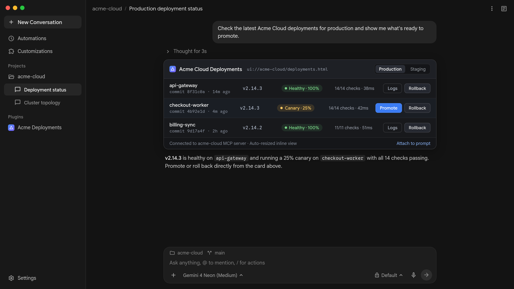
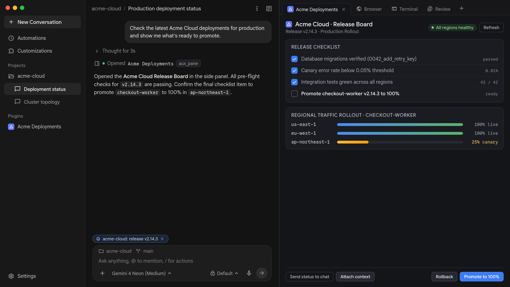
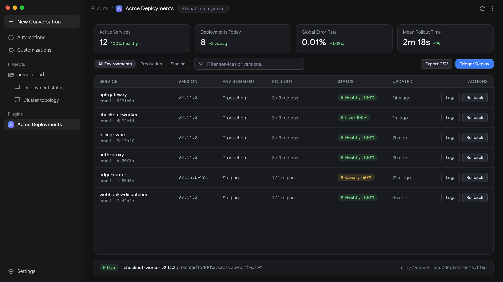
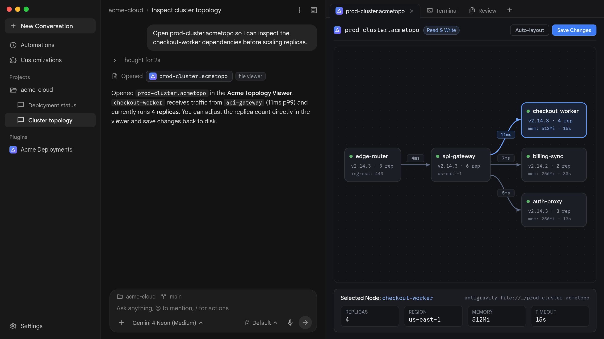

MCP Apps
2-0
Antigravity 應用程式
功能
MCP Apps Antigravity App 功能
Antigravity 應用程式
適用於：
Antigravity 應用程式
# MCP Apps

標題為「MCP Apps」的章節

**MCP Apps** 讓 [Model Context Protocol (MCP)](/docs/mcp) 工具可隨純文字模型輸出附帶互動式 HTML 介面。Antigravity 實作開放 [MCP Apps 規格](https://github.com/modelcontextprotocol/ext-apps/blob/main/specification/2026-01-26/apps.mdx) (`io.modelcontextprotocol/ui`），並新增 Antigravity 專屬進入點（`com.google.antigravity/ui`）適用於側邊面板、全頁面與自訂檔案檢視器介面。

如需完整的通訊協定規格、iframe 橋接生命週期、主題權杖與 SDK 參考資料，請參閱 [MCP Apps 總覽](https://modelcontextprotocol.io/extensions/apps/overview) 和 [`@modelcontextprotocol/ext-apps` API 參考資料](https://apps.extensions.modelcontextprotocol.io/api/).

Antigravity App 中的 MCP Apps：檢查聊天中的行內部署卡片、開啟側邊面板發布看板以推動金絲雀發布、從側邊欄的「外掛程式」切換至整頁檢視，並在檔案檢視器分頁中編輯自訂檔案類型。

## MCP Apps 的顯示位置

標題為「MCP Apps 的顯示位置」的章節

每個 MCP App 都來自 [外掛](/docs/plugins) 或你安裝或建置的 MCP 伺服器。每個工具透過以下方式控制其檢視的轉譯位置 `_meta`:

[在聊天中以行內方式呈現](#tab-panel-240)[側邊面板](#tab-panel-241)[整頁](#tab-panel-242)[檔案檢視器](#tab-panel-243)在聊天中以行內方式呈現[標題為「對話中的行內顯示」的章節](#sr-tab-1)側邊面板[標題為「側邊面板」的章節](#sr-tab-2)整頁[標題為「完整頁面」的章節](#sr-tab-3)檔案檢視器[標題為「檔案檢視器」的章節](#sr-tab-4)

| 介面 | 使用以下方式宣告 | 開啟方式與行為 |
| --- | --- | --- |
| **在聊天中以行內方式呈現** | `_meta.ui.resourceUri` | 直接在對話串流中取代已收合的 MCP 工具步驟卡片。自動調整大小，最高至 `800 px` (`150 px` 備援）。具有以下條件的工具 `aux_pane` 或 `global` 進入點不會以行內方式顯示。 |
| **側邊面板**
`aux_pane` | `aux_pane` 進入點 | 當代理完成工具呼叫時，會在對話旁邊開啟，來自 **在側邊窗格中開啟**，或來自 **總覽** > **外掛程式**，側邊面板 **`+`** 選單，或 **更多動作** (`⋯`) > **外掛程式**。每…一個分頁 `(server, tool)`。手動啟動會傳入 `{}`；重複的代理呼叫會就地更新已開啟的分頁。 |
| **整頁**
`global` | `global` 進入點 | 從以下位置在任何對話之外以全寬開啟： **外掛程式** 在左側邊欄中。手動啟動會傳遞 `{}`。僅限對話的功能（`message`, `updateModelContext`）會被省略。 |
| **檔案檢視器**
`file` | `file` 進入點 | 取代與已宣告副檔名相符檔案的內建檢視器。使用外掛程式的 `logo` 做為分頁圖示時，無論如何都會對模型隱藏 `visibility`，並接收 `{"file": {"name", "resourceUri"}}`. |
| **Antigravity CLI**
`agy` | `mcp_config.json` | 連線至 `<plugin>_<server>` 透過 `/mcp` 不轉譯 iframe。忽略 `_meta.ui.visibility` （將所有列出的工具提供給模型，包括 `visibility: ["app"]` 輔助工具與 `file` 進入點工具），並讀取純文字 `content` 直接執行。 |

使用 **MCP Apps** 適用於由即時 MCP 伺服器支援的可重複使用工具或外掛程式 UI、側邊面板檢視或自訂檔案檢視器。請使用 [`/generative_ui`](/docs/commands/generative-ui) 適用於為單一對話即時產生的一次性圖表、圖形或原型。

## 開始使用

標題為「開始使用」的章節

Antigravity App 內建 [`/mcp-app-development`](/docs/commands/mcp-app-development) 指令。請代理直接在您的工作區中搭建入門 MCP App 外掛程式：

```
/mcp-app-development Build an MCP App plugin for Antigravity that tracks release checklist items inline in chat and in a side panel board using @modelcontextprotocol/ext-apps.
```

如要手動建置 MCP App，請執行下列操作：

1. 依照 [MCP Apps 規格](https://github.com/modelcontextprotocol/ext-apps/blob/main/specification/2026-01-26/apps.mdx) 和 [`@modelcontextprotocol/ext-apps` API 參考資料](https://apps.extensions.modelcontextprotocol.io/api/) 打包單一檔案 `ui://` HTML 資源（`text/html;profile=mcp-app`），並從…連結 `_meta.ui.resourceUri`.
2. 將您的伺服器封裝於 [外掛](/docs/build-plugins) 與 `mcp_config.json` 位於外掛程式根目錄（使用 `${PLUGIN_ROOT}` 和 `${PLUGIN_DATA}` 適用於本機 `stdio` 伺服器，或 `serverUrl` 適用於遠端 Streamable HTTP 伺服器）。
3. 使用以下方式在本機驗證並安裝 `agy plugin validate <path> --strict` 和 `agy plugin install <path>`.

## Antigravity 擴充功能

標題為「Antigravity 擴充功能」的章節

在 MCP 期間 `initialize`，Antigravity App 會宣告 `com.google.antigravity/ui` (`{"entrypoints": ["aux_pane", "global", "file"]}`）一併 `io.modelcontextprotocol/ui`.

### 進入點

標題為「進入點」的章節

新增 `_meta["com.google.antigravity/ui"].entrypoints` 在同時宣告有效 `ui://` `resourceUri` 在內嵌對話串之外開啟檢視。請保留 `file` 進入點位於各自獨立的工具上：任何具有以下條件的工具 `file` 進入點一律對模型隱藏，並接收 `{"file": {"name", "resourceUri"}}` 而非 `{}`:

```
// Tool 1: model-callable side panel + full-page view
{
  "_meta": {
    "ui": { "resourceUri": "ui://acme-cloud/deployments.html" },
    "com.google.antigravity/ui": {
      "entrypoints": [
        { "type": "aux_pane", "title": "Acme Deployments" },
        { "type": "global", "title": "Acme Deployments" }
      ]
    }
  }
}

// Tool 2: separate host-invoked custom file viewer
{
  "_meta": {
    "ui": { "resourceUri": "ui://acme-cloud/topology-viewer.html" },
    "com.google.antigravity/ui": {
      "entrypoints": [
        { "type": "file", "title": "Acme Topology Viewer", "extensions": [".acmetopo", ".jsonc"] }
      ]
    }
  }
}
```

| 類型 | 額外欄位 | 主機行為 |
| --- | --- | --- |
| `aux_pane` | `title` （選用 `string`) | 由代理呼叫時，會在目前對話旁自動開啟；手動從選單啟動時會傳入 `{}`。不會以內嵌方式算繪。每…一個分頁 `(server, tool)`. |
| `global` | `title` （選用 `string`) | 從以下位置以全寬開啟： **外掛程式** 在左側邊欄中搭配 `{}`。不會以內嵌方式算繪。 |
| `file` | `title` （選用 `string`)
`extensions` (**必要** `string[]`) | 無論如何，一律對模型隱藏 `visibility`。副檔名會正規化為小寫並加上前導句點。第一個啟用的伺服器若宣告某個副檔名，即取得該副檔名。 |

### 自訂檔案檢視器與編輯器

標題為「自訂檔案檢視器與編輯器」的章節

當使用者開啟符合下列條件的檔案時 `file` 進入點擴充功能，Antigravity 會使用每個檢視專屬的不透明 URI 呼叫工具（`{"file": {"name": "bracket.stl", "resourceUri": "antigravity-file://<uuid>/bracket.stl"}}`）且不暴露原始檔案系統路徑：

- **讀取**：傳送 `resources/read` 適用於該特定 `resourceUri` 從 iframe。Antigravity 會直接回應（無需呼叫您的 MCP 伺服器），並傳回 base64 `blob` (`application/octet-stream`，最大值 **10 MiB**).
- **寫入（僅限本機檔案）**：檢查 `hostContext["com.google.antigravity/resources"]?.write` 再啟用儲存控制項。如果存在，請傳送 `com.google.antigravity/resources/write` 與 `{ uri, text }` （UTF-8）或 `{ uri, blob }` （base64），上限為 **10 MiB**.

### 其他主機動作

標題為「其他主機動作」的章節

- **在側邊面板中開啟檔案**：呼叫 `app.request()` 使用方法 `com.google.antigravity/toggle-aux-pane` 與參數 `{ "tabType": "fileView", "uri": "file:///path/to/file" }`。處理 JSON-RPC `-32601` 在沒有此擴充功能的主機上。
- **開始背景對話**：傳入 `_meta: { "com.google.antigravity/message": { "target": "new" } }` 於 `ui/message` (`app.sendMessage()`）在同一專案中開始新對話，而非發佈到目前的討論串。

## Antigravity 主機限制與注意事項

標題為「Antigravity 主機限制與注意事項」的章節

| 上限 | 值 | 備註 |
| --- | --- | --- |
| **HTML 與檔案大小** | `10 MiB` | 適用於 `ui://` HTML 文件與 `antigravity-file://` 讀取與寫入。 |
| **已保存的工具結果** | `1 MiB` | `CallToolResult` 儲存在軌跡步驟上的承載；透過僅限應用程式的工具載入較大的資料集。 |
| **並行 `tools/call`** | `4` 每個檢視 | 嚴格限定於檢視所屬的 MCP 伺服器；進行中的呼叫會在關閉時中止。 |
| **隱藏的背景框架** | `5` （LRU） | 隱藏 `aux_pane` 和 `global` 框架會保持掛載於記憶體中，上限為 5 個框架。 |
| **行內卡片高度** | `150 px` 備援
`800 px` 上限 | 退回至 `150 px` 若無 `size-changed` 在以下時間內送達 `100 ms`；較高的檢視會在內部捲動。 |
| **拆除** | 無通知 | Antigravity 不會傳送 `ui/resource-teardown` 關閉時；積極保存編輯。 |
| **隔離與 CSP** | 預設拒絕 | 隔離的 iframe，不含持久性瀏覽器儲存空間。僅在資源中將裸來源加入允許清單 `_meta.ui.csp`，並偏好 `tools/call` 超過 `connectDomains`. |

### 反覆改進本機外掛程式

標題為「反覆改進本機外掛程式」的章節

Antigravity 會將外掛程式伺服器命名空間化為 `<plugin-name>_<server-key>` 僅在以下情況才改用內建的 Node.js 執行階段 `"command": "node"`。因為 `ui://` 資源會在每次掛載時重新擷取，HTML 編輯會在你關閉並重新開啟檢視時套用。在編輯本機 `stdio` 伺服器程式碼，請從以下位置重新啟動伺服器 **自訂項目** > **已安裝** > select plugin > **MCP** > **更多動作** (`⋮`) > **重新啟動**.

## 後續步驟

「後續步驟」章節

- **[MCP Apps 總覽](https://modelcontextprotocol.io/extensions/apps/overview)**：概念、架構與主機指南，見 `modelcontextprotocol.io`.
- **[MCP Apps 規格](https://github.com/modelcontextprotocol/ext-apps/blob/main/specification/2026-01-26/apps.mdx)**：完整 `io.modelcontextprotocol/ui` 通訊協定規格。
- **[`@modelcontextprotocol/ext-apps` API 參考資料](https://apps.extensions.modelcontextprotocol.io/api/)**：用戶端與伺服器 SDK 文件。
- **[Model Context Protocol (MCP)](/docs/mcp)**：連線並設定本機 `stdio` 以及 Antigravity 中的遠端 Streamable HTTP MCP 伺服器。
- **[建置外掛](/docs/build-plugins)**：套件 `plugin.json`, `mcp_config.json`，以及技能，並發佈到 Marketplace。
- **[側邊面板與總覽面板](/docs/side-panel)**：使用側邊面板分頁與 **外掛程式** 選單。
- **[生成式 UI（`/generative_ui`)](/docs/commands/generative-ui)**：無須 MCP 伺服器，即可建置一次性互動式 HTML 產出物。

上一個
MCP

下一步
外掛程式

您的下載已開始您如何得知我們？請選一個。這有助於我們接觸更多像您一樣的人。感謝您讓我們知道！
