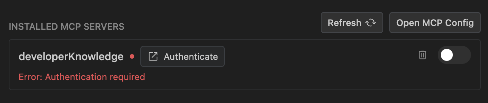
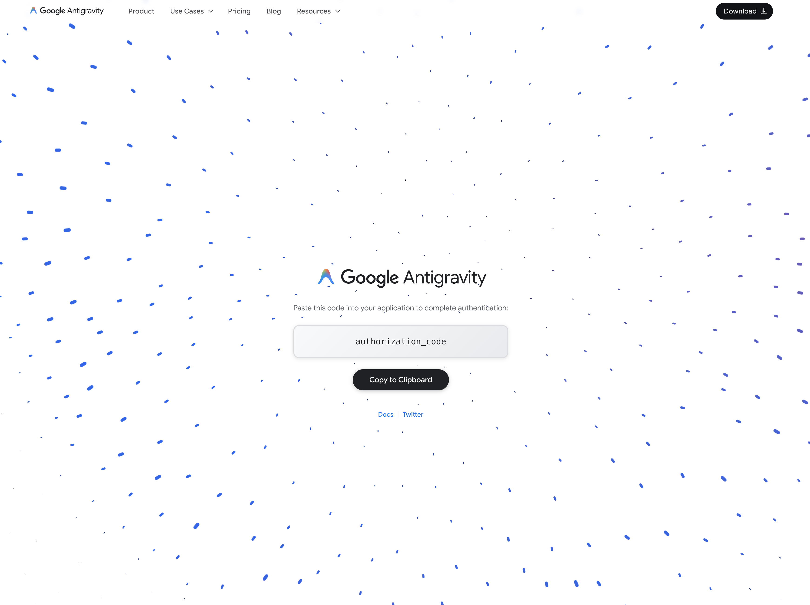
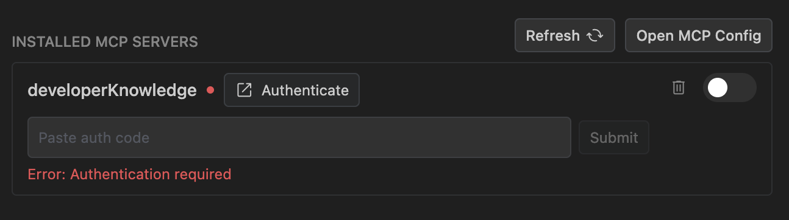
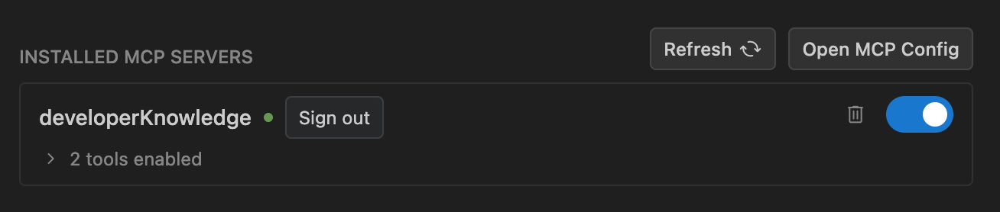

MCP
2-0
Antigravity 應用程式
功能
MCP Antigravity 應用程式功能
Antigravity 應用程式
Antigravity CLI
Antigravity IDE
適用於：
Antigravity 應用程式
Antigravity CLI
Antigravity IDE
# Model Context Protocol (MCP)

[「模型情境協定（MCP）」章節](#model-context-protocol-mcp)

Antigravity 支援 [Model Context Protocol (MCP)](https://modelcontextprotocol.io)，開放標準，讓 AI 代理與編輯器能安全連接本機開發者工具、資料庫、檔案解析器與外部遠端 API。此整合為 AI 模型提供超越您目前工作區的即時內容與執行能力。

在本指南中，您將學會如何在 Antigravity 產品間連線與設定 MCP 伺服器。

## 什麼是 MCP？

[「什麼是 MCP？」章節](#what-is-mcp)

MCP 是 Antigravity 與更廣泛開發環境之間的通用橋樑。您無需手動將資料庫結構描述、日誌或 API 規格複製貼上到提示詞或聊天面板，MCP 讓 Antigravity 在需要時直接擷取結構化內容或代表您執行安全動作。

### 新增上下文

[「新增上下文」章節](#add-context)

透過 MCP，Antigravity 可以使用來自已連接 MCP 伺服器的即時資料，為其推理與建議提供依據：

- 撰寫 SQL 查詢時，Antigravity 可檢查您的即時 Neon、Supabase 或 AlloyDB 結構描述，以建議正確的資料表與資料行名稱。
- 在除錯部署失敗時，Antigravity 可直接從 Netlify 或 Heroku 提取近期的建置記錄。

### 新增自訂工具

[「新增自訂工具」章節](#add-custom-tools)

透過 MCP，Antigravity 可以執行您已連接的伺服器所定義的特定安全動作：

- 為以下項目建立 Linear 問題 `TODO` 項目。
- 在 Notion 或 GitHub 上搜尋驗證模式。

## 依介面開始使用

[「依介面開始使用」章節](#getting-started-by-surface)

- [Antigravity 應用程式](#tab-panel-199)
- [Antigravity CLI](#tab-panel-200)
- [Antigravity IDE](#tab-panel-201)

### Antigravity 應用程式

[「Antigravity App」章節](#sr-tab-1)

在 Antigravity App 中，您可以在以下位置管理 MCP 伺服器 **MCP 伺服器** 區段，屬於 **自訂項目** 頁面。

若要檢視及更新 MCP 伺服器：

1. 按一下 **自訂項目** 在側邊欄中。
2. 按一下 **已安裝** 並捲動至 **MCP 伺服器** 區段。

若要從下列項目安裝 MCP 伺服器 **MCP 伺服器** 區段：

1. 按一下 **新增 MCP 伺服器** (**+**）。這會開啟可搜尋的可用 MCP 伺服器清單。
2. 搜尋或捲動到您想安裝的 MCP 伺服器。
3. 按一下 **新增**.

如要管理 MCP 伺服器，請按一下 **更多動作** (**⋮**）在其旁邊，然後選擇 **Restart**, **停用**，或 **刪除**。若要尋找您的設定檔，請按一下 **複製設定檔路徑** 在區段標題中。

### Antigravity CLI

[「Antigravity CLI」章節](#sr-tab-2)

Antigravity CLI 同時支援本機 `stdio` 行程與遠端主機 MCP 伺服器組態。於 Antigravity CLI 安裝 MCP 伺服器的最簡單路徑是使用 **互動式 MCP 管理員**。您也可以手動編輯全域伺服器設定或工作區層級的 `mcp_config.json`.

#### 互動式 MCP 管理員

[「互動式 MCP 管理員」章節](#interactive-mcp-manager)

類型 `/mcp` 於提示詞面板內部並按下 Enter 開啟互動式 **MCP 管理員覆疊層**。此面板可讓您執行下列動作：

- 檢視使用中、已斷線或載入中伺服器的即時狀態環。
- 手動重新載入伺服器設定或檢查即時連線日誌。

#### 全域與工作區伺服器設定

[「全域與工作區伺服器設定」章節](#global-and-workspace-server-configs)

Antigravity CLI 從兩個設定檔載入 MCP 伺服器定義：

- **全域設定**: `~/.gemini/config/mcp_config.json`, 適用於您的所有專案.
- **工作區設定**: `<workspace>/.agents/mcp_config.json`, 僅適用於該工作區.

已啟用 [外掛](/docs/plugins) 也可以新增 MCP 伺服器（定義於外掛程式的 `<plugin-root>/mcp_config.json` 檔案；請參閱 [建置外掛](/docs/build-plugins#mcp-servers)).

直接使用標準方式編輯任一檔案 [MCP 伺服器設定結構](/docs/mcp#mcp-configuration-structure). 例如，下方的條目會連線到遠端伺服器，並提高其 [逾時](/docs/mcp#mcp-server-timeouts) 至 600 秒（10 分鐘），適用於長時間執行的工具：

```
{
  "mcpServers": {
    "my-remote-server": {
      "serverUrl": "https://api.example.com/mcp/",
      "headers": {
        "Authorization": "Bearer YOUR_API_TOKEN"
      },
      "timeoutSeconds": 600
    }
  }
}
```

### Antigravity IDE

[「Antigravity IDE」章節](#sr-tab-3)

在 Antigravity IDE 中，管理 MCP 伺服器最簡單的方式是透過內建的 MCP 商店。在 MCP 商店中，您可以瀏覽、探索並安裝支援的 MCP 伺服器。您也可以透過更新您的來安裝自訂伺服器 `mcp_config.json`.

若要使用 MCP 商店：

1. 按一下 **…** 於編輯器代理側邊面板頂部並選取 **MCP 伺服器**.
2. 將游標停留在任何支援的伺服器上並點選 **安裝** （或按一下伺服器以檢視詳細資訊，然後按一下 **安裝**).
3. 依照螢幕上的提示操作。

安裝後，來自伺服器的資源與工具會自動提供給編輯器使用。

若要連接商店中未列出的自訂 MCP 伺服器：

1. 按一下 **…** 於編輯器代理側邊面板頂部並選取 **MCP 伺服器**.
2. 按一下 **管理 MCP 伺服器**.
3. 按一下 **檢視原始設定**.
4. 修改 `mcp_config.json` 檔案含您的自訂 [MCP 伺服器設定](/docs/mcp#mcp-configuration-structure).

設定檔全域位於 `~/.gemini/config/mcp_config.json` （或在本機工作區中的 `.agents/mcp_config.json`).

## MCP 設定結構

[「MCP 設定結構」章節](#mcp-configuration-structure)

無論是為 Antigravity App、Antigravity IDE、Antigravity CLI 或 [外掛](/docs/plugins) (`<plugin-root>/mcp_config.json`), `mcp_config.json` 遵循標準化的 JSON 結構描述。根物件包含一個 `mcpServers` 對應表，其中每個鍵都是唯一的伺服器識別碼：

```
{
  "mcpServers": {
    "sqlite-explorer": {
      "command": "node",
      "args": ["/usr/local/bin/sqlite-mcp-server.js"],
      "env": {
        "SQLITE_DB_PATH": "/var/data/app.db"
      }
    },
    "my-remote-server": {
      "serverUrl": "https://api.example.com/mcp/",
      "headers": {
        "Authorization": "Bearer YOUR_API_TOKEN"
      }
    }
  }
}
```

### MCP 設定屬性

[「MCP 設定屬性」章節](#mcp-configuration-properties)

每個伺服器項目，位於 `mcpServers` 必須指定 **一個傳輸屬性** (`command` 用於本機 `stdio` 伺服器，或 `serverUrl` 用於遠端 Streamable HTTP 伺服器），且可包含以下任何選用屬性：

| 屬性 | 類型 | 預設 | 描述 |
| --- | --- | --- | --- |
| **`command`** | `string` | *必填，適用於 `stdio`* | 用來啟動本機的可執行檔路徑或命令名稱 `stdio` MCP 伺服器程序。 |
| **`serverUrl`** | `string` | *遠端必填* | 使用 Streamable HTTP 傳輸之遠端 MCP 伺服器的端點 URL。你也可以使用 `url`. |
| **`args`** | `string[]` | `[]` | 傳遞至下列項目的命令列引數 `command` 可執行檔 (`stdio` 僅限傳輸）。 |
| **`env`** | `object` | `{}` | 注入至本機的環境變數鍵值對應表 `stdio` 伺服器處理程序。 |
| **`cwd`** | `string` | — | 本機啟動時使用的工作目錄 `stdio` 伺服器處理程序。 |
| **`headers`** | `object` | `{}` | 隨遠端要求傳送的自訂 HTTP 要求標頭 `serverUrl` 連線（例如， `Authorization` 或 API 金鑰標頭）。 |
| **`authProviderType`** | `string` | — | 內建驗證提供者。設定為 `"google_credentials"` 附加 Google Application Default Credentials (ADC)。 |
| **`oauth`** | `object` | — | 手動 OAuth 2.0 用戶端憑證（`clientId` 以及選用 `clientSecret`）適用於不支援用戶端 ID 中繼資料文件（CIMD）或動態用戶端註冊（DCR）的遠端伺服器。 |
| **`disabled`** | `boolean` | `false` | 何時 `true`, 會暫停伺服器連線，但不會從以下位置移除其設定: `mcp_config.json`. |
| **`enabledTools`** | `string[]` | — | 從此伺服器向代理公開的工具名稱允許清單。設定後，伺服器上的所有其他工具都會隱藏。 |
| **`disabledTools`** | `string[]` | `[]` | 不提供給代理的工具名稱拒絕清單。 |
| **`tools`** | `object` | — | 依工具名稱設定的個別工具設定（`tools.<toolName>`). `eager` (boolean) 會預先註冊工具，而非延遲載入（請參閱 [工具載入](/docs/mcp#tool-loading-lazy-vs-eager)). `background` (`"off"` 或 `"always"`）控制背景執行： `"always"` 會將工具的呼叫作為背景任務執行，而且 `"off"` 會在前景執行它們。 |
| **`timeoutSeconds`** | `integer` | `180` 每次工具呼叫， `300` 連線 | 連線至伺服器並列出其工具，以及每次工具呼叫的逾時時間（以秒為單位）。負值，例如 `-1`, 會同時關閉兩者。請參閱 [MCP 伺服器逾時](/docs/mcp#mcp-server-timeouts). |

### MCP 伺服器逾時

[標題為「MCP server timeouts」的章節](#mcp-server-timeouts)

依預設，Antigravity 最多等待 5 分鐘讓 MCP 伺服器連線並列出其工具，每次工具呼叫最多 3 分鐘。執行時間過長的工具呼叫會失敗，並顯示指出伺服器與時間上限的錯誤，例如：

```
MCP tool call to server "sqlite-explorer" timed out after 3m0s
```

若伺服器的工具需要更多時間，請設定 `timeoutSeconds` 在該伺服器的項目中：

- 正值（以秒為單位）會取代這兩個限制。例如， `600` 讓每次工具呼叫最長可執行 10 分鐘。
- 負值，例如 `-1`, 會關閉這兩項限制.
- `0`, 或離開 `timeoutSeconds` 未設定時，保留預設值。

由於同一個值也限制了伺服器的連線時間，太小的值可能會讓啟動緩慢的伺服器無法連線。

下列範例讓每個工具呼叫都能在 `sqlite-explorer` 伺服器執行最長 10 分鐘：

```
{
  "mcpServers": {
    "sqlite-explorer": {
      "command": "node",
      "args": ["/usr/local/bin/sqlite-mcp-server.js"],
      "timeoutSeconds": 600
    }
  }
}
```

## 工具載入：延遲與預先

[「工具載入：延遲與預先」章節](#tool-loading-lazy-vs-eager)

已連線的 MCP 伺服器可能提供數十個工具，且 JSON 結構描述龐大。每一輪都將每個工具定義載入模型的上下文視窗會消耗權杖並增加延遲，即使這些工具並未使用。為了降低上下文用量，Antigravity 同時支援 **lazy** 和 **eager** 工具載入。

### 延遲載入（預設）

[「延遲載入（預設）」章節](#lazy-loading-default)

預設情況下，所有已啟用的 MCP 工具都是 **lazy-loaded**:

1. **磁碟上的結構描述快取**：當 MCP 伺服器連線時，Antigravity 會寫入每個工具的 JSON 結構描述（`name`, `description`，與 `parameters`）以 `<app-data-dir>/mcp/<serverName>/<toolName>.json` (`~/.gemini/antigravity/mcp/<serverName>/` 在 Antigravity App 和 Antigravity IDE 中，或 `~/.gemini/antigravity-cli/mcp/<serverName>/` 在 Antigravity CLI 中），以及選用的 `instructions.md` 檔案（如果伺服器在初始化期間提供說明）。
2. **精簡的系統提示詞**：Antigravity 包含確切的 `<app-data-dir>/mcp/<serverName>` 代理系統提示詞中的目錄路徑（因此代理不需要你知道路徑即可運作），並列出每個伺服器的工具名稱，依以下項目分組： `Eager` 和 `Lazy`，而非完整宣告。
3. **隨需呼叫**：當代理需要延遲載入的工具時，它會讀取 `<app-data-dir>/mcp/<serverName>/<toolName>.json` 以檢查工具的參數，然後透過內建的以下項目呼叫工具： `call_mcp_tool` 工具（傳遞 `ServerName`, `ToolName`，與 `Arguments`).

### 預先載入

[「預先載入」章節](#eager-loading)

當已啟用的工具設定為 `"eager": true`，Antigravity 會在模型的原生工具宣告中預先註冊完整說明與參數結構描述，作為 `mcp_<serverName>_<toolName>` （列於 `Eager` 在系統提示詞中）。

- **直接呼叫**：代理會呼叫 `mcp_<serverName>_<toolName>` 直接在單一輪次中執行，而不需要從磁碟讀取結構描述檔案或呼叫 `call_mcp_tool`.
- **較高的權杖用量**：由於工具的完整結構描述會在每一輪都傳送給模型，因此請將預先載入保留給經常使用的核心工具，這類工具省下額外檔案讀取步驟的效益，超過每輪權杖成本。

### 設定預先載入的工具

[「設定預先載入的工具」章節](#configure-eager-tools)

若要從 MCP 伺服器預先載入特定工具，請新增 `tools` 對應至伺服器在以下項目中的項目： `mcp_config.json` 並設定 `"eager": true` 針對你想預先註冊的每個工具：

```
{
  "mcpServers": {
    "sqlite-explorer": {
      "command": "node",
      "args": ["/usr/local/bin/sqlite-mcp-server.js"],
      "env": {
        "SQLITE_DB_PATH": "/var/data/app.db"
      },
      "tools": {
        "read_query": {
          "eager": true
        },
        "list_tables": {
          "eager": true
        }
      }
    }
  }
}
```

伺服器上未列出、已啟用的任何工具 `"eager": true` 預設仍維持延遲載入。預先載入與延遲載入的評估是在以下項目之後進行： `enabledTools` 和 `disabledTools` 已套用，因此 `"eager": true` 僅影響已啟用的工具；標示為 `"eager": true` 也在 `disabledTools`，或不在非空白的 `enabledTools` 清單，保持隱藏。

## MCP 驗證

[「MCP 驗證」章節](#mcp-authentication)

已連接的 MCP 伺服器可使用內建 Google 憑證、自動 OAuth 流程或自訂 HTTP 標頭，對外部服務進行安全驗證。

### Google 憑證

[「Google 憑證」章節](#google-credentials)

設定 `authProviderType` 至 `"google_credentials"` 使用 Google 應用程式預設憑證（ADC）：

```
{
  "mcpServers": {
    "my-gcp-service": {
      "serverUrl": "https://example.googleapis.com/mcp/",
      "authProviderType": "google_credentials"
    }
  }
}
```

這需要先在本機設定 Application Default Credentials。若要設定，請執行：

```
gcloud auth application-default login
```

若您先前已登入，請執行下列指令確認已設定配額專案：

```
gcloud auth application-default set-quota-project {QUOTA_PROJECT}
```

### OAuth

[「OAuth」章節](#oauth)

Antigravity 會自動為支援以下功能的遠端 MCP 伺服器處理採用 Proof Key for Code Exchange (PKCE) 的 OAuth 2.0 [用戶端 ID 中繼資料文件 (CIMD)](https://datatracker.ietf.org/doc/html/draft-ietf-oauth-client-id-metadata-document) 或 [動態用戶端註冊 (DCR)](https://datatracker.ietf.org/doc/html/rfc7591)。對於這些伺服器，不需要額外的用戶端設定：

```
{
  "mcpServers": {
    "oauth-server": {
      "serverUrl": "https://api.example.com/mcp/"
    }
  }
}
```

連線至受 OAuth 保護的 MCP 伺服器時，Antigravity 會探索伺服器的 Protected Resource Metadata（`/.well-known/oauth-protected-resource`，其 `resource` 值必須與 MCP 伺服器網址相符），以及以下位置的第一個項目： `authorization_servers` (`/.well-known/oauth-authorization-server` 或 `/.well-known/openid-configuration`），然後依下列順序解析用戶端憑證：

1. **手動用戶端憑證**：使用 `oauth.clientId` （以及選用的 `oauth.clientSecret`）如果在 `mcp_config.json`.
2. **用戶端 ID 中繼資料文件 (CIMD)**：使用 Antigravity 代管的中繼資料 URL 作為 `client_id` 如果授權伺服器的中繼資料包含 `"client_id_metadata_document_supported": true` （對於少數內建整合，Antigravity 會先使用自己預先註冊的用戶端，再嘗試 CIMD）。
3. **動態用戶端註冊 (DCR)**：如果授權伺服器中繼資料包含 `registration_endpoint`.

#### 用戶端 ID 中繼資料文件 (CIMD)

[標題為「Client ID Metadata Document (CIMD)」的章節](#client-id-metadata-document-cimd)

Antigravity 會在以下網址發佈其 OAuth 用戶端 ID 中繼資料文件。在 Antigravity IDE 中，CIMD 支援需要 2.6.0 以上版本：

```
https://antigravity.google/oauth/client-metadata.json
```

MCP 伺服器與 OAuth 授權伺服器可以使用 CIMD 驗證 Antigravity 用戶端，無需動態用戶端註冊或手動逐一設定使用者 `clientId` 設定：

1. Advertise `"client_id_metadata_document_supported": true`, `"code_challenge_methods_supported": ["S256"]` （須使用 PKCE），以及非空白的 `issuer` 在您的授權伺服器中繼資料中（`/.well-known/oauth-authorization-server` 或 `/.well-known/openid-configuration`).
2. 啟動 OAuth 流程時，Antigravity 會傳送 `client_id=https://antigravity.google/oauth/client-metadata.json`, `redirect_uri=https://antigravity.google/oauth-callback`，一個 `S256` PKCE 質詢，以及 RFC 8707 `resource` 參數（位於授權和權杖要求中）。
3. 您的授權伺服器可以從以下位置擷取並驗證 JSON 文件 `https://antigravity.google/oauth/client-metadata.json` 動態設定，或透過以下方式將該網址預先列入允許清單，作為公開用戶端 ID `https://antigravity.google/oauth-callback` 作為重新導向 URI。

供參考， `https://antigravity.google/oauth/client-metadata.json` 提供以下中繼資料：

```
{
  "client_id": "https://antigravity.google/oauth/client-metadata.json",
  "client_name": "Google Antigravity",
  "client_uri": "https://antigravity.google",
  "logo_uri": "https://antigravity.google/assets/image/brand/antigravity-icon__full-color.png",
  "redirect_uris": [
    "https://antigravity.google/oauth-callback"
  ],
  "grant_types": [
    "authorization_code",
    "refresh_token"
  ],
  "response_types": [
    "code"
  ],
  "token_endpoint_auth_method": "none"
}
```

#### 手動用戶端憑證

[標題為「手動用戶端憑證」的章節](#manual-client-credentials)

如果伺服器既不支援 CIMD，也不支援動態用戶端註冊，您可以手動提供用戶端憑證：

```
{
  "mcpServers": {
    "oauth-server": {
      "serverUrl": "https://api.example.com/mcp/",
      "oauth": {
        "clientId": "your-client-id",
        "clientSecret": "your-client-secret"
      }
    }
  }
}
```

若您手動提供用戶端憑證，請確保以下 URL 已在您的 OAuth 提供者註冊為重新導向 URI：

```
https://antigravity.google/oauth-callback
```

#### 驗證伺服器

[標題為「驗證伺服器」的章節](#authenticate-a-server)

若要連接啟用 OAuth 的伺服器：

1. 在 Antigravity App 中，按一下 **自訂項目** 在側邊欄中，然後按一下 **已安裝**.
2. 在 **MCP 伺服器**，按一下 **驗證** 伺服器旁邊。 
3. 在瀏覽器中完成驗證並複製授權碼。 
4. 將程式碼貼到 **輸入授權碼** 欄位，然後按一下 **提交**. 

驗證後，伺服器會自動重新連線。



存取權杖儲存於 `~/.gemini/antigravity/mcp_oauth_tokens.json`。過期的權杖會自動重新整理，無效的權杖會被移除。

### 自訂標頭

[「自訂標頭」章節](#custom-headers)

對於需要自訂 HTTP 標頭（如 API 金鑰或 bearer 權杖）的遠端伺服器，將其加入 `headers` 物件。例如：

```
{
  "mcpServers": {
    "my-remote-server": {
      "serverUrl": "https://api.example.com/mcp/",
      "headers": {
        "Authorization": "Bearer YOUR_API_TOKEN"
      }
    }
  }
}
```

## MCP 權限與存取控制

[「MCP 權限與存取控制」章節](#mcp-permissions-and-access-control)

Model Context Protocol 工具與資源的存取受 Antigravity 的下列項目規範 [權限系統](/docs/permissions)。預設情況下，未設定的 MCP 工具在…中執行 **詢問** 模式，執行前需要您的核准。您可在政策組態中允許特定工具或整個伺服器：

- **`mcp(server/tool)`**：比對特定伺服器上的特定工具。
- **`mcp(server/*)`**：比對指定伺服器上的所有工具。
- **`mcp(*)`**：比對所有已連接伺服器上任何 MCP 工具的全域萬用字元。

## 支援的 MCP 伺服器

[「支援的 MCP 伺服器」章節](#supported-mcp-servers)

MCP 商店為各種開發者平台、資料庫與生產力服務提供直接整合：

資料庫與儲存空間（15 個伺服器）
- [AlloyDB for PostgreSQL](https://cloud.google.com/alloydb/docs/ai/use-alloydb-mcp)
- [BigQuery](https://cloud.google.com/bigquery/docs/use-bigquery-mcp)
- [Bigtable Admin 遠端 MCP](https://docs.cloud.google.com/bigtable/docs/use-bigtable-mcp)
- [ClickHouse](https://clickhouse.com/docs/use-cases/AI/MCP)
- [Cloud SQL（MySQL、PostgreSQL、SQL Server、Managed）](https://docs.cloud.google.com/sql/docs/mysql/use-cloudsql-mcp)
- [Dataplex](https://docs.cloud.google.com/dataplex/docs/use-remote-mcp)
- [MCP 資料庫工具箱](https://mcp-toolbox.dev/documentation/introduction/)
- [MongoDB](https://github.com/mongodb-js/mongodb-mcp-server)
- [Neo4j](https://neo4j.com/docs/mcp/current/)
- [Neon](https://github.com/neondatabase-labs/mcp-server-neon)
- [Pinecone](https://github.com/pinecone-io/pinecone-mcp)
- [Prisma](https://github.com/prisma/prisma?tab=readme-ov-file#mcp-server)
- [Redis](https://github.com/redis/mcp-redis)
- [Spanner](https://docs.cloud.google.com/spanner/docs/use-spanner-mcp)
- [Supabase](https://github.com/supabase-community/supabase-mcp)

開發人員工具與 CI/CD（17 台伺服器）
- [Apigee MCP](https://docs.cloud.google.com/apigee/docs/reference/apis/apihub/mcp)
- [Atlassian](https://support.atlassian.com/atlassian-rovo-mcp-server/docs/getting-started-with-the-atlassian-remote-mcp-server/)
- [雲端 CLI 執行](https://docs.cloud.google.com/sdk/use-gcloud-mcp)
- [鍛造](https://app.softwareforge.ai/docs/introduction)
- [GitHub](https://github.com/github/github-mcp-server)
- [GitLab Orbit](https://docs.gitlab.com/orbit/remote/access/mcp/)
- [GKE OneMCP](https://docs.cloud.google.com/kubernetes-engine/docs/how-to/use-gke-mcp)
- [框架](https://github.com/harness/mcp-server)
- [Heroku](https://github.com/heroku/heroku-mcp-server)
- [Home Developer MCP](https://developers.home.google.com/mcp/developer)
- [Linear](https://linear.app/changelog/2025-05-01-mcp)
- [mabl](https://help.mabl.com/hc/en-us/articles/47299375773844-mabl-MCP-overview)
- [Netlify](https://github.com/netlify/netlify-mcp)
- [Opsera AI 代理](https://docs.agents.opsera.ai/)
- [Postman](https://github.com/postmanlabs/postman-mcp-server)
- [SonarQube](https://github.com/SonarSource/sonarqube-mcp-server)
- [Vercel](https://vercel.com/docs/agent-resources/vercel-mcp)

前端與設計（8 個伺服器）
- [Canva](https://www.canva.dev/docs/mcp/)
- [Chrome DevTools](https://github.com/ChromeDevTools/chrome-devtools-mcp)
- [Dart](https://dart.dev/tools/mcp-server)
- [Figma Dev Mode MCP](https://help.figma.com/hc/en-us/articles/32132100833559-Guide-to-the-Dev-Mode-MCP-Server)
- [Locofy](https://www.locofy.ai/docs/export-and-deployment/locofy-mcp/)
- [Lovable MCP](https://docs.lovable.dev/integrations/lovable-mcp-server)
- [Miro](https://developers.miro.com/docs/miro-mcp)
- [Mobbin MCP](https://mobbin.com/mcp)

安全性（4 部伺服器）
- [CrowdStrike](https://github.com/CrowdStrike/falcon-mcp)
- [Endor Labs](https://docs.endorlabs.com/setup-deployment/mcp/antigravity)
- [Splunk](https://splunkbase.splunk.com/app/7931)
- [Wiz](https://www.wiz.io/blog/introducing-wiz-mcp)

分析、AI 與雲端（33 個伺服器）
- [Airweave](https://github.com/airweave-ai/airweave)
- [Antimetal](https://docs.antimetal.com/connect)
- [Arize](https://github.com/Arize-ai/arize-tracing-assistant)
- [雲端稽核管理員](https://docs.cloud.google.com/audit-manager/docs/reference/auditmanager/mcp)
- [Courtroom5](https://courtroom5.com/)
- [Daloopa](https://docs.daloopa.com/docs/mcp)
- [Docusign](https://developers.docusign.com/platform/mcp-server/)
- [Exa](https://docs.exa.ai/reference/exa-mcp)
- [FactSet AI-Ready Data](https://developer.factset.com/mcp/factset-ai-ready-data-mcp)
- [Finnhub](https://finnhub.io/mcp)
- [Firebase](https://firebase.google.com/docs/ai-assistance/mcp-server)
- [Fiscal.ai](https://docs.fiscal.ai/docs/guides/mcp-integration)
- [Google Cloud 配額](https://cloud.google.com/docs/quotas/overview)
- [Google Developer Knowledge](https://developers.google.com/knowledge/mcp)
- [Grafana Cloud](https://github.com/grafana/ai-marketplace/tree/main/plugins/grafana-cloud-mcp)
- [Guidepoint](https://github.com/guidepointglobal/mcp-skills-plugins)
- [Harvey](https://developers.harvey.ai/guides/harvey_mcp)
- [iManage](https://docs.imanage.com/ai/mcpserver-user-help/en-US/iManage_MCP_Server_Help.html)
- [LegalZoom](https://www.legalzoom.com/ai)
- [Looker](https://mcp-toolbox.dev/documentation/connect-to/ides/looker_mcp/)
- [LSEG](https://developers.lseg.com/)
- [NetDocuments](https://docs.cloud.google.com/gemini/enterprise/docs/connectors/netdocuments)
- [Notion](https://github.com/makenotion/notion-mcp-server)
- [平行搜尋](https://docs.parallel.ai/search/search-mcp)
- [PayPal](https://developer.paypal.com/tools/mcp-server/)
- [Perplexity Ask](https://github.com/ppl-ai/modelcontextprotocol)
- [PostHog](https://posthog.com/mcp)
- [Relativity](https://docs.cloud.google.com/gemini/enterprise/docs/connectors/relativity)
- [S&P 全域](https://github.com/kensho-technologies/kfinance)
- [Salesforce](https://developer.salesforce.com/docs/platform/hosted-mcp-servers/guide/sobject-all.html)
- [循序思考](https://github.com/modelcontextprotocol/servers/tree/main/src/sequentialthinking)
- [Stripe](https://github.com/stripe/agent-toolkit/tree/main/modelcontextprotocol)
- [Windsor AI](https://windsor.ai/documentation/windsor-mcp/)

### 範例：搜尋 Google 開發人員文件

[標題為「Example: search Google developer docs」的章節](#example-search-google-developer-docs)

The [Google Developer Knowledge MCP 伺服器](https://developers.google.com/knowledge/mcp) 讓 Antigravity 搜尋並閱讀官方、最新的 Google 開發人員文件，包括 Android、Firebase、Google Cloud、Google Maps Platform，以及本站的 Antigravity 文件，讓代理在撰寫程式碼前能查閱目前的 API，而不只仰賴訓練資料。它提供三個工具： `search_documents`, `get_documents`，與 `answer_query`.

安裝 **Google Developer Knowledge** 從 MCP Store 取得，如下列所述： [依介面開始使用](#getting-started-by-surface). 它會使用您的 Google 憑證連線，因此不需要 API 金鑰。如需其他設定方式，例如 Antigravity CLI 或共用工作區設定，請依照 [Antigravity 步驟](https://developers.google.com/knowledge/mcp?tab=google-antigravity#configure-ide) 在 Developer Knowledge 文件中。

連線後，您可以要求代理以文件為依據進行工作。例如：

```
Look up the current Antigravity hooks documentation and add a PreToolUse hook that blocks shell commands which modify files outside this workspace.
```

[上一個
生命週期掛鉤](/docs/hooks/)

[下一步
外掛程式](/docs/plugins/)

您的下載已開始

## 您如何得知我們？

請選一個。這有助於我們接觸更多像您一樣的人。

感謝您讓我們知道！
