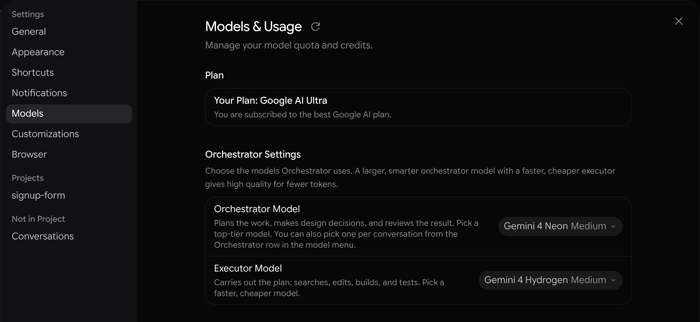

選擇模型
2-0
Antigravity 應用程式
開始使用
選擇模型 Antigravity App 開始使用
Antigravity 應用程式
Antigravity CLI
IDE 擴充功能
Antigravity IDE
適用於：
Antigravity 應用程式
Antigravity CLI
IDE 擴充功能
Antigravity IDE
# 選擇模型

「選擇模型」章節

Antigravity 讓您存取 Google DeepMind 與合作夥伴供應商的領先前沿推理模型。您可以隨時切換模型並選擇思考等級（`Low`, `Medium`, `High`，或 `Extra` 在支援的模型上），在快速編輯的回應速度與複雜架構及偵錯工作的更深入多步驟推理之間取得平衡。若要在同一對話中將頂尖規劃器模型與較快的執行器模型配對，請選取 [Orchestrator](#orchestrator).

## 選取模型

「選擇模型」章節

您可以從對話提示框下方的模型選擇器選單，選擇要使用的推理模型：

Plan Segmented Control
Model
View Usage Action
Usage Popout
Gemini Models
Weekly Limit Remaining
100%
Five Hour Limit Remaining
100%
Claude and GPT models
Weekly Limit Remaining
100%
Five Hour Limit Remaining
100%
† 適用於付費的 Google AI Pro 方案，或可在符合資格的高階裝置上試用。若要切換為付費的 Google AI Pro 方案， [提交請求](https://one.google.com/support).

‡ 於 [Gemini 企業版](/docs/enterprise#supported-models-in-gemini-enterprise)，Orchestrator 僅以 Gemini 4 Carbon（High）作為規劃者，搭配 Gemini 4 Hydrogen（High）作為執行者；自訂規劃者與執行者選取僅適用於 Google AI Pro 與 Google AI Ultra。

大多數可調整的 Gemini 模型提供 `Low`, `Medium` （預設值），且 `High` 思考等級。 **Gemini 4 Neon** 和 **Gemini 4 Hydrogen** 新增標示為以下內容的第四層級 **`Extra`** 在模型選取器中，這會設定 **超高** 推理預算（`xhigh` 於 [Antigravity CLI](/docs/cli/commands/effort), 例如 `--model gemini-4-neon-xhigh` 或 `--effort xhigh`），當任務需要最大推理深度時。

您選擇的推理模型會在對話內的訊息之間保持不變。如果您在代理執行期間變更推理模型，它會繼續使用先前選擇的推理模型，直到完成該回合的步驟（或直到您取消目前的執行）。

## 推理模型

「推理模型」章節

對於核心推理模型，Antigravity 提供領先的前沿模型。可用性取決於你的方案：

| 模型 | 免費 & Google AI Plus | Google AI Pro | Google AI Ultra | 企業版 |
| --- | --- | --- | --- | --- |
| [Gemini 4 Neon](/blog/gemini-4-neon-in-google-antigravity) | ❌ | ✅† | ✅ | ✅ |
| [Gemini 4 Carbon](/blog/gemini-4-carbon-in-google-antigravity) | ❌ | ❌ | ✅ | ✅ |
| [Gemini 4 Argon](/blog/gemini-4-argon-in-google-antigravity) | ❌ | ✅† | ✅ | ✅ |
| [Gemini 4 Hydrogen](/blog/gemini-4-hydrogen-in-google-antigravity) | ❌ | ✅** | ✅ | ✅ |
| [Orchestrator](/docs/models#orchestrator) | ❌ | ✅† | ✅ | ✅‡ |
| [Gemini 3.8 Flash](/blog/gemini-3-8-flash-in-google-antigravity) | ✅ | ✅ | ✅ | ✅ |
| [Gemini 3.7 Flash](/blog/gemini-3-7-flash-in-google-antigravity) | ❌ | ❌ | ❌ | ✅ |
| [Gemini 3.6 Flash](/blog/gemini-3-6-flash-in-google-antigravity) | ❌ | ❌ | ❌ | ✅ |
| [Gemini 3.1 Pro](/blog/gemini-3-1-pro-in-google-antigravity) | ❌ | ❌ | ❌ | ✅ |
| Claude Sonnet 5.5（thinking）** | ❌ | ✅** | ✅ | ✅ |
| Claude Opus 5.5（thinking）** | ❌ | ✅** | ✅ | ✅ |
| Claude Sonnet 4.6（thinking）* | ✅ | ✅ | ❌ | ❌ |
| Claude Opus 4.6（thinking）* | ✅ | ✅ | ❌ | ❌ |
| GPT-OSS-120b* | ✅ | ✅ | ✅ | ❌ |

* 將於 2026 年 11 月 30 日移除。

** 僅適用於 Google AI Pro 的非試用訂閱。若要取消試用並切換為付費的 Google AI Pro 方案， [提交請求](https://one.google.com/support).

† 適用於付費的 Google AI Pro 方案，或可在符合資格的高階裝置上試用。若要切換為付費的 Google AI Pro 方案， [提交請求](https://one.google.com/support).

‡ 於 [Gemini 企業版](/docs/enterprise#supported-models-in-gemini-enterprise)，Orchestrator 僅以 Gemini 4 Carbon（High）作為規劃者，搭配 Gemini 4 Hydrogen（High）作為執行者；自訂規劃者與執行者選取僅適用於 Google AI Pro 與 Google AI Ultra。

若要深入了解推理模型速率限制，請參閱 [計畫頁面](/docs/plans)。若您將 Antigravity 與 Gemini Enterprise 搭配使用，請參閱 [Gemini Enterprise 中支援的模型](/docs/enterprise#supported-models-in-gemini-enterprise).

### Gemini 4 Neon

標題為「Gemini 4 Neon」的章節

**Gemini 4 Neon** 會出現在每個包含該模型的方案的模型選取器頂端。如果您尚未選擇模型，它是新對話的預設模型；如果您已選取模型，Antigravity 會保留您的選擇。您可以隨時切換至任何其他模型。

- **思考等級**: `Low`, `Medium` （預設值）， `High`，與 `Extra`。在…中 [Antigravity CLI](/docs/cli/commands/effort)，這些是 `low`, `medium`, `high`，與 `xhigh` （例如， `--model gemini-4-neon-xhigh`).
- **上下文視窗**：最多 512K 個權杖。
- **可用性**：Google AI Ultra、Google AI Pro（付費方案，或符合資格的高階裝置試用），以及 [Gemini 企業版](/docs/enterprise#supported-models-in-gemini-enterprise)。 Gemini 4 Neon 不適用於 Free 與 Plus 方案。
- **Orchestrator**：在 Google AI Ultra 與 Google AI Pro 上，選取 [Orchestrator](#orchestrator) 使用 Gemini 4 Neon 進行規劃，並將 實作步驟交給較快的執行器（在 Gemini Enterprise 中，Orchestrator 僅將 Gemini 4 Carbon 與 Gemini 4 Hydrogen 配對）。

## Orchestrator

標題為「Orchestrator」的章節

**Orchestrator** 是模型選擇器選項，適用於 **Google AI Ultra**, **Google AI Pro** （付費方案，或符合資格的高階裝置試用），且 **[Gemini 企業版](/docs/enterprise#supported-models-in-gemini-enterprise)** 可在單一對話中配對兩個模型：較大的 **Orchestrator （規劃器）模型** 規劃並檢視工作，而較快的 **執行者模型** 執行搜尋、檔案編輯、建置與測試。

開啟 **Google AI Ultra** 和 **Google AI Pro** 於 **Antigravity 應用程式**，你可以在…下方 為每個角色選擇模型與思考層級 **設定** > **模型** > **Orchestrator 設定**，或將滑鼠停留 **Orchestrator** 在模型 選擇器中，覆寫單一對話的規劃器：

| 角色 | Responsibilities | 支援的模型 |
| --- | --- | --- |
| **協調器模型** （規劃者） | 探索程式碼庫、撰寫計畫並檢視進度 | [**Gemini 4 Neon**](#gemini-4-neon) （預設值）， [**Gemini 4 Carbon**](/blog/gemini-4-carbon-in-google-antigravity), [**Gemini 4 Argon**](/blog/gemini-4-argon-in-google-antigravity), **Claude Opus 5.5** |
| **執行器模型** | 搜尋、編輯檔案、執行建置與測試 | [**Gemini 4 Hydrogen**](/blog/gemini-4-hydrogen-in-google-antigravity) （預設值）， **Claude Sonnet 5.5** |

可用的模型與思考層級符合你的方案（請參閱 [推理模型表格](#reasoning-model)）。在…中 **Antigravity CLI** 在 Google AI Ultra 和 Google AI Pro 上， `/model` 提供單一 **Orchestrator** 列，包含 **Planner** 選擇器（`Neon`, `Carbon` 在 Google AI Ultra 上，或 `Argon`）與…配對 **Gemini 4 Hydrogen**.

每個規劃器與執行器模型也可依您的方案，在模型選取器中作為獨立選項使用。Orchestrator 會自動協調它們，讓您獲得頂尖的規劃品質，同時比單獨執行規劃器更快完成，並使用更少的權杖。

Orchestrator 不是會預先分類您的提示詞、再將整個要求傳送給單一模型的路由器。相反地，兩個模型會在同一項任務中協作，並隨著工作進展來回交接控制權：

- **協調者模型負責規劃。** 您傳送的每則訊息都會先進入唯讀規劃階段，規劃器會在這個階段探索程式碼庫、釐清不明確之處，並撰寫具體的實作計畫，包含應觸發重新規劃的條件。如果您的訊息是不需要變更的問題、審查或說明，規劃器會直接回答；對於步驟已確定的小型後續事項，則會立即交出簡短計畫。
- **執行者模型負責執行工作。** 計畫就緒後，執行器 （例如 **Gemini 4 Hydrogen**）接手搜尋、套用檔案編輯、撰寫 程式碼、執行建置與測試，並根據計畫驗證結果。
- **發生意外狀況時，控制權會交還。** 如果執行器遇到阻礙，例如驗證步驟連續失敗兩次、介面行為與預期不同，或是計畫未確定的設計選擇，它會將控制權交還給規劃器，規劃器會檢查對話狀態、修復計畫，再將執行交還給執行器。
- **協調者模型會檢閱進度。** 在較長的任務中，每當您在執行器工作時傳送訊息，執行器都會向規劃器報告進度，規劃器會對照計畫檢查已完成的工作，然後完成已完成的工作、繼續執行剩餘步驟，或更新計畫。

這些交接會在單一回應中自動完成，因此您無需在規劃與執行之間手動切換模型。如要在單一模型上執行每個步驟，請直接在模型選取器中選取該模型。可用性取決於您的方案；請參閱 [推理模型表格](#reasoning-model).

### 選取 Orchestrator

標題為「選取 Orchestrator」的章節

[Antigravity 應用程式](#tab-panel-234)[Antigravity CLI](#tab-panel-235)Antigravity 應用程式[「Antigravity App」章節](#sr-tab-1)  點按對話提示詞方塊下方的模型選取器。   按一下 **Orchestrator** 選取它。在 Google AI Ultra 和 Google AI Pro 上， 點按 **Orchestrator** 使用你作用中的 **協調器模型** 來自 **設定** > **模型** > **Orchestrator 設定** （顯示在…旁邊 **Orchestrator**, 例如 `Gemini 4 Neon Medium`），或你可以將滑鼠停留 **Orchestrator** 僅為目前 對話選取規劃器模型與思考層級。  在 Antigravity App 中選取 Orchestrator：開啟提示詞方塊下方的模型選取器，將游標停留在 Orchestrator 上的 New 標記以查看摘要，開啟 Orchestrator 子選單，選取 Gemini 4 Carbon High 做為對話的規劃者，然後輸入任務。如要變更預設 **協調器模型** 和 **執行器模型** 套用於所有 新的 Orchestrator 對話，請開啟 **設定** > **模型** 並更新 **Orchestrator 設定**:如同其他模型，Orchestrator 在對話的其餘時間會保持選取狀態，直到您選擇其他模型為止。App 中的自訂協調器與執行器模型選擇適用於本機對話。Antigravity CLI[「Antigravity CLI」章節](#sr-tab-2)在 Antigravity CLI 中選取 Orchestrator：按 Tab 補全 /model，反白 Orchestrator 列，使用 Planner 列上的左、右方向鍵選擇 Carbon，按 Enter 確認，並確認 /effort 不適用於它。你可以透過下列任一方式選取 Orchestrator：  **互動式選取器**：執行 `/model`，醒目顯示 **Orchestrator** （在 Google AI Ultra 與 Google AI Pro 上，請使用 ← / → 或 Tab 以 選取 **Planner**: `Neon`, `Carbon` 在 Google AI Ultra 上，或 `Argon`），並 按下 Enter。你的選擇會在多個工作階段之間保留。   **啟動時**：啟動 CLI 或在…中 執行時，傳入模型的名稱或識別碼 [無頭模式](/docs/cli/headless) （使用 `--model gemini-pro-orchestrator` 於 [Gemini 企業版](/docs/enterprise#selecting-models-and-thinking-levels)): `agy --model "Orchestrator (Neon)"
agy -p "Add input validation to the signup form and run the tests." --model "Orchestrator (Carbon)"`  執行 `agy models` 列出你帳號可用的每個模型識別碼。 由於 CLI 中的 Orchestrator 使用固定的推理預算， `--effort` 和 `/effort` 不適用於它；執行 `/effort` 在選取 Orchestrator 時 回報其工作量無法調整，例如 `Effort isn't adjustable for Orchestrator (Carbon).`

### 何時使用 Orchestrator

標題為「何時使用 Orchestrator」的章節

- **Orchestrator（建議的預設值）**：大多數日常開發，例如 功能開發、錯誤修正、重構與多檔案偵錯，你 希望由頂級規劃者模型（例如 Gemini 4 Neon、Gemini 4 Carbon、Gemini 4 Argon 或 Claude Opus 5.5）規劃並審查工作，同時由更快的 執行者（例如 Gemini 4 Hydrogen）執行實作步驟。
- **Gemini 4 Neon、Gemini 4 Carbon 或 Gemini 4 Argon**：每一個 中間步驟都需要在單一模型上達到最大推理深度的工作，例如 從頭設計複雜的分散式系統、解開細微的 並行競爭條件，或執行多儲存庫遷移。
- **Gemini 4 Hydrogen**：快速的日常編碼與維護工作，你 不需要獨立的規劃階段，例如套件 升級、程式碼去重、建立樣板程式碼、為定義明確的函式撰寫單元測試、更新文件，或產生快速指令碼。

Orchestrator 在對話中維持單一代理，並在每個回合內於規劃與執行之間交接。若要讓多個代理平行工作或互相檢查工作成果，請使用 [子代理](/docs/subagents), [Swarm](/docs/swarm), [Boost](/docs/boost)，或 [Teamwork](/docs/teamwork).

## 其他模型

「其他模型」章節

Antigravity 在技術堆疊的各部分使用不可自訂的其他模型：

- **[Nano Banana 2](/blog/nano-banana-pro)**：當代理產生 UI 模型、產生圖片以填充網頁或應用程式、建立系統或架構圖，或執行其他生成式圖片任務時，由生成式圖片工具使用。

上一個
驗證

下一步
與 Google 攜手建置

您的下載已開始您如何得知我們？請選一個。這有助於我們接觸更多像您一樣的人。感謝您讓我們知道！
