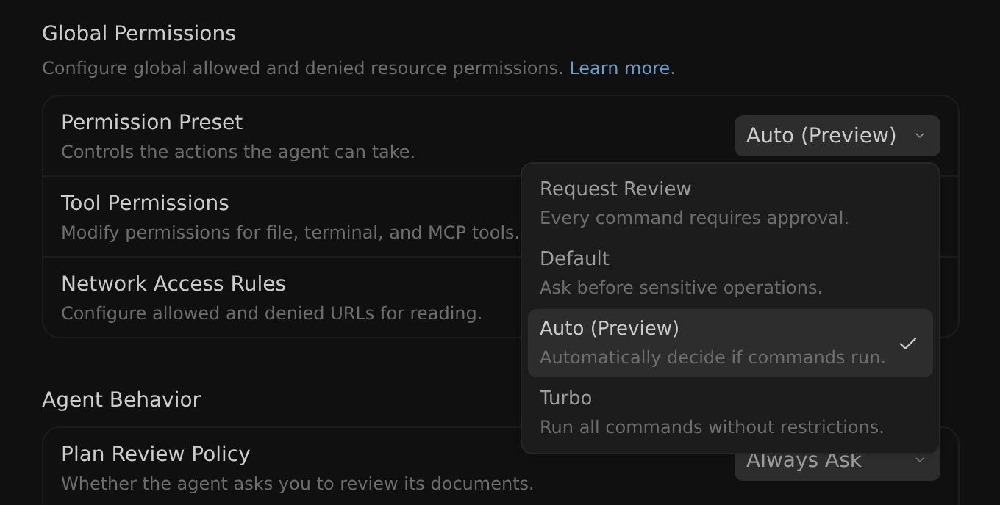
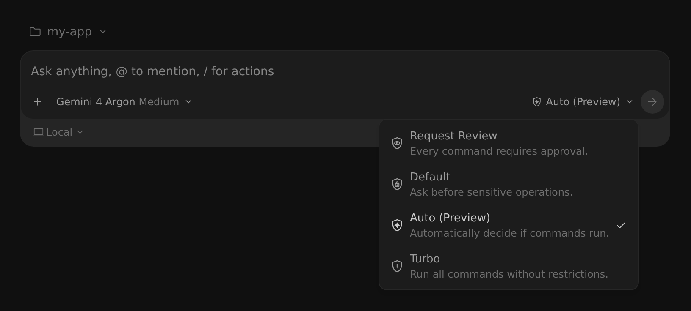

權限
2-0
Antigravity 應用程式
功能
權限 Antigravity App 功能
Antigravity 應用程式
Antigravity CLI
適用於：
Antigravity 應用程式
Antigravity CLI
# 代理權限

[「代理權限」章節](#agent-permissions)

Antigravity 使用統一的細粒度權限引擎，在拒絕、詢問與允許存取清單間評估敏感工具操作。如果您將 Antigravity 與 Gemini Enterprise 搭配使用，請參閱 [Gemini Enterprise 中的 Antigravity](/docs/enterprise#autonomous-tool-permissions-and-human-in-the-loop-controls).

- [Antigravity 應用程式](#tab-panel-204)
- [Antigravity CLI](#tab-panel-205)

## Antigravity 應用程式

[「Antigravity App」章節](#sr-tab-1)

### 已更新的權限設定

[標題為「Updated permission settings」的章節](#updated-permission-settings)

Antigravity 使用強健、統一的權限引擎來保護您的環境，同時啟用自主工作流程。代理執行的每個敏感操作都會表示為 **權限資源** 格式為 `action(target)`.

權限會依據三個不同的存取清單進行評估：

- **拒絕**：該動作會立即被封鎖。
- **詢問**：代理會暫停並提示要求您的明確核准後再繼續。
- **允許**：允許該動作，無需提示。

#### 權限預設集

[「權限預設集」章節](#permission-presets)

The **權限預設** 控制代理動作的核准方式。您設定的允許、拒絕與詢問規則會疊加在預設值之上並一律優先：

| 預設集 | [終端機沙箱](/docs/sandbox) | 終端機指令 | 檔案存取 | MCP & 網頁 |
| --- | --- | --- | --- | --- |
| **要求審查** | 已停用 | 一律詢問 | 僅限工作區 | 詢問 |
| **預設** *（預設）* | 已啟用 | 沙箱內允許；沙箱外詢問 | 工作區 + 暫存目錄 | 詢問 |
| **自動** | 已啟用 | 在沙箱內允許；在外部自動檢查 | 工作區 + 暫存目錄 | 詢問 |
| **Turbo** | 已停用 | 已允許（無限制） | 完整檔案系統 | 已允許 |

使用沙箱的兩個預設集運作方式如下：

- **預設** (*「敏感操作前先詢問。」*；預設）：終端機指令會在隔離的 **[終端機沙箱](/docs/sandbox)** 存取範圍限於你的工作區與暫存目錄，且 **無網路存取**。當指令需要網路連線或主機資源時，代理會請求在沙箱外執行—除非已有…涵蓋，否則會徵求您的核准 `command(...)` 允許規則。
- **自動** (*「自動決定是否執行指令。」*）：指令也會預設在終端機沙箱內執行。當指令需要在沙箱外執行時，Antigravity 會自動評估它，讓安全且可還原的指令能直接執行而無須提示，而具風險或不可逆的指令仍會請求您的核准。

請參閱 **[代理設定](/docs/agent-settings)** 查看各預設的更多詳情。

#### 變更你的權限預設值

[標題為「Change your permission preset」的章節](#change-your-permission-preset)

您可以為所有專案設定預設、為單一專案覆寫預設，或從訊息框切換預設。

##### 針對所有專案

[標題為「For all projects」的章節](#for-all-projects)

若要變更所有專案的預設集，請開啟 **設定** > **一般** > **全域權限** > **權限預設集** (**權限** > **這部電腦** 如果遠端代理可供您使用）：



勾號標示的是您目前的全域預設集。

##### 針對單一專案

[標題為「For a single project」的章節](#for-a-single-project)

若要覆寫單一專案的全域預設集，請在下列位置變更該專案的預設集： **設定** > **專案**. 新專案預設為 **繼承全域設定**，遵循您的全域預設。

##### 從訊息框

[標題為「From the message box」的章節](#from-the-message-box)

於 `v2.23.0+`, 您也可以從訊息框的權限選擇器中選擇預設集:



選擇器會變更您的全域預設集，若專案有覆寫，則變更專案的預設集。若要移除專案覆寫，請選擇 **使用全域設定**.

#### 支援的動作與比對規則

[「支援的動作與比對規則」章節](#supported-actions-and-matching-rules)

下表列出支援的權限動作、其目標格式與預設行為：

| 動作 | 目標格式 | 預設備援 |
| --- | --- | --- |
| `read_file` | `read_file(/path)`, `read_file(dir)`，或 `read_file(*)` | **詢問** （在工作區中允許） |
| `write_file` | `write_file(/path)` 或 `write_file(*)` | **詢問** （在工作區中允許） |
| `read_url` | `read_url(domain)` 或 `read_url(*)` | **詢問** |
| `execute_url` | `execute_url(domain)` 或 `execute_url(*)` | **詢問** |
| `download_url` | `download_url(domain)` 或 `download_url(*)` | **詢問** |
| `command` | `command(prefix)`, `command(regex:pattern)`，或 `command(*)` | **詢問** （在 Default 與 Auto 預設下於沙箱中允許） |
| `mcp` | `mcp(server/tool)`, `mcp(server/*)`，或 `mcp(*)` | **詢問** |

每個動作與其目標的對應方式如下：

- **`read_file`**: 比對絕對路徑或相對於專案工作區根目錄的路徑。授予對所有內含檔案與資料夾的遞迴讀取權限。使用 `read_file(*)` 比對系統上的所有檔案。
- **`write_file`**：與以下相同 `read_file`。隱含授與 `read_file` 適用於完全相同的目標路徑。
- **`read_url`**: 比對主機名稱與子網域（例如， `google.com` 涵蓋 `mail.google.com`）。忽略 URL 路徑區段。使用 `read_url(*)` 比對任何網域。
- **`execute_url`**：涵蓋 Antigravity App 中的內建瀏覽器代理從網域下載檔案 (可在以下位置設定 [瀏覽器子代理](/docs/browser) 開啟或重新導向至某個網域上的頁面。會比對主機名稱與一般子網域，並忽略 URL 路徑區段，同時隔離 `localhost` by `:port` （例如， `localhost:3000` 與……不同 `localhost:8080`) 且需要針對敏感的 Google 子網域 (例如 `mail.google.com`, `docs.google.com`, `drive.google.com`，與 `console.cloud.google.com`). A `read_url` 授權不涵蓋它。
- **`download_url`**：確保 **瀏覽器操作規則** 於 `v2.30.0+`，已移除的工作者會顯示在可收合的 `v2.31.0+`)。使用相同的網域， `localhost:port`，以及敏感的 Google 子網域比對規則，例如 `execute_url` (`data:` 和 `blob:` 下載一律只要求核准一次，且可執行檔或主動標記檔案類型會遭到封鎖）。請參閱 [瀏覽器使用權限與安全防護措施](/docs/browser#permissions-and-safety-guardrails).
- **`command`**: 預設以字面方式比對完整單字或權杖前綴。若要以規則運算式比對，請在目標開頭加上 `regex:` 前綴 (每個空白分隔的字符會評估為錨定正規表示式 `^(?:pattern)$`，例如， `command(regex:npm run (build.*))`）。涵蓋沙箱內外的執行。
- **`mcp`**: 比對確切的 MCP 工具，或指定伺服器上的所有工具（同樣適用於本機與遠端 MCP 伺服器）。使用 `mcp(*)` 比對任何工具。

##### 當指令需要完全相符時

[「當指令需要完全比對時」章節](#when-commands-require-an-exact-match)

某些殼層結構可在看似無害的前綴後面隱藏任意指令執行，例如指令或程序替換（`$(...)`，反引號， `<(...)`），算術環境（`$((...))`），大括號展開（`{a,b}`），非字面指令名稱、網路或檔案描述元重新導向，以及執行子指令的開發者工具旗標（例如 `git -c core.pager=<cmd>` 或 `tar --to-command`）。當 Antigravity 偵測到其中任何一項（或無法乾淨地解析指令）時，會對整個指令列停用前綴比對：僅當規則比對整行時，指令才會無需提示執行 **逐字比對** （或橫跨整行原始行 `regex:` 規則），否則退回 **詢問**.

標準的殼層組合仍照常進行前綴比對：管線、 `&&`/`||`/`;` 鏈、引號字面量、純 `$VAR` 引數、簡單的檔案重新導向，以及透明包裝（`timeout`, `nohup`, `nice`, `env`，其內部指令會獨立評估）。例如，使用 `command(git)` 於您的允許清單， `git status && git log` 執行時不會提示，而 `git log $(whoami)` 提示核准。

##### 了解跨平台的 read_url 與 execute_url

[「了解各平台的 read_url 與 execute_url」章節](#understanding-read_url-and-execute_url-across-the-platform)

Antigravity 會檢查 `read_url` 和 `execute_url` 在三個方面：

1. **網頁閱讀**: 當代理為了研究擷取網頁 Markdown 時，它會檢查您的 `read_url` 授權（複數）。
2. **瀏覽器子代理**：當代理控制某個分頁時，該分頁的圖示會 變更為代理游標箭頭 (頁面載入時會顯示旋轉圓環)。在 頁面上，動畫游標會在目標之間移動、適應捲動與輸入，並顯示描述目前步驟的狀態藥丸 (或 `execute_url` 和 `download_url` 該網域的授權，而非 `read_url` (且每次檔案上傳都需要一次性核准，即使在 **Turbo**)。如需詳細資訊，請參閱 [瀏覽器使用](/docs/browser#permissions-and-safety-guardrails) 和 [允許清單與拒絕清單](/docs/ide/allowlist-denylist).
3. **終端機沙箱化**：在以下項目下授權的任何網域 `read_url` 直接編譯進沙箱的出站網路允許清單，允許如 等指令 `curl` 或 `npm` 連線至已授權的主機。

##### 跨平台指令與路徑比對

[「跨平台指令與路徑比對」章節](#cross-platform-command-and-path-matching)

無論您是在 macOS、Linux 或 Windows 上開發，Antigravity 都能確保您的權限規則運作一致。在 macOS 與 Linux 上，路徑使用標準正斜線（`/`）。在 Windows 上，Antigravity 會在規則評估前自動正規化路徑
，方式為移除磁碟機代號（例如， `C:`）並轉換所有反斜線（`\`）轉為正斜線（`/`).

#### 隱含權限規則

[「隱含權限規則」章節](#implicit-permission-rules)

Antigravity 套用下列隱含的權限規則：

- **寫入即表示可讀取**：允許 `write_file` 於路徑自動授予 `read_file` 於該路徑。
- **拒絕讀取即代表拒絕寫入**：拒絕 `read_file` 於路徑立即阻擋 `write_file` 於該路徑。

#### 互動式權限提示

[「互動式權限提示」章節](#interactive-permission-prompts)

當代理遇到需要核准的作業（**詢問** 模式)，互動式卡片出現於您的編輯器。在按一下 之前 **允許** 適用於檔案、URL 或 MCP 權限，您可以直接在提示卡中編輯目標字串以擴大授予範圍（例如，將單一檔案請求如 `/project/file.txt` 至父目錄 `/project`）。Antigravity 會驗證您編輯的目標安全地涵蓋該操作，並在該回合剩餘時間套用擴大的授權，防止相關操作重複提示。 *（備註：終端機指令不支援範圍編輯）。*

#### 終端機指令與沙箱

[「終端機指令與沙箱」章節](#terminal-commands-and-the-sandbox)

在 **自動** 和 **預設** 預設下，代理會在隔離的環境內執行終端機指令 [終端機沙箱](/docs/sandbox)，預設僅能存取您的工作區與系統暫存目錄，且無網路存取。指令可在沙箱中無需手動核准執行，您的權限授權可進一步決定沙箱能觸及的範圍：

- 在以下項目下授與的路徑 `read_file` 動態填入沙箱的唯讀檔案系統允許清單。
- 在以下項目下授與的路徑 `write_file` 動態填入沙箱的讀寫檔案系統允許清單。
- 授與的網域，位於 `read_url` 定義輸出網路存取政策。

由於某些指令無法在沙箱中執行——例如需要網路存取的指令——代理仍可選擇在沙箱外執行指令：

- **預設** *（預設）*：沙箱外的指令會提示您核准，除非已由 `command` 規則。
- **自動**：Antigravity 會自動評估需要在沙箱外執行的指令，讓安全、可還原的指令無需提示即可繼續，而具風險或不可逆的指令仍需核准。

#### 預設系統行為與防護機制

[「預設系統行為與防護機制」章節](#default-system-behaviors-and-guardrails)

當動作未明確列於您的允許、拒絕或詢問清單時，Antigravity 會退回安全的系統預設值：

1. **指令**：在以下項目下 **預設** 預設下，指令在沙箱內執行時不會提示，在沙箱外執行則需要核准。在 **自動**, 沙箱外的安全指令會直接執行、不提示，而敏感或不可逆的指令則會暫停等待核准.
2. **工作區檔案**：讀寫作用中專案目錄內的檔案無需提示即可進行，而非工作區檔案則需要核准。
3. **網頁瀏覽預設為詢問**：適用於以下項目的動作 `read_url` 和 `execute_url` 預設為 **詢問**。代理在讀取或開啟網頁之前會暫停並提示您明確核准，除非已設定允許規則。
4. **MCP 工具預設為詢問**：未設定的 MCP 工具呼叫會提示要求核准。

#### 設定範例

[「設定範例」章節](#configuration-examples)

下列範例顯示…的規則 **允許清單**，定義無需提示即可執行的動作：

```
command(git)                             # Standard git commands
command(regex:npm run (build|lint|test)) # Allow safe npm scripts using regex
command(git push)                        # Allow git push, inside or outside the sandbox
read_file(/var/log/app)                  # Read external log paths
write_file(src/)                         # Edit relative src/ folder
read_url(google.com)                     # Fetch Google subdomains
mcp(linter/*)                            # Run linter MCP tools
```

下列範例顯示…的規則 **拒絕清單**，定義永久封鎖的動作：

```
command(rm -rf)                    # Block destructive deletions
command(regex:curl .*)             # Block unvetted curl downloads
command(sudo)                      # Block sudo privileges
write_file(.git/)                  # Safeguard Git history
write_file(/home/user/.ssh)        # Safeguard SSH keys
```

下列範例顯示…的規則 **詢問清單**，定義暫停以待手動確認的動作：

```
command(*)                         # Prompt all commands
execute_url(aws.amazon.com)        # Prompt before opening AWS pages
mcp(sql/execute_mutation)          # Prompt modifying SQL queries
```

### 先前的權限設定

[標題為「Previous permission settings」的章節](#previous-permission-settings)

Antigravity 使用強健、統一的權限引擎來保護您的環境，同時啟用自主工作流程。代理執行的每個敏感操作都會表示為 **權限資源** 格式為 `action(target)`.

權限會依據三個不同的存取清單進行評估：

- **拒絕**：該動作會立即被封鎖。
- **詢問**：代理會暫停並提示要求您的明確核准後再繼續。
- **允許**：允許該動作，無需提示。

#### 支援的動作與比對規則

[「支援的動作與比對規則」章節](#supported-actions-and-matching-rules-1)

下表列出先前權限設定中支援的權限動作、其目標格式與預設行為：

| 動作 | 目標格式 | 預設備援 |
| --- | --- | --- |
| `read_file` | `read_file(/path)`, `read_file(dir)`，或 `read_file(*)` | **詢問** （在工作區中允許） |
| `write_file` | `write_file(/path)` 或 `write_file(*)` | **詢問** （在工作區中允許） |
| `read_url` | `read_url(domain)` 或 `read_url(*)` | **詢問** |
| `execute_url` | `execute_url(domain)` 或 `execute_url(*)` | **詢問** |
| `download_url` | `download_url(domain)` 或 `download_url(*)` | **詢問** |
| `command` | `command(prefix)`, `command(regex:pattern)`，或 `command(*)` | **詢問** |
| `unsandboxed` | `unsandboxed(prefix)`, `unsandboxed(regex:pattern)`，或 `unsandboxed(*)` | **詢問** |
| `mcp` | `mcp(server/tool)`, `mcp(server/*)`，或 `mcp(*)` | **詢問** |

每個動作與其目標的對應方式如下：

- **`read_file`**: 比對絕對路徑或相對於專案工作區根目錄的路徑。授予對所有內含檔案與資料夾的遞迴讀取權限。使用 `read_file(*)` 比對系統上的所有檔案。
- **`write_file`**：與以下相同 `read_file`。隱含授與 `read_file` 適用於完全相同的目標路徑。
- **`read_url`**: 比對主機名稱與子網域（例如， `google.com` 涵蓋 `mail.google.com`）。忽略 URL 路徑區段。使用 `read_url(*)` 比對任何網域。
- **`execute_url`**：涵蓋 Antigravity App 中的內建瀏覽器代理從網域下載檔案 (可在以下位置設定 [瀏覽器子代理](/docs/browser) 開啟或重新導向至某個網域上的頁面。會比對主機名稱與一般子網域，並忽略 URL 路徑區段，同時隔離 `localhost` by `:port` （例如， `localhost:3000` 與……不同 `localhost:8080`) 且需要針對敏感的 Google 子網域 (例如 `mail.google.com`, `docs.google.com`, `drive.google.com`，與 `console.cloud.google.com`). A `read_url` 授權不涵蓋它。
- **`download_url`**：確保 **瀏覽器操作規則** 於 `v2.30.0+`，已移除的工作者會顯示在可收合的 `v2.31.0+`)。使用相同的網域， `localhost:port`，以及敏感的 Google 子網域比對規則，例如 `execute_url` (`data:` 和 `blob:` 下載一律只要求核准一次，且可執行檔或主動標記檔案類型會遭到封鎖）。請參閱 [瀏覽器使用權限與安全防護措施](/docs/browser#permissions-and-safety-guardrails).
- **`command`**: 預設以字面方式比對完整單字或權杖前綴。若要以規則運算式比對，請在目標開頭加上 `regex:` 前綴 (每個空白分隔的字符會評估為錨定正規表示式 `^(?:pattern)$`，例如， `command(regex:npm run (build.*))`).
- **`unsandboxed`**: 預設逐字以字面方式比對指令前綴（或使用 `regex:`）。符合此授權的指令在終端機沙箱啟用時，會在容器隔離之外執行。
- **`mcp`**: 比對確切的 MCP 工具，或指定伺服器上的所有工具（同樣適用於本機與遠端 MCP 伺服器）。使用 `mcp(*)` 比對任何工具。

##### 當指令需要完全相符時

[「當指令需要完全比對時」章節](#when-commands-require-an-exact-match-1)

某些殼層結構可在看似無害的前綴後面隱藏任意指令執行，例如指令或程序替換（`$(...)`，反引號， `<(...)`），算術環境（`$((...))`），大括號展開（`{a,b}`），非字面指令名稱、網路或檔案描述元重新導向，以及執行子指令的開發者工具旗標（例如 `git -c core.pager=<cmd>` 或 `tar --to-command`）。在 PowerShell 或命令提示字元等 Windows 殼層上，語法無法乾淨拆分為個別單字的指令也屬於此類。當 Antigravity 偵測到其中任何一項時，會對整個指令列停用前綴比對：僅當規則比對整行時，指令才會無需提示執行 **逐字比對** （或橫跨整行原始行 `regex:` 規則，例如 `command(regex:git .*)`），否則退回至 **詢問**.

標準的殼層組合仍照常進行前綴比對：管線、 `&&`/`||`/`;` 鏈、引號字面量、純 `$VAR` 引數、簡單的檔案重新導向，以及透明包裝（`timeout`, `nohup`, `nice`, `env`，其內部指令會獨立評估）。例如，使用 `command(git)` 於您的允許清單， `git status && git log` 執行時不會提示，而 `git log $(whoami)` 提示核准。

##### 了解跨平台的 read_url 與 execute_url

[「了解各平台的 read_url 與 execute_url」章節](#understanding-read_url-and-execute_url-across-the-platform-1)

Antigravity 會檢查 `read_url` 和 `execute_url` 在三個方面：

1. **網頁閱讀**: 當代理為了研究擷取網頁 Markdown 時，它會檢查您的 `read_url` 授權（複數）。
2. **瀏覽器子代理**：當代理控制某個分頁時，該分頁的圖示會 變更為代理游標箭頭 (頁面載入時會顯示旋轉圓環)。在 頁面上，動畫游標會在目標之間移動、適應捲動與輸入，並顯示描述目前步驟的狀態藥丸 (或 `execute_url` 和 `download_url` 該網域的授權，而非 `read_url` (且每次檔案上傳都需要一次性核准，即使在 **Turbo**)。如需詳細資訊，請參閱 [瀏覽器使用](/docs/browser#permissions-and-safety-guardrails) 和 [允許清單與拒絕清單](/docs/ide/allowlist-denylist).
3. **終端機沙箱化**：在沙箱模式下，在以下項目下授權的任何網域 `read_url` 直接編譯進容器的出站網路允許清單 (`AllowedDomains`），允許類似…的指令 `curl` 或 `npm` 連線至已授權的主機。

##### 跨平台指令與路徑比對

[「跨平台指令與路徑比對」章節](#cross-platform-command-and-path-matching-1)

無論您是在 macOS、Linux 或 Windows 上開發，Antigravity 都能確保您的權限規則運作一致。在 macOS 與 Linux 上，路徑使用標準正斜線（`/`）。在 Windows 上，Antigravity 會在規則評估前自動正規化路徑
，方式為移除磁碟機代號（例如， `C:`）並轉換所有反斜線（`\`）轉為正斜線（`/`).

#### 隱含權限規則

[「隱含權限規則」章節](#implicit-permission-rules-1)

Antigravity 套用下列隱含的權限規則：

- **寫入即表示可讀取**：允許 `write_file` 於路徑自動授予 `read_file` 於該路徑。
- **拒絕讀取即代表拒絕寫入**：拒絕 `read_file` 於路徑立即阻擋 `write_file` 於該路徑。

#### 互動式權限提示

[「互動式權限提示」章節](#interactive-permission-prompts-1)

當代理遇到需要核准的作業（**詢問** 模式)，互動式卡片出現於您的編輯器。在按一下 之前 **允許** 適用於檔案、URL 或 MCP 權限，您可以直接在提示卡中編輯目標字串以擴大授予範圍（例如，將單一檔案請求如 `/project/file.txt` 至父目錄 `/project`）。Antigravity 會驗證您編輯的目標安全地涵蓋該操作，並在該回合剩餘時間套用擴大的授權，防止相關操作重複提示。 *（備註：終端機指令不支援範圍編輯）。*

#### 終端機沙箱化（預覽版）

[「終端機沙箱化（預覽）」章節](#terminal-sandboxing-preview)

啟用沙箱時，權限授與也適用於指令：

- 在以下項目下授與的路徑 `read_file` 動態填入沙箱的唯讀檔案系統允許清單。
- 在以下項目下授與的路徑 `write_file` 動態填入沙箱的讀寫檔案系統允許清單。
- 授與的網域，位於 `read_url` 定義輸出網路存取政策。

#### 預設系統行為與防護機制

[「預設系統行為與防護機制」章節](#default-system-behaviors-and-guardrails-1)

當動作未明確列於您的允許、拒絕或詢問清單時，Antigravity 會退回安全的系統預設值：

1. **指令預設為詢問**：未設定的終端機指令（`command` 和 `unsandboxed`）需要手動核准，除非已在您的設定中設為無需提示即可執行。
2. **工作區檔案**：讀寫作用中專案目錄內的檔案無需提示即可進行，而非工作區檔案則需要核准。
3. **網頁瀏覽預設為詢問**：適用於以下項目的動作 `read_url` 和 `execute_url` 預設為 **詢問**。代理在讀取或開啟網頁之前會暫停並提示您明確核准，除非已設定允許規則。
4. **MCP 工具預設為詢問**：未設定的 MCP 工具呼叫會提示要求核准。

#### 設定範例

[「設定範例」章節](#configuration-examples-1)

下列範例顯示…的規則 **允許清單**，定義無需提示即可執行的動作：

```
command(git)                             # Standard git commands
command(regex:npm run (build|lint|test)) # Allow safe npm scripts using regex
unsandboxed(git push)                    # Allow git push outside sandbox
read_file(/var/log/app)                  # Read external log paths
write_file(src/)                         # Edit relative src/ folder
read_url(google.com)                     # Fetch Google subdomains
mcp(linter/*)                            # Run linter MCP tools
```

下列範例顯示…的規則 **拒絕清單**，定義永久封鎖的動作：

```
command(rm -rf)                    # Block destructive deletions
command(regex:curl .*)             # Block unvetted curl downloads
command(sudo)                      # Block sudo privileges
write_file(.git/)                  # Safeguard Git history
write_file(/home/user/.ssh)        # Safeguard SSH keys
```

下列範例顯示…的規則 **詢問清單**，定義暫停以待手動確認的動作：

```
command(*)                         # Prompt all commands
execute_url(aws.amazon.com)        # Prompt before opening AWS pages
mcp(sql/execute_mutation)          # Prompt modifying SQL queries
```

## Antigravity CLI

[「Antigravity CLI」章節](#sr-tab-2)

### CLI 細粒度權限

[「CLI 細緻權限」章節](#cli-fine-grained-permissions)

為在啟用自主工作流程的同時保護您的工作站，Antigravity CLI 整合了穩健的 **細粒度的權限引擎**。代理執行的每個敏感操作都表示為 **權限資源** 格式為 `action(target)`.

權限會依據全域設定中設定的三個不同存取清單進行評估（`~/.gemini/antigravity-cli/settings.json`):

- **`deny`**：該動作會立即被封鎖。
- **`ask`**：代理會暫停並提示要求您的明確核准後再繼續。
- **`allow`**：該動作自動核准，無需提示。

### 支援的 CLI 動作與比對規則

[「支援的 CLI 動作與比對規則」章節](#supported-cli-actions-and-matching-rules)

細緻權限遵循標準結構描述模式：

```
action(target)
```

支援的動作、目標格式規格與預設備援行為列於下表：

| 動作 | 目標格式 | 預設備援 |
| --- | --- | --- |
| **`read_file`** | `read_file(/path)`, `read_file(dir)`，或 `read_file(*)` | **詢問** （在工作區中自動允許） |
| **`write_file`** | `write_file(/path)` 或 `write_file(*)` | **詢問** （在工作區中自動允許） |
| **`read_url`** | `read_url(domain)` 或 `read_url(*)` | **詢問** |
| **`execute_url`** | `execute_url(domain)` 或 `execute_url(*)` | **詢問** |
| **`command`** | `command(prefix)`, `command(regex:pattern)`，或 `command(*)` | **詢問** |
| **`unsandboxed`** | `unsandboxed(prefix)`, `unsandboxed(regex:pattern)`，或 `unsandboxed(*)` | **詢問** |
| **`mcp`** | `mcp(server/tool)`, `mcp(server/*)`，或 `mcp(*)` | **詢問** |

每個動作的比對演算法如下：

- **`read_file`**: 比對絕對路徑或相對於工作區根目錄的路徑。授予對所有內含檔案與資料夾的遞迴讀取權限。 `read_file(*)` 比對系統上的所有檔案。
- **`write_file`**：與以下相同 `read_file`。隱含授與 `read_file` 適用於完全相同的目標路徑。
- **`read_url`**: 比對主機名稱與子網域（例如， `google.com` 涵蓋 `mail.google.com`）。忽略 URL 路徑區段。 `read_url(*)` 比對任何網域。
- **`execute_url`**：涵蓋瀏覽器子代理在某個網域上開啟頁面的情形，例如瀏覽至某個 URL 或開啟新頁面時。比對主機名稱和子網域，忽略 URL 路徑區段。 `read_url` 授權不涵蓋它。
- **`command`**: 預設逐字以字面方式比對指令前綴。若要使用規則運算式，請加上 `regex:` 前綴 (例如， `command(regex:npm run (build|lint|test))`）。無論指令在終端機沙箱內或外執行，皆涵蓋該指令。
- **`unsandboxed`**: 僅限商業與企業版帳號。其他帳號會忽略 `unsandboxed` 規則並顯示警告；請使用 `command` 改用此方式。預設會依字面逐詞比對指令前綴（或以 `regex:`）。符合此授權的指令在終端機沙箱啟用時，會在容器隔離之外執行。
- **`mcp`**: 比對確切的 MCP 工具，或指定伺服器上的所有工具（適用於本機與遠端 MCP 伺服器）。 `mcp(*)` 比對任何工具。

#### CLI 全域萬用字元語法

[「CLI 全域萬用字元語法」章節](#cli-global-wildcard-syntax)

在所有支援的動作類型中，傳遞全域萬用字元 `*` （例如 `read_file(*)`, `command(*)`，與 `mcp(*)`）比對該整個動作命名空間內的所有目標。

#### CLI 隱含權限規則

[「CLI 隱含權限規則」章節](#cli-implicit-permission-rules)

Antigravity CLI 套用以下隱含權限規則：

- **寫入即表示可讀取**：允許 `write_file` 於路徑自動授予 `read_file` 於該路徑。
- **拒絕讀取即代表拒絕寫入**：拒絕 `read_file` 於路徑立即阻擋 `write_file` 於該路徑。

#### CLI 跨平台路徑正規化

[「CLI 跨平台路徑正規化」章節](#cli-cross-platform-path-normalization)

無論您是在 macOS、Linux 或 Windows 上開發，Antigravity 都能確保您的權限規則運作一致。在 macOS 與 Linux 上，路徑使用標準正斜線（`/`）。在 Windows 上，Antigravity 會在規則評估前自動正規化路徑
，方式為移除磁碟機代號（例如， `C:`）並將所有反斜線轉換（`\`）轉為正斜線（`/`).

#### CLI 跨平台指令比對

[「CLI 跨平台指令比對」章節](#cli-cross-platform-command-matching)

在 PowerShell 或命令提示字元等 Windows shell 中，無法乾淨拆成多個單字的指令預設需要精確比對。若要在 Windows 上比對指令及其子指令，請使用 `regex:` 前綴 (例如，
`command(regex:git .*)` 允許任何 `git` 指令）。

---

### 預設 CLI 系統行為與防護機制

[「預設 CLI 系統行為與防護機制」章節](#default-cli-system-behaviors-and-guardrails)

當動作未明確列於您的 `allow`, `deny`，或 `ask` 清單，系統退回安全的系統預設值：

1. **工作區會自動允許**：在標準運作中，讀取和寫入使用中專案目錄內的檔案會自動獲得允許（且在 `auto` 和 `accept-edits` 模式）。
2. **指令會在以下位置的沙箱中執行 `auto` 模式**: 當 `auto` 模式啟用時，命令會在以下位置內執行： [終端機沙箱](/docs/sandbox) 無須提示，而需要在沙箱外執行的命令會自動接受評估，因此只有具風險或不可還原的動作會暫停並等待核准。
3. **網頁瀏覽預設為詢問**：適用於以下項目的動作 `read_url` 和 `execute_url` 預設為 **詢問**。代理在讀取或開啟網頁之前會暫停並提示您核准，除非已設定允許規則。
4. **其他未設定的動作預設為「詢問」**：未設定 `mcp` 工具、非工作區檔案存取，以及以下位置以外的命令： `auto` 模式預設為 **詢問**, 並受您目前的執行模式與 `toolPermission` 設定。

### 執行模式與終端機沙箱

[標題為「Execution modes and the terminal sandbox」的章節](#execution-modes-and-the-terminal-sandbox)

您的精細 `allow`, `ask`，與 `deny` 規則一律優先（`Deny > Ask > Allow`）。對於未被明確規則涵蓋的操作，Antigravity CLI 會評估您目前作用中的 [執行模式](/docs/cli/modes) (`--mode` 或 `agentMode` 於 `settings.json`）與 `toolPermission` 原則：

- **`auto` 模式 (`--mode=auto` 或 `"agentMode": "auto"`)**: 自動核准工作區檔案編輯，並在以下範圍內執行終端機指令 [終端機沙箱](/docs/sandbox) （預設）。當指令需要在沙箱外執行時，Antigravity CLI 會自動評估，讓安全、可逆的指令不經提示即執行，而有風險或不可逆的指令仍會暫停等待您的核准。啟用時，右下角狀態列會顯示 `auto` 且提示詞預留位置文字為 `Auto mode: edits & safe commands auto-approved (shift+tab to cycle)`.
- **`accept-edits` 模式 (`--mode=accept-edits`)**: 自動核准工作區檔案的編輯與建立，同時持續依您的以下設定評估 shell 指令 `toolPermission` 原則與細粒度規則。
- **`default` 模式（預設值；選取 `default` 於 `/config`)**：在修改或建立檔案前提示進行互動式差異審查，並根據您的 `toolPermission` 政策（`request-review` 預設啟用）。
- **`toolPermission` 覆寫設定**: `strict` 和 `always-proceed` (`--dangerously-skip-permissions`）優先於 `auto` 模式。在 `auto` 模式， `proceed-in-sandbox` 在沙箱中執行指令時不會提示，執行沙箱外的指令前會先詢問。自 `v1.4.4`，如果您的機器上無法使用沙箱， `proceed-in-sandbox` 行為類似 `request-review` （請參閱 [終端機沙箱](/docs/sandbox)).

請參閱 **[選擇執行模式](/docs/cli/modes)** 如需使用下列方式切換模式的詳情： Shift + Tab, `--mode`，或 `/config`.

---

### 互動式 CLI 權限提示

[「互動式 CLI 權限提示」章節](#interactive-cli-permission-prompts)

當代理遇到需要核准的作業（**詢問** 模式)，互動式提示卡出現於您的 TUI。

確認之前 **允許** 適用於檔案、URL 或 MCP 權限，您可以直接在提示卡中編輯目標字串以擴大授予範圍（例如，將單一檔案請求如 `/project/file.txt` 至父目錄 `/project`）。CLI 會驗證您編輯的目標安全地涵蓋該操作，並在該回合剩餘時間套用擴大的授權，防止相關操作重複提示。 *（備註：終端機指令不支援範圍編輯）。*

---

### CLI 設定範例

[「CLI 設定範例」章節](#cli-configuration-examples)

將這些規則新增至您的 `~/.gemini/antigravity-cli/settings.json` 檔案：

```
{
    "permissions": {
        "allow": [
            "command(git)",
            "command(regex:npm run (build|lint|test))",
            "read_file(/var/log/app)",
            "write_file(src/)",
            "read_url(google.com)",
            "mcp(linter/*)"
        ],
        "deny": [
            "command(rm -rf)",
            "command(regex:curl .*)",
            "command(sudo)",
            "write_file(.git/)",
            "write_file(/home/user/.ssh)"
        ],
        "ask": ["command(*)", "execute_url(aws.amazon.com)", "mcp(sql/execute_mutation)"]
    }
}
```

## 相關資源

[「相關資源」章節](#related-resources)

探索相關文件與指南：

- **[權限指令](/docs/cli/commands/permissions)**：在 TUI 中互動式管理規則。
- **[沙箱自訂](/docs/sandbox)**：強制執行 OS 層級容器隔離邊界。
- **[外掛程式與技能](/docs/plugins)**：建立您自己的自訂技能與斜線指令。
- **[設定、算繪與按鍵繫結](/docs/settings)**：自訂鍵盤快速鍵與緩衝區。

[上一個
管理對話](/docs/cli/conversations/)

[下一步
Tab 補全](/docs/ide/tab/)

您的下載已開始

## 您如何得知我們？

請選一個。這有助於我們接觸更多像您一樣的人。

感謝您讓我們知道！
