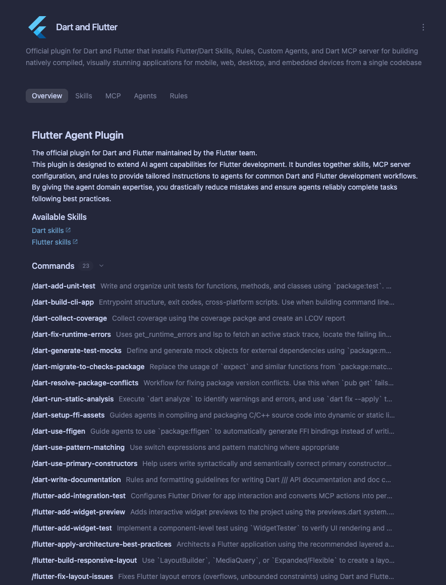
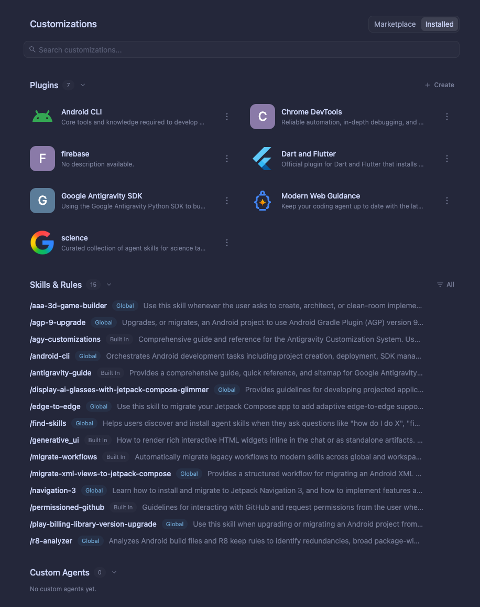

外掛程式
2-0
Antigravity 應用程式
功能
外掛程式 Antigravity App 功能
Antigravity 應用程式
Antigravity CLI
Antigravity IDE
適用於：
Antigravity 應用程式
Antigravity CLI
Antigravity IDE
# 外掛程式

[「外掛」章節](#plugins)

外掛程式封裝可重複使用的 [技能](/docs/skills), [Model Context Protocol (MCP)
伺服器](/docs/mcp), [自訂代理與子代理](/docs/subagents),
[規則](/docs/rules)，與 [生命週期掛鉤](/docs/hooks) 合併為單一
具版本的單位。您可以從以下位置安裝精選外掛程式：
[Antigravity Marketplace](/docs/marketplace)，從 GitHub
儲存庫或本機目錄安裝外掛程式，或 [建置並發佈您自己的外掛程式](/docs/build-plugins).

| Goal | 指南 |
| --- | --- |
| **瀏覽 Marketplace 目錄** | **[市集](/docs/marketplace)** — 探索、安裝並設定 Google 與合作夥伴的外掛，在 App 與 CLI 中皆可使用。 |
| **使用並管理已安裝的外掛程式** | **本頁** — 了解 [外掛隨附的內容](#what-a-plugin-bundles), [如何使用已安裝的外掛程式](#using-installed-plugins)，與 [如何依介面管理外掛程式](#managing-plugins-by-surface). |
| **建置、驗證並發佈外掛** | **[建置外掛](/docs/build-plugins)** — 依照 3 步驟快速入門， `plugin.json` manifest schema、元件撰寫指南， `agy plugin validate --strict`，以及 Marketplace 提交。 |

## 外掛程式包含哪些內容

[標題為「What a plugin bundles」的章節](#what-a-plugin-bundles)

單一外掛程式可以打包五種自訂元件的任意組合：

| 元件 | 它如何擴充 Antigravity |
| --- | --- |
| **[技能](/docs/skills)** | 任務專屬的工作流程、輔助指令碼與參考文件，依需求載入或透過以下方式明確呼叫 `/<skill-name>`. |
| **[MCP 伺服器](/docs/mcp)** | 遠端 HTTPS 或本機 `stdio` Model Context Protocol 工具伺服器（`<plugin-name>_<server-name>`），包括 OAuth 登入與使用者提示的 API 金鑰變數。 |
| **[自訂代理 & 子代理](/docs/subagents)** | 具備專屬系統提示詞、模型層級與工具許可清單的專門代理，可作為背景子代理執行，或作為您的主要工作階段代理。 |
| **[規則](/docs/rules)** | 持續性的程式設計慣例、架構限制，或檔案 glob 範圍的指示。 |
| **[生命週期掛鉤](/docs/hooks)** | 同步 shell 指令或提示詞評估，用於檢查、封鎖或擴充代理生命週期事件與工具呼叫。 |

## 使用已安裝的外掛程式

[標題為「Using installed plugins」的章節](#using-installed-plugins)

外掛程式安裝並啟用後，其隨附元件會
自動在您所有工作區工作階段中提供：

### 起始提示詞與技能

[標題為「Starter prompts and skills」的章節](#starter-prompts-and-skills)

- **起始提示詞標籤**: 在 Antigravity App 中 (**自訂項目 > Marketplace** 或 **自訂項目 > 已安裝**），開啟外掛程式的詳細頁面 並點選任一 **建議的提示詞標籤** 位於頁面頂部，可立即開始 引導式工作： 
- **自動載入技能**: 以自然語言描述您的任務。在 工作階段啟動時，Antigravity 只會載入 `name` 和 `description` 每個 已啟用外掛程式技能的內容，並讀取完整的 `SKILL.md` 在提示詞相符時 依需求提供指示。
- **斜線指令呼叫**：輸入 `/<skill-name>` 在對話中（例如， `/dart-add-unit-test` 或 `/hello`）以明確觸發外掛程式技能。

### MCP 工具與憑證設定

[標題為「MCP tools and credential setup」的章節](#mcp-tools-and-credential-setup)

- **呼叫 MCP 工具**: 請代理查詢已連線的服務或對其採取動作 （例如 Firebase、Dart 與 Flutter、Stripe、Datadog、Figma 或 Jira）。隨附的 MCP 工具會以以下命名空間區分: `<plugin-name>_<server-name>`.
- **API 金鑰與設定變數**: 如果外掛宣告了必要的 設定變數（例如 API token 或專案 URL），透過 CLI 安裝該 外掛後，在完成設定前會保持停用。在以下位置將外掛開啟 時 **自訂項目 > 已安裝** （或按下 Space 在外掛程式 上，位於 CLI 的 `/plugin` **已安裝** 分頁）會開啟設定對話框，提示輸入 每個變數。
- **OAuth 登入**: 如果外掛使用 OAuth 2.0 且沒有必要的設定 變數，它會以啟用狀態安裝，並在其 MCP 伺服器連線時於瀏覽器中提示您 完成登入.

### 自訂代理和子代理

[標題為「Custom agents and subagents」的章節](#custom-agents-and-subagents)

- **自動背景委派**: 當 `subagent: true` （預設）時， 主要代理會自動將專門任務（例如安全性 審查、無障礙稽核或框架遷移）委派給外掛程式 隨附的子代理在背景執行。
- **直接執行外掛程式代理**: 當 `mainAgent: true` （預設）時，您 可以選取外掛程式的自訂代理作為您的主要工作階段代理：  **Antigravity 應用程式**: 從對話檢視中的代理選擇器，或在以下位置 選擇代理 **自訂項目 > 已安裝 > 自訂代理**. **Antigravity CLI（互動式）**：執行 `/agents` 檢查並切換 代理。 **Antigravity CLI（shell）**: 列出所有可用的代理（包括外掛程式 代理），並以特定代理啟動工作階段： `# List built-in, workspace, and plugin agents agy agents  # Start an interactive or headless session with a plugin agent agy --agent <agent-name>`

### 規則與生命週期掛鉤

[標題為「Rules and lifecycle hooks」的章節](#rules-and-lifecycle-hooks)

- **規則**: 常駐外掛規則，以及 glob 或模型觸發的規則，會在外掛啟用時自動套用.
- **生命週期掛鉤**: 隨附 `PreToolUse`, `PostToolUse`, `SessionStart`，與 `Stop` 外掛程式啟用期間，掛鉤會在背景自動執行。

---

## 依介面管理外掛

[「依介面管理外掛」章節](#managing-plugins-by-surface)

請依照下方說明，在您慣用的介面上安裝、設定、啟用、停用或
解除安裝外掛程式：

- [Antigravity 應用程式](#tab-panel-208)
- [Antigravity CLI](#tab-panel-209)
- [Antigravity IDE](#tab-panel-210)

### Antigravity 應用程式

[「Antigravity App」章節](#sr-tab-1)

#### 在應用程式中瀏覽和管理外掛

[標題為「Browse and manage plugins in the App」的章節](#browse-and-manage-plugins-in-the-app)

1. 開啟 **自訂項目** 分頁，位於以下位置下方 **自動化** 在左側 邊欄中。
2. 使用頂部的分段切換開關在下列項目之間切換： **市集** （所有可用的 外掛程式）並 **已安裝** （您已安裝的外掛程式、技能、規則與 自訂代理）： 
3. 在 **市集** 分頁，按一下 **+** 在外掛程式卡片上以安裝它，或 點選卡片以查看其起始提示詞， **總覽**, **技能**, **MCP**, **代理**，與 **規則** 分頁，再按一下 **新增**.
4. 在 **已安裝** 分頁，點選 **⋮** 任一外掛程式旁的選單（或開啟 外掛程式卡片），以啟用、停用或解除安裝它。

如需附螢幕截圖的完整逐步導覽，請參閱
[市集指南](/docs/marketplace).

#### 手動外掛安裝

[「手動安裝外掛」章節](#manual-plugin-installation)

您也可以將自訂或本機外掛程式的目錄放在
以下任一位置來安裝：

- **工作區層級**：將外掛程式資料夾置於 `.agents/plugins/` 於您工作區的根目錄。該外掛僅在該專案中工作時啟用。
- **全域層級**：將外掛程式資料夾置於 `~/.gemini/config/plugins/`。 外掛程式會在您工作站上的所有工作區中啟用。

### Antigravity CLI

[「Antigravity CLI」章節](#sr-tab-2)

#### 互動式外掛管理員（`/plugin`)

[「互動式外掛管理員（/plugin）」章節](#interactive-plugins-manager-plugin)

在互動式 TUI 工作階段中，執行 `/plugin` （或其別名 `/plugins`）以開啟
 **外掛程式管理員**，您可在…中瀏覽市集
**探索** 分頁、從本機目錄安裝外掛，或在…中啟用、停用與解除安裝外掛 **已安裝** 分頁。

您也可以直接在提示詞中使用內嵌子指令（`install`, `uninstall`, `enable`, `disable`，與 `list`）。對於
市集安裝， `<marketplace-name>` 支援官方市集（`antigravity-plugins-official`):

```
/plugin install <plugin-name>@antigravity-plugins-official
/plugin install <local-path>
/plugin enable <plugin-name>
/plugin disable <plugin-name>
/plugin uninstall <plugin-name>
/plugin list
```

關於的完整互動式導覽，請參閱 **探索** 和 **已安裝** 分頁、鍵盤快速鍵與行內市集命令，請參閱
[市集指南](/docs/marketplace?tab=cli).

#### CLI 殼層子指令（`agy plugin`)

[「CLI Shell 子指令（agy plugin）」章節](#cli-shell-subcommands-agy-plugin)

在互動式 TUI 工作階段之外，Antigravity CLI 提供 `agy plugin`
子指令管線，讓您從您的
殼層安裝、檢查、驗證及管理外掛：

- **安裝外掛**：從官方市集安裝 （`antigravity-plugins-official`, 需要有效的 `agy` 登入工作階段）、 GitHub 存放庫 URL，或本機目錄： `# Install from the official marketplace (<marketplace-name> only supports antigravity-plugins-official) agy plugin install <plugin-name>@antigravity-plugins-official  # Or install by plugin name (defaults to <plugin-name>@antigravity-plugins-official) agy plugin install <plugin-name>  # Install from a GitHub repository link agy plugin install https://github.com/<owner>/<repo>  # Install from a local plugin directory agy plugin install </path/to/local/plugin>`
- **從 Gemini CLI 或 Claude Code 匯入擴充功能**: 將現有的 擴充功能從下列位置遷移： `~/.gemini/extensions/` 或 `~/.claude/plugins/` （或傳入 特定目錄路徑）： `agy plugin import agy plugin import gemini agy plugin import claude`
- **列出已安裝的外掛**：檢視所有已安裝外掛程式、其啟用或 停用狀態、版本、來源與元件計數。傳遞 `--json` 以 JSON 陣列輸出清單，並附完整元件名稱（`skills`, `agents`, `rules`, `mcpServers`，與 `hooks`）與安裝路徑： `# Human-readable summary of installed plugins agy plugin list  # Machine-readable JSON output with component names and paths agy plugin list --json` 執行中 `agy plugin list` 輸出已安裝外掛與元件 數量的摘要： `Installed plugins: - firebase (enabled, 1.0.3)     Source:     antigravity-plugins-official     Components: 13 skills, 1 agent - flutter (enabled, 1.0.6)     Source:     antigravity-plugins-official     Components: 25 skills, 1 agent, 2 rules, 1 MCP server - gcalendar (enabled, 0.0.7)     Source:     antigravity-plugins-official     Components: 1 skill` 執行中 `agy plugin list --json` 以 JSON 格式輸出完整詳情： `[   {     "name": "firebase",     "enabled": true,     "version": "1.0.3",     "source": "antigravity-plugins-official",     "path": "/home/user/.gemini/config/plugins/firebase",     "skills": [       "firebase-ai-logic",       "firebase-app-hosting",       "firebase-auth-basics",       "firebase-basics"     ],     "agents": [       "firebase"     ]   },   {     "name": "gcalendar",     "enabled": true,     "version": "0.0.7",     "source": "antigravity-plugins-official",     "path": "/home/user/.gemini/config/plugins/gcalendar",     "skills": [       "gcalendar"     ]   } ]`
- **啟用或停用外掛**：切換外掛程式而不移除其檔案： `agy plugin disable <plugin_name> agy plugin enable <plugin_name>`
- **解除安裝外掛**：移除外掛程式檔案並清理組態 登錄： `agy plugin uninstall <plugin_name>`
- **驗證外掛程式目錄**: 驗證 `plugin.json`、元件 frontmatter、MCP 伺服器與掛鉤設定，以及標誌路徑（`--strict` 將警告視為錯誤）： `agy plugin validate ./my-plugin agy plugin validate --strict ./my-plugin`

#### CLI 檔案系統位置

[「CLI 檔案系統位置」章節](#cli-filesystem-location)

安裝後，CLI 會將外掛資產暫存於您的全域設定目錄：

```
~/.gemini/config/plugins/<plugin_name>/
```

### Antigravity IDE

[「Antigravity IDE」章節](#sr-tab-3)

#### 獨立式 IDE 外掛程式安裝

[「獨立 IDE 外掛安裝」章節](#standalone-ide-plugin-installation)

在獨立的 Antigravity IDE 中，外掛可在本機或全域載入：

- **工作區層級**：將外掛程式資料夾儲存至 `.agents/plugins/` 於您的專案 根目錄。
- **全域層級**：將外掛程式資料夾儲存至 `~/.gemini/config/plugins/` 在所有 IDE 視窗中啟用它們。
- **編輯器設定**：存取 **自訂項目** 代理側邊面板的下拉式選單，以審查啟用中的外掛元件並檢查已載入的技能。

---

## 建置並發佈自己的外掛

[標題為「Build and publish your own plugin」的章節](#build-and-publish-your-own-plugin)

外掛程式是由下列項目定義的獨立目錄： `plugin.json` manifest（或
`.antigravity-plugin/plugin.json`），以及選用的技能、MCP 伺服器
設定、自訂代理、規則與生命週期掛鉤：

```
{
  "$schema": "https://antigravity.google/schemas/v1/plugin.json",
  "name": "my-first-plugin",
  "displayName": "My First Plugin",
  "version": "1.0.0",
  "description": "Starter plugin that bundles custom skills and MCP tools.",
  "logo": "assets/logo.svg",
  "suggestedPrompts": [
    "Run a readiness check on the current project"
  ]
}
```

準備好為您的團隊建立自訂外掛程式，或將合作夥伴整合
發佈至 Antigravity Marketplace 了嗎？請繼續前往 **[建置外掛](/docs/build-plugins)** 適用於：

- **[快速入門：建立您的第一個外掛程式](/docs/build-plugins#quickstart-create-your-first-plugin)**
- **[`plugin.json` manifest 參考文件與完整 JSON schema](/docs/build-plugins#manifest-file-pluginjson)**
- **[撰寫技能、MCP 伺服器、自訂代理、規則與掛鉤](/docs/build-plugins#authoring-plugin-components)**
- **[在本機驗證 (`agy plugin validate --strict`）並提交至 Marketplace](/docs/build-plugins#validating-and-publishing-plugins)**

[上一個
MCP](/docs/mcp/)

[下一步
邊車](/docs/sidecars/)

您的下載已開始

## 您如何得知我們？

請選一個。這有助於我們接觸更多像您一樣的人。

感謝您讓我們知道！
