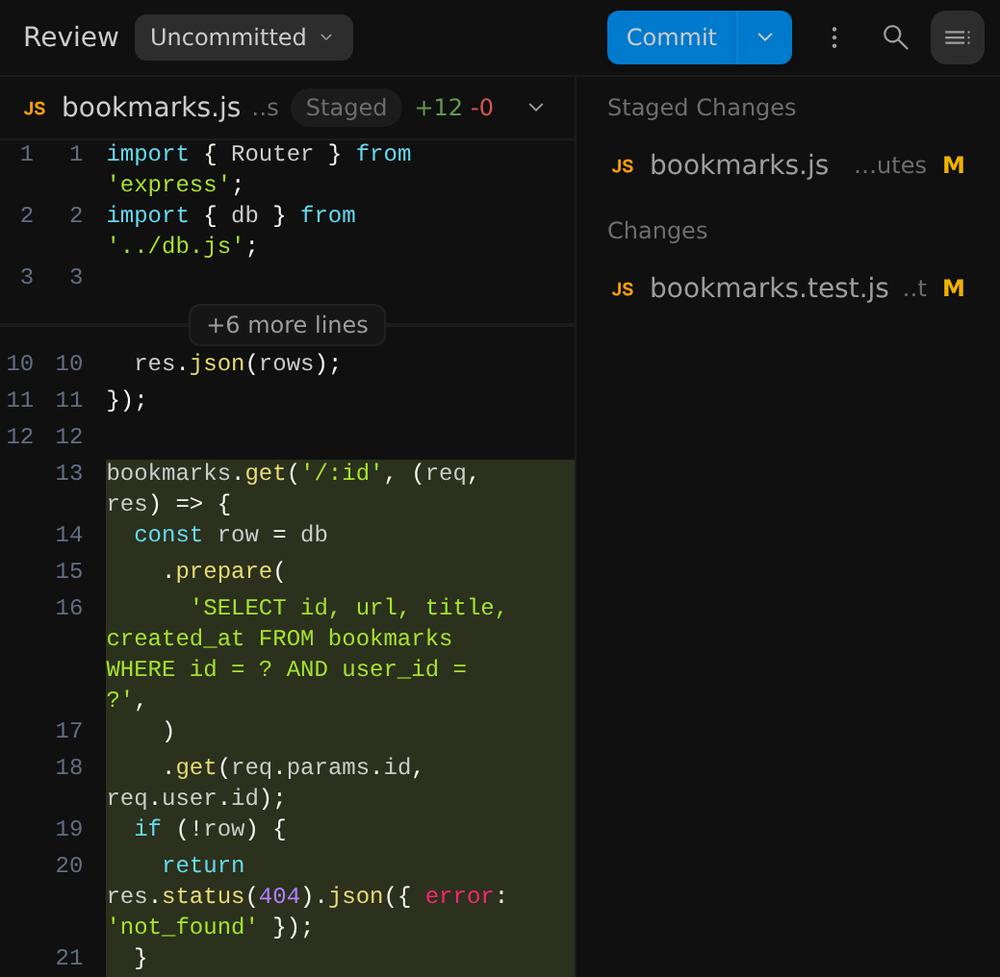
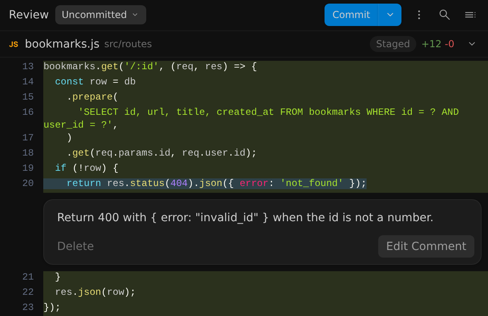
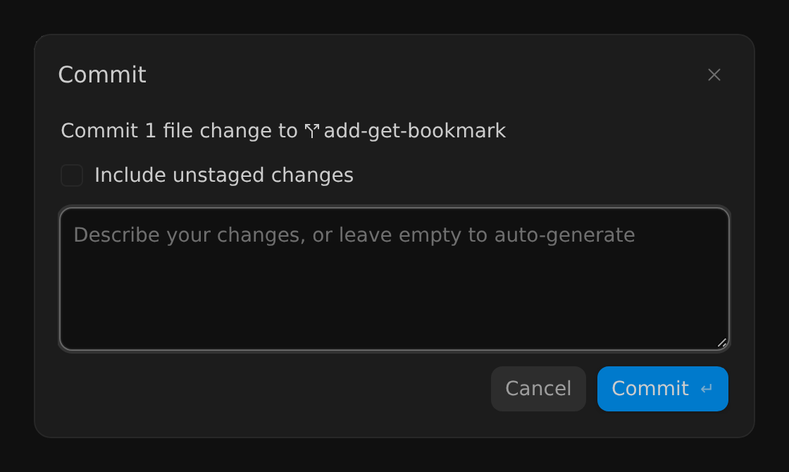

審查變更
2-0
Antigravity 應用程式
功能
檢視變更 Antigravity App 功能
Antigravity 應用程式
Antigravity CLI
適用於：
Antigravity 應用程式
Antigravity CLI
# 審查變更

[「審查變更」章節](#review-changes)

在保留代理的變更之前，先檢查它做了哪些變更。逐一檔案檢視差異，
逐行向代理提供意見回饋，並在 Antigravity 應用程式中將
結果提交至 Git，無需離開 Antigravity。

- [Antigravity 應用程式](#tab-panel-217)
- [Antigravity CLI](#tab-panel-218)

## Antigravity 應用程式

[「Antigravity App」章節](#sr-tab-1)

在 Antigravity 應用程式中， **審查** 窗格會顯示您專案
Git 儲存庫中的變更，包括代理的編輯。

### 開啟審查窗格

[標題為「Open the Review pane」的章節](#open-the-review-pane)

在對話中，請執行下列任一操作：

- 在 **總覽** 面板，點選 **審查**. 如果面板被隱藏，請按一下 **切換總覽面板** 位於對話右上方，或按下 Cmd + Option + O 於 macOS 或 Ctrl + Alt + O 在 Windows 與 Linux 上。
- 在變更了檔案的代理回覆下方，按一下 **審查** 在彙總變更 的卡片上，例如 **2 個檔案已變更**. 窗格會開啟並篩選 至該回合，如以下所述 [檢視單一回合](#review-a-single-turn).

窗格會以下列形式開啟： **審查** 分頁，位於側邊面板中、對話旁邊。
若要將它展開覆蓋對話，請按一下 **最大化窗格**，或按下
Cmd + Shift + M 於 macOS 或
Ctrl + Shift + M 在 Windows 與 Linux 上。若要列出
變更的檔案，請點選 **切換側邊欄** 位於窗格右上方。

在此範例中，代理新增了一個路由與一個測試。路由檔案已暫存，
而測試檔案有未暫存的變更：

側邊欄中的每個檔案都會顯示一個狀態字母。將滑鼠游標停留在該字母上，即可查看
它的含義：

| Letter | 含義 |
| --- | --- |
| **M** | 已修改 |
| **A** | 已加入（已暫存的新檔案） |
| **U** | 未追蹤（尚未暫存的新檔案） |
| **D** | 已刪除 |
| **R** | 已重新命名 |

點選側邊欄中的檔案，即可捲動至其差異。

### 選擇要比較的內容

[標題為「Choose what to compare」的章節](#choose-what-to-compare)

使用下列項目旁的選單： **審查** 選擇窗格顯示哪些變更：

| 選項 | 顯示 |
| --- | --- |
| **未提交** | 工作樹中已暫存與未暫存的變更，分組於 **已暫存的變更** 和 **變更**. 這是預設值. |
| **分支** | 目前分支自其基底分支分出以來的每一項變更，例如 `origin/main`，包括未提交的變更。此選項僅在 Antigravity 能找到基礎分支時才會出現。 |
| **代理編輯** | 代理在此對話中修改的檔案，無論是否已提交。 |

暫存、取消暫存及捨棄檔案僅限於 **未提交** 檢視。

#### 檢視單一回合

[標題為「Review a single turn」的章節](#review-a-single-turn)

若只要查看代理在一輪中所做的變更，請按一下 **審查** 在該輪次的
**已變更 N 個檔案** 卡片。若要跳至某個檔案，請按一下卡片以列出其檔案，
然後再按一下該檔案。

窗格標頭會顯示 **針對 Turn** 以及該回合的提示詞。若要返回
所有變更，請按一下 **清除篩選條件** (**X**）位於提示詞旁。

### 調整差異檢視

[標題為「Adjust the diff view」的章節](#adjust-the-diff-view)

使用 Review 窗格頂部的這些控制項來變更差異的顯示方式：

| 控制 | 其功能 |
| --- | --- |
| **⋮** > **查看分割差異** | 並排顯示舊版與新版。選擇 **查看堆疊差異** 返回單欄。 |
| **⋮** > **隱藏空白字元變更** | 隱藏僅影響空白字元的變更。選擇 **顯示空白字元變更** 再次顯示它們。 |
| **⋮** > **全部收合** | 收合每個檔案的差異。選擇 **全部展開** 再次展開它們。 |
| **搜尋** | 在差異中尋找文字。 |
| **+N 行** | 顯示變更之間隱藏的未變更行，例如 **+6 行**. 當有 10 行以上被隱藏時， **+10** 按鈕也會出現，一次顯示 10 行。 |

若要收合或展開單一檔案，請按一下其標頭
右側的箭頭。

### 將意見回饋傳送給代理

[標題為「Send feedback to the agent」的章節](#send-feedback-to-the-agent)

在特定行留言，告訴代理要變更什麼：

1. 將滑鼠懸停在某一行上並點擊 **新增行內評論** (**+**）位於該行開頭 。若要對多行加上註解，請選取它們並點選 **留言** 在 隨即出現的彈出視窗中。
2. 輸入您的意見回饋，然後按一下 **新增評論**.

您的留言會顯示在它所參照的那幾行下方，您可以在那裡編輯或刪除
它：

留言會附加到你的下一則訊息上，像是這樣的標籤 **1 則留言**
會出現在訊息框上方。將滑鼠懸停在標籤上即可預覽您的留言。
傳送訊息（可附帶或不附帶更多文字），代理便會收到每一則
留言及其檔案和行號。

若要參照某些行而不留言，請選取它們並按一下 **引用** 在
彈出視窗中，或按下 Cmd + L 於 macOS 或
Ctrl + L 在 Windows 與 Linux 上。行範圍參照，例如
 `bookmarks.js #L13-16`，會被加入訊息框。

### 暫存、取消暫存與捨棄檔案

[標題為「Stage, unstage, and discard files」的章節](#stage-unstage-and-discard-files)

在 **未提交** 檢視中，將滑鼠懸停在側邊欄的檔案上，即可顯示其
操作：

- **暫存變更** (**+**）：將檔案移動至 **已暫存的變更**.
- **取消暫存變更** (**−**）：將已暫存的檔案移回 **變更**.
- **捨棄未暫存的變更**: 還原該檔案未暫存的編輯。

若某個檔案同時有已暫存與未暫存的變更，它會同時列在兩個群組中。

### 提交你的變更

[標題為「Commit your changes」的章節](#commit-your-changes)

若要從 Review 窗格提交，請執行下列步驟：

1. 按一下 **提交** 位於窗格頂部。該 **提交** 對話框會顯示將提交多少 檔案變更，以及提交到哪個分支。
2. 若您有已暫存的變更，只會提交那些變更。若也要提交您的 未暫存變更，請選取 **包含未暫存的變更**. 如果沒有任何內容 已暫存，此選項已預先選取.
3. 輸入提交訊息，或將欄位留空，讓代理根據對話 與您要提交的檔案撰寫一則。
4. 按一下 **提交**，或按下 Enter. 若要在訊息中開始 新行，請按下 Shift + Enter.

這是 **提交** 針對單一已暫存檔案的對話框：

當 Antigravity 執行作業時，按鈕會顯示 **正在提交…**, 前面加上
**正在生成提交訊息…** 若您將訊息留空。

點選旁邊的箭頭 **提交** 以取得更多操作：

- **修訂**: 將您的變更加入最新的提交並保留其訊息。若 沒有任何暫存內容，會先暫存所有變更。若您已推送該 提交，請之後自行強制推送，例如使用 `git push --force-with-lease`. **推送** 在「審查」窗格中不會強制推送。
- **推送**: 將分支的提交推送至其上游分支，或將該 分支發佈至 `origin` 若尚無上游分支。若您無法推送， 選單會顯示原因，例如 **沒有要推送的提交** 或 **未設定遠端**.

當沒有可提交的內容，但分支有待推送的提交時，按鈕
會從 **提交** 至 **推送**.

## Antigravity CLI

[「Antigravity CLI」章節](#sr-tab-2)

在 Antigravity CLI 中， `/diff` 指令會開啟全螢幕差異檢視器，
顯示您工作區與對話中的變更。

### 開啟差異檢視器

[標題為「Open the diff viewer」的章節](#open-the-diff-viewer)

類型 `/diff` 於提示詞方塊並按下 Enter. 檢視器會在
以下位置開啟 **所有變更** 檢視。選取檔案並按 Enter 開啟其
差異，並按 Esc 返回。

### 切換檢視

[標題為「Switch views」的章節](#switch-views)

按下 ←/→ 在這些檢視之間切換：

| 檢視 | 顯示 |
| --- | --- |
| **所有變更** | 您工作區中未提交的變更。這是預設值。 |
| **每輪** | 對話每一輪的變更。 |
| **提交樹** | 您存放庫的提交紀錄。按下 Enter 在 commit 上，以列出其變更的檔案。 |

### 在行上留言

[標題為「Comment on lines」的章節](#comment-on-lines)

若要向代理提供意見回饋，請開啟檔案的差異，將游標移到某一行，
然後按下 C, 輸入您的留言，然後按下 Enter.

當您離開 `/diff` 包含未送出的留言， **未傳送的留言** 畫面
出現。請按 Y 將留言作為您的下一個
提示詞傳送給代理，或按 N 退出而不傳送它們。

如需每個按鍵的說明，請參閱 [差異比對指令 (`/diff`)](/docs/cli/commands/diff).

## 後續步驟

[「後續步驟」章節](#next-steps)

探索相關文件：

- [差異比對指令 (`/diff`)](/docs/cli/commands/diff): 在 Antigravity CLI 中檢閱變更、回合與 提交。
- [產出物](/docs/artifacts): 檢閱並評論代理的計畫、導覽與 其他交付成果。
- [專案](/docs/projects): 選擇代理要在您的本機 checkout 中工作，或在新的 Git worktree 中工作.
- [功能概覽](/docs/features): 探索其他 Antigravity App 功能.

[上一個
終端機沙箱](/docs/sandbox/)

[下一步
Jupyter 筆記本](/docs/jupyter-notebooks/)

您的下載已開始

## 您如何得知我們？

請選一個。這有助於我們接觸更多像您一樣的人。

感謝您讓我們知道！
