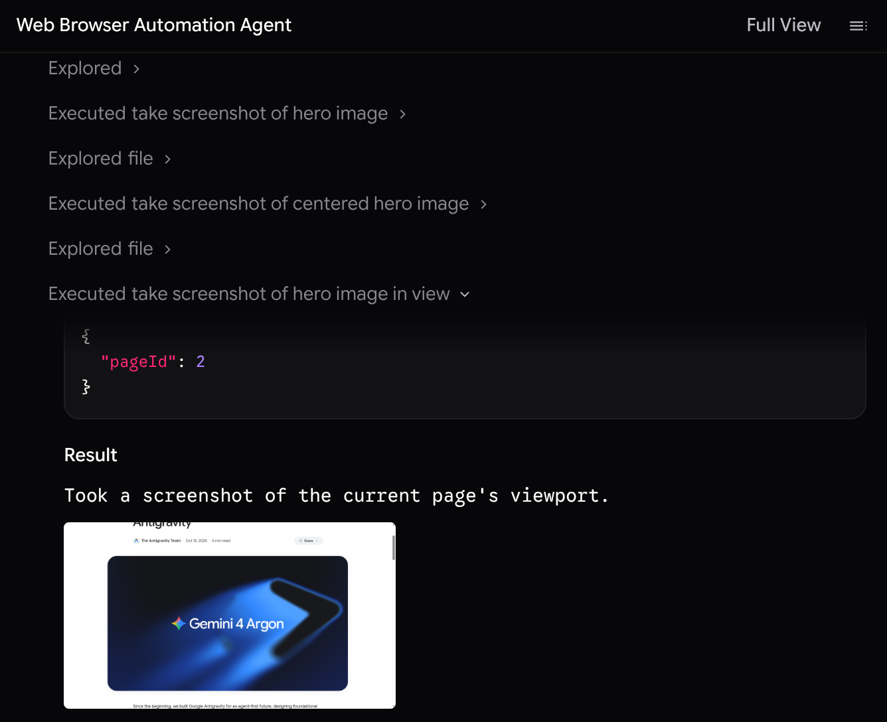
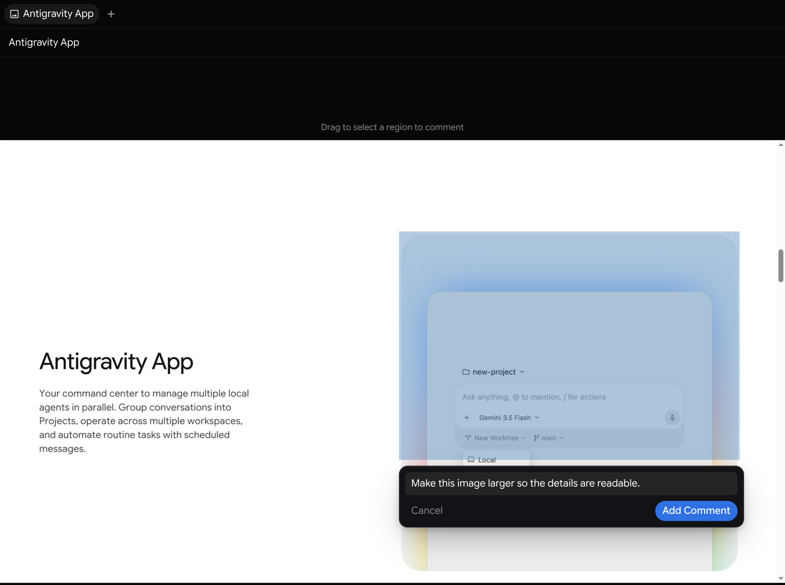

螢幕截圖
2-0
Antigravity 應用程式
功能
螢幕截圖 Antigravity App 功能
Antigravity 應用程式
Antigravity IDE
適用於：
Antigravity 應用程式
Antigravity IDE
# 螢幕截圖

[「螢幕截圖」章節](#screenshots)

The [瀏覽器子代理](/docs/browser) 可擷取可見頁面或其中單一元素的螢幕截圖，例如用來檢查頁面的呈現方式。請在提示詞中要求擷取螢幕截圖，或在任務需要時由子代理自行擷取。您也可以按一下 **將螢幕截圖加入對話** (相機圖示)，位於 Antigravity App 內建瀏覽器工具列，可將您正在瀏覽的頁面快照直接附加到提示詞。

在 Antigravity 應用程式中 (`v2.30.0+`，個人 Google 帳號)，以自然語言詢問或輸入 [`/browser`](/docs/commands/browser) 後方接著任務—子代理會直接在內建瀏覽器內執行，無需外部瀏覽器設定。在商務與企業帳戶（以及 Antigravity CLI）上， `/browser` 連接至已啟用遠端偵錯的 Google Chrome；請參閱 [設定 Chrome](/docs/commands/browser#set-up-chrome).

在您的對話中，子代理會顯示在寫著以下內容的列中 **Starting** 或 **Started**，後面接著代理為它取的名字，例如「Web Browser Automation Agent」。按一下該名稱，或位於 **子代理** 對話總覽的區段，以在側邊面板中開啟其對話。每張螢幕截圖都是一個步驟，並標示子代理擷取內容的簡短摘要。展開步驟，即可查看工具的引數、其結果，以及螢幕截圖的縮圖。

螢幕截圖本身不是產出物。若要評論螢幕截圖，請要求代理將它儲存到對話的產出物中，然後從代理的回覆開啟圖片。拖曳以選取圖片的區域，輸入您的註解，然後按一下 **新增評論**。註解不會立即傳送：它們會保留為待處理註解，隨您的下一則訊息傳送給代理，或當您從 **審查** 產出物標頭中的按鈕。

[上一個
導覽](/docs/walkthrough/)

[下一步
審查產出物（CLI）](/docs/cli/artifacts/)

您的下載已開始

## 您如何得知我們？

請選一個。這有助於我們接觸更多像您一樣的人。

感謝您讓我們知道！
