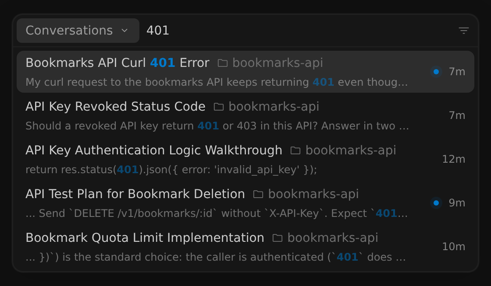
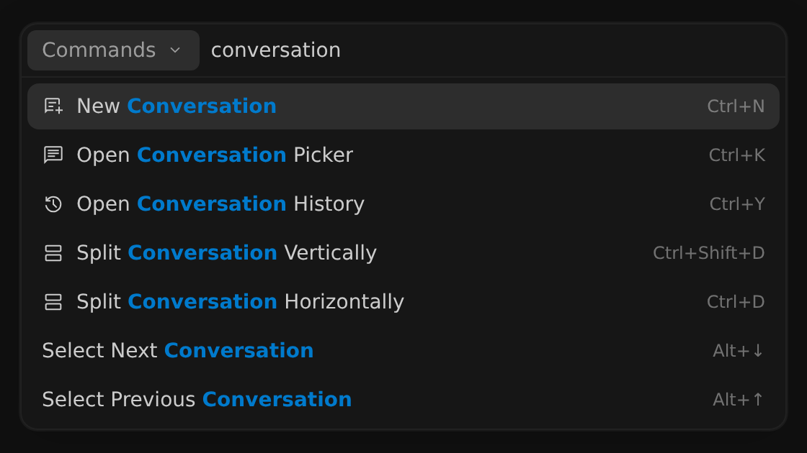

搜尋與指令面板
2-0
Antigravity 應用程式
功能
搜尋與指令面板 Antigravity App 功能
Antigravity 應用程式
Antigravity CLI
適用於：
Antigravity 應用程式
Antigravity CLI
# 搜尋與指令面板

[標題為「Search and command palette」的章節](#search-and-command-palette)

不離開鍵盤即可找到過去的對話、檔案或命令。
在 Antigravity 應用程式中，指令面板會搜尋你的完整文字
對話，包括你的提示詞和代理的回覆。在
Antigravity CLI 中， `/resume` 會找出過去的對話，並 `/codesearch` 搜尋
您工作區中的程式碼。

- [Antigravity 應用程式](#tab-panel-224)
- [Antigravity CLI](#tab-panel-225)

## Antigravity 應用程式

[「Antigravity App」章節](#sr-tab-1)

### 開啟命令選擇區

[標題為「Open the command palette」的章節](#open-the-command-palette)

指令面板可搜尋您過去的對話、專案檔案、專案，
以及應用程式指令。這些類別各有專屬的鍵盤快速鍵：

| 類別 | macOS | Windows 與 Linux |
| --- | --- | --- |
| **對話** | Cmd + K | Ctrl + K |
| **檔案** | Cmd + P | Ctrl + P |
| **專案** | Cmd + Shift + K | Ctrl + Shift + K |
| **指令** | Cmd + Shift + P | Ctrl + Shift + P |

您也可以開啟 **對話** 類別，方法是按一下 **搜尋
對話** （放大鏡圖示），位於視窗左上方的上一頁與下一頁
按鈕旁。

若要在面板開啟時切換到其他類別，請執行下列
其中一項：

- 點選搜尋框左側的分類名稱，然後選取 不同的分類。
- 類型 `>` 在空白的搜尋框中，以切換至 **指令**.

使用 ↑ 和 ↓ 瀏覽結果，請按
Enter 開啟所選的結果，並按 Esc 關閉
指令面板。

### 搜尋過去的對話

[標題為「Search past conversations」的章節](#search-past-conversations)

按下 Cmd + K （macOS）或 Ctrl + K
（Windows 與 Linux）。當搜尋框為空時，面板會列出您最近的
對話，預設以最近更新者優先。當您輸入時，
面板會搜尋每個對話的以下部分：

- 對話標題，包括您重新命名的標題。
- 該對話的專案名稱及其資料夾名稱（若專案有多個資料夾， 則為第一個資料夾）。
- 您的提示詞。
- 代理的回覆。

搜尋涵蓋您的提示詞與代理回應的文字，包括其中的任何程式碼區塊。不包括代理的思考、產出物、代理執行的指令或其輸出，也不包括它讀取或變更的檔案內容。

每個結果都會顯示對話標題、其專案、上次
更新的時間，以及符合文字的片段，其中你的搜尋詞彙已
醒目標示。例如，搜尋 `401` 會找出提及
該狀態碼的對話，包括只出現在提示詞中，或出現在代理回應的
程式碼區塊中的對話：



搜尋時請注意以下事項：

- 搜尋不區分大小寫。
- 僅您仍在輸入的單字會與較長 單字的開頭相符，因此 `pagin` 會找出關於分頁的對話。其他字詞必須 與完整字詞相符。
- 若您輸入多個單字，每個單字都必須出現在對話的同一個部分：全部在標題中、全部在專案名稱中、全部在資料夾名稱中、全部在您的提示詞中，或全部在代理的回覆中。這些單字的順序不限，也不需要相鄰，但若例如一個單字只出現在您的提示詞中、另一個只出現在代理的回覆中，該對話便不符合。在長對話中，這些單字還必須出現在大致相同的少數幾則訊息之內。
- 結果依相關性排序。包含您輸入字詞且完全相符的對話會優先顯示。標題以及專案或資料夾名稱中的相符項目，權重高於提示詞或代理回應中的相符項目，而最近更新的對話排名較高。
- 封存的對話不會出現在最近對話清單中，但 會出現在搜尋結果中，排名較低。在 2.26.0 版及更新版本中， 封存結果會以封存圖示標記。
- 目前檢視中開啟的對話不會出現在 最近對話清單中，但可能會出現在搜尋結果中。

選取一個結果以開啟該對話。

#### 排序與篩選對話

[標題為「Sort and filter conversations」的章節](#sort-and-filter-conversations)

在 2.26.0 及更新版本中，您可以排序與篩選清單。點擊
搜尋框右側的篩選圖示，然後選擇下列其中一個
選項：

| 選項 | 其功能 |
| --- | --- |
| **排序對話** > **最後更新** | 依最近活動列出對話。這是預設排序。 |
| **排序對話** > **上一個提示詞** | 依您上次傳送提示詞的時間列出對話。 |
| **篩選** > **僅未讀** | 僅顯示有您尚未檢視之更新的對話。 |
| **篩選** > **僅已封存** | 僅顯示已封存的對話。 |
| **篩選** > **僅自動化** | 僅顯示由 Automations 啟動的對話。 |

排序適用於搜尋框為空時出現的清單，因此
**排序對話** 搜尋時選項會隱藏。篩選條件同時套用於
清單與搜尋結果。

#### 在提示詞中引用過去的對話

[標題為「Reference a past conversation in a prompt」的章節](#reference-a-past-conversation-in-a-prompt)

若要為代理提供先前對話的脈絡，請輸入 `@` 在訊息
框中，並選擇 **對話**. 對話清單使用與指令面板相同的
全文搜尋.

### 尋找檔案

[標題為「Find files」的章節](#find-files)

按下 Cmd + P （macOS）或 Ctrl + P
（Windows 與 Linux），然後輸入檔案名稱或路徑的一部分。結果會顯示
每個檔案的名稱及其在專案中的路徑。選取一個檔案以在
側邊面板中開啟它。

當搜尋框為空時，面板會顯示 **最近的檔案** 用於
目前的對話，例如代理變更過的檔案。

The **檔案** 類別比對的是檔案名稱與路徑，而非檔案內容。若要尋找
檔案內的文字，請開啟檔案並按下 Cmd + F 或
Ctrl + F，如以下所述：
[在對話或檔案中尋找文字](#find-text-in-a-conversation-or-file).

### 執行指令

[標題為「Run commands」的章節](#run-commands)

按下 Cmd + Shift + P （macOS）或
Ctrl + Shift + P （Windows 與 Linux）以列出目前檢視中可用的
指令。每個指令都會顯示其
鍵盤快速鍵（若有）。輸入文字以篩選清單，然後按下
Enter 執行所選的指令。例如，輸入
`conversation` 列出名稱包含該字詞的指令：



有些指令僅在對話開啟時出現，例如 **釘選此
對話**, **封存此對話**，與 **在對話中尋找**. 若要
查看主要鍵盤快速鍵，請前往 **設定** > **快速鍵**.

### 切換專案

[標題為「Switch projects」的章節](#switch-projects)

按下 Cmd + Shift + K （macOS）或
Ctrl + Shift + K （Windows 與 Linux），然後
輸入專案名稱的一部分。選取一個專案以在其中開始新對話
，或選取 **專案之外** 開始不屬於
任何專案的對話。若要深入了解，請參閱 [專案](/docs/projects).

### 在對話或檔案中尋找文字

[標題為「Find text in a conversation or file」的章節](#find-text-in-a-conversation-or-file)

按下 Cmd + F （macOS）或 Ctrl + F
（Windows 與 Linux）以開啟 **Find** 列，適用於目前聚焦的檢視：
目前的對話，或在側邊
面板中開啟的檔案、產出物或差異。輸入時，符合項目會反白顯示，且該列會顯示目前選取的是哪個符合項目，例如 **1 of 2**.

若要縮小符合範圍，請開啟下列任一選項：

| 選項 | 其功能 |
| --- | --- |
| **區分大小寫 (Aa)** | 僅比對大小寫完全相同的文字。 |
| **全字相符 (ab)** | 僅比對完整單字。 |
| **使用正規表示式 (.*)** | 將您的搜尋文字視為正規表示式。 |

按下 Enter 前往下一個相符項目，並
Shift + Enter 前往上一個相符項目。請按
Esc 關閉 **Find** bar.

## Antigravity CLI

[「Antigravity CLI」章節](#sr-tab-2)

### 尋找過去的對話

[標題為「Find past conversations」的章節](#find-past-conversations)

執行 `/resume` （或其別名（複數） `/switch` 和 `/conversation`）在提示詞框中
，以開啟對話選取器：

```
/resume
```

輸入文字以依對話標題、第一則提示詞的第一行
或對話 ID 篩選清單。選擇器不會搜尋您對話的
全文，因此找不到只在對話後段出現的字詞，
例如代理回覆中的字詞。按下 Enter 繼續
所選的對話。

若要尋找您在 Antigravity App 中開始的對話，請按下
Tab 切換至 **其他** 分頁。選取對話，按
Enter，然後按下 Y 將副本匯入 CLI。

您也可以在啟動 CLI 時繼續一段對話：

- 執行 `agy -c` 繼續目前資料夾中最近的對話。
- 執行 `agy --conversation <conversation-id>` 繼續特定的對話。

若要了解如何重新命名、刪除與匯入對話，請參閱
[恢復指令（`/resume`)](/docs/cli/commands/resume).

### 搜尋程式碼

[標題為「Search code」的章節](#search-code)

執行 `/codesearch` （或其別名（複數） `/cs` 和 `/search`）後面接著您的查詢
，以搜尋工作區中的程式碼：

```
/codesearch requireApiKey
```

The **程式碼搜尋** 面板會依檔案分組列出相符項目。按下
Enter 在檔案檢視器中開啟所選的相符項目，定位到相符的
行。若要了解查詢語法、路徑篩選器與行留言，請參閱
[程式碼搜尋指令 (`/codesearch`)](/docs/cli/commands/codesearch).

## 後續步驟

[「後續步驟」章節](#next-steps)

探索相關文件：

- [專案](/docs/projects): 將資料夾、設定與對話 整理成專案。
- [恢復指令（`/resume`)](/docs/cli/commands/resume): 在 Antigravity CLI 中瀏覽、重新命名、 刪除與匯入對話.
- [程式碼搜尋指令 (`/codesearch`)](/docs/cli/commands/codesearch): 搜尋 您在 Antigravity CLI 中的工作區程式碼。
- [設定](/docs/settings): 設定 Antigravity App 與 Antigravity CLI.

[上一個
遠端代理](/docs/remote-agents/)

[下一步
側邊面板與總覽](/docs/side-panel/)

您的下載已開始

## 您如何得知我們？

請選一個。這有助於我們接觸更多像您一樣的人。

感謝您讓我們知道！
