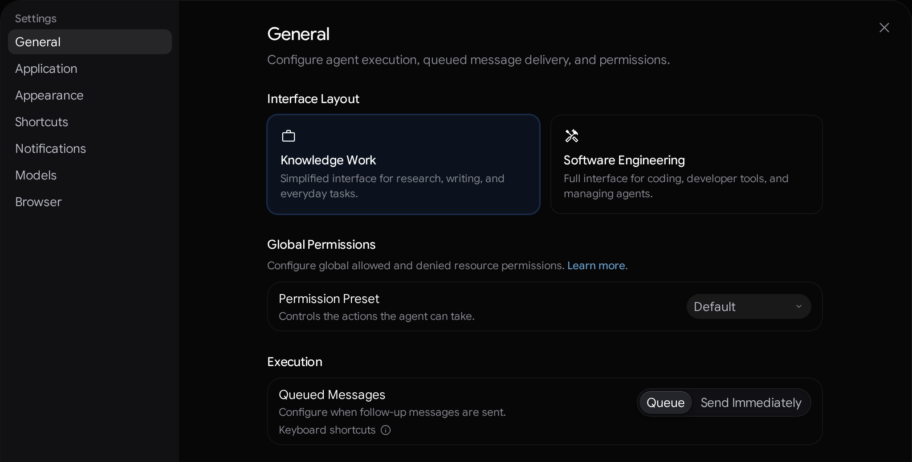
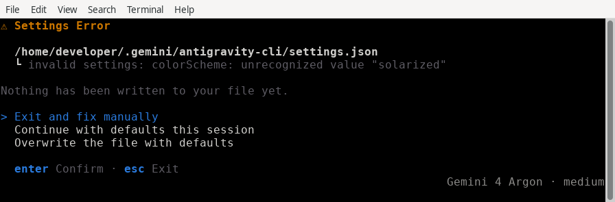
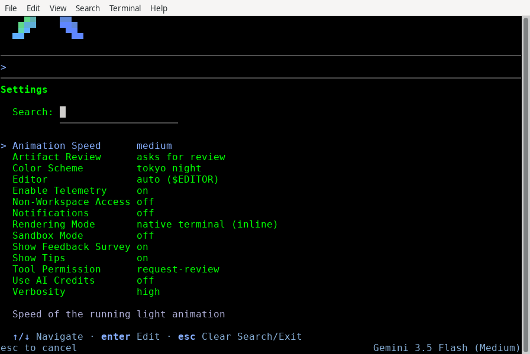
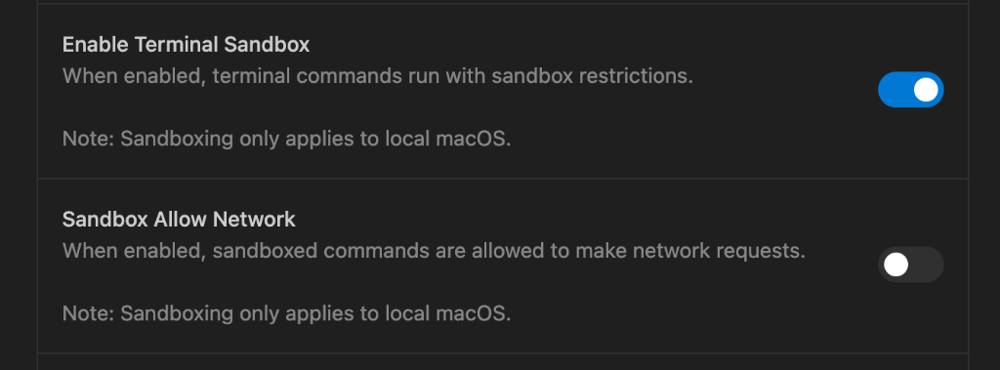
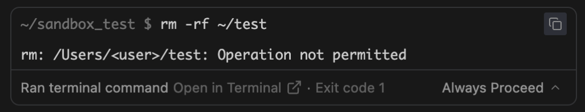
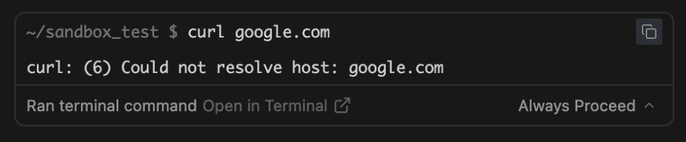
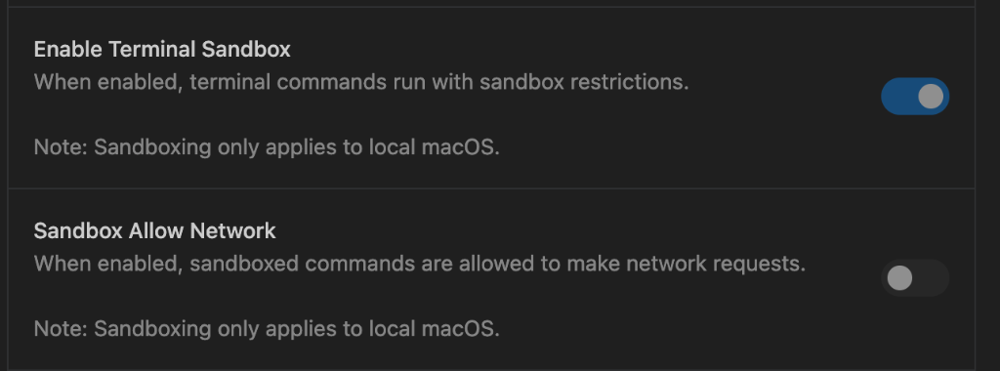

設定
2-0
Antigravity 應用程式
功能
設定 Antigravity App 功能
Antigravity 應用程式
Antigravity CLI
Antigravity IDE
適用於：
Antigravity 應用程式
Antigravity CLI
Antigravity IDE
# 設定

[「設定」章節](#settings)

跨 Antigravity 介面設定偏好設定、執行邊界、指令權限與工具遙測。

- [Antigravity 應用程式](#tab-panel-226)
- [Antigravity CLI](#tab-panel-227)
- [Antigravity IDE](#tab-panel-228)

## Antigravity 應用程式

[「Antigravity App」章節](#sr-tab-1)

### 設定架構

[「設定架構」章節](#settings-architecture)

Antigravity 採用階層式設定架構，讓您可以精細控制開發環境。設定分為全域應用程式偏好與隔離的專案層級邊界，以確保強健的安全性與靈活的工作區設定。

#### 存取設定

[「存取設定」章節](#accessing-settings)

您可以使用以下任一方法開啟「設定」面板：

- **鍵盤快速鍵**：按下 Cmd + , 於應用程式內的任何作用中 介面。
- **側邊欄導覽**：按一下 **設定** 於左側邊欄底部。
- **專案設定**：按一下特定專案旁的齒輪圖示。

#### 四個設定類別

[「四種設定類別」章節](#the-four-settings-categories)

設定分為四個不同的範圍，以保持設定乾淨且彼此隔離：

##### 全域設定

[「全域設定」章節](#global-settings)

全域設定適用於所有工作區：

- **介面版面配置** (`v2.30.0+`，個人 Google 帳號)：切換 **知識工作** 和 **軟體工程** [介面版面配置](#interface-layout) 下方 **一般** > **介面 版面配置**.
- **帳戶設定**：管理驗證工作階段並切換遙測 （啟用或停用共用互動日誌以改善模型）。
- **全域權限**: 適用於所有 對話的集中式預設工具邊界:  **權限預設集**：選擇 **要求審查**, **預設** (*default*), **自動** (`v2.23.0+` 在 macOS 與 Linux 上， `v2.26.0+` 在 Windows 上）， 或 **Turbo**. 您也可以從訊息框撰寫區的權限選擇器中選擇預設集 (`v2.23.0+`），這會 變更您的全域預設，或在專案覆寫時變更專案的預設。若要移除專案覆寫，請選擇 **使用全域設定**. 細粒度的允許、詢問和拒絕規則（請參閱 **[代理權限](/docs/permissions)**).
- **外觀**：自訂視覺主題與面板版面配置。
- **瀏覽器** (`v2.30.0+`)：設定 **連結開啟方式**, **下載位置**, **瀏覽記錄**，與 **瀏覽器操作規則** 下方 **設定** > **瀏覽器** （請參閱 **[瀏覽器使用](/docs/browser#configure-browser-settings)**).
- **模型用量**：選擇並設定預設推理模型。
- **自訂項目**：管理 Model Context Protocol (MCP) 伺服器、自訂 技能與外掛程式。

##### 專案設定

[「專案設定」章節](#project-settings)

專案設定僅適用於特定專案的範圍：

- **資料夾**：定義與專案關聯的本地資料夾清單。 Antigravity 會自動偵測這些資料夾的 Git 組態，以 處理對話目標：  **本機**：在新對話檢視中選取此項，以直接在 現有資料夾中工作。 **Worktree**：選取此項以在資料夾中啟動新的 worktree。若 資料夾沒有 Git，則改用現有本地資料夾。
- **代理設定**：設定專案專屬的代理行為：  **權限設定** （更新的權限系統）：選擇專案的 **權限預設集**—**繼承全域設定**, **要求審查**, **預設**, **自動** (`v2.23.0+` 在 macOS 與 Linux 上， `v2.26.0+` 在 Windows 上），或 **Turbo**—控制 代理如何執行殼層指令、存取檔案，以及如何使用 [終端機沙箱](/docs/sandbox) （請參閱 **[代理權限](/docs/permissions)** 和 **[代理設定](/docs/agent-settings)**). **終端機執行政策** ([先前的權限設定](/docs/agent-settings#previous-permission-settings)）： 控制代理執行 shell 指令的方式。 **資料夾外檔案存取政策** （先前的權限設定）： 定義代理如何存取專案邊界外的檔案（一律 允許、一律詢問或一律拒絕）。 **沙箱模式** （先前的權限設定）：在自訂安全性預設中開啟或關閉終端機沙箱 容器（請參閱 **[終端機沙箱](/docs/sandbox)**).
- **專案層級權限**：在專案層級設定權限。當 您與代理互動時，會累積可自動加入專案權限的權限要求。
- **自訂項目**：源自全域與專案專屬 自訂。您可以檢視加入專案之每個資料夾來源的所有技能。

##### 獨立對話

[「獨立對話」章節](#standalone-conversations)

您也可以在專案之外開始對話：

- **行為**：獨立對話沒有可設定的資料夾， 改為在本地暫存目錄中執行。
- **設定**：獨立對話可擁有自己的設定（例如 終端機執行、檔案存取政策與權限），類似於 專案，但獨立於任何專案結構運作。

##### 其他

[「其他」章節](#miscellaneous)

存取快速鍵與回饋工具：

- **快速鍵**：檢視並自訂鍵盤快速鍵組態。
- **意見回饋**：存取意見回饋表單，直接將報告傳送給團隊。

### 介面版面配置

[標題為「介面版面配置」的章節](#interface-layout)

使用個人 Google 帳戶登入時， **設定** > **一般** >
**介面版面配置** (`v2.30.0+`) 可讓您在 Antigravity App 的兩種介面
設定之間選擇：

- **知識工作**: *為研究、寫作與日常工作設計的簡化介面。* 讓焦點保持在對話、文件、產出物與資料夾輸出上，同時隱藏 Git、終端機與程式碼差異控制項。
- **軟體工程**: *用於程式設計、開發者工具與 管理代理的完整介面。* 提供 Git 工作樹與分支控制、行內差異與 變更審查、整合式終端機、子代理卡片，以及完整的自訂 清單。



During [首次啟動設定](/docs/getting-started) 使用個人 Google
帳戶時，Antigravity 會根據您選擇的角色（**知識工作** 供 *知識工作*, *科學*, *設計*，與 *其他*;
**軟體工程** 供 *軟體工程* 和 *資料 & 分析*)，或
在以下位置啟動 **軟體工程** 如果您按一下 **Skip**。僅限 CLI：
[Gemini 企業版](/docs/enterprise) 帳戶一律使用 **軟體
工程** 版面配置，以及 **介面版面配置** 不會顯示在設定中。

切換版面配置會立即更新已開啟與新的對話，無需重新啟動應用程式。兩種版面配置執行的是完全相同的代理，並支援相同的
[models](/docs/models), [權限預設集](/docs/permissions),
[技能](/docs/skills), [規則](/docs/rules), [MCP 伺服器](/docs/mcp)，與
[外掛](/docs/plugins)——切換時只會變更介面中
顯示的控制項：

| Area | 軟體工程 | 知識工作 |
| --- | --- | --- |
| **專案與資料夾** | 提示詞，適用於 **本機** 或 **新的工作樹** 模式，適用於 Git 存放庫；會顯示 Git 分支選擇器、GitHub 控制項，以及 **在 IDE 中開啟**；設定 | 直接在您專案的資料夾中執行，不會出現工作樹或 Git 分支提示；隱藏 GitHub 與 **在 IDE 中開啟** 控制項；分叉會保留在目前資料夾中（*在這個資料夾中分叉對話*). |
| **對話與核准** | 保持可展開 `Worked for` 對話串中的工具群組、行內程式碼差異、行數與子代理卡片；權限提示包含原始指令規則編輯器。 | 在代理工作期間顯示即時進度列，並在回覆完成後清除，讓焦點保持在回覆與產出物上；權限提示會以自然語言摘要呈現。 |
| **側邊面板與總覽面板** | **總覽** includes **審查**, **檔案**, **終端機**，與 **擴充功能** 列，一個 **自訂區段** 選單，以及適用於 **子代理**, **背景工作**, **Goals**, **Documents**, **產出物**, **Links**, **已修改的檔案**，與 **Uploads**. | **總覽** 會保持隱藏，直到對話產生輸出為止，並省略 **審查**, **終端機**，與 **自訂區段**，標示 **檔案** 側邊欄樹狀結構 **資料夾**，並著重於 **Documents**, **產出物**, **Links**, **Uploads**，與 **背景工作**. |
| **自訂（`Installed` 分頁）** | 列出已安裝的 **外掛程式**, **技能 & 規則**, **自訂代理**，與 **MCP 伺服器**. | 列出已安裝的 **外掛程式** 僅限（已安裝的技能、規則、自訂代理與 MCP 工具仍會在背景保持啟用）。 |
| **設定** | 顯示開發者子區段（**終端機**, **工作區**，與 **Labs**) 以及詳細的權限規則。 | 將進階權限規則與開發人員子區段收合在 **進階設定** 於 **設定** > **一般** 以及專案設定，並隱藏 **外觀** > **對話步驟** 切換開關與程式碼語法預覽。 |

### 資料收集設定

[「資料收集設定」章節](#data-collection-settings)

The **啟用遙測** 設定位於「設定」面板的…下方
**帳戶** 區段。啟用後，Antigravity 會收集互動內容，用於評估、開發與改進 Antigravity 及支援 Antigravity 的模型。

## Antigravity CLI

[「Antigravity CLI」章節](#sr-tab-2)

設定永久偏好設定、自訂快速鍵、切換終端機顯示緩衝區，並管理執行階段 CLI 參數覆寫。

### 設定偏好設定

[「設定偏好設定」章節](#setting-up-preferences)

Antigravity CLI 將使用者偏好儲存於精簡、可向前相容的 JSON 設定檔中。

#### 設定檔位置

[「設定檔位置」章節](#configuration-file-location)

持久設定以純 JSON 格式儲存：

```
~/.gemini/antigravity-cli/settings.json
```

CLI 利用 **稀疏持久化** 僅將與系統預設值不同的值寫入磁碟。這讓您的設定檔保持乾淨、精簡，並與未來更新完全向前相容。

#### 編輯器自動完成與驗證

[標題為「Editor autocomplete and validation」的章節](#editor-autocomplete-and-validation)

Antigravity 發佈了一個 [JSON Schema](/schemas/v1/settings.json) 供
`settings.json`. 支援 JSON Schema 的編輯器，例如 VS Code 與 JetBrains
IDE，會用它來提供自動完成、懸停說明與驗證。若要啟用
它，請加入 `$schema` 鍵，位於檔案頂部：

```
{
  "$schema": "https://antigravity.google/schemas/v1/settings.json",
  "agentMode": "accept-edits",
  "colorScheme": "tokyo night",
  "notifications": true
}
```

CLI 會忽略 `$schema` 並在儲存檔案時保留它。

#### 其他設定檔

[標題為「Other configuration files」的章節](#other-configuration-files)

鍵盤快速鍵、掛鉤、MCP 伺服器與外掛程式各自在專屬
檔案中設定：

- **鍵盤快速鍵**: `~/.gemini/antigravity-cli/keybindings.json`. `/keybindings` 在您的編輯器中開啟檔案。請參閱 [按鍵綁定 設定](#keybindings-configuration).
- **掛鉤**: `~/.gemini/config/hooks.json` 適用於所有工作區，或 `<workspace>/.agents/hooks.json` 用於單一工作區。 `/hooks` 新增、編輯，並 開啟或關閉掛鉤，也會將新掛鉤儲存到全域檔案。掛鉤不會加入到 `settings.json`: CLI 會保留一個 `hooks` 鍵放在該處，但從未載入。 請參閱 [掛鉤](/docs/hooks?tab=cli).
- **MCP 伺服器**: `~/.gemini/config/mcp_config.json` 適用於所有工作區，您可以 使用下列方式管理： `/mcp`，或 `<workspace>/.agents/mcp_config.json` 用於單一 工作區。請使用與您的全域伺服器不同的名稱：當兩個檔案使用 相同名稱時，已在執行的伺服器會保留該名稱。請參閱 [MCP](/docs/mcp?tab=cli).
- **外掛程式**: 安裝於 `~/.gemini/config/plugins/<plugin>/`，或在 `<workspace>/.agents/plugins/<plugin>/` 用於單一工作區。每個外掛程式可以 有一個 `plugin.json` manifest，由以下項目描述： [外掛資訊清單 結構描述](/schemas/v1/plugin.json). 請參閱 [外掛程式](/docs/plugins?tab=cli).

#### CLI 如何讀取與儲存 settings.json

[標題為「How the CLI reads and saves settings.json」的章節](#how-the-cli-reads-and-saves-settingsjson)

- **僅儲存非預設值。** 當您透過下列方式變更設定時， `/config`, `/model`, `/effort`, `/statusline`, `/title`，或 `/permissions`, 或 在權限提示中選擇一律允許或拒絕某項動作時，CLI 只會儲存 值與預設值不同的鍵。將選項設回 預設值即會移除該鍵。CLI 會一次取代整個檔案，並將它 設為僅您的使用者可讀取 (`0600`).
- **該檔案會在啟動時正規化。** 當 CLI 以有效的檔案啟動時， 它會以自己的格式重寫該檔案，這也會移除設定 為預設值的鍵。
- **未知的鍵會予以保留。** CLI 會忽略它不認識的鍵，例如 `$schema` 或較新版本的設定，並在儲存 檔案時將其保留。
- **問題會在您的工作階段開始前回報。** 若某個鍵的類型 錯誤或值無法辨識，或檔案不是有效的 JSON，CLI 會開啟 **設定 錯誤** 畫面，上面標示了檔案與問題。在您選擇處理方式之前，檔案不會被 變更。

例如，無法辨識的 `colorScheme` 值會開啟此畫面：



畫面提供三個選項：

- **退出並手動修正**: 結束 CLI，讓您可以編輯檔案。
- **本工作階段以預設值繼續**: 啟動工作階段而不變更 檔案。若值無效，CLI 會使用該鍵的預設值並 套用您的其餘設定，下次儲存設定時，會 捨棄該無效值。若檔案不是有效的 JSON，CLI 會使用全部 預設值，在您修正檔案之前不會儲存任何設定變更。
- **以預設值覆寫檔案**: 在您確認後，將檔案副本 儲存在它旁邊，名稱為 `settings.json.corrupted.<timestamp>` 並將每項 設定重設為預設值，包括檔案中的權限規則。

#### 互動式設定面板

[「互動式設定面板」章節](#the-interactive-settings-panel)

若要直接在使用中的終端機工作階段內編輯設定，而無需開啟原始 JSON 檔案：

1. 類型 `/config` （或其別名 `/settings`）於提示詞面板內並按下 Enter。該 **設定** 面板會在提示詞下方開啟，並列出每個 設定及其目前值： 
2. 使用 在可用選項之間導覽 ↑/↓, 或開始 輸入以篩選清單，位於 **搜尋**.
3. 按下 ←/→ 變更反白的設定，或按 Enter 開啟其選項，反白一個值，並按 Enter 儲存。變更會立即儲存。
4. 按下 Esc 關閉面板。如果您已在以下位置輸入 **搜尋**, 第一個 Esc 將其清除。在開啟的選項清單中， Esc 取消。

### 命令列覆寫

[「命令列覆寫」章節](#command-line-overrides)

您可以使用 CLI 指令旗標，暫時覆寫個別終端機工作階段的持續性偏好設定：

```
agy --sandbox --model="Gemini 3.8 Flash"
```

當旗標覆寫某項設定時， `/config` 以該設定的值
為旗標命名。例如，使用 `--sandbox`:

```
Sandbox Mode                 on (overridden by --sandbox)
```

旗標覆寫僅適用於目前的工作階段，且不會儲存至
`settings.json`.

### 視覺呈現模式

[「視覺算繪模式」章節](#visual-rendering-modes)

TUI 以兩種視覺模式之一呈現，模式由下列項目設定： **渲染模式**
(`altScreenMode`）選項，位於 `/config`.

#### Alt-screen 模式（`always`)

[「備用畫面模式（永遠）」章節](#alt-screen-mode-always)

此模式使用終端機的備用
緩衝區開啟專屬顯示畫面，打造沉浸式的獨立應用程式介面：

- **主要功能**：整合回捲、滑鼠滾輪捲動支援、 自訂算繪捲軸，以及結束時乾淨的終端機狀態還原。
- **最適合用於**：進階終端機 模擬器（例如 iTerm2、Ghostty 或 WezTerm）中的標準本地開發工作階段。

#### 內嵌模式（`never`)

[「內嵌模式（永不）」章節](#inline-mode-never)

此模式會在終端機的標準
stdout 管線中依序呈現輸出：

- **主要功能**：將整個工作階段記錄保留在模擬器的 原生回捲緩衝區內，不擷取滑鼠輸入，並與標準指令輸出無縫協作。
- **最適合用於**：遠端 SSH 終端機、終端機多工器，例如 `tmux` 或 `screen`，以及低頻寬遠端工作階段。

### 設定選項參考

[「設定選項參考」章節](#configuration-options-reference)

互動式設定面板 (`/config`）與 `settings.json` 讓您可以
自訂 CLI 在多個類別中的行為。每個選項都會列出其
`settings.json` 鍵（以括號標示）。如需包含每個鍵及其類型與
預設值的完整表格，請參閱 [CLI 參考資料](/docs/cli/reference#configuration-keys-settingsjson).

#### 安全與權限

[「安全性與權限」章節](#safety-and-permissions)

管理代理與您的系統及程式碼庫的互動方式：

- **代理模式（`agentMode`)**: 控制檔案的工作階段執行模式 編輯、指令評估與規劃（也可以依工作階段分別設定，透過 `--mode` 或以 Shift + Tab；請參閱 [選擇執行模式](/docs/cli/modes)):  `auto`：自動核准 工作區檔案編輯，在 [終端機沙箱](/docs/sandbox) （預設），並會自動評估 需要在沙箱外執行的指令，讓安全、可逆的指令 不經提示即執行，而有風險或不可逆的指令則會暫停等待 核准（顯示為 `auto` 在右下角狀態列中，且 `Auto mode: edits & safe commands auto-approved (shift+tab to cycle)` 在 提示詞輸入框中）。 `default` （預設；選取 `default` 於 `/config`，或保留 `agentMode` 未設定或 `""`）：在修改或建立檔案前提示進行互動式差異 審查，並遵循 `toolPermission` 適用於命令。 `accept-edits`：自動核准工作區檔案編輯和建立，同時繼續遵循 `toolPermission` 適用於命令。 `plan`: 在開頭加上 `/plan` 讓代理先分析程式碼庫並擬定 計畫，再進行編輯。
- **工具權限（`toolPermission`)**：控制代理在沙箱外使用工具前，何時徵求您的 核准 `auto` 模式（以及 `strict` 和 `always-proceed` 覆寫）。您的 拒絕規則 [權限](#permissions) 在每一種模式下封鎖某個操作：  `request-review` （預設 `toolPermission` 值）：在執行寫入、 Bash、網頁或 MCP 工具之前提示您核准，除非允許規則涵蓋該動作。 `proceed-in-sandbox`: 當沙箱 模式開啟且指令在終端機沙箱內執行時，不提示直接執行終端機指令；否則 會提示檢閱。 `strict`: 在每個工具動作（包括檔案讀取）前提示，即使 有允許規則相符也一樣（覆寫 `auto` 模式）。 `always-proceed`: 不經提示執行終端機指令、網路要求與 MCP 工具 ，但符合詢問或拒絕規則的動作除外（最高 風險，請謹慎使用；覆寫 `auto` 模式）。
- **產出物審查（`artifactReviewPolicy`)**: 控制代理在繼續之前，針對產出物（例如 實作計畫）徵求回饋時，是否會停下來等您檢閱。它不影響檔案編輯，那是由 Agent Mode 控制的:  `asks-for-review` （預設； **要求審查** 於 `/config`）：代理 一律等待您的審查。 `agent-decides` (**代理決定**）：目前運作方式與以下相同： `asks-for-review`. `always-proceed` (**一律繼續進行**）：代理會繼續，不等待 您的審查。
- **沙箱模式（`enableTerminalSandbox`)**：啟用時（`on`），將所有由代理發起的終端機指令限制在安全的 OS 容器中。當 `auto` 模式啟用時，終端機沙箱會自動啟用，且 只有需要於沙箱外執行的命令才會接受自動 核准評估。
- **非 Workspace 存取（`allowNonWorkspaceAccess`)**：啟用時（`on`）， 讓代理能讀取並編輯工作區資料夾外的檔案，但須受 您的工具權限、代理模式與權限規則約束。設定為 `off` 為了安全起見， 預設

#### 顯示與轉譯

[「顯示與算繪」章節](#display-and-rendering)

自訂 TUI 的視覺體驗：

- **轉譯模式（`altScreenMode`)**: 控制 TUI 如何使用您的終端機:  `default` (**原生終端機（行內）**）：在您終端機的回捲緩衝中以行內方式呈現對話 ，並在替換畫面中開啟全螢幕檢視，例如差異 檢視器。 `always` (**無閃爍（altscreen）**）：在替換畫面中執行整個 TUI，具有自己的回捲緩衝、滑鼠滾輪捲動與 捲軸。 `never` (`settings.json` 僅限）：永不使用替代畫面，即使是 全螢幕檢視。
- **色彩配置（`colorScheme`)**: 選取視覺主題： `terminal` （預設；使用您終端機的顏色）， `light`, `solarized light`, `colorblind-friendly light`, `dark`, `solarized dark`, `colorblind-friendly dark`，或 `tokyo night`.
- **動畫速度（`runningLightSpeed`)**：調整進度 指示器動畫的速度（`fast`, `medium` （預設值）， `slow`，或 `off`).
- **詳細程度（`verbosity`)**: 控制對話顯示多少 代理的工作內容:  `high`: 完整顯示每個工具呼叫、指令與思考過程。 `medium` （預設）：將相關的工具呼叫與想法彙整為簡短 摘要，同時保持指令與回應可見。 `low`: 僅顯示代理的回應，並將工具活動摺疊為 權杖用量摘要。
- **顯示進行中的任務（`hideActiveItems`)**: 在提示詞方塊下方顯示作用中的子代理與 背景工作。預設開啟；關閉它可節省 `"hideActiveItems": true`.
- **選取時複製 (`copyOnSelect`)**: 在 alt-screen 模式下，當您放開滑鼠選取時，會將文字複製到 剪貼簿。預設開啟。關閉時， 產出物檢視器會使用您終端機本身的文字選取功能.

#### 編輯器與通知

[「編輯器與通知」章節](#editor-and-notifications)

設定與主機環境的整合：

- **編輯器（`editor`)**: CLI 用來開啟產出物與 檔案，以及撰寫提示詞的外部編輯器（Ctrl + G）。預設為 `auto`, 會使用 `$EDITOR` 而且若未設定，則會改用 `vim` 在 macOS 與 Linux 上，或至 `edit` 然後 `notepad` 在 Windows 上。您也可以 選擇 `vim` 或 `emacs`, 或輸入另一個指令，搭配 **其他…**.
- **編輯器模式（`editorMode`)**：CLI 提示詞 本身內部使用的編輯模型。預設為 `default` （純文字編輯）；將其設為 `vim` 適用於模態 編輯。請參閱 [Vim 編輯器模式](/docs/cli/vim-editor-mode)。這 獨立於 `editor` 上方的設定，僅用於選取外部程式。
- **編輯器模式 › 先插入 (`vimInsertFirst`)**: 當 Editor Mode 為以下狀態時顯示 `vim`. 啟用後，提示會以 Insert 模式啟動，且單獨的 Enter 提交。預設為關閉。
- **通知（`notifications`)**：啟用時（`on`），響起終端機 鈴聲並顯示桌面通知，當代理需要您的核准或 答覆，或完成其輪次時。預設為關閉。

#### 對話

[標題為「Conversations」的章節](#conversations)

控制後續訊息的傳送方式，以及過去對話的列出方式：

- **佇列中的訊息（`queuedMessages`)**: 控制在代理工作期間，您 傳送的訊息會如何處理. `queue` （預設， **佇列**）將其保留至 目前輪次結束，並 `send-immediately` (**立即傳送**） 中斷代理並立即傳送。按下 Alt + M 反向傳送一則訊息。
- **對話選擇器分組 (`pickerGrouping`)**: 控制以下項目的方式 [`/resume`](/docs/cli/commands/resume) 選擇器會列出對話。 `none` （預設）顯示單一清單，最近的優先，並 `grouped` 將對話 依工作區分組。按下 Ctrl + F 在選取器 中，僅為該工作階段切換檢視。

#### AI 點數與回饋

[「AI 額度與意見回饋」章節](#ai-credits-and-feedback)

管理用量、提示與遙測：

- **使用 AI 點數（`useG1Credits`)**：啟用時（`on`），允許 CLI 在 您的方案配額用盡後，使用您的 AI 點數進行模型要求。預設為 關閉。此選項不會顯示於企業帳戶。
- **啟用遙測**：啟用時（`on`），CLI 收集使用資料以協助 Google 改進 Antigravity。此選擇會與您的帳戶一起儲存，而非儲存在 `settings.json`，且對企業帳戶一律關閉。
- **顯示提示（`showTips`)**: 切換在代理產生回應時 是否顯示實用的使用提示。預設開啟。
- **顯示意見回饋問卷（`showFeedbackSurvey`)**: 啟用任務完成後的定期簡短 問卷，以協助改善體驗。預設開啟.

### 僅在 settings.json 中可用的設定

[標題為「Settings available only in settings.json」的章節](#settings-available-only-in-settingsjson)

下列鍵沒有 `/config` 選項。將它們加入 `settings.json` 變更
它們的方法：

- **`clearScrollbackOnResize`** （boolean，預設 `true`）：在行內呈現中， 當 CLI 重新繪製對話時會清除您終端機的回捲緩衝，例如在您調整視窗大小後 。設定為 `false` 保留較早的終端機 輸出。
- **`disableSlashCommands`** （boolean，預設 `false`): In [無頭 模式](/docs/cli/headless) (`-p`），傳送以此開頭的提示詞 `/` 依原樣傳給 模型，而不是將它們當作斜線指令或技能執行。與下列相同 `--disable-slash-commands` 旗標。
- **`historySize`** （integer，預設 `2000`）：保存在磁碟上的提示詞歷史記錄項目數 。CLI 會在結束時修剪歷史記錄： `-1` 保留每個項目， 且 `0` 清除歷史紀錄。
- **`model`** （string，預設 `""`）：您所選的模型，透過 `/model`, 依其標籤 儲存。若該模型已無法使用，CLI 會使用預設 模型並顯示警告.
- **`modelProvider`** （string，預設 `""`）：設定為 `"gemini"` 使用位於以下位置的金鑰，直接將模型 請求傳送至 Gemini API `GEMINI_API_KEY`. 請參閱 [使用 Gemini API 金鑰](/docs/install#using-a-gemini-api-key).
- **`trustedWorkspaces`** （string[]，預設 `[]`）：您在 CLI 詢問時選擇信任的資料夾 。CLI 會為您新增項目。
- **`useTerminalCursor`** （boolean，預設 `false`）：使用您終端機本身的 游標形狀，而非方塊游標。

對於接受物件的按鍵，例如 `permissions`, 請參閱 [物件
設定](#object-settings).

### 物件設定

[標題為「Object settings」的章節](#object-settings)

這些鍵的值為 JSON 物件。

#### `permissions`

[標題為「permissions」的章節](#permissions)

代理工具的允許、詢問與拒絕規則。每條規則都是一個
`action(target)` 字串，例如 `command(git status)` 或
`read_url(github.com)`, 且左括號前不加空格。deny
規則的優先順序高於 ask 規則，ask 規則又高於
allow 規則。CLI 會忽略無法剖析的規則。關於支援的動作與
目標的比對方式，請參閱 [代理權限](/docs/permissions?tab=cli).

```
{
  "permissions": {
    "allow": ["command(git status)", "read_url(github.com)"],
    "ask": ["command(git push)"],
    "deny": ["write_file(.env)"]
  }
}
```

這些是下列位置中的規則： **全域** 的範圍
[`/permissions`](/docs/cli/commands/permissions). CLI 會將它們與以下檔案中的
規則合併 **專案** 和 **共用** 範圍。

#### `statusLine` 和 `title`

[標題為「statusLine and title」的章節](#statusline-and-title)

執行您自己的指令碼，在提示框下方繪製狀態列，或設定終端機視窗標題。這兩個鍵都接受具有以下屬性的物件：

- **`command`** （string）：要執行的 Shell 指令，透過 `sh -c` (`cmd /c` 在 Windows 上）。它會在以下位置以 JSON 形式接收工作階段狀態： `stdin`. 開頭的 `~` 會展開為您的主目錄。
- **`type`** （string，預設 `"command"`）：選用。 `"command"` 是唯一 支援的類型。
- **`enabled`** （boolean，預設 `true`): `false` 停止執行 `command` 但 會將其保留在 `settings.json`. 如需 `statusLine`, 則會改為顯示內建狀態列 .
- **`padding`** （integer，預設 `0`): `statusLine` 僅限。狀態列上方的 空白行。
- **`stack_with_default`** （boolean，預設 `false`): `statusLine` 僅限。當 `true`, 會將您的狀態列顯示在內建狀態列下方，而不是取代它.

請勿將這些金鑰設定為 `true` 或 `false`. CLI 會將布林值讀取為
`{"enabled": true}` 或 `{"enabled": false}` 在沒有 `command`, 因此不會執行任何指令碼
。若要停用某個指令碼並保留它，請設定 `"enabled": false` 在
物件內。如需指令碼範例及指令碼所接收的 JSON，請參閱 [狀態
列自訂](/docs/cli/statusline) 和 [終端機標題
自訂](/docs/cli/title).

#### `sandboxProxy`

[標題為「sandboxProxy」的章節](#sandboxproxy)

將沙箱化終端機指令的網路流量透過您自己的 HTTP 代理傳送，而非 CLI 內建的代理。僅在以下情況適用 [終端機
沙箱](/docs/sandbox?tab=cli) 開啟時，您的 proxy 接著必須強制執行任何
`read_url` 規則。

```
{
  "sandboxProxy": {
    "http": {
      "address": "proxy.example.com:3128",
      "certFile": "/etc/ssl/certs/proxy-ca.pem"
    }
  }
}
```

設定 `address` （proxy 的 `host:port`）連同 `certFile` （proxy 的 CA
憑證），並 `username` 連同 `password` 若您的 proxy 需要它們。
若任一組不完整，CLI 會忽略 `sandboxProxy`.

#### `customModelsConfig` 和 `gcp`

[標題為「customModelsConfig and gcp」的章節](#custommodelsconfig-and-gcp)

- **`customModelsConfig`**: 將模型加入 `/model` 當您使用 [Gemini API 金鑰](/docs/install#using-a-gemini-api-key). CLI 僅在以下情況才會讀取它 `modelProvider` 是 `"gemini"` 和 `GEMINI_API_KEY` 已設定，且在您 以 Google 帳戶登入時將其忽略。以下各項目 `customModels` 需要一個 `modelName` 以下列形式 `gemini-api://<base_url>/models/<model>`，並可以設定 一個 `label` 供 `/model`.
- **`gcp`**: 由下列項目儲存： **使用 Google Cloud 專案** 登入選項： `project` 是專案 ID，且 `location` 是 `global`, `us`，或 `eu`.  CLI 會使用它們來填入下一次登入，因此您不需要編輯它們.

### 自訂狀態列與終端機標題

[「自訂狀態列與終端機標題」章節](#custom-status-lines-and-terminal-titles)

對於進階 TUI 環境整合，你可以切換使用中的度量，或
部署自訂指令碼以產生動態狀態列並修改終端機
視窗標題：

- **[狀態列自訂](/docs/cli/statusline)**：了解如何 管理狀態指示器面板，並建構自訂格式的狀態列 shell 指令碼。
- **[終端機標題自訂](/docs/cli/title)**：了解如何 切換視窗標題輸出，並將即時代理狀態傳送至視窗 標頭。

### 按鍵綁定設定

[「按鍵繫結設定」章節](#keybindings-configuration)

您可以將按鍵對應至特定工作區指令，來自訂 TUI 中的幾乎所有快速鍵。

#### 按鍵綁定檔案位置

[「按鍵繫結檔案位置」章節](#keybindings-file-location)

自訂對應表會與您的主要設定設定檔一同儲存：

```
~/.gemini/antigravity-cli/keybindings.json
```

#### 格式與自訂

[「格式與自訂」章節](#format-and-customization)

JSON 結構會將單一 TUI 指令動作對應至快速鍵
序列陣列：

```
{
  "cli.clear_screen": ["ctrl+l"],
  "prompt.insert_newline": ["shift+enter", "ctrl+j"],
  "edit.open_editor": ["ctrl+g"]
}
```

若要完全停用預設快速鍵，請將其動作對應至空陣列 `[]`。
若您的 JSON 結構描述格式錯誤或無效，CLI 會對這些特定動作退回系統
預設值，並載入其餘有效的對應。

#### 正在還原預設值

[「還原預設值」章節](#restoring-defaults)

若要將所有按鍵還原為系統預設值，請刪除快速鍵設定檔：

```
rm ~/.gemini/antigravity-cli/keybindings.json
```

### 後續步驟

[「後續步驟」章節](#next-steps)

設定好環境後，請檢視安全控制與擴充性選項：

- **[權限與沙箱](/docs/sandbox)**：管理安全執行 隔離邊界。
- **[外掛程式與技能](/docs/plugins)**：建立您自己的自訂技能並 匯入舊版外掛程式。
- **[CLI 參考資料](/docs/cli/reference)**：存取快速參考表， 列出所有組態選項、指令與預設按鍵對應。

## Antigravity IDE

[「Antigravity IDE」章節](#sr-tab-3)

設定 Antigravity 代理如何與您的環境互動、執行指令，以及保護您的工作區。

### 指令執行與檔案存取

[「指令執行與檔案存取」章節](#command-execution-and-file-access)

#### 終端機指令自動執行

[「終端機指令自動執行」章節](#terminal-command-auto-execution)

控制代理執行所產生殼層指令的方式：

- **要求審查**：代理在執行任何終端機指令前一律 提示要求確認（明確加入可設定允許清單的除外）。
- **一律繼續**：代理會自動執行指令而 不提示（明確加入可設定拒絕清單的除外）。高度自主，高度風險。

#### 代理非工作區檔案存取

[「代理非工作區檔案存取」章節](#agent-non-workspace-file-access)

允許代理檢視與編輯使用中專案資料夾之外的檔案：

- 預設情況下，代理只能存取專案內的資料夾與本機應用程式資料目錄 `~/.gemini/antigravity-ide/` （其中包含產出物、知識項目與設定檔）。
- 強制執行此邊界可保護您的本機敏感資料。請謹慎啟用非工作區存取。

### 嚴格模式

[「嚴格模式」章節](#strict-mode)

嚴格模式為代理提供增強的安全控制，讓您可以限制其對外部資源與敏感操作的存取。啟用嚴格模式時，會強制執行多項安全措施以保護您的環境。

#### 瀏覽器 URL 允許清單與拒絕清單

[「瀏覽器 URL 允許清單與拒絕清單」章節](#browser-url-allowlist-and-denylist)

在嚴格模式中，代理與外部網站互動的能力受瀏覽器允許清單與拒絕清單規範。這適用於：

- **外部 Markdown 圖片**：代理僅算繪來自 允許 URL 的圖片。
- **讀取 URL 工具**：Read URL 工具僅對允許的 URL 自動執行。

#### 終端機、瀏覽器與產出物審查政策

[「終端機、瀏覽器與產出物審查政策」章節](#terminal-browser-and-artifact-review-policies)

嚴格模式會對終端機、瀏覽器與產出物互動強制執行下列行為：

- **終端機自動執行**：設為「Request Review」。代理在執行任何終端機指令前一律提示 要求許可。啟用嚴格模式時會忽略終端機允許清單。
- **瀏覽器 JavaScript 執行**：設為「Request Review」。代理在瀏覽器中執行 JavaScript 前一律 提示要求許可。
- **產出物審查**：設為「Request Review」。代理在依產出物中規劃的計畫行動前一律提示 要求確認。

#### 檔案系統存取

[「檔案系統存取」章節](#file-system-access)

嚴格模式會限制代理對檔案系統的存取，確保它只與授權的檔案互動：

- **遵守 .gitignore**：代理會遵守 `.gitignore` 規則，防止其存取被忽略的檔案。
- **工作區隔離**：已停用對工作區外部檔案的存取。 代理只能檢視及編輯指定工作區內的檔案。

### 終端機沙箱化

[「終端機沙箱化」章節](#terminal-sandboxing)

沙箱為代理執行的終端機指令提供核心層級隔離。啟用後，指令會在受限環境中執行，檔案系統與網路存取有限，
保護您的系統免於意外
修改。

沙箱目前預設為停用，但未來
版本可能改變。macOS 與 Linux 支援沙箱。在 macOS 上，它運用 Seatbelt
（`sandbox-exec`），即 Apple 的核心層級沙箱機制。在 Linux 上，它使用
核心命名空間進行程序隔離。

#### 啟用沙箱

[「啟用沙箱」章節](#enabling-sandboxing)

您可以在 Antigravity 使用者設定中啟用或停用沙箱功能。切換
「Enable Terminal Sandbox」，即可開啟或關閉沙箱功能。啟用後，您也可以
另外使用「Sandbox Allow Network」切換開關來控制網路存取。



#### 限制

[「限制」章節](#restrictions)

啟用沙箱時，代理的終端機指令受下列限制：

- **檔案系統**：指令只能寫入您指定的工作區 目錄與必要的系統位置。這可防止代理意外刪除或修改專案外部的檔案。 
- **網路存取**: 網路連線可以獨立控制。請使用 Antigravity 使用者設定中的「Sandbox Allow Network」開關，在維持檔案系統限制的同時，允許或 拒絕網路存取。

以下是一個因網路限制而被封鎖的指令範例：



#### 與嚴格模式互動

[「與嚴格模式互動」章節](#interaction-with-strict-mode)

啟用嚴格模式時，沙箱會自動啟用並拒絕網路存取。這確保在嚴格環境中運作時獲得最大保護。



[上一個
在編輯器中檢視變更](/docs/ide/review-changes-editor/)

[下一步
代理設定](/docs/agent-settings/)

您的下載已開始

## 您如何得知我們？

請選一個。這有助於我們接觸更多像您一樣的人。

感謝您讓我們知道！
