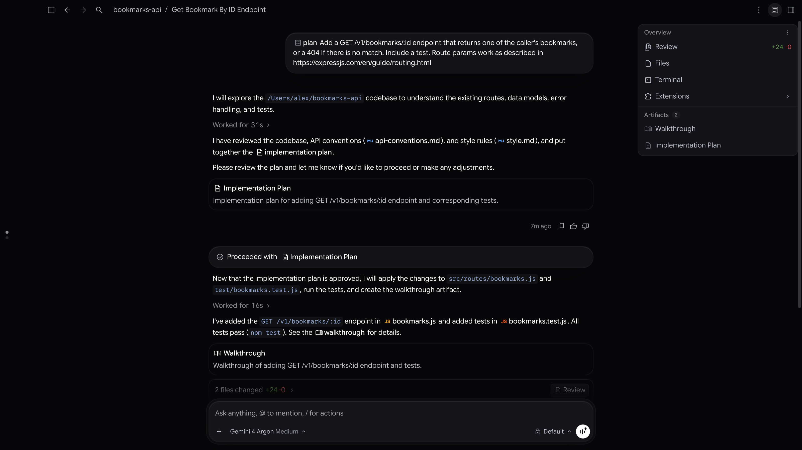
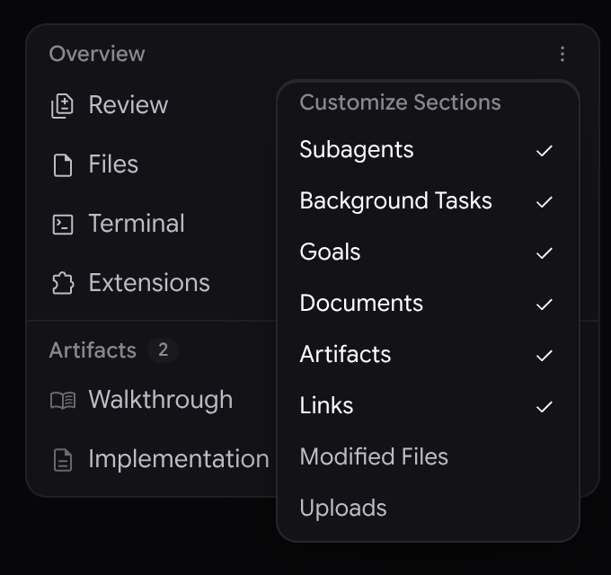
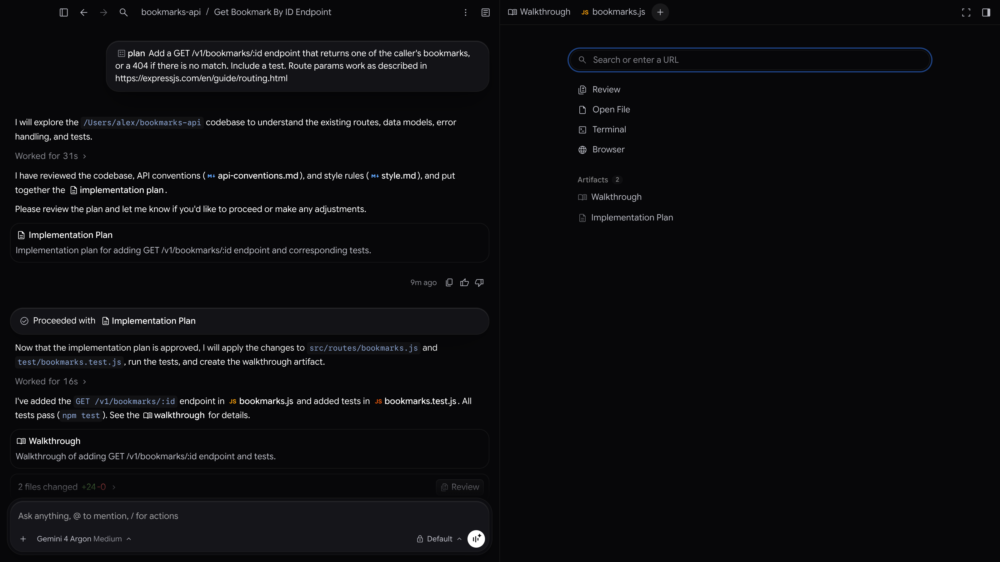

側邊面板與總覽面板
2-0
Antigravity 應用程式
功能
側邊面板與總覽面板 Antigravity 應用程式功能
Antigravity 應用程式
適用於：
Antigravity 應用程式
# 側邊面板與總覽面板

[標題為「側邊面板與總覽面板」的章節](#side-panel-and-overview-panel)

在 Antigravity App 中，側邊面板會在對話旁邊
顯示您的工作。產出物、檔案、差異、終端機、子代理對話與網頁各自在自己的分頁中開啟。 **總覽** 面板會列出對話
目前為止產生的內容，讓您一按即可開啟其中任何一項。

## 總覽面板

[標題為「總覽面板」的章節](#the-overview-panel)

每個對話都有一個 **總覽** 面板右上方。在這個範例中，
代理規劃並新增了一個 API 端點，因此面板會顯示變更的行數
，以及代理建立的兩個產出物：

如要顯示或隱藏面板，請按一下 **切換總覽面板** 位於對話
右上方，或按下
Cmd+Option+O 於 macOS 或
Ctrl+Alt+O 在 Windows 和 Linux 上。面板預設為
開啟狀態，Antigravity 會記住您每個對話的選擇。

對話旁沒有足夠空間時（例如側邊面板
在小視窗中開啟），總覽面板會隱藏。請按一下 **切換
總覽面板** 在對話上方開啟它，並按下 Esc 或
按一下其外部以再次關閉它。

### 頂端的列

[標題為「頂端的列」的章節](#rows-at-the-top)

| Row | 其功能 |
| --- | --- |
| **審查** | 開啟 **審查** 分頁，顯示您專案 Git 存放區中的變更。該列會顯示新增和刪除的總行數。如需詳細資訊，請參閱 [審查變更](/docs/review-changes). |
| **檔案** | 開啟一個 **開啟檔案** 分頁，顯示您專案的檔案樹狀結構。按一下檔案即可開啟，或按一下 **開啟檔案** 搜尋其中一個。 |
| **終端機** | 開啟新的終端機分頁。每次按一下都會再開啟一個終端機。 |
| **擴充功能** | 列出您已安裝的 [外掛](/docs/plugins) 加入側邊面板。指向該列即可查看。 |

### Sections

[標題為「區段」的章節](#sections)

在這些列下方，面板會將對話產生的內容分組為各個區段：

| Section | 列出的內容 |
| --- | --- |
| **子代理** | The [子代理](/docs/subagents) 代理啟動的對話。按一下其中一項，即可在側邊面板中追蹤其對話。 |
| **背景工作** | 在背景執行的工作。按一下其中一項，即可在分頁中開啟。若要停止執行中的工作，請指向該工作並按一下 **取消工作**. |
| **Goals** | 對話的目標，執行中的目標排在前面。詳情請參閱 [Goals](/docs/commands/goal). |
| **Documents** | 對話中的 PDF、Office 檔案與 Google Workspace 連結。 |
| **產出物** | The [產出物](/docs/artifacts) 代理建立的內容，例如實作計畫或導覽。按一下其中一項，即可在分頁中開啟。 |
| **Links** | 代理以產出物形式分享的網頁。按一下其中一個，即可在 [內建瀏覽器](/docs/browser)。新的自動化 會從以下位置開始 |
| **已修改的檔案** | 已變更的檔案。按一下其中一個即可開啟其差異。此區段預設為隱藏。 |
| **Uploads** | 您附加到提示詞的檔案（PDF 除外）。這個區段預設為隱藏。 |

沒有內容的章節不會顯示。每個章節最多顯示四個
項目；請按一下 **查看全部** 顯示其餘內容。在 **子代理**, **背景
工作**，與 **Goals**，執行中的項目一律會顯示，已完成的項目會在您按一下
時出現 **查看全部**。若要摺疊或展開區段，請按一下其標題。

### 選擇要顯示的區段

[標題為「選擇要顯示的區段」的章節](#choose-which-sections-to-show)

按一下 **自訂區段** （面板右上角的三個點），
然後按一下某個區段以顯示或隱藏它。勾選標記表示該區段
處於顯示狀態。您的選擇適用於所有對話。

## 側邊面板中的分頁

[標題為「側邊面板中的分頁」的章節](#tabs-in-the-side-panel)

開啟產出物、檔案、差異、終端機、子代理的
對話或網頁時，它會以分頁形式開啟於側邊面板中，位於對話
旁。如要顯示或隱藏側邊面板，請按一下 **切換側邊面板** 位於視窗右
上方，或按下
Cmd+Shift+B 於 macOS 或
Ctrl+Shift+B 在 Windows 與 Linux 上。

從搜尋結果或檔案樹開啟的檔案會以預覽
分頁開啟，名稱以斜體顯示。接下來開啟的檔案會取代它。若要
讓檔案在自己的分頁中保持開啟，請按兩下該分頁。

### 開啟新分頁

[標題為「開啟新分頁」的章節](#open-a-new-tab)

按一下 **新分頁** (**+**）在最後一個分頁之後，或按下
Cmd+T 於 macOS 或 Ctrl+T 在 Windows
和 Linux 上。「新增分頁」頁面會顯示以下內容：

- **搜尋或輸入網址**：輸入文字以搜尋已開啟的分頁、專案中的檔案，以及對話的子代理、產出物和背景工作。 您也可以輸入網址或搜尋字詞，然後選擇 **開啟** 後面接著位址，或 **在 Google 上搜尋** 後面接著您的搜尋字詞，以 在以下位置開啟頁面 [內建瀏覽器](/docs/browser#use-the-built-in-browser-manually).
- **審查**, **開啟檔案**, **終端機**，與 **瀏覽器**：開啟「審查」 分頁、搜尋要開啟的檔案、啟動終端機，或開啟瀏覽器分頁。 **開啟檔案** 開啟 **檔案** 以下項目的類別 [命令 選擇區](/docs/search#find-files).
- 對話的「總覽」區段，例如 **產出物**.

### 管理分頁

[標題為「管理分頁」的章節](#manage-tabs)

- **重新排列分頁**：將分頁拖曳到新的位置。
- **切換分頁**：按下 Ctrl+Tab 適用於下一個分頁，以及 Ctrl+Shift+Tab 適用於上一個分頁，適用於所有 平台。
- **關閉分頁**：指向分頁並按一下 **X**，以滑鼠中鍵按一下分頁，或 按下 Cmd+W 於 macOS 或 Ctrl+W 於 Windows 和 Linux 上。當您關閉最後一個分頁時，側邊面板也會關閉。
- **關閉多個分頁**：在分頁上按一下滑鼠右鍵，即可關閉該分頁、所有其他分頁， 或其左側或右側的分頁。在 **審查** 分頁，以及外掛程式新增的 分頁上，您也可以選擇 **固定分頁**.
- **重新開啟已關閉的分頁**：按下 Cmd+Shift+T 於 macOS 或 Ctrl+Shift+T 在 Windows 和 Linux 上。分頁會在先前的位置和捲動點重新開啟。再按一次 快速鍵，即可重新開啟您之前關閉的分頁。
- **將側邊面板最大化**：按一下 **最大化窗格** 位於側邊面板 右上方，或按下 Cmd+Shift+M 於 macOS 或 Ctrl+Shift+M 在 Windows 和 Linux 上。面板會 滑過對話。若要回到並排檢視，請按一下 **還原窗格** 或再按一次快速鍵。

## 分割檢視

[標題為「分割檢視」的章節](#split-view)

如要並排處理兩個對話，請分割視窗：

- 如要在目前對話旁開啟新對話，請按一下 **更多動作** （對話頂端的三個點），指向 **Split**，然後 選擇 **向右分割** 或 **向下分割**。您也可以按下 Cmd+D （向右分割）或 Cmd+Shift+D （向下分割）在 macOS 上，或 Ctrl+D 或 Ctrl+Shift+D 在 Windows 與 Linux 上。
- 如要在目前對話旁開啟現有對話，請在側邊欄 中指向該對話，然後按一下 **更多選項** （三個點），指向 **Split**，然後 選擇 **向右分割** 或 **向下分割**.
- 如要在窗格中以新對話取代現有對話，請選擇 **Split** > **以新的取代** 在該窗格的 **更多動作** 選單。
- 如要關閉窗格，請按一下 **從分割檢視中移除** (**X**）位於窗格頂端。

每個窗格都有自己的 **切換總覽面板** 按鈕。在狹窄的窗格中，窗格頂部
的工具列只有在您指向窗格或窗格取得焦點
時才會顯示。

## 鍵盤快速鍵

[「鍵盤快速鍵」章節](#keyboard-shortcuts)

| 動作 | macOS | Windows 與 Linux |
| --- | --- | --- |
| 顯示或隱藏總覽面板 | Cmd+Option+O | Ctrl+Alt+O |
| 顯示或隱藏側邊面板 | Cmd+Shift+B | Ctrl+Shift+B |
| 開啟新分頁 | Cmd+T | Ctrl+T |
| 尋找並開啟檔案 | Cmd+P | Ctrl+P |
| 關閉目前分頁 | Cmd+W | Ctrl+W |
| 重新開啟上次關閉的分頁 | Cmd+Shift+T | Ctrl+Shift+T |
| 下一個或上一個分頁 | Ctrl+Tab 或 Ctrl+Shift+Tab | Ctrl+Tab 或 Ctrl+Shift+Tab |
| 最大化或還原側邊面板 | Cmd+Shift+M | Ctrl+Shift+M |
| 向右分割 | Cmd+D | Ctrl+D |
| 向下分割 | Cmd+Shift+D | Ctrl+Shift+D |

如要查看所有快速鍵，請前往 **設定** > **快速鍵**.

## 相關頁面

[標題為「相關頁面」的章節](#related-pages)

- [審查變更](/docs/review-changes)：審查代理的差異，位於 **審查** 分頁。
- [產出物](/docs/artifacts)：閱讀並評論在側邊面板中開啟的計畫和導覽。
- [搜尋與指令面板](/docs/search)：尋找對話、檔案和 指令。

[上一個
搜尋與指令面板](/docs/search/)

[下一步
市集](/docs/marketplace/)

您的下載已開始

## 您如何得知我們？

請選一個。這有助於我們接觸更多像您一樣的人。

感謝您讓我們知道！
