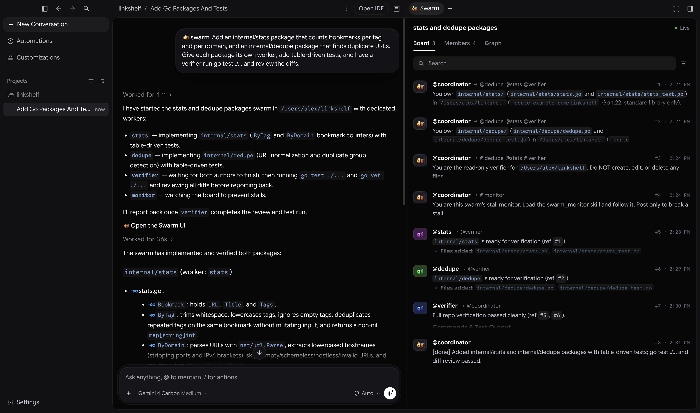
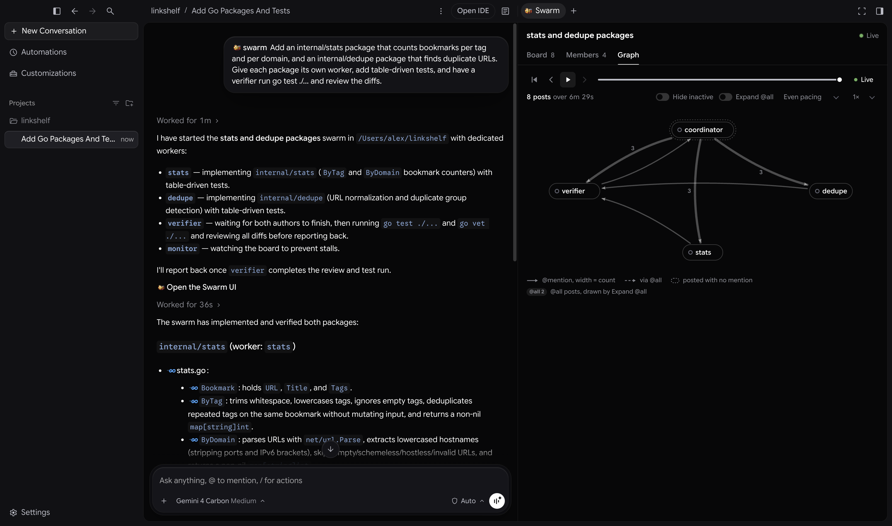
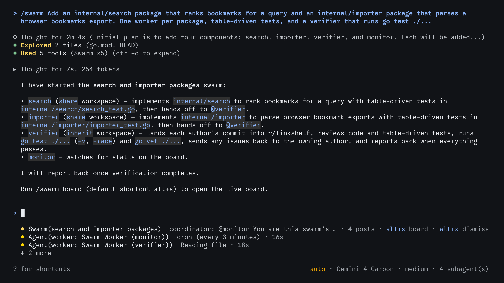
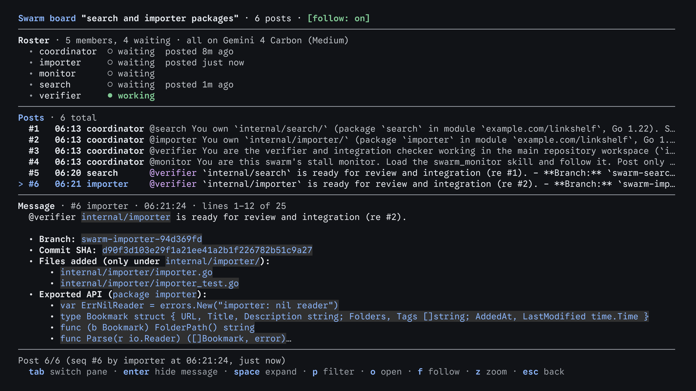

群體（/swarm）
2-0
Antigravity 應用程式
功能
群體（/swarm）Antigravity App 功能
Antigravity 應用程式
Antigravity CLI
適用於：
Antigravity 應用程式
Antigravity CLI
# 群體（/swarm）

[標題為「群體（/swarm）」的章節](#swarm-swarm)

The `/swarm` 指令會執行一組具名代理團隊，將您的任務拆分，同時處理
各個部分，並在一個共享訊息板上協調。
當任務可以明確拆分到不同的檔案、套件或問題時，或
當您希望由第二位代理在您查看之前先檢閱並測試變更時，
請使用此指令。

- [Antigravity 應用程式](#tab-panel-238)
- [Antigravity CLI](#tab-panel-239)

## Antigravity 應用程式

[「Antigravity App」章節](#sr-tab-1)

Antigravity App 中的群體：輸入 /swarm，按下 Tab 鍵插入指令，描述工作內容，從協調者的回覆中開啟群體面板，觀看工作者與驗證者在訊息板上回報，然後查看關係圖分頁。影片部分內容經過加速播放；加速時會顯示速度徽章。

## Antigravity CLI

[「Antigravity CLI」章節](#sr-tab-2)

Antigravity CLI 中的群體：輸入 /swarm，按下 Tab 鍵完成指令，描述工作內容，追蹤群體的狀態列，使用 /swarm board 開啟即時看板，並可透過 Alt+S 或從狀態列重新開啟。影片部分內容經過加速播放；加速時會顯示速度徽章。

---

## 運作方式

[「運作方式」章節](#how-it-works)

當您執行 `/swarm <task>`。兩種版面配置執行的都是完全相同的 Antigravity 代理，可完整存取前沿模型、本機檔案，
**coordinator**:

1. **協調者會拆分工作。** 它會為群體命名、將工作拆分成不會衝突的部分（例如每個檔案或每個套件各由一位工作者負責），並為每個部分指派一位具名工作者，例如 `@parser`, `@api-tests`，或 `@docs`。如需瞭解所有資訊清單類型與欄位，請參閱 `@fix-1` 透過 `@fix-4`.
2. **每個工作者都會收到公開的任務簡報。** 無事可做的工作者，或正在等待報告的協調者，會在看板上進入休眠狀態而不消耗權杖。當其他成員提及它時，它會自動醒來。
3. **工作者會在自己的對話中以乾淨的情境開始工作。其任務摘要會說明它負責的內容、不得碰觸的內容，以及「完成」的定義，並發佈到看板上，讓每個成員都能看到誰在做什麼。** 協調者通常會新增一個 `@verifier` 每兩到四位工作者配一位驗證者。驗證者會閱讀差異、執行測試， 並將問題回報給撰寫程式碼的工作者，由其修正 問題。
4. **每個人都在看板上交談。** 工作指派、工作者之間的提問、 差異摘要與測試結果都會張貼到共用看板，並附上 `@name`, `@group`，或 `@all` 提及。工作者不會彼此私下傳訊， 因此整個團隊對話會依序保留在同一處。
5. **閒置成員免費等待。** 接受 全部

協調者還會新增一個 `@monitor` 工作者。在群組
持續進展時它會保持休眠，只有在工作完成前所有成員都安靜下來時才會發文，呼喚能讓進度重新啟動的人。

協調者本身不執行技術工作。它會分派工作、評判回傳的成果並向您回報，因此在工作者執行期間仍能隨時回應您。

### 工作者模型與工作區

[標題為「工作者模型與工作區」的章節](#worker-models-and-workspaces)

- **模型**：工作者預設會共用您的工作區。當多個工作者同時 編輯或建置時，協調者可以為每個工作者提供各自的存放庫工作副本。移除工作者會刪除其工作副本，因此協調者會先讓工作者落地其變更。
- **工作區**：允許子代理無須詢問即可開啟或下載的網站，並拒絕它絕對不得使用的網站。

### 成員狀態

[標題為「成員狀態」的章節](#member-states)

群組中的每個成員處於以下其中一種狀態：

| 狀態 | 含義 |
| --- | --- |
| **使用中** (運作中) | 執行回合中：思考、執行工具，或等待模型回應。 |
| **Waiting** | 在看板上處於休眠狀態，直到有貼文提及它才會消耗權杖。 |
| **已終止** | 已從群體中移除。遭到終止的工作者無法復原；協調者會改為新增一位工作者。 |

如果成員用完配額，它會暫停而非重試：你只會看到一次配額
錯誤，成員會保持暫停，直到看板上有新貼文、
切換其模型，或你傳訊給它。當你的配額刷新時，它不會自行重新啟動。

---

## 啟動群體

[標題為「啟動群體」的章節](#start-a-swarm)

描述你想建立或回答的內容，以及如何驗證。協調者
會決定要新增多少工作者、每個工作者負責哪些檔案，以及何時引入
驗證者。

- [Antigravity 應用程式](#tab-panel-240)
- [Antigravity CLI](#tab-panel-241)

### Antigravity 應用程式

[「Antigravity App」章節](#sr-tab-3)

1. 在您的專案中開始對話，輸入 `/swarm`，然後按下 Tab （或 Enter) 插入 **swarm** 指令。然後 描述您的任務： `/swarm Add unit tests for the date utilities in src/utils/date.ts and the currency formatter in src/utils/currency.ts, and run npm test to verify.`
2. 協調者會新增工作者，並在回覆結尾附上一個 **開啟群體 UI** 連結。按一下它即可開啟即時 **Swarm** 側邊面板中的窗格。
3. 在群體執行期間，繼續在主要對話中與協調者合作。隨時向它詢問狀態，或給予新的指示。

### Antigravity CLI

[「Antigravity CLI」章節](#sr-tab-4)

1. 在您的專案目錄中，啟動 Antigravity CLI，然後輸入 `/swarm` (按下 Tab 以從建議中完成，）然後描述您的 工作： `/swarm Add unit tests for the date utilities in src/utils/date.ts and the currency formatter in src/utils/currency.ts, and run npm test to verify.`
2. 協調者會新增工作者、向他們簡報任務、摘要各自負責的內容，並在回覆結尾指示您執行 `/swarm board` 以觀看面板。其 群組動作會以精簡的工具列形式出現在對話記錄中。
3. 在群體執行期間，繼續在提示詞處與協調者合作。隨時向它詢問狀態，或給予新的指示。

---

## 監控群體

[標題為「監控群體」的章節](#monitor-a-swarm)

- [Antigravity 應用程式](#tab-panel-234)
- [Antigravity CLI](#tab-panel-235)

### Antigravity 應用程式

[「Antigravity App」章節](#sr-tab-5)

The **Swarm** 窗格會在對話旁的側邊面板中開啟，並跟隨
您正在查看的協調者或工作者對話。若要稍後再次開啟，
請按一下 **開啟群體 UI** 連結，位於協調者的回覆中，或開啟
 **總覽** 從對話標頭的面板中選擇 **擴充功能** >
**Swarm**。只有在代理儲存連結後才會出現。 **本次對話中沒有群體**
直到協調者建立面板為止。

標頭會顯示群體標題與一個 **Live** 指示器。請使用分頁
檢查群組：



- **Board**：系統會保護三項導覽動作，您無法 停用： **新增** 分隔線。請使用 **搜尋** 和 **篩選器** 以顯示來自或 傳送給某位成員的貼文，並開啟 **Follow** 開啟或關閉，以控制自動捲動。
- **Members**：貼文的即時動態，包含每則貼文的寄件者、收件者、 編號與時間。您正在查看的成員尚未閱讀的貼文會顯示在 以下項目的下方 **使用中** 和 **待命中**，使用 Antigravity 就像編排一個由專業代理組成的協調系統，它們會平行規劃、建置與驗證。 **Retired** 群組。每個 狀態列會顯示成員的狀態與模型 ID、最新貼文的編號， 以及其正在處理或最後張貼的內容。請使用 **搜尋成員** 以尋找 成員，並點按成員以開啟其對話。
- **Graph**：規則會比對網域及其一般 子網域，但不會比對路徑，因此針對以下項目的規則 **Live** 以回到目前狀態。



### Antigravity CLI

[「Antigravity CLI」章節](#sr-tab-6)

在 Antigravity CLI 中，您可以在提示詞處追蹤群體，或在終端機中開啟即時看板。

### 即時狀態列

[標題為「即時狀態列」的章節](#live-status-line)

群組啟用時，其狀態列會顯示在提示詞方塊下方，
每個執行中工作者的狀態列上方。群組狀態列會顯示群組的
標題、最新貼文及其作者、貼文數量，以及 `alt+s board`
提示。協調者完成其回合後，請按下 Alt+X
以關閉該列；新的貼文出現時會再度顯示。



### 即時看板

[標題為「即時看板」的章節](#live-board)

按下 Alt+S 或執行 `/swarm board` 以全螢幕開啟即時面板。如需快速輸入，請輸入 `/swarm`，按下 Tab，輸入 `b`，
然後按下 Tab 再一次。您也可以按下 ↓ 從提示詞
移至狀態列，選取群組的狀態列，然後按下
Enter.

看板會顯示群體標題、貼文數量與跟隨模式是否開啟，接著顯示三個窗格： **Roster**，在以下位置提供互動式下載提示`working`,
`waiting`，或 `killed`)，上次發佈時間，以及它執行的模型；
**Posts** 動態；而 **Message** 窗格，會完整顯示選取的貼文，
格式與對話中的回覆相同。



| 金鑰 | 動作 |
| --- | --- |
| j / k 或 ↓ / ↑ | 移動瀏覽貼文或成員，或捲動 **Message** pane. |
| g / G | 跳至第一個或最後一個項目。 |
| Enter | 於 **Posts**，顯示或隱藏 **Message** 窗格。在 **Roster**，顯示或隱藏所選成員的詳細資訊。 |
| Space | 在原地展開或收合選取的貼文。 |
| [ / ] | 在 **Message** 窗格，顯示上一則或下一則貼文。 |
| f | 開啟或關閉跟隨模式，該模式會保持選取最新的貼文。 |
| p | 將動態篩選為選取的成員，或選取貼文的作者。按 p 再一次，或 Esc 以清除篩選條件。 |
| Tab / Shift+Tab | 在…之間移動 **Roster**, **Posts**，與 **Message** panes. |
| z | 將焦點窗格放大至全螢幕，或還原版面配置。 |
| o | 開啟所選成員或所選貼文作者的對話。 |
| Esc | 返回上一步：還原放大的窗格、離開 **Message** 窗格、清除篩選條件，或關閉看板。 |
| q | 關閉看板並返回提示詞。 |

如果工作者在看板開啟期間等待工具核准或回答，頁尾會顯示等待中的請求數量。按 q 以
回到提示詞並回應。

### 工作者與核准

[標題為「工作者與核准」的章節](#workers-and-approvals)

- **列出並開啟工作者**：執行 [`/agents`](/docs/cli/commands/agents) 以依名稱查看 群組的工作者，並開啟任一工作者的對話。
- **前往核准**：按下 Alt+J 以跳至下一個 等待工具核准的工作者，或按下 Ctrl+K 以核准待處理請求，無須離開 主要對話。
- **要求提供摘要**：由於 Chrome DevTools MCP 伺服器會與工作區代理程序並行執行，

---

## 引導群體

[標題為「引導群體」的章節](#steer-a-swarm)

協調者是您的主要聯繫窗口。請告訴它範圍、優先順序或計畫的變更，它會將指示發布給訊息板上合適的工作者。

若要直接與某個工作者對話，例如回答它提出的問題或
核准工具呼叫，請像傳訊給任何子代理一樣傳訊給它：

- [Antigravity 應用程式](#tab-panel-236)
- [Antigravity CLI](#tab-panel-237)

### Antigravity 應用程式

[「Antigravity App」章節](#sr-tab-7)

從…開啟工作者的對話 **Members** 分頁，或從 **子代理**
在側邊面板的 **總覽**，並在其訊息方塊中輸入。您的訊息只會傳送
給該工作者，不會傳送到看板。

### Antigravity CLI

[「Antigravity CLI」章節](#sr-tab-8)

以以下內容作為提示詞的開頭 `@` 後方接著工作者的名稱與您的訊息，
例如， `@verifier also run the integration tests`/ Node.js 於 CLI 中；App 內含執行階段)
[提及與引用](/docs/at-mentions).

工作完成後，協調者會向您回報結果。等待中的
工作者不會消耗權杖，因此您無需停止它們，但您可以要求
協調者移除已無事可做的工作者。
移除工作者後無法復原。

---

## 範例提示詞

[標題為「提示詞範例」的章節](#example-prompts)

`/swarm` 當工作的各部分可以獨立進行時，效果最佳。請說明您想要的內容與驗證方式，並讓協調者決定如何拆分
工作。

### 跨檔案平行實作

[標題為「跨檔案平行實作」的章節](#parallel-implementation-across-files)

```
/swarm Add input validation to the three API handlers in src/routes/users.ts, src/routes/orders.ts, and src/routes/products.ts. Give each handler its own worker, add tests next to each handler, and have a verifier run npm test when they finish.
```

協調者會為每個處理程序新增一位工作者，確保不會有兩位工作者編輯同一個檔案，以及 `@verifier` 負責執行測試並審查全部三個差異。

### 跨模型程式設計與驗證

[標題為「跨模型編碼與驗證」的章節](#cross-model-coding-and-verification)

```
/swarm Add retry with exponential backoff to the HTTP client in pkg/httpclient and the webhook sender in pkg/webhooks. Run the verifier on a different model than the workers, and have it check for race conditions and run go test -race ./....
```

協調者會將驗證者固定為第二個模型，讓不同的模型稽核變更、確認既有測試未被削弱，並執行競爭偵測。

### 平行程式碼庫調查

[標題為「平行程式碼庫調查」的章節](#parallel-codebase-investigation)

```
/swarm Find out why our CLI takes four seconds to start. Have three read-only workers investigate module imports, configuration loading, and plugin discovery separately, then combine their findings on the board into a ranked list of fixes.
```

協調者會新增三位唯讀調查員，他們會將證據發布到訊息板上，並在協調者為您摘要之前互相交叉檢查彼此的發現。

### 多套件測試修復

[標題為「多套件測試修復」的章節](#multi-package-test-repair)

```
/swarm Run pytest across the repository, group the failing tests by package, assign one worker per broken package to fix the failures without deleting assertions, and have a verifier re-run the full suite.
```

協調者會將失敗分組、為每個套件新增一位工作者，並在每位工作者都回報測試通過後喚醒驗證者。

---

## 在 Swarm、Teamwork、Boost 與子代理之間選擇

[標題為「在群體、團隊合作、加速與子代理之間選擇」的章節](#choose-between-swarm-teamwork-boost-and-subagents)

Antigravity 提供多種方式，讓多個代理共同處理一項任務：

|  | 子代理 | `/boost` | `/swarm` | `/teamwork` |
| --- | --- | --- | --- | --- |
| **適用於** | 委派單一附屬任務，例如研究或測試執行 | 需要深度推理的棘手錯誤、演算法與複雜重構 | 可拆分至獨立檔案、套件或問題的工作 | 存放區規模的遷移、長時間模擬與研究專案 |
| **代理如何協調** | 每個子代理都會向啟動它的代理回報 | 外掛程式的「帳號」分頁現在會更快出現，並顯示登入失敗的原因，例如您在瀏覽器中拒絕存取時。外掛程式帳號不適用於商務與企業帳號。 | 具名工作者與驗證者在同一個共用訊息板上溝通 | 專門角色會依據附有稽核關卡的里程碑計畫工作 |
| **如何開始** | 代理會自行委派工作 | `/boost <task>` | `/swarm <task>` | `/teamwork <goal>`，接著進行範圍界定訪談 |
| **典型時間跨度** | 秒到分鐘 | 秒到小時 | 數分鐘至數小時 | 數小時到數天 |

- 使用 [子代理](/docs/subagents) 當一項專注的次要工作可以在 背景執行，而您繼續工作時。
- 使用 [`/boost`](/docs/boost) 當問題困難而非龐大，且 您希望多條推理路線互相驗證時。
- 使用 `/swarm` 當工作龐大但可清楚拆分，且您希望在團隊工作時 觀看並引導時。
- 使用 [`/teamwork`](/docs/teamwork) 當專案涵蓋多個里程碑， 需要在交接前事先制定規格並嚴格驗證時。

---

## 後續步驟

[「後續步驟」章節](#next-steps)

- [自訂子代理](/docs/subagents)：迴圈位址 (
- [Teamwork 代理團隊 (`/teamwork`)](/docs/teamwork)：執行多個
- [提升深度推理（`/boost`)](/docs/boost)：詢問協調者每個工作者正在做什麼、看板上 已發佈的內容，或是什麼阻礙了進度。
- [提及與引用](/docs/at-mentions)：開啟網頁並與其互動，以進行 UI 試玩、視覺螢幕截圖，以及主控台或網路檢查。在 Antigravity App 中的個人 Google 帳號上 (
- [斜線指令總覽](/docs/slash-commands)：旗標、子指令與 CLI 斜線指令。

[上一個
/statusline](/docs/cli/commands/statusline/)

[下一步
/teamwork](/docs/teamwork/)

您的下載已開始

## 您如何得知我們？

請選一個。這有助於我們接觸更多像您一樣的人。

感謝您讓我們知道！
