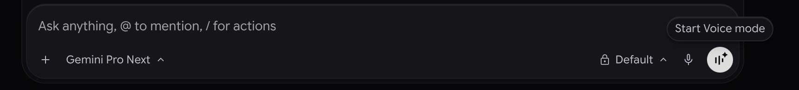
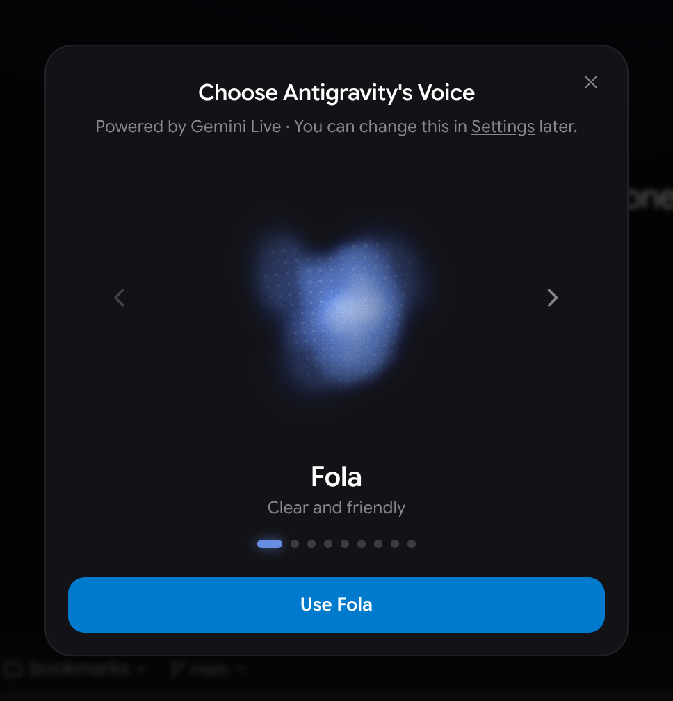
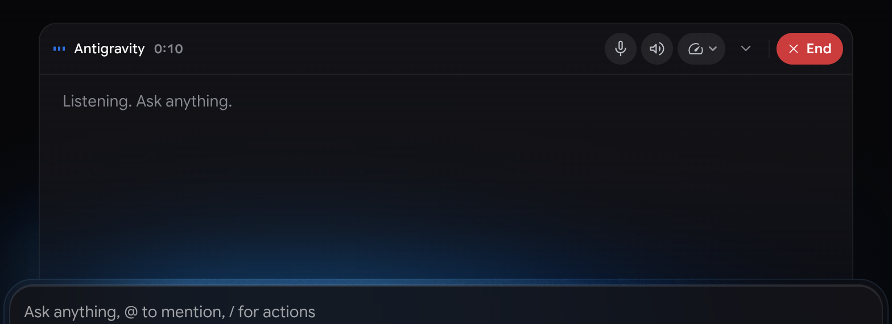
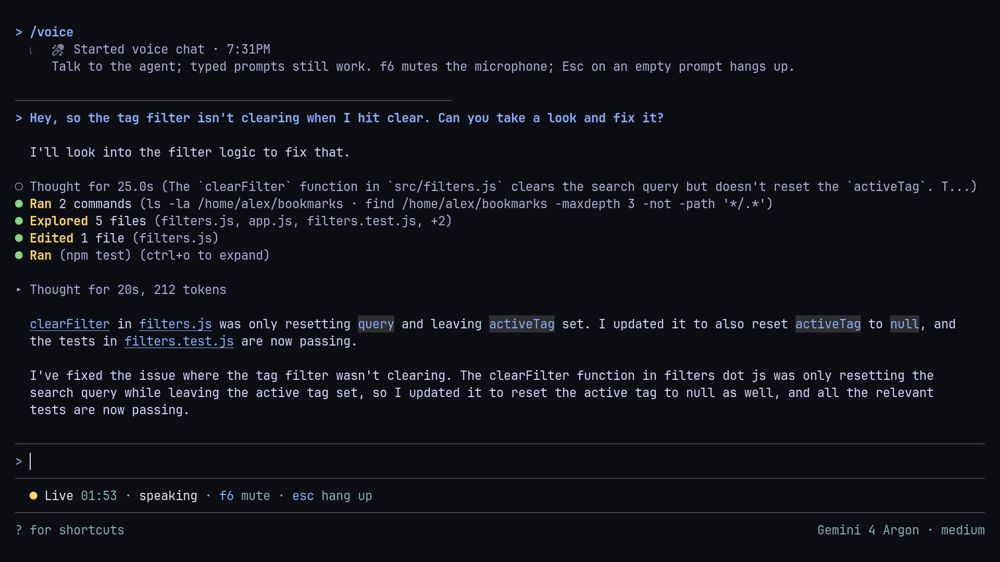
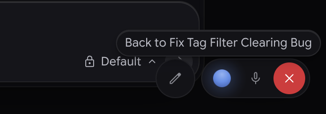
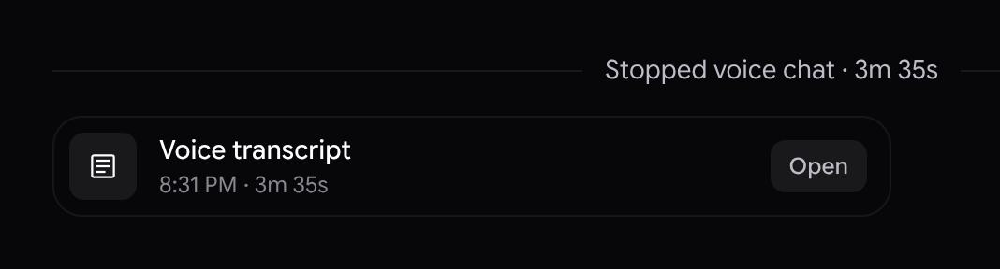
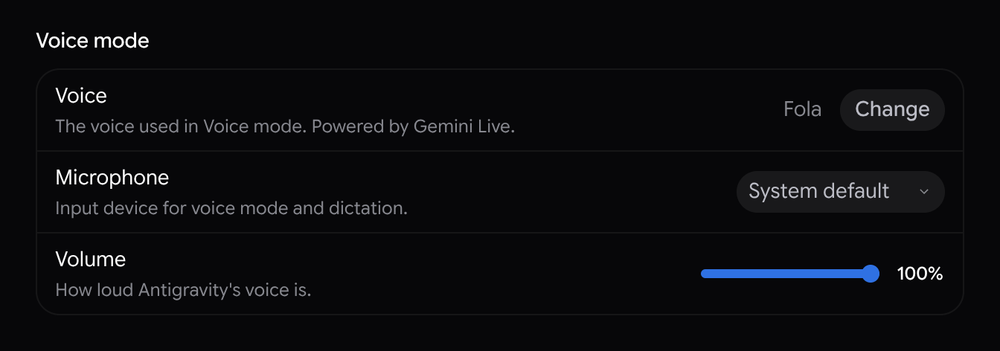

語音模式
2-0
Antigravity 應用程式
功能
語音模式 Antigravity App 功能
Antigravity 應用程式
Antigravity CLI
適用於：
Antigravity 應用程式
Antigravity CLI
# 語音模式

[標題為「語音模式」的章節](#voice-mode)

大聲與代理交談，並即時聽到它的回答。透過
**Antigravity 中的語音模式**，由以下項目啟用 **Gemini Live**，在語音模式中，你和 Antigravity 說話的方式，就像在通話中和隊友說話一樣：交給它一項任務，在工作進行時引導它，並回答授權提示詞，不需要點擊。

- [Antigravity 應用程式](#tab-panel-254)
- [Antigravity CLI](#tab-panel-255)

## Antigravity 應用程式

[「Antigravity App」章節](#sr-tab-1)

Antigravity App 中的語音模式：大聲說出修正需求，讓代理處理，再聆聽結果。影片有聲音。

## Antigravity CLI

[「Antigravity CLI」章節](#sr-tab-2)

Antigravity CLI 中的語音模式：使用 /voice live 啟動，大聲說出修正需求，再聆聽結果。影片有聲音。

語音模式適用於 Antigravity CLI 1.5.0 版及更新版本。

## 總覽

[「總覽」章節](#overview)

語音模式將對話轉變為與代理的口語雙向對話。在您說話的同時，代理會在對話中執行工作，因此您可以一邊閱讀：

- **自然說話**：大聲指派任務、提出問題或思考問題， 就像輸入提示詞一樣。語音模式會繼續您目前所在的對話， 因此代理具備先前訊息的情境，包括您輸入的訊息。
- **在工作進行時加以引導**：補充細節、修正方向，或停止任務， 無需等待它完成。
- **以語音回答**：允許或拒絕權限提示，並大聲回答代理的 問題。
- **選擇您要聽到的內容**：代理依預設會安靜工作。當您需要時，請要求以口頭方式提供進度更新。
- **跟著閱讀**：代理撰寫、編輯或繪製的所有內容都會如常出現在 對話中，您可以在交談時追蹤您與代理說的話。

### 語音模式與語音聽寫

[標題為「語音模式與語音聽寫」的章節](#voice-mode-and-voice-dictation)

- [Antigravity 應用程式](#tab-panel-244)
- [Antigravity CLI](#tab-panel-245)

### Antigravity 應用程式

[「Antigravity App」章節](#sr-tab-3)

Antigravity 應用程式有兩種使用語音的方式：

|  | 語音模式 | 語音聽寫 |
| --- | --- | --- |
| **其功能** | 與代理進行語音對話。 | 將您說的話輸入訊息框。 |
| **如何開始** | 按一下 **啟動語音模式** 在訊息方塊中。 | 按一下訊息方塊中的麥克風，或按下 Ctrl + M. |
| **代理的回答方式** | 大聲說出來，同時其工作會顯示在對話中。 | 以文字方式，在您傳送訊息後。 |
| **適用時機** | 您想免持操作，或在代理工作時以口述方式討論工作。 | 您想在傳送提示詞之前先審查並編輯它。 |

如要深入了解聽寫功能，請參閱
[語音轉錄](/docs/features#voice-transcription).

### Antigravity CLI

[「Antigravity CLI」章節](#sr-tab-4)

Antigravity CLI 有兩種使用語音的方式：

|  | 語音模式 | 語音聽寫 |
| --- | --- | --- |
| **其功能** | 與代理進行語音對話。 | 將您說的話輸入提示詞方塊。 |
| **如何開始** | 執行 `/voice live`，或按下 F6. | 執行 `/voice dictate` 或 `/record`，或按下 F5. |
| **代理的回答方式** | 大聲說出來，同時其工作會顯示在對話中。 | 以文字方式，在您傳送提示詞後。 |

如要深入了解聽寫功能，請參閱
[CLI 中的語音聽寫](/docs/cli/commands/voice).

## 啟動語音模式

[標題為「啟動語音模式」的章節](#start-voice-mode)

- [Antigravity 應用程式](#tab-panel-256)
- [Antigravity CLI](#tab-panel-257)

### Antigravity 應用程式

[「Antigravity App」章節](#sr-tab-5)

您可以在新對話或現有對話中啟動語音模式。在現有
對話中，語音模式會以語音方式繼續該對話。

如要啟動語音模式，請執行下列操作：

1. 訊息框為空白時，請按一下 **啟動語音模式**。它是聽寫麥克風旁邊帶有音條的圓形 按鈕，只在訊息方塊為空時 出現。當代理閒置時，它會出現在 **Send**。代理工作時，它會出現在用來 停止代理的按鈕旁邊。 
2. 如果 Antigravity App 要求存取您的麥克風，請允許。
3. 首次啟動語音模式時， **選擇 Antigravity 的語音** 對話方塊會開啟並播放語音範例。如要聆聽其他語音，請按一下 箭頭或按下 ← 和 →。若要選擇正在播放的語音，請按一下 **使用** 按鈕（會顯示語音名稱），或按下 Enter. 
4. 開始說話。

啟動語音模式時，訊息框上方會升起一個面板，並顯示
**連接中…** 當語音模式連線時。準備就緒後會播放提示音。
面板頂端的通話列會顯示輪到誰發言，以及語音模式已開啟多久，後面接著 [controls](#use-the-controls)。在您
開口之前，面板會顯示 **正在聆聽。請隨意提問。** 對話也會顯示
一個 **已開始語音對話** 標記，包含時間。

### Antigravity CLI

[「Antigravity CLI」章節](#sr-tab-6)

您可以在新對話或現有對話中啟動語音模式。在現有
對話中，語音模式會以語音方式繼續該對話。

如要啟動語音模式，請執行 `/voice live`，或按下 F6。CLI 需要
麥克風和喇叭。在 SSH 工作階段中，執行 `agy mic-serve` 在您自己的
電腦上並設定 `ANTIGRAVITY_MIC`，如同
[語音聽寫](/docs/cli/commands/voice).

語音模式開始時，對話會顯示 **已開始語音對話** 行
包含時間，而提示詞下方的狀態列會顯示 **Live**、語音模式已開啟多久，以及代理正在聆聽、思考或說話。
您與代理說的話會出現在對話中，您仍然可以輸入
提示詞。

如要選擇 `/voice` 自行啟動時，請前往 `/settings` > **語音模式**。
預設值， **auto**，在語音模式可用且您的電腦
有麥克風和喇叭時啟動語音模式，否則使用聽寫。

## 與代理交談

[標題為「與代理交談」的章節](#talk-to-the-agent)

像在通話中與隊友交談一樣與代理交談。代理會
立即回應閒聊，以及關於它已說過內容的問題。任何需要您的程式碼、檔案、工具或最新資訊的事項，
都會成為對話中的工作，而您會大聲聽到結果。

在語音模式中，您可以執行下列任一操作：

- **指派工作**：說出您的需求，例如「找出失敗的測試並修正 它。」代理會確認即將執行的動作，然後開始工作。
- **引導工作**：在代理工作時補充細節或更正，例如 「只要檢查就好，先不要變更任何內容。」代理會將變更套用至 正在執行的任務。
- **詢問目前狀況**：詢問「你在做什麼？」或「進行到哪個步驟？」 以了解最新進度。
- **停止工作**：說出「停止」、「取消」或「算了」。代理會停止 正在執行的任務。
- **暫停代理**：說出「等一下」、「稍等」或「我正在閱讀」，讓 代理停止說話，直到您再次開口。您也可以隨時透過說話打斷代理。
- **在螢幕上顯示內容**：請代理顯示、列印或繪製某些內容， 例如表格或圖表。代理會將它加入對話， 並大聲說明，而非朗讀給您聽。
- **逐字聆聽**：請代理逐字朗讀答案，或 逐步帶您了解。
- **改為輸入**：在訊息方塊中輸入訊息並傳送。代理會 大聲確認收到，並像處理口頭要求一樣處理它。
- **共用檔案**：將檔案（例如螢幕截圖或記錄檔）附加到 訊息。代理會大聲告訴您它已收到檔案。

- [Antigravity 應用程式](#tab-panel-246)
- [Antigravity CLI](#tab-panel-247)

### Antigravity 應用程式

[「Antigravity App」章節](#sr-tab-7)

說話時，您的話語會顯示在訊息框上方的面板中，並在您停下片刻後淡出。接著，面板會以導言句與簡短段落顯示代理的回覆，並隨著代理說話逐字亮起。您與代理說的話不會加入對話，但您可以
[開啟文字記錄](#read-the-transcript) 語音模式結束後。面板的逐字稿可能會聽錯字詞，但代理會直接聽到您的語音，因此逐字稿錯誤並不代表代理誤解了您。

### Antigravity CLI

[「Antigravity CLI」章節](#sr-tab-8)

您與代理說的話會顯示在對話中，就像輸入的提示詞與
回覆一樣。根據預設，代理說話時您的麥克風會靜音，因此如要以說話方式打斷代理，請先執行 `/voice duplex on`。請使用耳機，
以免代理聽到自己的聲音。

## 以語音回答權限提示與問題

[標題為「以語音回答權限提示與問題」的章節](#answer-permission-prompts-and-questions-by-voice)

代理需要您核准某項動作或向您提問時，會大聲朗讀請求並等待您的回答。您不需要按一下任何項目。

如要以語音回覆權限提示，請執行下列操作：

1. 聆聽代理對此動作的摘要與建議。
2. 說出您想要的回答方式。例如：  **允許一次**：「僅允許這一次。」 **允許用於這次對話**：「允許在這次對話中使用。」 **允許用於這個專案**：「允許在這個專案中使用。」 **全域允許**：「一律允許。」 **拒絕**：「不要。」若要拒絕並建議替代做法，請說類似 「不要，先執行測試。」的話。

代理會以簡短的「Done.」或「Denied.」確認。部分高風險動作僅能
允許一次。在等待權限提示時，說出「Stop」或
「Cancel that」即表示拒絕。

如要回答代理的問題，請說出您想要的選項，例如「第
一個」，或自行回答。

## 取得語音進度更新

[標題為「取得語音進度更新」的章節](#get-spoken-progress-updates)

根據預設，代理會安靜地工作，只有在有答案或
需要您的輸入時才會發言。您第一次在語音模式中指派任務時，它會告訴您
它正在安靜工作，而且您可以隨時詢問進度。開啟語音更新後，代理大約每 30 秒會提供一次簡短更新，除非您要求不同的間隔。

如要變更聽到進度更新的頻率，請隨時說出類似下列
的話：

| To | 例如，說 |
| --- | --- |
| 開啟更新 | “隨時告訴我最新情況”或“更新我。” |
| 聽取更多更新 | “增加更新頻率”或“告訴我每一步。” |
| 聽取較少更新 | “減少更新頻率”或“這樣有點太多了。” |
| 設定間隔 | “每分鐘更新我一次。” |
| 關閉更新 | “安靜工作”或“完成時再告訴我。” |

語音模式結束時，語音更新會關閉，因此語音模式一律以
安靜狀態啟動。

## 使用控制項

[標題為「使用控制項」的章節](#use-the-controls)

- [Antigravity 應用程式](#tab-panel-248)
- [Antigravity CLI](#tab-panel-249)

### Antigravity 應用程式

[「Antigravity App」章節](#sr-tab-9)

語音模式開啟期間，語音模式面板頂部的通話列會顯示
下列內容：

| 控制 | 其功能 |
| --- | --- |
| Speaker | 顯示輪到誰發言： **You** 搭配麥克風，讓您在說話的同時， **Antigravity** 其餘時間則顯示音條。 |
| 經過時間 | 顯示語音模式已開啟多久。 |
| **將麥克風靜音** | 將麥克風靜音。靜音時按鈕會變成紅色。若要取消靜音，請按一下 **取消靜音麥克風**. |
| **將 Antigravity 靜音** | 將代理的語音靜音，但不結束語音模式。代理的回覆仍會顯示在面板中，您可以改為閱讀。若要再次聽到代理的聲音，請按一下 **取消靜音 Antigravity**。下次啟動語音模式時，代理的語音會恢復。 |
| **語音速度** | 設定代理說話的速度。按一下它，然後拖曳 **語音速度** 滑桿至 0.75 倍到 2 倍的速度。按鈕一律會顯示量表；目前的速度會顯示在其工具提示中和滑桿旁邊。您的選擇會立即生效，並於下次使用語音模式時套用。 |
| **最小化** | 會將面板收合為僅剩通話列，直到語音模式結束為止。如要再次顯示整個面板，請按一下 **Expand**. |
| **End** | 結束語音模式。 |

如要從鍵盤將麥克風靜音或取消靜音，請按下
Option + M 於 macOS 或 Alt + M 於
Windows 和 Linux 上。此快速鍵在您於訊息方塊中輸入時有效，
但在游標位於終端機中時無效。當您靜音時，Antigravity 應用程式會
傳送靜音，而非您麥克風的音訊。

如要從鍵盤將代理的語音靜音或取消靜音，請按下
Shift + Option + M 於 macOS 或
Alt + Shift + M 在 Windows 與 Linux 上。

### 在另一個對話中繼續交談

[標題為「在另一個對話中繼續交談」的章節](#keep-talking-in-another-conversation)

語音模式開啟期間切換至其他對話時，語音模式
會繼續執行，視窗角落會出現浮動 Dock，讓您
仍可控制它：

在 Dock 中，您可以執行下列操作：

- 按一下鉛筆圖示，即可輸入訊息或為您正在進行 的對話新增檔案。
- 按一下發光的圓球即可返回該對話。其工具提示會顯示 對話標題。
- 將麥克風靜音，或按一下 **×** 結束語音模式。

如要移動 Dock，請拖曳它。您也可以按下 Tab 直到圓球
被選取為止，然後按下 Option 以及 macOS 上的方向鍵，或
Alt 以及 Windows 與 Linux 上的方向鍵。

語音模式一次只能在一個對話中開啟。開啟期間，
**啟動語音模式** 不會顯示在其他對話中。

### 結束語音模式

[標題為「結束語音模式」的章節](#end-voice-mode)

您可以透過以下任一方式結束語音模式：

- 按一下 **End** 在通話列中，或 **×** 在浮動 Dock 中。
- 說「Bye」或「End the call」。

關閉或重新載入 Antigravity App 視窗時，語音模式也會結束。代理仍在處理的任何
工作，在語音模式結束後
仍會繼續在對話中執行。

語音模式開啟期間，您正在交談的視窗不會播放
通知音效，以免打斷代理的語音。

### 閱讀文字記錄

[標題為「閱讀文字記錄」的章節](#read-the-transcript)

語音模式結束時，對話會顯示 **已停止語音對話** 標記
顯示語音模式開啟了多久，以及 **語音逐字稿** 卡片：

如要查看您與代理的對話內容，請按一下 **開啟** 在卡片上。
**語音逐字稿** 窗格會在對話旁邊開啟。若要複製整個
文字記錄，請按一下 **複製文字記錄** 位於窗格頂部。

逐字稿會儲存在您的電腦上，並在您刪除
對話時一併刪除。

### Antigravity CLI

[「Antigravity CLI」章節](#sr-tab-10)

語音模式開啟期間，請使用下列命令與按鍵：

| To | 執行此操作 |
| --- | --- |
| 將麥克風靜音或取消靜音 | 按下 F6 或 Shift + F6，或執行 `/voice mute`. |
| 結束語音模式 | 按下 Esc 在代理閒置時使用空白提示詞，按下 F7，或執行 `/voice stop`. |
| 變更語音 | 執行 `/voice speaker` 後面接著語音名稱，例如 `/voice speaker Arlo`. |
| 變更音量 | 執行 `/voice volume` 值介於 0 到 100 之間。 |
| 變更速度 | 執行 `/voice speed` 值介於 0.5 到 3 之間。 |
| 讓自己可以打斷代理 | 執行 `/voice duplex on`。請使用耳機，以免代理聽到自己的聲音。 |

如要改以聽寫方式輸入提示詞，請先結束語音模式，然後執行
`/voice dictate`。語音模式結束時，對話會顯示
**已停止語音對話** 行，顯示語音模式開啟了多久。當您切換到另一個對話或結束 CLI 時，語音模式也會
結束。

## 變更語音設定

[標題為「變更語音設定」的章節](#change-voice-settings)

- [Antigravity 應用程式](#tab-panel-258)
- [Antigravity CLI](#tab-panel-259)

### Antigravity 應用程式

[「Antigravity App」章節](#sr-tab-11)

語音設定位於 **設定** > **一般** > **語音模式**:

如要變更語音設定，請執行下列操作：

1. 開啟 **設定**：按下 Cmd + , 於 macOS 或 Ctrl + , 在 Windows 和 Linux 上，或按一下 **設定** 位於左側邊欄 底部。然後前往 **一般**.
2. 在 **語音模式** 區段，執行下列任一操作：  如要變更語音，請按一下 **變更** 旁邊 **語音**，聆聽 語音，然後按一下 **使用** 您想要的語音的按鈕。 如要選擇輸入裝置，請在 **麥克風** 清單。 預設值為 **系統預設值**。語音聽寫使用相同的麥克風。 如要調整代理語音的音量，請拖曳 **Volume** slider.

如要變更語音速度，請使用 [controls](#use-the-controls)
當語音模式開啟時。您也可以在語音模式中詢問代理如何變更
您的語音設定。

### Antigravity CLI

[「Antigravity CLI」章節](#sr-tab-12)

語音設定位於 `/settings`:

- **語音模式**：什麼 `/voice` 自行啟動時： **auto**, **live**，或 **dictation**.
- **即時模式** > **語音**, **全雙工**, **Volume**，與 **播放速度**：與 `/voice speaker`, `/voice duplex`, `/voice volume`，與 `/voice speed` 指令。

如果您尚未在 CLI 中選擇語音或音量，它會使用您
在 Antigravity App 中選擇的語音與音量。

## 鍵盤快速鍵

[「鍵盤快速鍵」章節](#keyboard-shortcuts)

- [Antigravity 應用程式](#tab-panel-250)
- [Antigravity CLI](#tab-panel-251)

### Antigravity 應用程式

[「Antigravity App」章節](#sr-tab-13)

| 動作 | macOS | Windows 與 Linux |
| --- | --- | --- |
| 在語音模式中將麥克風靜音或取消靜音 | Option + M | Alt + M |
| 在語音模式中將代理的語音靜音或取消靜音 | Shift + Option + M | Alt + Shift + M |
| 在語音對話方塊中聽取上一個或下一個語音 | ← 或 → | ← 或 → |
| 使用語音對話方塊中正在播放的語音 | Enter | Enter |
| 移動停靠列，並選取其中的圓形圖示 | Option + ↑ / ↓ / ← / → | Alt + ↑ / ↓ / ← / → |
| 開啟設定 | Cmd + , | Ctrl + , |

於 **設定** > **快速鍵**，靜音快速鍵列示為
**將語音麥克風靜音** 和 **將語音喇叭靜音** 下方 **對話**.

### Antigravity CLI

[「Antigravity CLI」章節](#sr-tab-14)

| 動作 | 金鑰 |
| --- | --- |
| 啟動語音模式，或將麥克風靜音或取消靜音 | F6 |
| 將麥克風靜音或取消靜音 | Shift + F6 |
| 結束語音模式 | F7，或 Esc 在代理閒置時使用空白提示詞 |
| 口述提示詞 | F5 |

## 語音模式的運作方式

[標題為「語音模式的運作方式」的章節](#how-voice-mode-works)

- **您的語音**：Antigravity 會將您麥克風的音訊串流至 Google 伺服器，Gemini Live 模型會辨識您說的話並產生 代理的語音回覆。當代理處理您要求的事項時，該要求會包含您說話的音訊。
- **存取**：在語音模式中，Gemini Live 模型只能存取您啟動語音模式所在的 對話。處理檔案、指令和 工具的工作會在對話中進行，遵循您慣常的 [權限](/docs/permissions).
- **Transcripts**：在 Antigravity App 中，您與代理說的話會在語音模式開啟時出現在語音模式面板中，並顯示於 **語音逐字稿** 卡片，會儲存在您的電腦上，直到語音模式結束。在 Antigravity CLI 中，口述的語句會顯示在對話中。代理的工作與 書面回覆會保留在對話中。

## Limitations

[標題為「限制」的章節](#limitations)

語音模式有下列限制：

- 在 Antigravity App 中，語音模式僅適用於本機 對話。不適用於 [遠端控制](/docs/remote-control) 工作階段，或在雲端中執行的對話。
- 語音模式一次只能在一個對話中開啟。
- 您無法在子代理的對話或側邊 問題中啟動語音模式。
- 在 Antigravity CLI 中，語音模式不適用於列印模式或 遠端代理工作階段。
- **啟動語音模式** 只有在您可以傳送訊息時才會顯示。例如，當您已登出或已達使用上限時，它 不會顯示。

## 疑難排解

[「疑難排解」章節](#troubleshooting)

- [Antigravity 應用程式](#tab-panel-252)
- [Antigravity CLI](#tab-panel-253)

### Antigravity 應用程式

[「Antigravity App」章節](#sr-tab-15)

如果語音模式未如預期運作，請嘗試下列解決方法：

- **「啟動語音模式」未出現**：清除訊息方塊，包括所有 附加檔案，並確認語音模式未在另一個 對話中開啟。請確認您已登入且尚未達到 用量上限。您的帳戶可能尚未提供語音模式。
- **“麥克風遭到封鎖。請允許麥克風存取權。”**：Antigravity App 無法使用 您的麥克風。請在作業系統的隱私權設定中允許 Antigravity App 存取麥克風，然後再次啟動語音模式：  **macOS**：前往 **系統設定** > **隱私權 & 安全性** > **麥克風**. **Windows**：前往 **設定** > **隱私權 & security** > **麥克風**， 並確認 **允許桌面應用程式存取您的麥克風** 已開啟。
- **麥克風沒有音訊**：若 **沒有來自** 後面接著您的 麥克風名稱，或 **未偵測到麥克風音訊**，出現在語音模式 面板上方，表示 Antigravity App 未收到您麥克風的聲音。請按一下 **切換麥克風** 並選擇其他麥克風，或在以下位置選擇 **設定** > **一般** > **語音模式** > **麥克風**.
- **“無法連線”或“已中斷連線”**: 點擊 **再試一次**。如果語音模式 仍然無法連線，可能是您的帳戶尚未提供此功能。
- **“已達用量上限”**：您已達到方案的用量上限。如需 了解用量上限，請參閱 [方案](/docs/plans).

### Antigravity CLI

[「Antigravity CLI」章節](#sr-tab-16)

如果語音模式未如預期運作，請嘗試下列解決方法：

- **“即時模式無法用於這個工作階段。”**：請確認您使用的是 Antigravity CLI 1.5.0 以上版本。您的帳戶可能尚未提供語音模式。
- **“這是 SSH 工作階段，因此即時模式需要您工作站的麥克風和 喇叭。”**：執行 `agy mic-serve` 在您自己的電腦上，並使用以下方式啟動 CLI： `ANTIGRAVITY_MIC` 設定。如需詳細資訊，請參閱 [CLI 中的語音聽寫](/docs/cli/commands/voice).

## 後續步驟

[「後續步驟」章節](#next-steps)

探索相關文件：

- [功能概覽](/docs/features)：了解您還可以在 Antigravity App 和 Antigravity CLI 中執行哪些操作。
- [代理權限](/docs/permissions)：了解權限預設值和 規則如何控制代理可以執行的動作。
- [CLI 中的語音聽寫](/docs/cli/commands/voice)：在 Antigravity CLI 中口述提示詞。

[上一個
提及與引用](/docs/at-mentions/)

[下一步
遠端控制](/docs/remote-control/)

您的下載已開始

## 您如何得知我們？

請選一個。這有助於我們接觸更多像您一樣的人。

感謝您讓我們知道！
