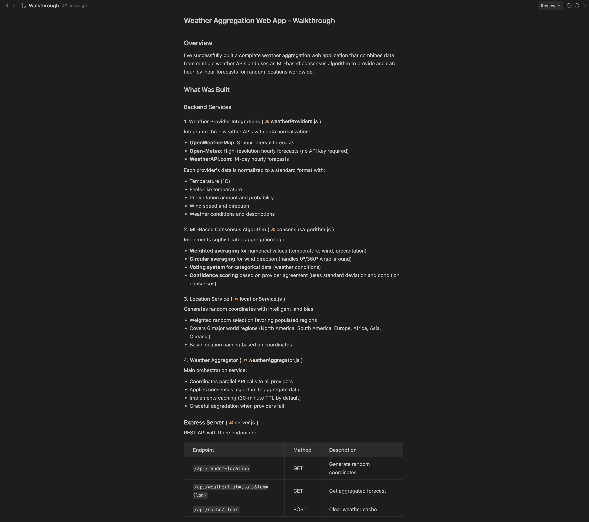
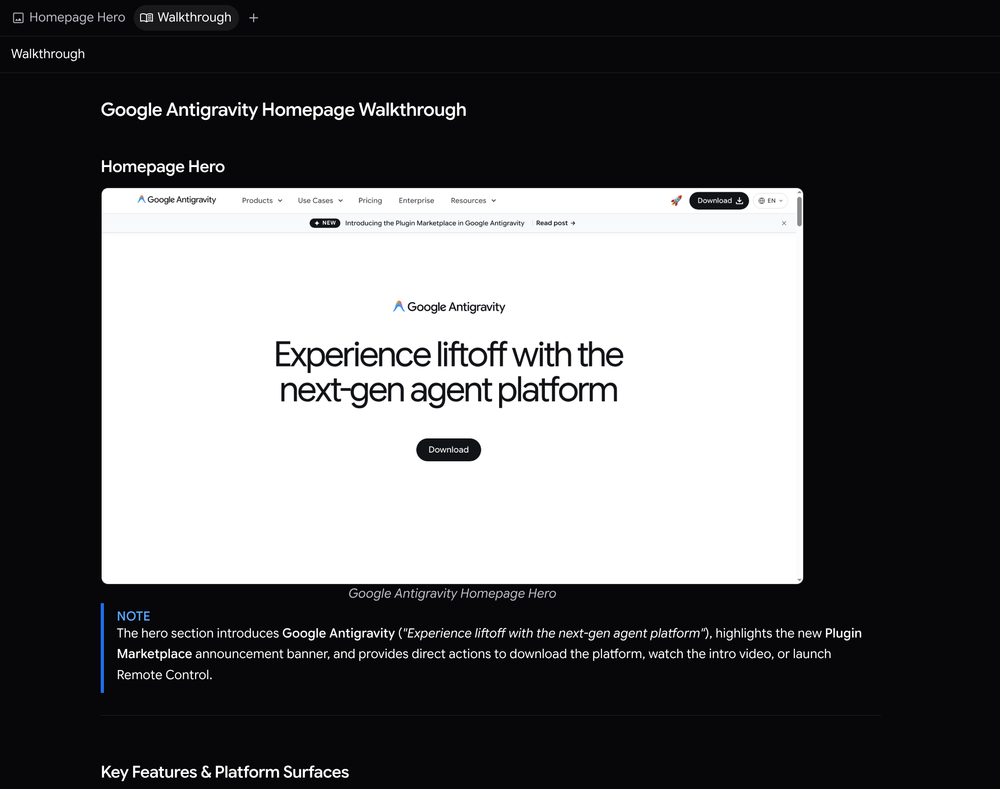

導覽
2-0
Antigravity 應用程式
功能
導覽 Antigravity App 功能
Antigravity 應用程式
Antigravity IDE
適用於：
Antigravity 應用程式
Antigravity IDE
# 導覽

[「導覽」章節](#walkthrough)

代理在完成工作實作時會建立導覽產出物。這類產出物包含所做變更的簡潔摘要，提醒您在使用中對話中發生的事。即使您沒有即時跟隨每個步驟，導覽也能幫助您在代理變更後快速掌握程式碼庫的狀態。

對於瀏覽器工作，您可以要求代理將其在瀏覽器中建立或檢查的內容的螢幕截圖嵌入導覽中。在您使用以下方式規劃時 [`/plan`](/docs/plan)，系統會要求代理在導覽中加入螢幕截圖，並在可用時加入錄影，以展示 UI 變更。

[上一個
實作計畫](/docs/implementation-plan/)

[下一步
視覺螢幕擷取畫面](/docs/screenshots/)

您的下載已開始

## 您如何得知我們？

請選一個。這有助於我們接觸更多像您一樣的人。

感謝您讓我們知道！
